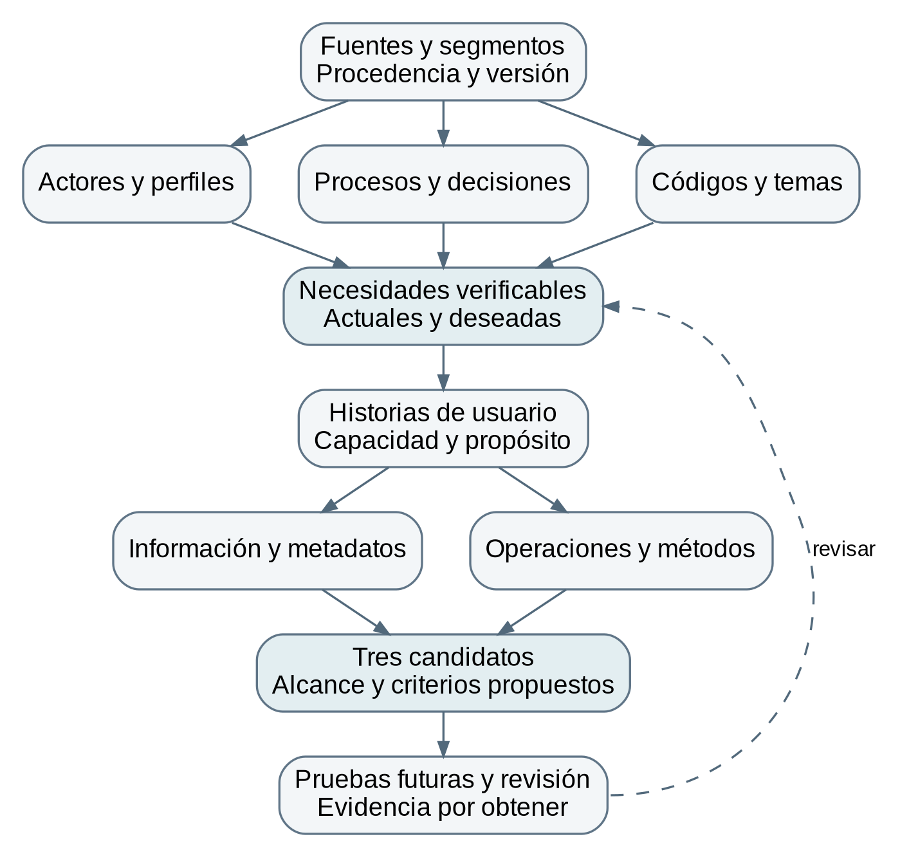
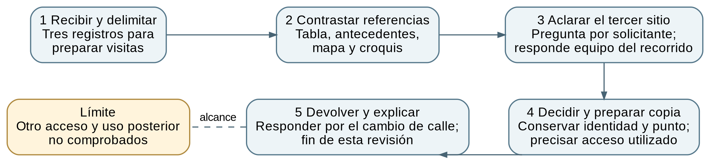
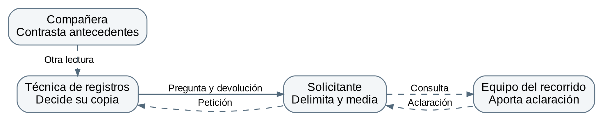

<!-- PORTADA_INICIO -->
# Procesos actores y necesidades de información territorial en cinco relatos

**Ricardo Alfonso Graffe Garcia**  
**Matrícula: A01664904**  
Diseño e implementación de innovaciones públicas · P3002B · AD2026  
Evidencia 1 individual · Descubre y Define

Reporte individual · Versión 1.3

[Repositorio de soporte: https://github.com/ricardo-alfonso-graffe-garcia/p3002b-carto-visor-evidencia-1](https://github.com/ricardo-alfonso-graffe-garcia/p3002b-carto-visor-evidencia-1)
<!-- PORTADA_FIN -->

<!-- CUERPO_INICIO -->

## 1 La pregunta que antecede al visor

Carto-Visor plantea concentrar y homologar información territorial para facilitar su consulta institucional. Tomo ese planteamiento de la Agencia Digital de Innovación Pública (ADIP) como un encargo por contrastar, no como diagnóstico establecido. Mi pregunta es: **¿qué debe conservar una organización de información territorial para ayudar a decidir sin borrar diferencias de significado, responsabilidad y ocasión?** Sostengo que su valor depende primero de hacer comprensible qué respalda cada decisión y hasta dónde puede usarse. La centralización física podría ayudar en determinadas circunstancias; estos relatos no permiten convertirla en condición general de utilidad.

El corpus reúne cinco funciones: mantenimiento público de registros, investigación universitaria, coordinación cultural civil, atención de una mercería y organización de una salida personal. Las dos últimas corresponden a usuarios no especializados; ninguna entrevista corresponde a ADIP. La diversidad permite comparar operaciones y límites de una solución uniforme. Los perfiles funcionales no representan instituciones o poblaciones. Esta aportación individual alimenta la discusión del equipo.

Las cinco transcripciones conforman el corpus del ejercicio académico. Distingo sus relatos de la documentación institucional y de las propuestas que elaboro; los ejemplos permiten examinar decisiones y necesidades, pero no demostrar cómo opera una dependencia concreta. La declaración final precisa el uso de IA y los registros disponibles.

## 2 Leer las respuestas junto con lo que se preguntó

Los tres instrumentos exploran actores y asociaciones, reconstrucción del proceso y necesidades de información, incluido un espacio ideal de consulta. Parten de actividades y episodios elegidos en el diálogo. Las asociaciones verbales se interpretan por su explicación: una misma imagen puede expresar funciones diferentes. Las repreguntas aclaran decisiones, suficiencia y excepciones; las agrupaciones de fases son retrospectivas y admiten solapamientos.

La apertura tiene límites observables. En la salida personal se ofrecen explícitamente lista, mapa u otra forma de consulta (E05-P153); esa preferencia no constituye evidencia espontánea de demanda. En la revisión técnica, una recapitulación supone que el acceso anterior dejó de utilizarse y la respuesta lo corrige (E01-P070–P073). Leer solo asentimientos o preguntas borraría estas diferencias. Los ejercicios ideales fueron solicitados y no describen automáticamente carencias pasadas.

El análisis combina lectura inductiva de episodios con dimensiones previas de procedencia, atribución y elicitación; es una estrategia híbrida. Conserva primeras lecturas, libro común, recodificación y síntesis asistidas por IA. La unidad codificada es un fragmento participante; preguntas y contexto se enlazan para interpretar su alcance, sin sumarlos como respuestas. El libro 1.3 contiene 64 códigos, 123 ejemplos, reglas y fronteras. La cobertura registrada comprende 545 párrafos participantes, 713 fragmentos y 971 asignaciones. Son unidades distintas y controles de alcance, sin equivalencia con relevancia, concordancia o validez humana.

Utilizo una **adaptación de JANUS**: el marco enlaza preparación de fuentes, codificación, síntesis, revisión de afirmaciones, redacción y empaquetado con procedencia (Feged Rivadeneira, 2025, Métodos). En este ejercicio se conservan versiones, segmentos y vínculos entre afirmaciones y respaldos. La comparación de interpretaciones y los controles documentales son asistidos; siguen pendientes la revisión humana independiente y el empaquetado interoperable completo. Citar el método no acredita haber superado todas sus puertas de calidad.

*Figura 1. Adaptación del esquema de las especificaciones integrales, sección 8. Las flechas muestran relaciones analíticas, no un orden rígido de ejecución; las pruebas de productos permanecen propuestas. Los vínculos deben poder recorrerse también desde el diseño hasta sus fuentes.*

La técnica explica: «Conservé el identificador y la ubicación del espacio.» ([E01-P065](REP01_repositorio/corpus/E01/E01_texto_con_localizadores.txt)). El código **conservar o modificar con sustento** distingue la decisión posterior al contraste de una omisión de mantenimiento. No acredita actualizar todas las bases; la figura 2 sitúa la decisión.

| Concepto del esquema | Definición y frontera | Ejemplo localizable |
|---|---|---|
| Conservar o modificar con sustento (C004) | Decidir después de revisar; ausencia de cambio sola no basta. | E01-P065, P159 |
| Procedencia y tipo de evidencia (C009) | Identificar fuente, acción y ocasión; no garantiza vigencia. | E03-P157 |
| Suficiencia situada (C014) | Juzgar respaldo para una tarea; no conocerlo todo. | E02-P083 |
| Condicionar el registro al esfuerzo (C031) | Acotar mantenimiento según utilidad y carga; no supone rechazo. | E03-P172 |

*Tabla 1. Ejemplos del esquema de códigos; el libro común conserva las definiciones completas, reglas y fronteras.*

El [libro completo](REP01_repositorio/55_libro_comun_v1_3.md), las [recodificaciones](REP01_repositorio/analisis/recodificacion/LEEME.md) y el [registro del corpus](REP01_repositorio/24_registro_corpus.json) permiten revisar ese recorrido y consultar los metadatos efectivamente conservados.

La síntesis transversal aporta tres decisiones. **La tarea define qué basta**: la suficiencia situada aparece en las cinco voces, pero revisar un lugar, describir una salida y comprar no exigen el mismo respaldo (tema S01-T001; hallazgo S01-H001; código C014). Por eso cada historia conserva una decisión y un criterio propio, en lugar de exigir información exhaustiva.

**La memoria sirve si recupera diferencias útiles**: explicar un cambio, contrastar ocasiones y retomar acuerdos requieren contenidos distintos, aunque imaginen carpetas o notas parecidas (S01-T006; S01-H016; E01-P125, E02-P143, E03-P156). De este patrón derivan los tres candidatos, con funciones separadas. **Mantenerlos también cuesta**: investigación, cultura, mercería y salida personal condicionan el registro a su esfuerzo y utilidad (S01-H018; C031; E02-P159, E03-P172, E04-P165, E05-P165). La comprobación debe admitir simplificar o abandonar el apoyo. El caso contrario importa: las notas ya ayudaron a resolver el episodio territorial; desear otra organización no demuestra una falla actual (S01-H019; E01-P157). La [síntesis y las cinco fichas](REP01_repositorio/editorial/revision_v1_2/perfiles_y_sintesis.md) conservan variantes y contraejemplos.

## 3 Cinco recorridos con cierres diferentes

Los procesos permiten preguntar qué ocurre después de obtener información. En la alcaldía, consultar el mapa sirve para interpretar una diferencia, preparar una copia y explicarla; no culmina en descargar una capa. El equipo del recorrido informa mediante quien solicitó la revisión. La compañera aporta otra lectura y la técnica decide su entrega. La observación modifica el acceso descrito, mientras el punto sigue representando el espacio. No se comprobó la situación de la otra puerta ni el uso posterior en visitas.

*Figura 2. Flechas de recorrido y respuesta dentro de E01; la aclaración pasa por la solicitante. Se comprimen acciones del mapa completo y se conserva el límite posterior a la entrega.*

Los cinco mapas completos conservan responsables, soportes, decisiones y retornos; esta síntesis delimita sus diferencias.

| Función | Inicio, decisión y cierre relatados | Soportes, canales y retorno |
|---|---|---|
| Registro público | Petición de tres registros; resolver identidad y acceso; devolver y responder. | Tabla, antecedentes, mapa y croquis; intercambio mediado y consulta entre colegas; vuelve una pregunta. |
| Investigación | Formular pregunta; reconstruir unidades comparables; presentar y ajustar texto. | Conversaciones, algunos acompañamientos, notas, esquemas y hoja de cálculo; discusión y devolución parcial hacen volver a casos. |
| Coordinación cultural | Invitación a regresar; construir propuesta y confirmar tres fechas; cerrar sin nueva serie comprometida. | Visita, mensajes, notas y calendario; consulta con anfitriones, mediación y ajustes entre encuentros. |
| Mercería | Revisar remanente; reponer lo conocido y no comprar alternativa; primer despacho del rollo nuevo. | Lista, referencia, muestra y examen material; relevo en mostrador y comunicación al regresar. |
| Salida personal | Querer mirar libros y acordar encuentro; elegir y renovar ganas de continuar; despedirse. | Mensajes, horario publicado, experiencia previa, lectura y preguntas en destino; aviso precisa encuentro. |

*Tabla 2. Síntesis de los cinco procesos relatados; los mapas completos conservan decisiones, responsables y retornos.*

En investigación, formular, observar, comparar y escribir se superponen. En cultura, confirmar fechas antecede al anuncio, pero preparar lecturas puede avanzar mientras se consulta. En comercio, conocer un proveedor cercano no obliga a visitarlo; en la salida personal, comprar no agota la convivencia. Unir estos recorridos como cadena institucional introduciría transferencias inexistentes.

El contraste documental conserva cuatro modelos parciales: publicación y actualización en la política de datos de 2020, funciones de estudios de la Procuraduría Ambiental y del Ordenamiento Territorial (PAOT), relaciones de datos del Sistema de Información Geográfica de la Ciudad de México (SIGCDMX) y condiciones de incorporación al SIG-PAOT. No son intercambiables con los relatos. En particular, un manual PAOT no describe la operación de una alcaldía anónima. El contraste documental identifica **cero fuentes formales directamente atribuibles a los cinco episodios y cero divergencias formalmente demostradas**. Faltan correspondencias de institución, procedimiento, conjunto y periodo; no cabe explicar incumplimientos sin establecerlas. Los [mapas completos](REP01_repositorio/67_procesos_descritos_v1_1.md) y el [contraste documental](REP01_repositorio/72_contraste_documental_v1_1.md) muestran qué evidencia permitiría hacerlo.

| Momento | Documentación consultada | Relatos y encargo por contrastar |
|---|---|---|
| Captura y preparación | PAOT documenta funciones de procesamiento y cartografía; SIGCDMX describe relaciones entre datos. No identifican la captura SSC del encargo. | E01 recibe petición y antecedentes; el levantamiento anterior no se reconstruyó. El encargo parte de límites de la Secretaría de Seguridad Ciudadana (SSC): faltan productor operativo, método y edición. |
| Actualización | La política de datos de 2020 distribuye responsabilidades de publicación y actualización; el SIG-PAOT fija condiciones de incorporación. | E01 conserva identidad y punto, ajusta descripción y devuelve una copia. Su incorporación a la fuente institucional es desconocida. Homologar exige acordar quién autoriza cambios. |
| Consulta y devolución | Los modelos documentales permiten examinar acceso y representaciones; no prueban su uso en estos episodios. | Los cinco recorridos terminan en decisiones diferentes. El visor del encargo debe comprobar qué devuelve, a quién y cómo recibe una incidencia. |

*Tabla 3. Contraste de captura, actualización y consulta. Modelos D01-M001 a M004: ámbitos diferentes, sin divergencia institucional demostrada.*

Los tres momentos requieren responsabilidades y respaldos; publicar una capa y explicar una copia tienen finalidades distintas, sin que ello acredite incumplimiento. El [recorrido institucional propuesto](REP01_repositorio/editorial/revision_v1_2/procesos_y_gobernanza.md) separa producción SSC, coordinación ADIP, desarrollo, consulta y autoridad de cambio, con tramos todavía desconocidos.

## 4 Poder preferencias y coordinación entre actores

El mapa ampliado distingue 46 actores funcionales en doce ámbitos. Incluye voces entrevistadas, terceros relatados y actores documentales; no suma entrevistas. Incluye los cinco episodios, datos públicos, homologación, incorporación y estudios PAOT, metadatos, consulta y prototipo. Los puestos PAOT proceden de su manual, sin atribuirlos a la técnica entrevistada.

Poder es capacidad relativa para condicionar una decisión; interés, lo que está en juego; posición, una postura expresada sobre un cambio concreto. La figura 3 distingue quién solicita, quién revisa, quién aclara y quién decide sobre la copia, sin atribuir una autoridad institucional general.

*Figura 3. Subred del mapa ampliado: técnica, solicitante, equipo del recorrido y compañera. Flecha continua: acción propia declarada; discontinua: intervención de terceros relatada por E01, sin voz independiente. Fuentes: ACT01-R001–R005. Las redes de los otros cuatro casos y las documentales se conservan en el soporte.*

Estas diferencias explican preferencias y posibles tensiones. La coordinadora afirma: «Con una nota clara, el calendario y mensajes directos nos entendemos.» ([E03-P182](REP01_repositorio/corpus/E03/E03_texto_con_localizadores.txt)). Una memoria podría facilitar que otra persona retomara acuerdos, pero quien deja las notas asumiría una carga. Una alianza con anfitriones sería plausible si conserva su capacidad de confirmar cambios; una nota tratada como mandato antiguo podría dificultarla. Es una hipótesis condicional, no resistencia observada.

Comparar otra ocasión también podría trasladar esfuerzo a quien comparte su experiencia; su disposición no fue recabada. Frente a homologación, **no se recabaron posturas**: preferir mejores notas no equivale a apoyar centralización ni justifica un cuadrante global. El [mapa ampliado](REP01_repositorio/76_actores_y_preferencias_v1_1.md) conserva ámbitos, relaciones y tres hipótesis condicionales de coordinación.

| Actor y ámbito de decisión | Poder e interés en ese ámbito | Preferencia y posibles consecuencias de un apoyo común |
|---|---|---|
| Técnica de registros; revisión entregada | Poder alto para decidir su copia; interés alto en referencias comprensibles. | Conservar contraste y consulta. Ganaría una explicación recuperable; cargas adicionales no determinadas. |
| Investigadora; comparación y escritura | Poder alto con su colega sobre el análisis; interés alto en sostener afirmaciones. | Comparar otra ocasión. Ganaría precisión; una estructura uniforme podría borrar diferencias entre observar y narrar. |
| Coordinadora; serie cultural | Poder medio: depende de espacio, mediadora y programación; interés alto en continuidad. | Retomar acuerdos y confirmar con anfitriones. Ganaría relevo; documentar podría exigir más esfuerzo que ayuda. |
| Responsable de mercería; surtido | Poder alto sobre reposición, sin controlar oferta; interés alto en explorar cantidades justificables. | Conservar muestra y prueba atribuida. Ganaría comparación; registrar todos los artículos añadiría trabajo. |
| Persona que propone la salida; propuesta propia | Poder alto sobre su propuesta, con encuentro acordado; interés alto en convivencia. | Guardar notas breves. Ganaría memoria útil; llenar fichas en cada visita sería una carga. |

*Tabla 4. Síntesis de cinco actores entrevistados; capacidades declaradas y consecuencias analíticas condicionales. El mapa ampliado conserva los 46 actores, incluidos terceros y unidades documentales. Ámbitos y evidencias: ACT01-A001, A005, A012, A019 y A024.*

Para el encargo propongo separar **productor o custodio**, que responde por la fuente; **coordinación**, que acuerda significados y responsabilidades; **desarrollo**, que implementa contratos; y **usuario**, que consulta y comunica discrepancias. La autoridad para incorporar una corrección debe acreditarse, sin atribuírsela automáticamente a ADIP o al equipo técnico. Como hipótesis de elección pública, compartir criterios puede reducir aclaraciones, pero imponer actualizaciones sin recursos desplaza trabajo al productor; preservar atribución y una vía de disputa podría facilitar cooperación. Estas son condiciones por negociar, no posturas recabadas ni organigrama comprobado.

## 5 Necesidades de información y criterios de verificación

Los 29 enunciados de necesidades relacionan persona, situación, información y decisión. Conviene distinguir información suficiente, respuesta parcial, carencia específica, deseo ideal y condición futura. Para comparar salidas, por ejemplo, la investigadora explica: «La suficiencia dependía de la afirmación, no era una propiedad de todo el material de una vez.» ([E02-P083](REP01_repositorio/corpus/E02/E02_texto_con_localizadores.txt)). La descripción fue posible; explicar una elección entre todas las alternativas requería información no reconstruida. En cultura queda parcialmente abierta la comunicación de la autonomía de cada sesión, sin evidencia de confusión general.

La prioridad es local y parcial: depende de la decisión que habilita la información, las consecuencias relatadas, su modalidad, la prioridad expresada y las restricciones de esfuerzo e incertidumbre. Admite empates y no mide factibilidad ni importancia urbana. Se conservan seis deseos ideales y una condición sobre accesos de una futura petición específica (N01-N005), sin inventarle una historia. Las 21 historias son elaboraciones analíticas de cinco perfiles funcionales, con 28 criterios y 90 operaciones propuestas; no requisitos aprobados.

| Perfil y necesidad ideal | Información actual y requerida | Comprobación futura |
|---|---|---|
| Técnica; último cambio | Algunas notas bastan; requiere motivo, respaldo, revisión y duda. | Explicar la revisión y decidir usar o consultar. |
| Investigadora; otra ocasión | Una salida detallada; requiere otra comparable con procedencia. | Precisar o reducir la afirmación y decidir si seguir aporta. |
| Coordinadora; acuerdos | Notas, mensajes y calendario bastaron; requiere qué retomar y revalidar. | Distinguir confirmado, posible y pendiente al relevar. |
| Mercería; desempeño | Referencia y tacto; requiere pruebas atribuidas de cosido, uso o lavado. | Justificar probar o dejar una alternativa. |
| Salida personal; conversación | Resolvió en destino; desea notas con fuente y ocasión. | Recuperar una razón y comprobarla al llegar. |

*Tabla 5. Cinco ejemplos del inventario de 29 necesidades (N01-N004, N009, N016, N023 y N029). Todos tienen prioridad alta dentro de su propia actividad; no constituyen un ranking entre perfiles. Son deseos ideales y comprobaciones propuestas, todavía no ejecutadas.*

Dos fichas explican cómo las capacidades cambian el diseño. **Revisión de registros territoriales**: compara antecedentes, croquis y aclaraciones; confía en su correspondencia para una petición acotada. Puede decidir su copia, sin organizar visitas ni certificar una puerta. Su necesidad ideal es retomar el último cambio; el diseño debe conservar fuente, duda y acceso a conversación (perfil HU01-P001; E01-P109/P125/P137; historias H001–H003).

**Atención y reposición de mercería**: reconoce existencias, mide remanentes y compara muestras; su conocimiento es material y comercial, sin especialización cartográfica. Una inspección parcial y la referencia pueden bastar para reponer, mientras probar otra tela requiere desempeño y una cantidad adquirible. El diseño debe conservar la muestra y la prueba atribuida; más datos no eliminan la restricción de compra (HU01-P004; E04-P080/P139/P152; H013–H018). Las fichas de investigación, coordinación cultural y salida personal, con capacidades, restricciones, confianza y fuentes, están en el soporte; ninguna biografía adicional se infiere.

**Historia de revisión territorial.** Como persona que retoma un registro territorial, quiero encontrar la explicación del último cambio pertinente, su respaldo y la duda que sigue abierta, para decidir si puedo usar el registro o necesito una nueva aclaración (HU01-H003, ideal a contrastar). «La explicación del último cambio que afecta la identificación del lugar.» ([E01-P137](REP01_repositorio/corpus/E01/E01_texto_con_localizadores.txt)) expresa la prioridad del ideal. La necesidad de recuperar cambio, motivo, respaldo y duda (N01-N004) orienta los metadatos. El criterio futuro exige explicar la decisión sin depender de memoria oral completa. Se conserva el original y se consulta ante hechos posteriores.

**Historia de contraste de ocasiones.** Como persona que investiga variación en las compras, quiero reconstruir una segunda ocasión que la persona considere distinta y leerla junto a la primera, para precisar la unidad, reducir o modificar una afirmación y decidir si seguir aporta (HU01-H006, ideal a contrastar). La prioridad de otra salida (E02-P143; N01-N009) exige enlazar ocasión, propósito, origen, secuencia, fuente y desconocidos. Periodo contextual y resolución temporal son distintos; esta última es desconocida. El criterio es precisar o reducir una afirmación, o justificar no seguir. «O explicar menos, pero mejor.» ([E02-P148](REP01_repositorio/corpus/E02/E02_texto_con_localizadores.txt)) ilustra esa utilidad. La restricción de participación y carga cambia el diseño: contraste voluntario acotado, sin diario obligatorio ni periodo semanal impuesto.

La cadena se puede recorrer en ambos sentidos: explicación imaginada de una revisión (E01-P125, fragmento R01-S093; códigos **explicación del cambio**, C016, y **organización de consulta**, C017) → **memoria que recupera diferencias útiles** (tema S01-T006, hallazgo S01-H016) → perfil de revisión → necesidad de explicación (N01-N004) → historia de retomar el cambio (HU01-H003) → metadatos (HU01-M003), operaciones OP009–OP013 y criterio K004 → expediente territorial. La prioridad se apoya adicionalmente en E01-P137, codificado C016.

| Metadatos de la historia territorial | Contenido y estado | Consecuencia operativa propuesta |
|---|---|---|
| Identidad y respaldo | Registro del lugar, versión, cambio, motivo, fuente y duda; clases de información respaldadas por el relato, originales no aportados. | Recuperar nota y fuente vinculadas; separar sitio de acceso y conservar el original. |
| Espacio y cobertura | Alcaldía no identificada; geometría, CRS, precisión y escala desconocidos. CRS: sistema de referencia de coordenadas. | Permitir consulta textual; detener mediciones o movimiento de puntos sin referencia acreditada. |
| Tiempo y calidad | Fecha de observación, revisión y vigencia separadas; resolución temporal desconocida. | No ordenar por «más reciente» si las fechas no son comparables; mostrar duda y fecha faltante. |
| Custodia y acceso | Funciones relatadas; autoridad formal, permisos de materiales y licencia pendientes. | Acceso por función y finalidad; lectura, propuesta de corrección y autorización separadas. |

*Tabla 6. Resumen del perfil de metadatos HU01-M003 y los contratos T01-C001/C002/C003/C007/C011. Valores desconocidos permanecen nulos con motivo; no son campos rellenados de una capa real.*

**Representación digital de la historia.** El registro HU01-OD037 describe la historia HU01-H003, versión 1.0, mediante su [objeto estructurado JSON](REP01_repositorio/analisis/historias/HU01/soportes_revisados_v1_1/objetos/historias/HU01-H003.json). Enlaza la necesidad N01-N004, el perfil HU01-P001 y los metadatos HU01-M003; conserva procedencia, huella y acceso. Forma parte de 76 objetos locales. Es un prototipo orientado a **FAIR Digital Objects (FDO)**: carece de identificador persistente, tipo y perfil registrados, por lo que no se presenta como FDO plenamente implementado (FDO Forum, s. f.).

La operación propuesta recibe identificador o nombre y notas autorizadas; reconoce entidad y revisión, recupera respaldo y duda, compara el alcance con la tarea y devuelve **usar**, **consultar** o **dejar pendiente**. La selección puede automatizarse; la suficiencia y la autorización requieren revisión humana. Si dos nombres coinciden sin identidad acreditada, conserva ambos candidatos: «No puede confirmarse que estas referencias correspondan al mismo lugar». Una incidencia pasa por propuesta, consulta, autorización e incorporación; esta última genera versión nueva sólo cuando exista competencia acreditada. El [diccionario y contrato operativo](REP01_repositorio/editorial/revision_v1_2/contratos_y_metadatos.md) precisan entradas, salidas, nulos, errores y responsabilidades.

La mercería impide reducir toda necesidad a datos espaciales. Su responsable señala: «Pero para la suavidad preferiría tener el pedazo en la mano.» ([E04-P152](REP01_repositorio/corpus/E04/E04_texto_con_localizadores.txt)). Quisiera conocer desempeño después de coser y usar, con contexto de prueba (N01-N023; HU01-H017). Esa evidencia no está disponible y obtenerla no elimina la presentación mínima de compra que limitó incorporar la alternativa. La referencia comercial identifica; no demuestra idoneidad ni ventas futuras. Una muestra física no se sustituye por una capa.

La salida personal aporta otro límite: «No saber qué libro iba a encontrar era parte de las ganas de ir.» ([E05-P119](REP01_repositorio/corpus/E05/E05_texto_con_localizadores.txt)). La nota ideal sobre lugares para conversar orientaría una propuesta, conservando fuente y ocasión (N01-N029; HU01-H021); una mesa libre ayer no asegura disponibilidad hoy. La necesidad legítima no obliga a registrar cada visita ni a anticipar toda experiencia. Muestras y notas privadas permanecen en el análisis y fuera del portafolio público. El [inventario de necesidades](REP01_repositorio/82_necesidades_v1_1.md) y las [historias y metadatos](REP01_repositorio/88_historias_y_objetos_v1_1.md) desarrollan las cadenas completas y sus vínculos sectoriales: función pública, investigación, actividad civil, comercio y vida personal, sin inventar programas institucionales de origen.

## 6 Contraste del diagnóstico institucional

El encargo exige distinguir distribución de información de daño demostrado. El contraste documental identifica fuentes y sistemas con responsabilidades distintas; su distribución no demuestra por sí sola que impida decidir. Los relatos plantean cuestiones acotadas que requieren explicación: ambigüedad sobre qué representa una referencia, alternativas incompletas para explicar elección y comunicación parcialmente resuelta de la participación cultural. No prueban un fallo general de homologación.

La hipótesis del cliente es que estandarizar y reunir información mejoraría su uso institucional. Es investigable, pero debe mostrar qué decisiones cambian y para quién. Una práctica suficiente no refuta problemas sistémicos posibles; sí limita usarla como evidencia de un déficit que no relata. A su vez, los antecedentes documentales de SIGCDMX cuestionan una ausencia absoluta de plataformas, sin demostrar que exista una base homologada de todos los límites.

Siguen sin verificar identidad, versiones, periodicidad y permisos de las dos capas SSC del encargo. No pueden sustituirse por un catálogo público parecido. La futura comparación requiere archivos y responsables, semántica de sus unidades y usos, además del ámbito jurídico pertinente. Las diez preguntas documentales pendientes se conservan juntas en la [agenda de verificación](REP01_repositorio/editorial/registros/agenda_pendientes.md). El juicio crítico consiste en delimitar estas dependencias, no en trasladar automáticamente las afirmaciones a tres categorías sin razonar su alcance.

## 7 Decisiones de representación cartográfica

Los apuntes de clase atribuidos a Andrea orientan una geografía crítica atenta a la historia que cuenta el mapa. Harley (1989, resumen y pp. 10–11) permite examinar selección, omisión y poder. La retórica visual reside en símbolos y jerarquías; la verbal, en títulos que podrían prometer accesos seguros sin prueba; la metodológica, en unidades y operaciones que hacen parecer equivalentes cosas distintas. La selección por contactos y disponibilidad también produce registro y subregistro: ausencia de observación no equivale a ausencia de actividad.

El problema de la unidad de área modificable distingue efecto de escala —agregar a áreas mayores— y de zonificación —cambiar agrupaciones a escala semejante— (Openshaw, s. f., pp. 8–10). Una comparación futura entre jurisdicciones y rejillas mantendría registros, periodo, variable y denominador. Las jurisdicciones ayudan a identificar quién puede intervenir; las rejillas sirven al contraste de sensibilidad, sin sustituir competencias. Unidades funcionales o comunitarias podrían responder otras preguntas si se documentan recorridos, autoría y posibilidad de cuestionarlas. Las ocho familias se evalúan en el [soporte de agregación](REP01_repositorio/analisis/diseno/T01/soportes_revisados_v1_1/desarrollo/alternativas_agregacion.md), no se imponen conjuntamente.

El Marco Geoestadístico organiza información censal mediante límites convencionales (INEGI, 2021, §6.2); ese fundamento histórico no acredita una edición vectorial actual ni equivalencia jurídica. Tampoco igualdad de conteos demuestra identidad de capas. Una tasa necesita población elegible y denominador defendibles; sin ellos corresponde describir. Escala de representación, resolución del insumo, unidad de decisión y cobertura deben diferenciarse; siguen desconocidas las de archivos no aportados.

Se proponen cuatro prácticas: comunicar incertidumbre y denominadores, comparar unidades, mostrar escenarios metodológicos y describir exclusiones. Su utilidad sería permitir explicar qué cambió bajo una regla y qué quedó fuera, sin inventar porcentajes de confianza. Ninguna fue ejecutada como análisis territorial.

Los cuatro lentes técnicos quedan subordinados a esas decisiones. El escaneo espacial necesitaría eventos y controles o exposición comparables; no elimina el problema de agregación. Ajustar una ley de potencia a una distribución de duraciones plantea una pregunta distinta de estimar una relación de escalamiento entre tamaño y esfuerzo; una recta logarítmica no basta para justificar el modelo. Mapper agrupa preimágenes de un filtro y conecta grupos con miembros compartidos; difiere de homología persistente y no establece causalidad (van Veen et al., s. f.). Un modelo basado en agentes exige reglas, calibración y evaluación para explorar escenarios, no predicción cierta (Grimm et al., 2020). Por estas condiciones, no propongo todavía escaneo, potencia/escalamiento ni agentes en los productos básicos. El análisis topológico de datos (TDA) queda condicionado, adicionalmente, a utilidad demostrable del cuaderno, matriz comparable y pertinencia multivariable. SaTScan, powerlaw, KeplerMapper y Mesa son herramientas candidatas con compatibilidad no probada, desarrolladas en los [lentes](REP01_repositorio/analisis/diseno/T01/soportes_revisados_v1_1/desarrollo/lentes.md).

**Protocolo espacial futuro.** Propongo explorar dónde coinciden menor cobertura vegetal y mayor separación respecto de equipamientos culturales, para orientar una verificación territorial. Es una pregunta de diseño adicional, no una demanda de las entrevistas ni un análisis ejecutado. Requeriría un ráster de vegetación validado, un directorio georreferenciado y fechado de equipamientos, límites con edición y permisos, y fechas compatibles; no se acredita aquí su disponibilidad. La fracción vegetal usaría área vegetal sobre área válida, excluyendo NoData; la distancia en línea recta no mediría acceso efectivo ni disposición a asistir.

Compararía jurisdicciones con rejillas propuestas de 500 m y 1 km, sólo si el detalle del insumo lo permite; cambiaría también el origen de la rejilla. Mantendría fuentes, periodo y reglas, y registraría cambios en las zonas seleccionadas para verificar. Mostraría cobertura válida, registros excluidos y causas. Si cambian las zonas por unidad, periodo o exclusión, comunicaría esa inestabilidad antes de priorizar; sin CRS, fechas o clasificación defendibles, detendría el cálculo afectado. El [protocolo completo](REP01_repositorio/editorial/revision_v1_2/protocolo_espacial_futuro.md) fija fórmulas, prueba controlada, comparación de capas, revisión humana y condiciones de extensión metropolitana.

La selección por historia y pregunta queda explícita: el expediente territorial puede justificar un **escaneo** sólo con revisiones y controles comparables, o **potencia/escalamiento** con esfuerzo medido; el cuaderno podría justificar **Mapper/TDA** después de una comparación simple y una matriz suficiente; la memoria cultural podría justificar **agentes** sólo si una pregunta de escenarios requiere reglas y observaciones de coordinación. El nuevo protocolo empieza con estadísticas descriptivas. La [matriz de los cuatro lentes](REP01_repositorio/editorial/revision_v1_2/lentes_y_antecedentes.md) muestra datos faltantes, salidas, sensibilidad y motivos de no selección actual.

## 8 Tres propuestas de apoyo documental

La adaptación de GeoInsights distingue extracción, unificación, agregación optativa, construcción, análisis y productos, con ramas y retornos (DataLama Team, 2020–2021). El snapshot y su commit se identifican en referencias; conserva licencia MIT. Lo utilizo como referencia de arquitectura; su aplicación a CDMX aún no se ha ejecutado. La procedencia debe conservar originales y derivados; un contrato establece significado, entrada, salida y condiciones de cada transformación. Unificar representaciones no autoriza fusionar entidades diferentes.

La [arquitectura gráfica del producto](REP01_repositorio/editorial/figuras/REP01-F003.svg) conserva agregación opcional y retorno de incidencias. Es distinta de la figura 1, que explica cómo este reporte fundamenta el diseño.

Del antecedente retomo etapas y configuración explícitas. PRE y POS organizan tareas globales alrededor de las ejecuciones seleccionadas; no son sinónimos de carpetas de datos. Las agregaciones por geometría, radio y comunidad responden a supuestos distintos, sin transferir parámetros epidemiológicos. El diseño propio añade control inicial de permisos, significado y alineación, y mantiene la agregación optativa. Nuevas fuentes exigirían un adaptador y pruebas de contrato; un ráster requeriría además bandas, máscara, resolución, CRS y regla de remuestreo. Earth Engine sería una opción para esa extensión, sin necesidad actual ni integración comprobada.

Un antecedente complementario de Capybara registra configuración de corridas, procedencia de afirmaciones y una divergencia espacial, y distingue concordancia concurrente de habilidad predictiva (Capybara Center for Risk Analysis, 2026, §§B y F). Retomo esa disciplina para separar relato, interpretación, propuesta y resultado calculado; no adopto sus cifras ni lo presento como el ejemplo exacto visto en clase. La comparación con GeoInsights y los sistemas documentales muestra qué aporta cada referente y qué no prueba.

El **expediente de revisión de lugares** reúne registro, explicación del cambio, respaldo y duda para decidir conservar, modificar o consultar. Su comprobación futura contrastaría si otra persona explica la revisión sin fingir precisión de puerta. El **cuaderno de contraste de ocasiones** enlaza narraciones, secuencias y procedencias para comparar unidades y acotar afirmaciones; se probaría qué cambia entre una ocasión y dos, si existe participación voluntaria. La **memoria de acuerdos culturales** distingue posibilidades, confirmaciones, notas y preguntas para retomar una relación; se probarían relevo y comprensión de una invitación sin exigir asistencia previa o escritura.

Priorizaría **el expediente territorial** para la siguiente comprobación: aporta explicabilidad de la revisión y asignación de responsabilidad, necesarias para una decisión pública defendible. Antes de programarlo, quien custodie la fuente debe aportar un registro autorizado y acreditar la vía de corrección. **La memoria cultural** queda segunda como apoyo de continuidad de un servicio cultural compartido, si coordinación y anfitriones aceptan revalidación y mantenimiento. **El cuaderno** queda tercero como apoyo metodológico para producir conocimiento territorial con afirmaciones mejor delimitadas; su contribución pública dependería de vincularlo con una decisión y un destinatario público concretos. Este orden de desarrollo es una propuesta editorial por proximidad al encargo y dependencias, distinta de la prioridad local de cada usuario. No modifica el catálogo T01 ni atribuye demanda de homologación. Los tres admiten simplificación o descarte si no aportan utilidad proporcional al mantenimiento. El [portafolio y los protocolos de prueba](REP01_repositorio/editorial/revision_v1_2/portafolio_y_validacion.md) separan utilidad, contenido, calidad y esfuerzo, con roles propuestos, nunca asignaciones aceptadas. Los [productos](REP01_repositorio/analisis/diseno/T01/soportes_revisados_v1_1/desarrollo/productos.md) y la [arquitectura completa](REP01_repositorio/analisis/diseno/T01/soportes_revisados_v1_1/desarrollo/arquitectura.md) conservan los once contratos y sus 119 campos, con representaciones y granularidades propuestas.

## 9 Conclusiones y agenda de verificación

El aporte defendible es un criterio de diseño: organizar información para recuperar significado y respaldo de decisiones, conservando la posibilidad de acotar, preguntar o mantener algo sin cambiarlo. Los casos suficientes y los deseos ideales sostienen esa conclusión conjuntamente. Homologar podría consistir en documentar correspondencias y responsabilidades; todavía falta demostrar cuándo una integración material aporta más que las prácticas existentes.

Aplico los **principios FAIR** como orientación: **localización**, mediante identificadores y catálogo; **accesibilidad**, mediante rutas y condiciones de consulta; **interoperabilidad**, mediante campos y relaciones explícitos; y **reutilización**, mediante versiones, procedencia y límites. El cumplimiento es parcial: faltan persistencia y registro externo, semántica compartida y acuerdos de derechos; el corpus no hereda la licencia MIT del código (GO FAIR Foundation, s. f.). La [matriz por principio y la ficha del objeto](REP01_repositorio/editorial/revision_v1_3/fair_fdo_y_janus.md) distinguen evidencia disponible y pendientes. FAIR es un conjunto de principios, no una certificación obtenida por guardar JSON.

La continuación tiene cuatro puertas. **Primero**, el autor debe coordinar una revisión humana de citas, interpretación y metodología; se cierra con observaciones y resolución, no con el recuento de controles. **Después**, productor y coordinación propuestos deben identificar fuente, edición, permiso y autoridad; sin ellos se detiene la transformación afectada. **Luego**, diseño y la función usuaria pertinente pueden comparar el apoyo con la práctica actual usando el mismo caso autorizado: explicar cambio, respaldo, duda y necesidad de consulta es el resultado correcto; crear una puerta cierta sería un error. Se registrarán ayudas, errores, decisión y esfuerzo, sin umbral de ahorro inventado. **Finalmente**, quienes asumirían custodia y actualización decidirán conservar, simplificar, descartar o implementar; la evidencia será un acuerdo revisable con alcance, acceso y versión.

Las limitaciones de JANUS permanecen explícitas: no se acreditan dos revisores humanos, concordancia ni parámetros de generación desconocidos. RO-Crate, PROV-O, DataCite y nanopublicaciones no están implementados. La ficha humana y el JSON permiten revisar un objeto concreto; completar su registro y validación requiere trabajo posterior, sin modificar retrospectivamente el corpus.
<!-- CUERPO_FIN -->

<!-- REFERENCIAS_INICIO -->
## Referencias

Las entrevistas se localizan en `REP01_repositorio/corpus/E01/` a `E05/`, archivos `E0x_texto_con_localizadores.txt`, versión 1.0, sin fecha de entrevista consignada. Son materiales del ejercicio, no publicaciones. Los documentos analíticos S01/P01/D01/ACT01/N01/HU01/T01, versiones 1.1, y el libro común 1.3 se citan mediante rutas y localizadores; el autor de este manuscrito no se atribuye por ello autoría personal de fuentes institucionales.

- *D01: Contraste documental y revisión del encargo*. (s. f.) (versión revisada 1.1). Documento interno, [texto completo](REP01_repositorio/72_contraste_documental_v1_1.md), apartados Fuentes y Modelos documentales; fuentes D01-F001/F002/F004/F009/F010. Consulta de este registro, no nueva inspección de todos sus originales externos.
- Capybara Center for Risk Analysis. (2026, 8 de julio). *Flood Exposure Situation Report Southern Mexico Veracruz Oaxaca Chiapas*. [Reporte](https://capybaracenter.blogspot.com/2026/07/flood-exposure-situation-report.html), procedencia y §§B, E y F. Antecedente complementario consultado para esta revisión; no se identifica con las capturas de clase.
- DataLama Team. (2020–2021). *COVID-19 GeoInsights Mobility Pipeline* [Código y documentación, commit ab60b86a6a87bca0dd370c7c4af3ada4185d187e]. [Repositorio de referencia](https://github.com/data-lama/covid_geoinsights_pipeline/tree/ab60b86a6a87bca0dd370c7c4af3ada4185d187e). README: Architecture, Configuration, External data y Credits; LICENSE: MIT. [Copia consultada](REP01_repositorio/analisis/referencias/GeoInsights/README.md).
- Feged Rivadeneira, A. (2025). *The JANUS Framework: Leveraging Large Language Models for Qualitative Analysis and Manuscript Writing* (preprint, versión 1). Research Square. [DOI](https://doi.org/10.21203/rs.3.rs-7580516/v1). [PDF consultado](https://assets-eu.researchsquare.com/files/rs-7580516/v1_covered_40ebb8ea-a7f4-4df6-b171-567fdac1a355.pdf), cubierta y métodos; revisión y empaquetado. La cubierta abrevia el nombre como Alejandro Feged; no se afirma revisión por pares.
- FDO Forum. (s. f.). *FAIR Data What is an FDO?* [Descripción](https://fairdo.org/about/what_is_an_fdo/), apartados An FDO is y What are Core FDOs. Consulta: 25 de noviembre de 2026. Referencia para delimitar los prototipos locales; no acredita su registro.
- GO FAIR Foundation. (s. f.). *The FAIR Guiding Principles*. [Principios](https://www.gofair.foundation/fair-principles), secciones Findable, Accessible, Interoperable, Reusable, en especial A1.2. Consulta: 25 de noviembre de 2026.
- Grimm, V., Railsback, S. F., Vincenot, C. E., Berger, U., Gallagher, C., DeAngelis, D. L., Edmonds, B., Ge, J., Giske, J., Groeneveld, J., Johnston, A. S. A., Milles, A., Nabe-Nielsen, J., Polhill, J. G., Radchuk, V., Rohwäder, M.-S., Stillman, R. A., Thiele, J. C., y Ayllón, D. (2020). The ODD protocol for describing agent-based and other simulation models: A second update to improve clarity, replication, and structural realism. *Journal of Artificial Societies and Social Simulation, 23*(2), 7. [Artículo](https://www.jasss.org/23/2/7.html), resumen y §1: propósito, entidades, escalas y programación de procesos.
- Harley, J. B. (1989). Deconstructing the map. *Cartographica, 26*(2), 1–20. [Copia consultada](https://disp.web.uniroma1.it/sites/default/files/Harley%20-%20deconstructing%20the%20map.pdf), resumen y pp. 10–11.
- Instituto Nacional de Estadística y Geografía. (2021). *Características de las localidades 2020: Síntesis metodológica y conceptual*. [Documento](https://www.inegi.org.mx/contenidos/inegi/spc/doc/bibliografia/CL_SMC_2020.pdf), §6.2, p. impresa 7, p. PDF 16 contando desde 1. Alcance histórico del Censo 2020; fuente T01-F041, no edición vectorial inspeccionada.
- Openshaw, S. (s. f.). *The modifiable areal unit problem* (Concepts and Techniques in Modern Geography, 38). Geo Books. [Copia consultada](https://www.uio.no/studier/emner/sv/iss/SGO9010/openshaw1983.pdf), introducción, pp. 3–4 y definiciones, pp. 8–10. Año no comprobado en el ejemplar consultado; no se deduce del nombre del archivo.
- van Veen, H. J., Saul, N., Eargle, D., y Mangham, S. W. (s. f.). *KeplerMapper: Background* (documentación 2.1.0). [Documentación](https://kepler-mapper.scikit-tda.org/en/latest/theory.html), sección Mapper. Se usa la explicación de construcción; no sus enunciados generales de robustez como garantía.

La atribución a Andrea procede de los apuntes resumidos en T01-G001 y del expediente del ejercicio; no se incorpora una publicación inexistente a esta bibliografía. La información técnica adicional de escaneo y potencia/escalamiento se presenta como síntesis del [soporte T01](REP01_repositorio/analisis/diseno/T01/soportes_revisados_v1_1/desarrollo/lentes.md), con sus registros primarios y límites de lectura. No se declaran nuevamente leídos todos esos originales en REP01.
<!-- REFERENCIAS_FIN -->

<!-- DECLARACION_IA_INICIO -->
## Declaración de uso de IA y registros del ejercicio

Se utilizó asistencia de modelos de lenguaje para construir y revisar las transcripciones, esquema de códigos, recodificar, sintetizar y relacionar procesos, actores, necesidades e historias. El manuscrito y sus soportes se integraron y revisaron con asistencia de Codex, descrito por el entorno como basado en GPT-6, y controles programáticos de citas, relaciones, integridad y navegación. No consta un identificador verificable de ejecución ni sus parámetros; se registran como desconocidos. Los textos canónicos se conservaron.

La revisión documentada es asistida y cuenta con revisión humana del autor. No se calcularon concordancia ni saturación, y las propuestas de utilidad no se probaron con participantes. La adaptación de JANUS se limita a organización, trazabilidad y revisión; no acredita conformidad integral. Los registros y prompts de análisis disponibles acompañan el repositorio; no se reconstruyeron exportaciones completas de conversaciones. El registro de incidencias y el registro de cambios de esta revisión precisan los alcances.

<!-- ANEXOS_AMPLIADOS_INICIO AG02 -->

## Anexos ampliados de evidencia análisis y diseño

Estos anexos desarrollan las relaciones que el cuerpo del reporte presenta de forma selectiva. Reúnen las fichas completas de las cinco funciones, las necesidades e historias, los mapas, los criterios de interpretación y las especificaciones propuestas. Los identificadores permiten regresar al respaldo; los conceptos y decisiones se explican antes de sus claves.

Las formulaciones y catálogos conservan sus versiones analíticas. La ampliación hace visible material de soporte y sus límites; los protocolos futuros, los objetos locales y las responsabilidades propuestas mantienen ese estado. La existencia de un enlace, una figura o una huella no sustituye revisión humana ni prueba de utilidad.

El repositorio público permite consultar la entrega completa. Los enlaces de estos anexos permiten acceder a los soportes analíticos y a su documentación detallada. Los identificadores y las versiones conservan la relación con cada etapa de análisis.

| Anexo | Contenido | Página de anexos |
| --- | --- | --- |
| A | [Recuento de ampliaciones y pendientes](#ANX_A) | [Ir al anexo](#ANX_A) |
| B | [Instrumentos perfiles y decisiones](#ANX_B) | [Ir al anexo](#ANX_B) |
| C | [Códigos y síntesis transversal](#ANX_C) | [Ir al anexo](#ANX_C) |
| D | [Procesos y contraste documental](#ANX_D) | [Ir al anexo](#ANX_D) |
| E | [Actores preferencias y relaciones](#ANX_E) | [Ir al anexo](#ANX_E) |
| F | [Necesidades verificables y prioridades](#ANX_F) | [Ir al anexo](#ANX_F) |
| G | [Historias metadatos y trazabilidad](#ANX_G) | [Ir al anexo](#ANX_G) |
| H | [Objetos digitales y principios FAIR](#ANX_H) | [Ir al anexo](#ANX_H) |
| I | [Operaciones y contratos de información](#ANX_I) | [Ir al anexo](#ANX_I) |
| J | [Geografía crítica agregación y cuatro lentes](#ANX_J) | [Ir al anexo](#ANX_J) |
| K | [Arquitectura portafolio y validación](#ANX_K) | [Ir al anexo](#ANX_K) |
| L | [Protocolo espacial futuro](#ANX_L) | [Ir al anexo](#ANX_L) |
| M | [JANUS revisión y continuidad](#ANX_M) | [Ir al anexo](#ANX_M) |
| N | [Auditoría y directorio de soportes](#ANX_N) | [Ir al anexo](#ANX_N) |

## Anexo A Recuento de ampliaciones y pendientes

El recuento distingue material disponible que faltaba desarrollar dentro del reporte, especificaciones de diseño para la etapa posterior y condiciones que todavía requieren evidencia. Esta distinción permite valorar la ampliación sin convertirla en nuevos hallazgos de campo.

[Volver al índice de anexos](#ANX_INDICE)

| Tema | Desarrollo incorporado | Anexo | Límite principal |
| --- | --- | --- | --- |
| Instrumentos y perfiles | Tres instrumentos y cinco perfiles completos | B | Los perfiles funcionales no representan instituciones o poblaciones. |
| Codificación | 64 códigos con definición, criterio y ejemplo literal | C | La ampliación no recodifica ni mide acuerdo entre personas. |
| Síntesis transversal | Siete temas, 22 hallazgos y seis relaciones desarrolladas | C | Los contraejemplos delimitan la interpretación. |
| Procesos | Cinco recorridos con agrupaciones, nodos, retornos y fuentes | D | Las agrupaciones de lectura no imponen una secuencia universal. |
| Proceso documentado | Cuatro modelos documentales y 13 contrastes acotados | D | Falta acreditar aplicabilidad formal a los cinco episodios. |
| Actores | 46 actores, 44 relaciones y redes de los cinco episodios | E | La posición frente a homologación continúa no recabada. |
| Necesidades | 29 enunciados con situación, prioridad y verificación propuesta | F | Una necesidad atendida no se convierte en carencia del sistema. |
| Historias | 21 formulaciones con operaciones, criterios, metadatos y cadena | G | Quince preservan actividad actual y seis son ideales a contrastar. |
| Metadatos | 21 dimensiones y un perfil completo de ejemplo | H | La granularidad desconocida no se completa con una fecha de edición. |
| Objetos locales | 76 registros con entidad, versión y acceso al payload | H | No hay PID, tipo y perfil externos registrados. |
| Contratos | Once contratos y sus 119 campos con controles | I | Son especificaciones propuestas, sin instancias de datos de producto. |
| Geografía crítica | Nueve fundamentos, ocho agregaciones y cuatro prácticas | J | La pertenencia geométrica no concede competencia jurídica. |
| Cuatro lentes | Matriz de pertinencia, parámetros, entradas y límites | J | No se ejecutaron escaneos, ajustes, Mapper o agentes. |
| Arquitectura y productos | Seis módulos, tres candidatos y puertas de avance | K | La prioridad de desarrollo no reemplaza la prioridad local de cada necesidad. |
| Protocolo espacial | Pregunta, variables, denominadores y sensibilidad | L | Extensión propuesta; datos y pruebas no ejecutados. |
| JANUS y FAIR | Aplicación, controles conservados y condiciones pendientes | H y M | La adaptación no acredita conformidad integral. |
| Auditoría y fuentes | 175 tratamientos y directorio de soportes y referentes | N | Un tratamiento registrado no equivale a cierre empírico. |

### Pendientes que la ampliación no puede cerrar

| Condición | Evidencia necesaria para resolverla |
| --- | --- |
| Procedimiento institucional aplicable | Fuente formal y vigente atribuible al episodio, unidad competente y correspondencia entre pasos; después podría evaluarse una divergencia. |
| Posturas ante homologación | Preguntas y respuestas explícitas sobre un escenario definido, con condiciones, beneficios y cargas; no inferir apoyo o rechazo del silencio. |
| Revisión humana independiente | Registro de persona revisora, material, decisiones, desacuerdos y versión. Si se calcula concordancia, muestra comparable y codificación independiente. |
| Privacidad previa y registro completo | Los controles históricos ausentes no se reconstruyen retrospectivamente; se conservan los prompts, salidas y parámetros realmente disponibles. |
| FDO y preservación | Decidir gobernanza, identificadores persistentes, perfiles, tipos y semántica; verificar recuperación y preservación. El ZIP y GitHub no prueban por sí solos esos requisitos. |
| Datos y autoridad de productos | Originales autorizados, significado, edición, licencia y funciones competentes antes de transformar o corregir datos. |
| Utilidad y análisis espacial | Casos autorizados equivalentes, tareas y resultados observables; recursos espaciales compatibles y prueba de sensibilidad. Los protocolos conservan estado futuro. |
| Antecedente exacto de clase | Se conserva el uso complementario de Capybara; no se identifica con la captura o corrida original no recuperada. |

**Soporte:** [Recuento de presencia y brechas de la revisión 1.3](REP01_repositorio/editorial/revision_v1_3/contraste_especificaciones_y_auditoria.md).

## Anexo B Instrumentos perfiles y decisiones

La indagación parte de actividades y episodios elegidos por cada voz. Las preguntas permiten que una decisión cotidiana revele información relevante antes de exigir capas, un mapa o una plataforma. Los tres instrumentos se complementan con el ejercicio de información ideal; su valor depende de la explicación y el contexto, no del soporte simbólico utilizado.

[Volver al índice de anexos](#ANX_INDICE)

| Instrumento | Qué permite comprender | Precaución de lectura |
| --- | --- | --- |
| Actores y asociaciones | La persona identifica participantes, atribuye funciones y explica sus asociaciones; las metáforas se interpretan mediante lo que verbaliza. | Una asociación no acredita la opinión del tercero ni una relación institucional observada. |
| Reconstrucción del proceso | Se sigue una ocasión concreta: inicio, acciones, soportes, decisiones, dudas, regresos y cierre. La persona puede reagrupar fases. | No convertir una intención en acción ni ordenar retrospectivamente todos los pasos como una secuencia rígida. |
| Necesidades de información e ideal | Se pregunta qué debía saber, qué obtuvo, qué bastó y qué desearía recuperar en otra ocasión; se exploran formas de consulta y prioridades. | El ideal fue solicitado. Desear algo para otra ocasión no demuestra que el episodio actual fallara ni aceptación de un producto. |

Las repreguntas sobre suficiencia, excepciones y alternativas ayudan a conservar diferencias. En la revisión territorial, una recapitulación sobre el acceso recibe una corrección; en la salida personal, se ofrecen lista, mapa u otra forma de consulta. Esas intervenciones se conservan como contexto de elicitación. No atribuyo neutralidad absoluta al guion ni trato un asentimiento como evidencia independiente.

**Soporte:** [Guion base y adaptaciones por perfil](REP01_repositorio/11_guion_base_y_adaptaciones.md).

### Información ideal y formas de consulta por perfil

El ejercicio del dashboard ideal se interpreta como un espacio para explicar qué querría comprender y recuperar la persona, con libertad de elegir soporte. No exige dibujar una pantalla o preferir un mapa. La tabla conserva la información deseada, la forma imaginada y su condición; las historias se desarrollan en G.

| Perfil y deseo | Información y consulta imaginada |
| --- | --- |
| Revisar correspondencia entre registros y lugares · Retomar el sentido del último cambio de un lugar (HU01-H003) | decidir si puedo usar el registro o necesito una nueva aclaración. Carpeta por lugar imaginada; explicación junto al registro; croquis o mapa si ayuda. La carpeta es soporte imaginado, no carencia de este caso; una observación nueva puede requerir conversación. No registrar todo lo que se desconoce. |
| Investigar relaciones entre actividades y comparar salidas · Contrastar otra ocasión antes de ampliar el seguimiento (HU01-H006) | precisar la unidad, reducir o modificar una afirmación y decidir si seguir aporta. Cuaderno por caso y periodo imaginado, narración breve y esquema cuando ayude; documentos actuales pueden bastar. Requiere interés y disponibilidad de quien comparta; carga anticipada no es rechazo recabado. No toda decisión se recuerda explícitamente ni el relato posterior es registro defectuoso. |
| Construir y sostener encuentros culturales compartidos · Retomar acuerdos del espacio entre personas del equipo (HU01-H011) | preparar una conversación situada sin depender de que otra persona recuerde toda la historia. Carpeta por espacio imaginada con página de interlocución y preguntas; notas propias separadas. Sirve especialmente si varias personas retoman; requiere notas fáciles de mantener y revalidación con anfitriones, sin explicarles su lugar desde una nota antigua. No perfiles individuales. |
| Construir y sostener encuentros culturales compartidos · Conocer ritmos de uso para preparar otra propuesta (HU01-H012) | plantear duración y forma de incorporarse y preparar preguntas para la visita. Descripción de uso situada en carpeta imaginada, contada por quienes conocen lugar. No es una verdad permanente del espacio. Una descripción no sustituye visita ni conversación, ni disponibilidad equivale a disposición a participar. |
| Atender la mercería y organizar reposición selectiva · Comparar desempeño antes de probar otro material (HU01-H017) | decidir si vale la pena probar una cantidad y explicar con límites lo que sé. Cuaderno tangible de muestras imaginado; material en mano y notas; foto complementaria si permite ver algo. Fuente de todas las pruebas no resuelta. No predice ventas ni recomienda para cualquier prenda. Cantidad adquirible sigue limitando incluso si conoce más. |
| Acordar una salida y explorar con margen para decidir · Recuperar una pista para proponer dónde conversar (HU01-H021) | proponer o descartar hacia dónde caminar y comprobar al llegar si aún sirve. Nota corta o lista propia imaginada; localización adicional si no ubica el lugar. Ideal para otras ocasiones elicitado; no garantiza mesa hoy, ambiente permanente o cómo se sentirá. No llenaría ficha cada visita ni revisaría todos los libros antes. |

| Voz | Función | Transcripción completa |
| --- | --- | --- |
| E01 | Revisar correspondencia entre registros y lugares | [Word](REP01_repositorio/corpus/E01/E01_transcripcion_v1.docx) · [Localizadores](REP01_repositorio/corpus/E01/E01_texto_con_localizadores.txt) |
| E02 | Investigar relaciones entre actividades y comparar salidas | [Word](REP01_repositorio/corpus/E02/E02_transcripcion_v1.docx) · [Localizadores](REP01_repositorio/corpus/E02/E02_texto_con_localizadores.txt) |
| E03 | Construir y sostener encuentros culturales compartidos | [Word](REP01_repositorio/corpus/E03/E03_transcripcion_v1.docx) · [Localizadores](REP01_repositorio/corpus/E03/E03_texto_con_localizadores.txt) |
| E04 | Atender la mercería y organizar reposición selectiva | [Word](REP01_repositorio/corpus/E04/E04_transcripcion_v1.docx) · [Localizadores](REP01_repositorio/corpus/E04/E04_texto_con_localizadores.txt) |
| E05 | Acordar una salida y explorar con margen para decidir | [Word](REP01_repositorio/corpus/E05/E05_transcripcion_v1.docx) · [Localizadores](REP01_repositorio/corpus/E05/E05_texto_con_localizadores.txt) |

### Revisar correspondencia entre registros y lugares (HU01-P001)

Síntesis analítica de la voz E01, sus capacidades y decisiones, limitada a la actividad relatada y sus variantes declaradas; no biografía ni arquetipo representativo.

**Voz y función:** E01; Técnica de registros (ACT01-A001).

**Capacidades:** Comparar nombres, descripción, croquis y punto según lo que representan. Formular una pregunta concreta y recuperar aclaración mediada. Contrastar con una compañera y explicar la revisión propia.

**Patrón de decisión:** Conserva o modifica después de comprender la correspondencia entre espacio, acceso y descripción.

**Restricciones y límites:** No organiza visitas ni decide actividades. El encargo no cambió en el episodio. El punto representa el sitio y no una puerta levantada con precisión; la primera intención de moverlo no se ejecutó. No es actualizar automáticamente todas las bases ni enviar cada intercambio interno. La carpeta es soporte imaginado, no carencia de este caso; una observación nueva puede requerir conversación. No registrar todo lo que se desconoce. No es una carencia del encargo relatado ni necesidad atribuida al equipo de visitas; la técnica dice quizá para otra solicitud. Debe delimitarse primero quién confirma qué.

**Caso que limita la generalización:** Un sitio nuevo con referencias claras o una relación sin observaciones no necesita la carpeta ideal. No representa toda la alcaldía ni organiza visitas.

**Historias asociadas:** Revisar identidad antes de conservar o modificar (HU01-H001); Devolver una revisión que pueda explicarse (HU01-H002); Retomar el sentido del último cambio de un lugar (HU01-H003).

**Necesidades:** Alcance y finalidad de la revisión (N01-N001); Identidad del espacio y sentido de la diferencia de acceso (N01-N002); Copia consultada y alcance de lo entregado (N01-N003); Explicación recuperable del último cambio pertinente (N01-N004); Condiciones de acceso para una petición futura específica (N01-N005).

**Rasgos no atribuidos:** no se completan edad, nombre, trayectoria o dominio tecnológico que no estén declarados. La fecha de entrevista permanece no consignada; las fechas editoriales no la sustituyen.

**Objeto de perfil:** [Ficha estructurada y evidencias](REP01_repositorio/analisis/historias/HU01/soportes_revisados_v1_1/objetos/perfiles/HU01-P001.json).

### Investigar relaciones entre actividades y comparar salidas (HU01-P002)

Síntesis analítica de la voz E02, sus capacidades y decisiones, limitada a la actividad relatada y sus variantes declaradas; no biografía ni arquetipo representativo.

**Voz y función:** E02; Investigadora (ACT01-A005).

**Capacidades:** Reconstruir actividades y distinguir observado, relatado e interpretado. Revisar unidad de comparación con colega y colaboradora. Acotar la escritura ante crítica y devoluciones parciales.

**Patrón de decisión:** La suficiencia depende de la afirmación: descripción de una salida y explicación de una elección requieren respaldos distintos.

**Restricciones y límites:** Distancia y tiempo siguen importando situadamente. Un mapa sin explicación no establece relación social o causa de elección. Una narración posterior tiene valor propio. La responsabilidad académica es del equipo y la objeción externa no lo sustituye. No se conoce un conjunto exhaustivo de opciones ni una causa única. Abordar el asunto o renunciar a la afirmación depende de qué se quiera sostener. Requiere interés y disponibilidad de quien comparta; carga anticipada no es rechazo recabado. No toda decisión se recuerda explícitamente ni el relato posterior es registro defectuoso.

**Caso que limita la generalización:** Una salida de comprar y volver limita la generalización del encadenamiento. No representa dos zonas ni ciudad; quienes compran y comerciantes no son nuevas voces.

**Historias asociadas:** Precisar qué salidas pueden compararse (HU01-H004); Escribir hasta donde alcanza la evidencia de elección (HU01-H005); Contrastar otra ocasión antes de ampliar el seguimiento (HU01-H006).

**Necesidades:** Unidad y relaciones que hacen comparables las salidas (N01-N006); Respaldo y alcance de las afirmaciones de investigación (N01-N007); Alternativas conocidas y posibles antes de explicar una elección (N01-N008); Contraste de una segunda ocasión del mismo caso (N01-N009).

**Rasgos no atribuidos:** no se completan edad, nombre, trayectoria o dominio tecnológico que no estén declarados. La fecha de entrevista permanece no consignada; las fechas editoriales no la sustituyen.

**Objeto de perfil:** [Ficha estructurada y evidencias](REP01_repositorio/analisis/historias/HU01/soportes_revisados_v1_1/objetos/perfiles/HU01-P002.json).

### Construir y sostener encuentros culturales compartidos (HU01-P003)

Síntesis analítica de la voz E03, sus capacidades y decisiones, limitada a la actividad relatada y sus variantes declaradas; no biografía ni arquetipo representativo.

**Voz y función:** E03; Coordinadora (ACT01-A012).

**Capacidades:** Construir contenido y compromisos con equipo y anfitriones. Valorar escucha, acomodo y recepción durante visita pertinente. Ajustar con mediadora y comunicar cierre sin promesa nueva.

**Patrón de decisión:** La continuidad del equipo y horario permite sesiones autónomas y participación diversa.

**Restricciones y límites:** Interés en volver y compatibilidad horaria son distintos. No determina horario favorito de la comunidad ni compromete sola salón, equipo o contenido. No busca el mejor salón de la ciudad, silencio absoluto, medición acústica o aforo técnico. Con otro propósito la revisión puede cambiar. La dirección sola no aclaraba esa puerta. La necesidad se atribuye a coordinar una indicación adecuada, no como voz directa de todo asistente. La necesidad comunicativa sigue parcialmente abierta para otra convocatoria. No prueba confusión general, obligación de productos o preferencia uniforme de asistentes. Ajuste de puerta durante sesión, mediación de contenido y aprendizaje entre sesiones no son un solo evento ni un fallo general. No debe fijarse por anticipado toda conversación. Interés en volver no es programación. No conocer significado total de la actividad no impide valorar lo observado. Sirve especialmente si varias personas retoman; requiere notas fáciles de mantener y revalidación con anfitriones, sin explicarles su lugar desde una nota antigua. No perfiles individuales. No es una verdad permanente del espacio. Una descripción no sustituye visita ni conversación, ni disponibilidad equivale a disposición a participar.

**Caso que limita la generalización:** Un lugar conocido o actividad con fecha dada cambia la preparación. Coordinar es también construir sentido; no solo empatar agendas ni describir preferencias comunitarias.

**Historias asociadas:** Acordar una propuesta cultural que se pueda anunciar (HU01-H007); Invitar y recibir sin exigir asistencia previa o escritura (HU01-H008); Ajustar recepción y mediación en su momento (HU01-H009); Cerrar una serie sin prometer otra (HU01-H010); Retomar acuerdos del espacio entre personas del equipo (HU01-H011); Conocer ritmos de uso para preparar otra propuesta (HU01-H012).

**Necesidades:** Compromisos compartidos que permiten anunciar la serie (N01-N010); Condiciones del salón para leer, conversar y recibir (N01-N011); Referencia de llegada útil para quien llega por primera vez (N01-N012); Alcance de la participación y autonomía de cada sesión (N01-N013); Observaciones para ajustar entre y durante los encuentros (N01-N014); Estado de cierre y propuestas todavía no comprometidas (N01-N015); Acuerdos e interlocución recuperables al retomar el espacio (N01-N016); Ritmos de uso para orientar otra propuesta cultural (N01-N017).

**Rasgos no atribuidos:** no se completan edad, nombre, trayectoria o dominio tecnológico que no estén declarados. La fecha de entrevista permanece no consignada; las fechas editoriales no la sustituyen.

**Objeto de perfil:** [Ficha estructurada y evidencias](REP01_repositorio/analisis/historias/HU01/soportes_revisados_v1_1/objetos/perfiles/HU01-P003.json).

### Atender la mercería y organizar reposición selectiva (HU01-P004)

Síntesis analítica de la voz E04, sus capacidades y decisiones, limitada a la actividad relatada y sus variantes declaradas; no biografía ni arquetipo representativo.

**Voz y función:** E04; Persona que atiende y compra (ACT01-A019).

**Capacidades:** Reconocer existencias, medir remanente y comparar muestras físicamente. Distinguir compra de consulta y oferta de desempeño desconocido. Compartir relevo autónomo, ordenar rollos y reconocer primer despacho.

**Patrón de decisión:** La reposición del conocido se distingue de explorar otro material; ambas pueden terminar con decisiones suficientes diferentes.

**Restricciones y límites:** No existe una cantidad igual para todos los artículos ni urgencia demostrada; la memoria orienta qué revisar y la medida precisa. El precio y disponibilidad se supieron en el proveedor; fuentes distribuidas bastaron. No se examinó el rollo entero. No es sustituir de fuerza al conocido ni un descarte solo por precio. Más información no elimina la restricción de cantidad. No retorno de quien preguntó no significa abandono, satisfacción ni que siga esperando un encargo. No implica lote formal ni cantidades o pérdidas; cierre es primer despacho, no venta de todo el rollo y no coser prendas. Fuente de todas las pruebas no resuelta. No predice ventas ni recomienda para cualquier prenda. Cantidad adquirible sigue limitando incluso si conoce más. La lista se forma progresivamente, no toda compra se hace en una salida y quien queda no pide autorización para cada venta.

**Caso que limita la generalización:** No especializado en cartografía o análisis de datos. Una petición no es demanda general; los criterios de piezas poco vendidas son práctica general y no otra compra del episodio.

**Historias asociadas:** Reponer el artículo conocido con comprobación suficiente (HU01-H013); Explorar una alternativa y dejar clara su situación (HU01-H014); Reconocer unidades y porciones al despachar (HU01-H015); Organizar una vuelta manteniendo el relevo autónomo (HU01-H016); Comparar desempeño antes de probar otro material (HU01-H017).

**Necesidades:** Remanente y movimiento para decidir qué reponer (N01-N018); Identidad y condiciones de compra del elástico conocido (N01-N019); Cantidad y conveniencia de incorporar una alternativa (N01-N020); Consulta recuperable y estado real de la alternativa (N01-N021); Unidades y porciones disponibles al despachar (N01-N022); Desempeño comparado tras coser y usar el material (N01-N023); Lista agrupada y condiciones de relevo para hacer la vuelta (N01-N024).

**Rasgos no atribuidos:** no se completan edad, nombre, trayectoria o dominio tecnológico que no estén declarados. La fecha de entrevista permanece no consignada; las fechas editoriales no la sustituyen.

**Objeto de perfil:** [Ficha estructurada y evidencias](REP01_repositorio/analisis/historias/HU01/soportes_revisados_v1_1/objetos/perfiles/HU01-P004.json).

### Acordar una salida y explorar con margen para decidir (HU01-P005)

Síntesis analítica de la voz E05, sus capacidades y decisiones, limitada a la actividad relatada y sus variantes declaradas; no biografía ni arquetipo representativo.

**Voz y función:** E05; Persona que propone la salida (ACT01-A024).

**Capacidades:** Acordar tiempos y punto de encuentro mientras revisa pendientes. Consultar apertura según propósito y orientarse preguntando en destino. Elegir leyendo y comprobar mesa y escucha antes de quedarse.

**Patrón de decisión:** Confirma lo que permite encontrarse y conserva decisiones que pertenecen a mirar libros o querer seguir.

**Restricciones y límites:** Horario publicado bastó para este propósito sin llamada; título específico o lugar nuevo podrían exigir otra preparación. La segunda parada abierta fue acordada. No es calidad objetiva ni demanda general de recomendación. Volver sin comprar también habría sido buena tarde; lectura posterior en casa es otra actividad. La necesidad se atribuye a la exploración compartida que relata esta voz, sin hacer de la amistad o del personal una voz entrevistada independiente. Cerca no tiene distancia exacta; escuchar se valoró ahí y no como umbral de ruido previo. Si no hubiera mesa no tenían compromiso de esperar. Ideal para otras ocasiones elicitado; no garantiza mesa hoy, ambiente permanente o cómo se sentirá. No llenaría ficha cada visita ni revisaría todos los libros antes.

**Caso que limita la generalización:** No especializado en cartografía o análisis de datos. Buscar un título concreto o ir con otra persona cambia acuerdos; comprar no es condición de buena tarde ni fin del episodio.

**Historias asociadas:** Acordar lo necesario para encontrarse (HU01-H018); Mirar y elegir leyendo con orientación puntual (HU01-H019); Decidir si seguimos conversando con condiciones presentes (HU01-H020); Recuperar una pista para proponer dónde conversar (HU01-H021).

**Necesidades:** Acuerdo y condiciones mínimas para encontrarse (N01-N025); Experiencia de lectura y precio para elegir en la librería (N01-N026); Orientación puntual hacia una sección (N01-N027); Condiciones presentes para seguir conversando (N01-N028); Referencia recordable para proponer dónde conversar (N01-N029).

**Rasgos no atribuidos:** no se completan edad, nombre, trayectoria o dominio tecnológico que no estén declarados. La fecha de entrevista permanece no consignada; las fechas editoriales no la sustituyen.

**Objeto de perfil:** [Ficha estructurada y evidencias](REP01_repositorio/analisis/historias/HU01/soportes_revisados_v1_1/objetos/perfiles/HU01-P005.json).

**Soporte:** [Cinco fichas y lectura transversal](REP01_repositorio/editorial/revision_v1_2/perfiles_y_sintesis.md).

## Anexo C Códigos y síntesis transversal

El libro común conserva una estrategia híbrida: lectura de episodios y dimensiones previas de procedencia, atribución y elicitación. Los fragmentos participantes se relacionan con preguntas y contexto. Un párrafo puede tener varios fragmentos y cada fragmento varios códigos; esos recuentos describen alcance documental, sin representar prevalencia o acuerdo entre codificadores.

[Volver al índice de anexos](#ANX_INDICE)

El análisis conservado registra 545 párrafos participantes, 713 fragmentos y 971 asignaciones. El libro común 1.3 contiene 64 códigos y 123 ejemplos. Aquí se desarrolla cada código con un ejemplo literal; el archivo enlazado conserva todos los ejemplos, fronteras y reglas. Las etiquetas se presentan completas y las claves quedan como localizadores.

**Soporte:** [Libro completo de códigos y 123 ejemplos](REP01_repositorio/55_libro_comun_v1_3.md).

#### Delimitar la responsabilidad y el servicio (C001)

Precisar qué corresponde hacer o entregar y qué pertenece a otras funciones.

**Incluir:** Finalidad y límites del encargo o servicio. Capacidad propia frente a decisiones ajenas. **Excluir:** Desconocer un resultado sin delimitar funciones. Suponer jerarquías por el papel relatado.

«Mi parte era revisar los registros y devolverlos de forma que quien preparaba las visitas pudiera reconocer los sitios. Yo no organizaba las visitas ni decidía qué actividades iban a realizar allí.» ([E01-P013](REP01_repositorio/corpus/E01/E01_texto_con_localizadores.txt)). Encargo técnico, sin dirección de las visitas.

#### Precisar qué entidad se reconoce (C002)

Distinguir el lugar o artículo de nombres, accesos y atributos que podrían confundir su identificación antes de actuar.

**Incluir:** Lugar frente a puerta, traslado o redacción. Artículo identificado mediante referencia, ancho, color o muestra. **Excluir:** Identificador como garantía de desempeño. Toda diferencia verbal tratada como entidad nueva.

«Porque yo podía cambiar una referencia de acceso conservando el registro del lugar. Si era otro espacio, ya no se resolvía cambiando una frase.» ([E01-P033](REP01_repositorio/corpus/E01/E01_texto_con_localizadores.txt)). Diferenciar identidad y acceso conduce a acciones distintas.

#### Contrastar soportes complementarios (C003)

Poner materiales distintos en relación para resolver una correspondencia, atendiendo a qué aporta y qué no aporta cada uno.

**Incluir:** Coincidencias y discrepancias entre antecedentes, croquis, descripción y aclaración. **Excluir:** Acumular materiales sin comparación. Juzgar suficiencia sin describir contraste.

«En la coincidencia del nombre, la esquina que mostraba el croquis, la descripción anterior y la aclaración del equipo. Ninguna cosa por separado me daba todo.» ([E01-P107](REP01_repositorio/corpus/E01/E01_texto_con_localizadores.txt)). El resto de P107 explica los límites de cada soporte.

#### Conservar o modificar con sustento (C004)

Resolver qué mantener o cambiar tras revisar, incluyendo el trabajo que no produce diferencias visibles en el archivo.

**Incluir:** Conservación deliberada y modificación acotada. Reconocimiento de revisión sin cambio visible. **Excluir:** Inacción supuesta por ausencia de cambios. Actualización de todas las bases deducida de una copia. La menor visibilidad del trabajo por sí sola corresponde a C061; C004 exige una decisión de mantener o modificar tras revisar.

«Cambié la descripción del acceso en la copia que estaba preparando. Conservé el identificador y la ubicación del espacio.» ([E01-P065](REP01_repositorio/corpus/E01/E01_texto_con_localizadores.txt)). Cambio en la copia preparada.

#### Preguntar para resolver una discrepancia (C005)

Precisar la duda y comprobar que una respuesta atiende la correspondencia que se necesita resolver.

**Incluir:** Pregunta concreta y exposición de diferencias. Reformular o detener una modificación ante respuesta insuficiente. **Excluir:** Pedir aprobación a una autoridad supuesta. Orientación puntual sin discrepancia.

«Si pregunto si es el mismo espacio y me contestan que la calle está bien escrita, todavía no sé si es el mismo espacio. Puede ser una respuesta correcta sobre otra cosa.» ([E01-P115](REP01_repositorio/corpus/E01/E01_texto_con_localizadores.txt)). Ejemplo de práctica declarada, no respuesta fallida de este episodio.

#### Intermediar entre encargo y experiencia del sitio (C006)

Mantener localizada una consulta y recuperar la aportación del recorrido para que otra persona incorpore la información.

**Incluir:** Solicitante que transmite la duda y recupera aclaración. Equipo que aporta experiencia del sitio. **Excluir:** Decisión técnica delegada a quien solicita. Contacto directo con el equipo supuesto.

«La pregunta la envié a quien nos había pedido la revisión y esa persona recuperó la aclaración.» ([E01-P037](REP01_repositorio/corpus/E01/E01_texto_con_localizadores.txt)). Intercambio mediado en este caso.

#### Contrastar interpretaciones entre colegas (C007)

Releer y cuestionar criterios con otras personas del trabajo, conservando responsabilidades diferenciadas.

**Incluir:** Otra lectura que descubre suposiciones. Discusión de notas y selección de observaciones. **Excluir:** Autorización jerárquica. Crítica externa confundida con responsabilidad del equipo.

«Le consulté porque trabajamos con información semejante y me servía contrastar la lectura. La decisión sobre la revisión que yo entregué fue mía.» ([E01-P055](REP01_repositorio/corpus/E01/E01_texto_con_localizadores.txt)). Consultar no equivale a pedir autorización.

#### Limitar lo afirmado a su respaldo (C008)

Expresar únicamente lo que una comprobación permite sostener, evitando exclusividad o precisión no establecidas.

**Incluir:** Acceso utilizado frente a único acceso. Detalle y precisión aparentes sin comprobación. **Excluir:** Listado de datos desconocidos sin decisión sobre qué afirmar. Exigir resolver toda duda para avanzar.

«Yo incorporé una referencia que el equipo había utilizado. No comprobé que la otra entrada estuviera cerrada o que hubiera una indicación de dejar de usarla.» ([E01-P071](REP01_repositorio/corpus/E01/E01_texto_con_localizadores.txt)). Corrección de una recapitulación; no prueba el estado real de la otra puerta.

#### Conservar procedencia y tipo de evidencia (C009)

Vincular una nota o decisión con quién aportó la información, qué se hizo y en qué ocasión, distinguiendo observación, relato y reconstrucción posterior.

**Incluir:** Origen de aclaraciones y acciones realizadas. Separación de visto, dicho después y pendiente. **Excluir:** Fuente como garantía automática. Narración posterior tratada como observación defectuosa. Formato de consulta por sí solo.

«También guardé la aclaración junto con lo que había recibido para poder explicar después por qué había hecho el ajuste.» ([E01-P065](REP01_repositorio/corpus/E01/E01_texto_con_localizadores.txt)). Soporte conservado de la revisión.

#### Comunicar lo necesario para comprender y usar (C010)

Seleccionar y explicar resultados o propuestas con sus condiciones relevantes para quien recibe, sin sobrecargar ni ampliar su alcance.

**Incluir:** Devolución entendible y explicación selectiva. Invitación que precisa qué se ofrece. Comunicación de relaciones y diferencias acotadas. **Excluir:** Enviar todos los intercambios. Demostrar uso posterior por haber entregado. Minimización de datos identificadores sin contenido comunicativo.

«Me interesa que entienda lo necesario para usarla. Si le mando una explicación larguísima de cada comparación, quizá le dificulte encontrar lo que necesita.» ([E01-P153](REP01_repositorio/corpus/E01/E01_texto_con_localizadores.txt)). Preferencia por explicación selectiva.

#### Delimitar y nombrar el recorrido desde la actividad (C011)

Reconocer inicio, cierre y partes del episodio con los términos de quien responde, permitiendo solapamientos y revisión de los nombres.

**Incluir:** Fases retrospectivas, retornos y actividades simultáneas. Cierre según lo que la persona considera completado. **Excluir:** Receta universal o etapas técnicas impuestas. Leer nombres de fases como cronología exacta.

«Lo estoy agrupando para explicarlo, pero no fue que cerré una parte y abrí la siguiente sin regresar.» ([E01-P089](REP01_repositorio/corpus/E01/E01_texto_con_localizadores.txt)). Agrupación retrospectiva.

#### Reconocer la copia o revisión consultada (C012)

Identificar qué documento y revisión está viendo alguien para interpretar la pregunta o distinguir notas anteriores y recientes.

**Incluir:** Versión de la copia y pasaje concreto. Antigüedad relativa de notas de revisión. **Excluir:** Sistema formal de versiones supuesto. Vigencia de condiciones del lugar confundida con versión documental.

«Si no sé eso, puedo explicar un cambio que todavía no están viendo. No siempre pasa, pero cuando pasa se resuelve viendo el documento concreto.» ([E01-P095](REP01_repositorio/corpus/E01/E01_texto_con_localizadores.txt)). Práctica general; el caso no prueba un fallo de versiones.

#### Resolver contingencias sin forzar una respuesta (C013)

Variar la actuación ante una duda no resuelta: consultar, apartar, posponer o buscar una alternativa pertinente.

**Incluir:** Entrega parcial con pendiente explícito. Otra fuente o lugar ante discrepancia o falta de artículo. **Excluir:** Alternativas narradas como sucesos ocurridos. Variación de preparación por propósito sin contingencia.

«Podía devolver los otros dos revisados y señalar que el tercero seguía pendiente de aclarar.» ([E01-P101](REP01_repositorio/corpus/E01/E01_texto_con_localizadores.txt)). Contrafactual de ausencia de aclaración.

#### Juzgar suficiencia para una tarea o afirmación (C014)

Determinar que el respaldo disponible permite actuar o describir algo acotado sin volverlo suficiente para todo.

**Incluir:** Criterios situados de confianza y comprobación proporcionada. Información parcial que basta para una decisión. **Excluir:** Garantía de verdad externa. Cantidad universal de datos. Confundir suficiencia con ausencia de desconocimientos.

«Cuando las referencias coincidieron y la aclaración respondió a la duda que yo tenía que resolver.» ([E01-P109](REP01_repositorio/corpus/E01/E01_texto_con_localizadores.txt)). Basta para conservar registro y ajustar descripción.

#### Conservar desconocimientos y límites de perspectiva (C015)

Reconocer datos, resultados, razones o perspectivas que esta voz no conoce y mantenerlos sin imputación.

**Incluir:** Ausencias, resultados posteriores y actores no consultados. Ambigüedad conservada sin razón única. **Excluir:** Falla del instrumento deducida de cualquier incógnita. Control de otra persona confundido con conocimiento.

«No vi cómo quedó la relación que usaron al salir ni estuve en esas visitas.» ([E01-P081](REP01_repositorio/corpus/E01/E01_texto_con_localizadores.txt)). Uso posterior fuera de su perspectiva.

#### Recuperar qué cambió y por qué (C016)

Poder reconstruir el significado y respaldo de una revisión anterior, especialmente al retomar un registro.

**Incluir:** Notas breves que no explican la decisión. Prioridad del último cambio relevante. **Excluir:** Formato de carpeta por sí solo. Falla general de registros inferida del deseo. Recuperar el motivo para guardar o considerar una opción sin revisión de registro: C062.

«La explicación del último cambio que afecta la identificación del lugar. Antes que reunir muchos materiales, querría poder entender eso.» ([E01-P137](REP01_repositorio/corpus/E01/E01_texto_con_localizadores.txt)). Prioridad deseada, no carencia de todo el episodio.

#### Organizar la consulta por una unidad pertinente (C017)

Imaginar un acceso acotado a materiales relacionados por lugar, caso, muestra u ocasión, según la decisión buscada.

**Incluir:** Carpeta por lugar, cuaderno por caso o muestras, notas breves. Entrada por lo conocido y comparación pertinente. **Excluir:** Producto tecnológico obligatorio. Todo el corpus o catálogo como condición. Formato entendido como necesidad informativa completa. La razón para conservar una opción como contenido corresponde a C062; la organización de acceso se conserva en C017.

«Al abrirla vería el registro con el que estoy trabajando y, al lado, las notas que explican los cambios o las revisiones.» ([E01-P125](REP01_repositorio/corpus/E01/E01_texto_con_localizadores.txt)). Carpeta por lugar imaginada.

#### Conservar recursos y prácticas que funcionan (C018)

Reconocer suficiencia de recursos vigentes y prácticas que se mantendrían aun con una mejora imaginada.

**Incluir:** Conversación, soportes sencillos y comprobación directa valorados. Continuidad de trabajo posible con recursos actuales. **Excluir:** Toda preferencia futura como prueba de déficit. Sustituir diálogo y experiencia por documentación exhaustiva.

«Comparar antes de cambiar. Y poder hacer una pregunta corta a la persona que tiene la experiencia del sitio.» ([E01-P147](REP01_repositorio/corpus/E01/E01_texto_con_localizadores.txt)). Prácticas que conservaría.

#### Situar lugares dentro de actividades y recorridos (C019)

Interpretar cercanía y posición relativa según lo que se hace, se combina o se decide, sin derivar motivos solo del mapa.

**Incluir:** Conexión entre visita y compra. Agrupación espacial y cercanía funcional al plan. **Excluir:** Trayecto más corto como norma. Ubicación que determina preferencias personales. Orientación de entrada por sí sola.

«Yo estaba entendiendo la cercanía como una relación entre dos puntos, y ella estaba describiendo una secuencia de cosas que hacía.» ([E02-P012](REP01_repositorio/corpus/E02/E02_texto_con_localizadores.txt)). Revisión de cercanía, sin eliminar distancia.

#### Acotar el alcance de consultas y casos (C020)

Usar experiencias accesibles para una pregunta o decisión delimitada, reconociendo selección y consulta parciales sin representatividad colectiva.

**Incluir:** Acceso mediante contactos y alcance del trabajo. Consulta de interés y disponibilidad de algunas personas. **Excluir:** Preferencia de toda la comunidad. Completar no respuestas. Suficiencia universal de una muestra pequeña.

«Las invitaciones se hicieron mediante contactos cercanos al equipo y personas que nos pusieron en contacto con otras. Eso facilitó el acercamiento, pero también limitó el tipo de experiencias al que llegamos.» ([E02-P045](REP01_repositorio/corpus/E02/E02_texto_con_localizadores.txt)). Acceso no representativo a casos de investigación.

#### Reconocer el control sobre la experiencia compartida (C021)

Reconocer que las personas deciden qué contar, qué permitir y qué aclarar sin asumir responsabilidad por toda la interpretación analítica.

**Incluir:** Consentir o restringir acompañamiento. Ampliar, corregir o no recordar experiencias. **Excluir:** Acceso completo a una vida. Aprobación académica exigida a participantes.

«Las personas participantes decidían qué contar y si querían que las acompañáramos. Cuando volvíamos sobre una duda, podían ampliar, corregir o simplemente decir que no recordaban.» ([E02-P065](REP01_repositorio/corpus/E02/E02_texto_con_localizadores.txt)). Acciones relatadas por E02, sin entrevista adicional a esas personas.

#### Adaptar la producción de evidencia al ritmo de la actividad (C022)

Combinar conversaciones, acompañamiento y notas según disponibilidad, consentimiento y lo que la persona está haciendo.

**Incluir:** Encuentros con orden variable. Caminar o esperar sin preguntar cada movimiento. **Excluir:** Acompañamiento obligatorio. Seguimiento ideal tratado como ejecutado.

«Hicimos primero una conversación para situar las compras en la vida cotidiana. Después, cuando era posible y la persona quería, acompañábamos una salida. No todas las experiencias tuvieron exactamente la misma secuencia.» ([E02-P046](REP01_repositorio/corpus/E02/E02_texto_con_localizadores.txt)). Secuencia relatada, sin frecuencia medida.

#### Revisar explicaciones causales y generalizaciones (C023)

Corregir relaciones presentadas como causas únicas, razones ocultas o reglas generales cuando el material sostiene una descripción más acotada.

**Incluir:** Visita y compra conectadas sin causa universal. Casos contrarios y razones diversas. **Excluir:** Descubrir la verdadera razón detrás de la voz. Concluir que cercanía o tiempo dejaron de importar.

«En los primeros apuntes aparecía algo como “elige mercado por visita familiar”. Era demasiado tajante. Lo cambiamos por una descripción de la relación entre ambas actividades y dejamos aparte lo que ella decía que acostumbraba hacer.» ([E02-P058](REP01_repositorio/corpus/E02/E02_texto_con_localizadores.txt)). Corrección de formulación relatada; no cita documental de aquellos apuntes.

#### Definir unidades comparables (C024)

Precisar qué salida o decisión se compara y bajo qué origen, propósito y actividades, antes de poner datos en una escala común.

**Incluir:** Tiempo desde puntos de partida diferentes. Compra grande frente a inmediata. Salida completa frente a decisión puntual. **Excluir:** Clasificación uniforme sin equivalencia. Contraste ideal declarado ya realizado.

«En un caso la persona salía de su vivienda; en otro, la compra ocurría después de una visita. Si poníamos esos tiempos juntos como si fueran equivalentes, hacíamos una comparación poco clara.» ([E02-P028](REP01_repositorio/corpus/E02/E02_texto_con_localizadores.txt)). La pregunta de la colega obliga a revisar el inicio de cada salida.

#### Interpretar ritmos y restricciones temporales (C025)

Comprender duración, espera o límite horario por su papel en la actividad, sin equiparar toda pausa con demora ni clasificar personas por tiempo.

**Incluir:** Ritmo de la salida y obligación de volver. Pausa con actividad propia. **Excluir:** Tiempo irrelevante. Duraciones comparables presumidas. Reserva de agenda propia por sí sola.

«Siguió importando que una persona tuviera que volver a cierta hora o que prefiriera hacer una compra breve. Lo que cambió fue la manera de usarlo.» ([E02-P088](REP01_repositorio/corpus/E02/E02_texto_con_localizadores.txt)). Corrige pérdida total de importancia del tiempo.

#### Recibir crítica externa sin delegar la decisión (C026)

Utilizar objeciones de comentaristas para revisar argumentos sin atribuirles aprobación vinculante.

**Incluir:** Preguntas del grupo sobre alternativas y alcance. **Excluir:** Tribunal o veredicto. Revisión humana independiente de C01. Discusión interna del equipo sin crítica externa.

«Sus preguntas nos obligaban a argumentar mejor o a revisar algo, pero podíamos no estar de acuerdo.» ([E02-P066](REP01_repositorio/corpus/E02/E02_texto_con_localizadores.txt)). Grupo de discusión relatado; no revisión de esta consolidación.

#### Acotar el registro y evitar perfiles innecesarios (C027)

Seleccionar información útil sin recopilar identificadores, trayectos o características personales que la tarea no necesita.

**Incluir:** Omitir ubicaciones identificadoras al comunicar. Guardar aprendizajes organizativos sin perfiles. Propuesta individual conservada como tal. **Excluir:** Registrar datos por ser tema de conversación. Opinión individual convertida en atributo del grupo.

«Cuidamos que los ejemplos no incluyeran detalles innecesarios sobre viviendas o recorridos que permitieran reconocer a las personas.» ([E02-P117](REP01_repositorio/corpus/E02/E02_texto_con_localizadores.txt)). Decisión de comunicación relatada.

#### Revisar descripciones con quienes vivieron la experiencia (C028)

Volver sobre lo comprendido y corregir secuencias o valoraciones para que la experiencia sea reconocible, sin exigir acuerdo total.

**Incluir:** Reconstrucción posterior y devolución parcial. Corrección de adjetivos o lectura ajena. **Excluir:** Validación completa por todas las personas. Transferir responsabilidad académica.

«Una persona insistió en que una salida que a nosotras nos parecía complicada era bastante normal para ella. Eso no cambiaba la secuencia, pero sí cuestionaba el adjetivo que estábamos usando.» ([E02-P123](REP01_repositorio/corpus/E02/E02_texto_con_localizadores.txt)). Retorno parcial; P122 niega revisión completa del resultado.

#### Desear contraste entre ocasiones de un mismo caso (C029)

Conocer variación interna mediante otra ocasión pertinente antes de extender la recopilación o comparar personas.

**Incluir:** Segunda ocasión contrastante priorizada. Cambio de propósito, tiempo, carga y opciones consideradas. **Excluir:** Registro exhaustivo de movimientos. Seguimiento ya aplicado. Número universal de ocasiones.

«La reconstrucción de una segunda ocasión que contrastara con la primera. No pediría de entrada un periodo entero.» ([E02-P143](REP01_repositorio/corpus/E02/E02_texto_con_localizadores.txt)). Prioridad expresada en el ejercicio ideal.

#### Valorar el apoyo por la decisión que permite tomar (C030)

Evaluar una organización o información imaginada por si ayuda a explicar, continuar, proponer, probar o descartar con razones pertinentes.

**Incluir:** Retomar sin reconstruir desde cero. Precisar o reducir afirmaciones. Justificar probar o dejar y contrastar luego. **Excluir:** Más material como utilidad automática. Beneficio futuro presentado como medido. Esfuerzo aceptable confundido con resultado útil.

«Que al retomar un lugar después de un tiempo pueda explicar la revisión sin depender de acordarme de la conversación.» ([E01-P141](REP01_repositorio/corpus/E01/E01_texto_con_localizadores.txt)). Utilidad anticipada del contenido de revisión.

#### Condicionar el registro a un esfuerzo viable (C031)

Acotar seguimiento y mantenimiento según carga aceptable, disponibilidad y sentido de lo registrado para quienes lo construyen.

**Incluir:** Negociar participación y alcance. No registrar cada ocasión por obligación. Abandonar notas sin utilidad. **Excluir:** Esfuerzo nulo exigido. Ahorro cuantificado inventado. Carga atribuida a personas no consultadas.

«Un cuaderno muy completo puede sonar útil desde mi mesa y ser una carga para quien tiene que ayudar a construirlo.» ([E02-P159](REP01_repositorio/corpus/E02/E02_texto_con_localizadores.txt)). Preocupación del investigador, no declaración directa de participantes.

#### Ajustar la preparación y el método al propósito (C032)

Reconocer que distintas preguntas, tiempos, compañía o familiaridad requieren otras formas de preparar y conocer.

**Incluir:** Acompañar no es requisito de toda investigación. Consulta previa si se busca un objeto concreto. Preparación variable según compañía y lugar. **Excluir:** Variaciones añadidas al episodio como hechos. Perfil fijo de planificación. Contingencia concreta sin cambio de propósito.

«En otro trabajo podría ser suficiente una conversación detallada, o podría necesitar algo completamente distinto. Depende de lo que quiera comprender.» ([E02-P174](REP01_repositorio/corpus/E02/E02_texto_con_localizadores.txt)). Pluralidad de métodos, sin regla universal de acompañamiento.

#### Admitir formas diversas de participar (C033)

Dar lugar a escuchar, contar o escribir sin exigir un producto ni elegir una forma como superior.

**Incluir:** Experiencias distintas y escritura optativa. Participación sin intervención oral. **Excluir:** Preferencia colectiva homogénea. Texto final obligatorio. Trayectos como datos a recolectar para coordinar.

«Hubo una persona que casi no intervino en voz alta y sí escribió. Otra prefería contar y no quiso leer un texto propio.» ([E03-P047](REP01_repositorio/corpus/E03/E03_texto_con_localizadores.txt)). Formas legítimas diversas, relatadas por coordinación.

#### Construir y seguir acuerdos compartidos (C034)

Concertar una actividad con otras personas, dar seguimiento y admitir decisiones distribuidas, incluidas opciones que se acuerda dejar abiertas.

**Incluir:** Responsables y respuestas por confirmar. Construcción conjunta de contenido. Acuerdo recíproco y renovación del plan. **Excluir:** Coordinación como control exclusivo. Apertura como imprevisión supuesta. Iniciativa inicial confundida con dirección permanente.

«Cuando conversamos, cambió un poco lo que cada quien estaba imaginando. Eso también es coordinar para mí: ayudar a que esa propuesta tome forma y luego poder cumplirla.» ([E03-P190](REP01_repositorio/corpus/E03/E03_texto_con_localizadores.txt)). Construcción, además de agendas.

#### Dar sentido a una propuesta en una relación concreta (C035)

Desarrollar una invitación desde una relación previa cuyo sentido debe construirse para esta ocasión.

**Incluir:** Colaboración anterior que abre conversación. Disponibilidad sin propuesta suficiente. Elección entre posibilidades situadas. **Excluir:** Relación previa como permiso automático. Búsqueda del mejor espacio de toda la ciudad.

«Podíamos tener un salón disponible y aun así no tener una propuesta que nos interesara compartir ahí. También estaba la relación con quienes nos recibían y la disposición de algunas personas a participar.» ([E03-P139](REP01_repositorio/corpus/E03/E03_texto_con_localizadores.txt)). Corrige reducción de la decisión al funcionamiento espacial.

#### Sostener continuidad con sesiones autónomas (C036)

Ofrecer una propuesta relacionada, horario y equipo reconocibles sin exigir asistencia repetida o tareas acumulativas.

**Incluir:** Entrada completa en cada sesión. Memoria sostenida por equipo y relaciones entre asistentes. **Excluir:** Retención obligatoria. Nueva serie comprometida por interés. Participantes obligados a recordar sesiones previas.

«Para mí la continuidad estaba en que podían volver y encontrar una propuesta relacionada, a las mismas personas del equipo y un horario conocido. No significaba llevar una tarea de una semana a otra.» ([E03-P101](REP01_repositorio/corpus/E03/E03_texto_con_localizadores.txt)). Continuidad compatible con asistencia única.

#### Comprobar usos con quienes conocen el espacio (C037)

Apoyarse en conocimiento operativo de anfitriones y en sus comprobaciones distribuidas sobre usos, acceso y disponibilidad.

**Incluir:** Usos no visibles en la visita. Comprobación con otras actividades y tiempos de acomodo. **Excluir:** Salón vacío como disponibilidad garantizada. Autorización individual absoluta. Perspectiva directa adicional de anfitriones.

«Yo podía ver el salón vacío y pensar que estaba disponible. Ellos sabían que después se ocupaba para otra cosa, o que había que dejar tiempo para acomodarlo.» ([E03-P029](REP01_repositorio/corpus/E03/E03_texto_con_localizadores.txt)). P027 muestra comprobaciones entre varias personas.

#### Adaptar la mediación a la conversación emergente (C038)

Vincular lo preparado con lo que sucede en el encuentro, cambiando la entrada sin perder el sentido cultural de la propuesta.

**Incluir:** Lectura y escritura adaptadas a una conversación. Preparación flexible de la mediadora. **Excluir:** Cualquier bisagra como función equivalente. Abandono de la actividad deducido de un ajuste. Revisión posterior entre sesiones.

«La mediadora dejó que eso siguiera y después invitó a escribir una escena de ese trayecto.» ([E03-P033](REP01_repositorio/corpus/E03/E03_texto_con_localizadores.txt)). P033 refiere una conversación del segundo encuentro sobre caminar al ritmo de otra persona; P034 niega abandono.

#### Hacer caber compromisos en el tiempo disponible (C039)

Revisar agendas, pendientes y acompañamiento para reservar tiempo propio o comprometer trabajo que pueda sostenerse.

**Incluir:** Capacidad del equipo y límite de ampliación. Apartar tiempo y margen personal. **Excluir:** Recursos reducidos a dinero. Disponibilidad ajena presumida. Medir ritmo de una actividad como si fuera agenda.

«Yo puedo salir de una conversación con varias ideas y ella me pregunta cuánto tiempo requiere cada una, quién la va a acompañar y qué más tenemos esa semana.» ([E03-P036](REP01_repositorio/corpus/E03/E03_texto_con_localizadores.txt)). Capacidad del equipo, sin veto ni presupuesto inventados.

#### Valorar condiciones del lugar para la actividad (C040)

Reconocer o desear conocer condiciones situadas para escuchar, conversar, escribir o quedarse, sin evaluar el lugar en general.

**Incluir:** Audición, mesa, acomodo y movimiento. Condiciones observadas o referencia parcial deseada. **Excluir:** Medición acústica o accesibilidad normativa no realizada. Toda foto como garantía. Fallo de esa tarde inferido del deseo.

«Para leer en voz alta y conversar no necesitábamos un silencio absoluto, pero sí poder oírnos sin estar levantando la voz todo el tiempo.» ([E03-P056](REP01_repositorio/corpus/E03/E03_texto_con_localizadores.txt)). Criterio situado, sin medición.

#### Dar referencias para llegar, ubicarse y encontrarse (C041)

Resolver una localización concreta con referencias de acceso, indicaciones o avisos que permitan reconocer dónde entrar o encontrarse.

**Incluir:** Puerta o fachada reconocible. Pregunta por sección. Aviso que precisa el encuentro. **Excluir:** Ruta óptima obligatoria. Indicación como elección del contenido. Dirección suficiente para cualquier ingreso.

«Me dijeron que convenía añadir que la entrada era por la puerta junto al patio, porque hay otra puerta que suele estar cerrada.» ([E03-P077](REP01_repositorio/corpus/E03/E03_texto_con_localizadores.txt)). Conocimiento local para quien llega por primera vez.

#### Confirmar lo indispensable para empezar (C042)

Distinguir condiciones previas que permiten cumplir el inicio de otras decisiones que pueden seguir abiertas.

**Incluir:** Confirmar fechas antes de invitar. Punto, coincidencia y tiempo para encontrarse. Preparación simultánea con umbral de anuncio. **Excluir:** Resolver toda incertidumbre. Prohibir ajustes posteriores. Cualquier dato suficiente como condición de inicio.

«Podíamos seguir eligiendo una lectura o ajustar cuántas hojas llevar, pero el lugar, las fechas, el equipo y la forma de recibir a la gente estaban acordados.» ([E03-P134](REP01_repositorio/corpus/E03/E03_texto_con_localizadores.txt)). Lo pendiente ya no impedía anunciar.

#### Resolver recepción y ajustes durante el encuentro (C043)

Preparar acomodo, materiales y llegada y resolver ajustes locales compatibles con la actividad dentro de la capacidad de quienes están presentes.

**Incluir:** Puerta, visibilidad, sillas y recepción. Decisión local sin volver a programación. **Excluir:** Decisión unilateral sobre nuevas fechas. Cambio pequeño entendido como fracaso. Mediación de contenidos confundida con acomodo.

«Dejamos la puerta entreabierta y movimos unas sillas que estorbaban la vista hacia adentro. Seguíamos escuchándonos bien. No tuvimos que rehacer la actividad.» ([E03-P089](REP01_repositorio/corpus/E03/E03_texto_con_localizadores.txt)). Ajuste ocurrido durante el primer encuentro.

#### Aprender y ajustar entre encuentros (C044)

Revisar lo ocurrido con mediadora y anfitriones para modificar explicaciones, acomodo o preparación de encuentros posteriores.

**Incluir:** Conversación posterior sobre tiempo e interés. Pregunta individual que motiva aclaración para siguientes sesiones. **Excluir:** Evaluación exhaustiva supuesta. Confusión general deducida de una pregunta. Ajuste dentro de la conversación en curso.

«Del primer encuentro salió una precisión para los siguientes: decir al inicio que se podía participar escuchando y que escribir era una invitación.» ([E03-P094](REP01_repositorio/corpus/E03/E03_texto_con_localizadores.txt)). P096 no generaliza la duda a todas las personas.

#### Distinguir interés, consulta y compromiso (C045)

Separar explorar o proponer una posibilidad de adquirir, sustituir, programar o prometer una acción futura.

**Incluir:** Interés sin nueva fecha. Consulta sin encargo ni obligación de compra. Posibilidad guardada sin ejecución. **Excluir:** Interés como acuerdo colectivo. Pregunta como pedido. Cierre de una serie como déficit obligatorio.

«había interés, pero todavía no una fecha ni un compromiso de repetir la misma serie.» ([E03-P108](REP01_repositorio/corpus/E03/E03_texto_con_localizadores.txt)). Cierre con futuro acotado.

#### Desear conocer ritmos de uso para orientar una propuesta (C046)

Obtener una primera idea de cómo se vive un horario para decidir duración, entrada y continuidad de una actividad, y formular mejores preguntas.

**Incluir:** Llegar de paso o poder quedarse. Movimiento y convivencia con otras actividades. **Excluir:** Horario libre como descripción completa. Descripción que sustituye visita y conversación. Datos técnicos de aforo inventados.

«No solamente qué horas están libres, sino cómo se vive ese horario. Si la gente llega con tiempo o de paso, si se puede quedar, qué otras actividades le dan movimiento al espacio.» ([E03-P150](REP01_repositorio/corpus/E03/E03_texto_con_localizadores.txt)). Deseo para propuestas futuras; P151 declara suficiente el caso actual.

#### Continuar el trabajo mediante relevo recíproco (C047)

Distribuir atención y compras con autonomía para continuar y comunicar después lo ocurrido en ausencia de la otra persona.

**Incluir:** Atender sin consulta por cada venta. Compradora intercambiable y devolución al regreso. **Excluir:** Jerarquía formal supuesta. Todo relevo reducido a memoria documental futura.

«La otra persona puede atender, medir, decir qué hay y qué no. Si necesita consultarme algo, lo hace, pero no es que espere mi respuesta para cada venta.» ([E04-P037](REP01_repositorio/corpus/E04/E04_texto_con_localizadores.txt)). P039 precisa que escuchar lo ocurrido al volver hace recíproco el relevo.

#### Reponer selectivamente según existencias y función del surtido (C048)

Decidir qué conservar o reponer por remanente, ventas, espacio y alternativas, sin una cantidad ni rotación universal.

**Incluir:** Observar y medir existencias. Artículo de poco movimiento que conviene conservar. No reponer todo por agotamiento. **Excluir:** Algoritmo de inventario o umbral universal. Baja frecuencia como descarte automático.

«No una cantidad igual para todo. En ese elástico me fijo en lo que queda y en cuánto se ha estado cortando.» ([E04-P057](REP01_repositorio/corpus/E04/E04_texto_con_localizadores.txt)). Criterio de práctica general aplicado al artículo.

#### Agrupar compras y organizar la vuelta (C049)

Reunir necesidades progresivamente y coordinar una salida por lo que se consigue junto y el tiempo de atención y regreso.

**Incluir:** Listas de ambas personas y compras separadas por lugar. Reserva de tiempo para comprar y volver. **Excluir:** Toda compra en una salida. Lista terminada de una vez. Búsqueda exhaustiva de alternativas.

«juntamos lo que correspondía comprar en el mismo lugar. Lo que se consigue en otro lado quedó aparte. No necesariamente hago todas las compras en una salida.» ([E04-P055](REP01_repositorio/corpus/E04/E04_texto_con_localizadores.txt)). Organización situada, lista progresiva.

#### Escuchar peticiones como indicios individuales (C050)

Reconocer usos y cualidades que aparecen en la atención sin convertir una petición en preferencia general ni compra confirmada.

**Incluir:** Suavidad relevante para esa persona. Usos que quien atiende no tenía presentes. **Excluir:** Demanda de toda la clientela. Intención futura atribuida al cliente. Cambio de surtido automático.

«Para esa persona también importaba mucho cómo se sentía. Eso me hizo fijarme en algo que, para esa compra, yo no había preguntado primero.» ([E04-P029](REP01_repositorio/corpus/E04/E04_texto_con_localizadores.txt)). P030 niega extrapolación al resto de clientes.

#### Relacionar la necesidad con la oferta disponible (C051)

Reconocer cómo quien vende muestra mercancía e informa referencia, disponibilidad, precio y presentación sin decidir la necesidad del negocio.

**Incluir:** Acceso a mercancía ofrecida y condiciones de compra. Pregunta precisa a quien atiende. **Excluir:** Garantía de adecuación posterior. Decisión del surtido delegada al proveedor. Toda metáfora de bisagra equivalente.

«Esa persona me muestra lo que tiene, busca la referencia o me dice si no está. No decide lo que necesito para la mercería, pero sí conecta mi lista con la mercancía que puedo revisar.» ([E04-P043](REP01_repositorio/corpus/E04/E04_texto_con_localizadores.txt)). Explicación de la bisagra comercial.

#### Examinar directamente opciones para elegir (C052)

Revisar propiedades relevantes mediante experiencia directa y condiciones de compra, distinguiendo interés propio de garantía de idoneidad futura.

**Incluir:** Tocar, estirar, comparar o despachar material. Leer candidatos y revisar precio antes de elegir libro. **Excluir:** Tacto como prueba de desempeño tras confección. Opinión ajena como fundamento no relatado. Calidad objetiva deducida del gusto.

«Comparé la muestra, el ancho y cómo se estiraba.» ([E04-P069](REP01_repositorio/corpus/E04/E04_texto_con_localizadores.txt)). Examen de material; no prueba uso en prenda.

#### Limitar incorporación por cantidad y conveniencia (C053)

Decidir cuánto adquirir y si conviene ampliar el surtido considerando presentación, espacio y convivencia de opciones.

**Incluir:** Cantidad mínima demasiado grande para explorar. Precio relevante sin ser causa única. Más información sin compra asegurada. **Excluir:** Descarte explicado solo por precio. Predicción de ventas. Reposición automática.

«Fue la cantidad que tenía que traer sin saber todavía si nos convenía tener los dos.» ([E04-P075](REP01_repositorio/corpus/E04/E04_texto_con_localizadores.txt)). No cuantifica precio ni cantidad.

#### Conservar y comunicar consultas pendientes (C054)

Guardar lo averiguado para retomarlo y compartirlo sin anunciar disponibilidad, encargo o seguimiento que no existen.

**Incluir:** Referencia y nota recuperables por ambas personas. Pendiente que espera sin descartarse. **Excluir:** Mercancía disponible inferida de haberla visto. Consulta diaria a todos los clientes. Descarte definitivo supuesto.

«Dejé la nota y se lo conté al regresar. Si vuelve a salir la pregunta, cualquiera de las dos personas puede ubicar qué fue lo que averigüé.» ([E04-P181](REP01_repositorio/corpus/E04/E04_texto_con_localizadores.txt)). Pendiente compartido; el resto del párrafo niega seguimiento diario.

#### Desear conocer el desempeño después del uso (C055)

Conocer qué sucede al confeccionar y usar un material poco conocido antes de incorporarlo a prueba en cantidad.

**Incluir:** Recuperación de forma, rigidez y enrollamiento como preguntas. Contexto de prueba y comparación conocido-alternativa. **Excluir:** Defectos atribuidos sin prueba. Predicción de ventas. Suavidad nueva como desempeño demostrado.

«cómo queda ese otro elástico después de coserlo y usarlo, no nada más cómo se siente cuando está nuevo.» ([E04-P139](REP01_repositorio/corpus/E04/E04_texto_con_localizadores.txt)). Deseo; P143 aclara que no se observaron esos posibles defectos.

#### Explorar y compartir sin compra obligatoria (C056)

Valorar mirar, descubrir y convivir como finalidad de la salida aunque no se adquiera un objeto.

**Incluir:** Buscar sin título fijado. Buena tarde posible sin compra. Descubrimiento deseado. **Excluir:** Compra como condición de éxito. Desinterés general por adquirir. Escoger un candidato concreto.

«Poder mirar sin sentir que tenía que salir corriendo y pasar un rato con esa persona. Si encontraba un libro, mejor. Pero podía volver sin comprar y aun así haber pasado una buena tarde.» ([E05-P014](REP01_repositorio/corpus/E05/E05_texto_con_localizadores.txt)). El desenlace real sí incluyó compra; no era condición.

#### Iniciar sin dirigir toda la actividad (C057)

Convertir una intención en propuesta y darle lugar sin atribuir a quien inicia control continuo sobre el encuentro.

**Incluir:** Mensaje que concreta una intención. Corrección de liderazgo permanente. **Excluir:** Proponer como autoridad total. Decidir por la compañía. Reservar agenda sin iniciar.

«Yo abrí el espacio, pero no fui dirigiendo todo. Ya estando ahí, cada quien decidió qué mirar. Y el lugar para tomar algo lo escogimos entre ambos.» ([E05-P032](REP01_repositorio/corpus/E05/E05_texto_con_localizadores.txt)). Corrección de conducción continua sugerida.

#### Usar familiaridad como referencia revisable (C058)

Apoyarse en experiencia previa del lugar o zona sin asumir identidad de condiciones actuales ni exigir reconstrucción completa del trayecto.

**Incluir:** Recuerdo suficiente para proponer. Cálculo habitual de llegada. Saber llegar sin nueva búsqueda. **Excluir:** Condiciones permanentes garantizadas. Falta de navegación como problema supuesto.

«Sé llegar a ambos; para esa vuelta no necesitaba buscar cómo moverme.» ([E04-P087](REP01_repositorio/corpus/E04/E04_texto_con_localizadores.txt)). Orientación ya resuelta en esta compra.

#### Conservar margen para decidir en la situación (C059)

Mantener decisiones que constituyen la experiencia abiertas a lo encontrado y a las ganas presentes, aun con referencias previas.

**Incluir:** Descubrir sin elegir todo antes. Renovar voluntad de continuar. Consultar y observar al llegar. **Excluir:** Imprevisión supuesta. Anticipación total como mejora automática. Eliminar acuerdos indispensables.

«Poder decidir una parte ahí. Ver qué nos dan ganas de hacer y no sentir que porque mandé un plan por mensaje ya lo tenemos que cumplir completo.» ([E05-P167](REP01_repositorio/corpus/E05/E05_texto_con_localizadores.txt)). Preferencia explícita, compatible con acuerdos previos.

#### Revalidar referencias según ocasión y fuente (C060)

Tratar información anterior o ajena como referencia de confianza graduada y comprobar qué sigue teniendo sentido en el momento actual.

**Incluir:** Fuente conocida frente a desconocida. Mañana frente a tarde. Comprobar acuerdos y condiciones al retomar. Basta una regla explícita de uso según ocasión o fuente, o una comprobación para decidir de nuevo; puede ser práctica relatada o preferencia futura. **Excluir:** Mesa pasada como disponibilidad presente. Etiqueta como garantía. Nota que reemplaza conversación actual. Indicar quién y cuándo, acompañado solo de advertencia de no permanencia, sin regla de uso ni comprobación: C009. No importar a ese fragmento la acción de otro párrafo.

«Con quienes llevan el lugar, usaría algunas notas para comprobar si siguen teniendo sentido.» ([E03-P161](REP01_repositorio/corpus/E03/E03_texto_con_localizadores.txt)). Revalidación deseada y dialogada.

#### Reconocer trabajo poco visible en el resultado (C061)

Valorar o hacer explícito el trabajo de preparación, comprobación o ajuste que no se aprecia al mirar solo el resultado mostrado.

**Incluir:** Contrastar trabajo previo y apariencia del resultado final. Valorar que se pueda contar preparación o ajuste menos visible. **Excluir:** Toda preparación como trabajo invisible sin comparación explícita. Mención de visibilidad física de una invitación o lugar. Concluir necesidad de documentar cada movimiento o de reconocimiento laboral no expresada.

«Esa parte no siempre se ve en el resultado final, porque al final queda una fila bastante sencilla.» ([E01-P151](REP01_repositorio/corpus/E01/E01_texto_con_localizadores.txt)). La parte refiere distinguir si las descripciones hablan de lo mismo; recuperar el párrafo completo.

#### Recuperar el motivo para guardar una opción (C062)

Poder recuperar por qué se conservó o consideró una opción, vinculando la referencia con el sentido que tiene para una decisión situada.

**Incluir:** Querer entender por qué se guardó un lugar al retomar notas. Información que permite recordar por qué esa opción quedó como candidata, cuando se explicita ese vínculo. **Excluir:** Todo recuerdo o toda preferencia sin vínculo con una opción guardada. Significado de un cambio previo en un registro: C016. Lista, carpeta o mapa por sí solos: C017. Beneficio general de decidir mejor sin recuperar una razón: C030.

«Primero quiero entender por qué guardé ese lugar.» ([E05-P154](REP01_repositorio/corpus/E05/E05_texto_con_localizadores.txt)). Leer P145-P152 y P162-P163 para la decisión imaginada; no inferir un motivo concreto en esta oración.

#### Formular y orientar una pregunta de indagación (C063)

Delimitar o revisar qué se intentará comprender y traducir esa pregunta en pautas para explorar experiencias, ajustando el foco cuando una distinción modifica la interpretación.

**Incluir:** Pasar de interés general a pregunta de trabajo delimitada que merece seguimiento. Preparar una hoja o guía con los aspectos de la experiencia que se intentará reconstruir. Revisar qué preguntar o qué distinciones seguir según lo que cambia la lectura del material. **Excluir:** Cualquier pregunta aclaratoria dentro de un encargo ya delimitado: examinar C005. Inventario de herramientas sin relación con una pregunta o pauta de exploración. Nombre de una fase sin desarrollo de la operación: examinar C011. Solo elegir o variar método según objetivo y condiciones: C032. Definir unidades de comparación sin formular o revisar la pregunta: C024.

«Escribimos una pregunta de trabajo y una hoja breve con lo que queríamos explorar. No era todavía un guion muy elaborado. Queríamos reconstruir una salida concreta, saber qué se había comprado, qué otros lugares habían intervenido y cómo la persona explicaba sus decisiones.» ([E02-P044](REP01_repositorio/corpus/E02/E02_texto_con_localizadores.txt)). Pregunta y hoja exploratorias para reconstruir una salida; no guion formal validado ni instrumento de este proyecto.

#### Ordenar y utilizar existencias para despachar (C064)

Organizar unidades físicas de mercancía o material por ubicación, separación y orden de consumo, manteniendo reconocible qué se entrega y qué porciones están disponibles.

**Incluir:** Separar mercancía por sección o agrupar unidades para su posterior despacho. Mantener una unidad abierta al frente y consumirla antes de abrir otra, sin mezclar porciones. Separar remanentes y distinguirlos de unidades disponibles para cualquier medida. **Excluir:** Solo decidir qué conviene comprar o reponer: examinar C048. Reconocer el tipo de artículo por referencia o muestra: C002. Contrastar compra con lista: C003; examinar propiedades presentes: C052. Acondicionar mobiliario, accesos o materiales para recibir una actividad sin organización de unidades de existencia: C043. Mera mención de poner cosas o acomodar sin describir unidad, ubicación de existencias u orden de uso.

«Guardado con los de ese ancho, y el que ya estaba abierto siguió al frente para terminarlo primero. No mezclamos los dos pedazos en un mismo rollo. Parece un detalle, pero así sabemos qué estamos cortando.» ([E04-P095](REP01_repositorio/corpus/E04/E04_texto_con_localizadores.txt)). Orden de consumo y separación de unidades del mismo artículo, sin inventar lote, cantidades o registros.

### Reglas de recodificación y fronteras conceptuales

Las reglas del libro delimitan unidad, modalidad, atribución y decisiones de codificación. Sus claves se identifican aquí como Libro R001–R018 para distinguirlas de las fichas de auditoría R001–R175. Las fronteras explican cuándo dos códigos próximos no son intercambiables.

| Regla del libro | Aplicación y referencia |
| --- | --- |
| Unidad (Libro R001) | Usar el párrafo canónico como unidad de registro y un fragmento continuo de significado como unidad de codificación. Guardar entrevista, párrafo, turno y offsets Unicode de inicio y fin exclusivos. Un párrafo puede tener varios fragmentos; un fragmento puede recibir varios códigos solo si expresa cada significado. Si una idea atraviesa párrafos, enlazar fragmentos separados con el mismo contexto, sin fabricar una cita única. Referencia: E01-P065 contiene cambio, conservación y procedencia; E03-P171-P172 separan utilidad, esfuerzo y suficiencia actual. |
| Unidad (Libro R002) | Seleccionar evidencia suficiente y recuperar la pregunta, el turno completo y los antecedentes de pronombres. Antes de asignar, leer el turno y las referencias previas; ampliar la cita dentro de su párrafo o añadir otra cita separada. Guardar referencias de contexto aunque no queden dentro de la cita. Si sigue ambiguo, marcar interpretación pendiente y no asignar por palabra afín. Referencia: E03-P078 remite a puerta en P077; E02-P115 requiere su continuación para comunicar relación entre compra y actividades; E04-P122 debe incluir la alternativa, no solo su negación final. |
| Unidad (Libro R003) | Revisar los 545 párrafos del participante bajo el mismo criterio, incluidos contexto y cierres locales. Cada párrafo tendrá un registro de cobertura con estado CODIFICADO, CONTEXTO, ADMINISTRATIVO o PENDIENTE_REVISION, sus fragmentos y razón. PENDIENTE_REVISION impide cerrar cobertura de esa entrevista. No imponer un segmento por párrafo ni conservar 522 como meta. Referencia: Las introducciones E02-P023/P037 y E03-P024 requieren revisión, al igual que E01-P039/P057 y E04-P041/P046. |
| Citas (Libro R004) | Toda cita será una subcadena continua exacta de un párrafo canónico del participante. Validar voz, texto y offsets. No corregir mayúsculas, unir partes ni introducir puntos suspensivos ajenos. Contexto del entrevistador se enlaza fuera de la evidencia participante. Si un ejemplo es insuficiente aunque literal, ampliarlo o reemplazarlo dejando historial. Referencia: E04-C003 y E04-C017 fueron ampliados en la entrada vigente; A05 corrigió hablar a gusto en la explicación sin cambiar JSON. |
| Metaforas (Libro R005) | Codificar la asociación explicada y sus límites, no el nombre aislado del objeto. Registrar nombre y párrafo introductorio como contexto cuando no explican función; enlazar desarrollo y correcciones. Si el mismo párrafo ya explica la relación, seleccionar ese desarrollo. No inferir instrumentos, personalidad o autoridad por la imagen. Referencia: Bisagra: E02-P025-P028 contrasta miradas, E03-P031-P034 media contenidos y E04-P043-P044 relaciona lista y oferta; tienen destinos diferentes. |
| Elicitacion (Libro R006) | Separar forma de la intervención, función discursiva, influencia sustantiva y marco del ejercicio. Para cada fragmento registrar intervencion_id(s), forma=ABIERTA/CERRADA/MIXTA/NO_INTERROGATIVA/NO_DETERMINABLE; funcion(es)=EXPLORACION/FOCALIZACION/SEGUIMIENTO/OPCIONES/RECAPITULACION/CIERRE/OTRA; influencia=SIN_CONTENIDO_SUGERIDO/CONTENIDO_SUGERIDO/NO_DETERMINABLE y marco=RELATO/METAFORA/IDEAL/OTRO. Una cerrada neutral se clasifica CERRADA y SIN_CONTENIDO_SUGERIDO si la intervención está disponible; no NO_DETERMINABLE por faltar una etiqueta local. Forma e influencia no miden verdad. Precisiones 1.1: forma describe la estructura de la pregunta cuando la hay, separada del contenido del preámbulo. Una recapitulación seguida de una única pregunta abierta es ABIERTA, con función RECAPITULACION y CONTENIDO_SUGERIDO; el preámbulo no la vuelve MIXTA. Usar MIXTA cuando se combinan preguntas abiertas y cerradas, o alternativas explícitas y una salida abierta como otra forma. Una pregunta formal de sí/no como recuerdas algún momento se registra CERRADA aunque solicite desarrollo; su función discursiva se registra aparte. Un foco mencionado por la persona y retomado sin proponer respuesta no es por sí solo contenido sugerido. Referencia: E05-P011 pregunta por título y P012 responde; E01-P024 pregunta cerrada focalizada; ambos se reclasificarán con la misma regla sin borrar etiquetas locales históricas. |
| Elicitacion (Libro R007) | Registrar por separado la respuesta a sugerencias o recapitulaciones y la iniciativa dentro del turno. Añadir respuesta=CONFIRMA/RECHAZA/MATIZA/CORRIGE/DESARROLLA/ASIENTE_SIN_DESARROLLO/NO_APLICA y movimiento=RESPUESTA/CONTINUACION/ACLARACION_PROPIA/AUTOCORRECCION_PROPIA/NUEVO_ASUNTO_PROPIO. Conservar intervención que abrió el turno y la inmediata; un nuevo párrafo no elimina elicitación previa. Si hay movimientos distintos, dividir fragmentos. Precisiones 1.1: CORRIGE cuando la respuesta rectifica una atribución, secuencia o reducción que juzga inadecuada, aunque se formule cordialmente como adición. MATIZA cuando conserva lo propuesto y añade condiciones u otra posibilidad sin rectificar su núcleo. Justificar la decisión y conservar la alternativa si es discutible. E03-P189 corrige la reducción a posibilidades preexistentes; E02-P148 añade que también sería útil explicar menos y se mantiene como MATIZA. Referencia: E05-P026 es aclaración propia de la cuerda dentro de una respuesta; P069 autocorrige cronología; P112 matiza fases. No son asuntos completamente no solicitados. |
| Elicitacion (Libro R008) | No resolver intervenciones mixtas mediante una etiqueta dominante que oculte sugerencias. Vincular cada fragmento al componente pertinente y registrar varias funciones cuando no se separan. Una opción rechazada sigue siendo sugerida. NO_DETERMINABLE se reserva a ausencia o ambigüedad real de contexto; registrar motivo y pendiente, no usarlo como sinónimo de cerrada. Precisiones 1.1: una intervención puede ser ABIERTA y tener varias funciones y contenido sugerido. No forzar MIXTA para registrar la influencia de una recapitulación; esta permanece en su eje propio. E03-P188 se registra ABIERTA; E05-P153, que ofrece lista/mapa/otra forma, se registra MIXTA. Referencia: E04-P066 recapitula soportes ya mencionados y pregunta si faltaba algo: forma CERRADA y función exploratoria/focalizada. No ofrece qué faltaba; el foco previo no basta por sí solo para sugerencia sustantiva. P067 desarrolla lo faltante. E05-P153 ofrece lista/mapa/otra forma y su influencia se conserva en P154. |
| Elicitacion (Libro R009) | Distinguir cortesía, asentimiento y aporte sustantivo sin crear necesidades desde un sí aislado. Consentimientos y despedidas sin contenido van a ADMINISTRATIVO; un asentimiento enlazado a una formulación previa va a CONTEXTO, sin evidencia independiente. Si añade límite, razón o corrección, codificar solo ese desarrollo con contexto. Leer los cierres antes de decidir. Referencia: E02-P090, E04-P179, E05-P175/P182 son asentimientos; E03-P197 añade valoración sustantiva del trabajo de preparar y ajustar. |
| Estatus (Libro R010) | Asignar estatus a la afirmación, no a la entrevista ni automáticamente al párrafo. Distinguir RELATO_EPISODIO, PRACTICA_GENERAL_DECLARADA, INTERPRETACION_PARTICIPANTE, PREFERENCIA_DESEADA, HIPOTETICO y DESCONOCIMIENTO_EXPLICITO. Subtipar HIPOTETICO como CONTRAFACTUAL/POSIBILIDAD/ILUSTRACION. Separar fragmentos con estatus distintos; si son inseparables, conservar etiquetas múltiples y nota que identifique cláusulas. Ninguna etiqueta verifica verdad externa. Precisiones 1.1: una intención recordada como parte de un episodio es RELATO_EPISODIO, con nota de que no acredita ejecución. PREFERENCIA_DESEADA corresponde a lo que desea o prefiere como criterio, ideal o apoyo; no se activa solo por un quería histórico. En E05-P012 ambos fragmentos de intención se mantienen como relato de aquella salida. La forma condicional no impone HIPOTETICO: distinguir práctica general, intención relatada, cortesía, preferencia condicional y escenario alternativo. No inferir existencia parcial de un recurso porque se niegue tenerlo completo. Referencia: E03-P172 mezcla carga futura, suficiencia actual y relevo imaginado; E04-P060 combina confirmación ocurrida y aplazamiento contrafactual. |
| Estatus (Libro R011) | Conservar sujeto, fuente de atribución y modalidad de cada necesidad o decisión. Registrar de quién se habla, quién lo afirma y si la atribución es declaración propia, tercero relatado o inferencia analítica. La inferencia llevará justificación separada. No convertir personas mencionadas en entrevistas adicionales ni atribuirles deseos o posiciones ausentes. Referencia: E01-P063 informa lo que quería el equipo mediante esta voz; E05-P061 desconoce qué revisó la amistad; E03-P111 conserva propuesta de una persona sin aprobación colectiva. |
| Estatus (Libro R012) | Separar práctica suficiente, información deseada, representación imaginada y criterio de utilidad. Codificar contenido con estatus; usar consulta para la forma de organizar, otros códigos para información y utilidad para ayuda esperada. Conservar negaciones y condiciones de alcance. No derivar requerimientos técnicos, fallas actuales o mejoras medidas de ejercicios ideales. Precisiones 1.1: el código expresa el significado y el estatus su modalidad. Un significado puede aparecer como práctica, deseo o posibilidad si cumple su definición; no excluirlo solo por no haber ocurrido. En E02-P148 pueden coexistir C030 por utilidad y C023 por revisar el alcance de una afirmación, conservando la posibilidad. En E03-P172 no se añade C047 porque no se expresa la autonomía y reciprocidad práctica que lo define, no simplemente porque el apoyo sea futuro. Referencia: E04-P139-P155 distingue tacto, desempeño deseado y cuaderno sin responsable de pruebas resuelto; E05-P143 niega que el deseo provenga de un fallo esa tarde. |
| Conteo (Libro R013) | Mantener separados párrafos, fragmentos, asignaciones, menciones y personas. Después de recodificar, definir denominador y unidad antes de contar. Una persona cuenta como una entrevista por código aunque tenga muchos fragmentos; múltiples códigos en un fragmento son asignaciones diferentes. Mención exige regla de evento discursivo y tratamiento de repetición/corrección; no inferirla del número de fragmentos. No publicar comparaciones desde conteos locales actuales. Referencia: 105 códigos locales, 522 segmentos y 545 registros de cobertura describen inventario, no prevalencia, importancia ni número de personas mencionadas. |
| Conteo (Libro R014) | No usar frecuencia como jerarquía de relevancia ni como criterio de descarte. Conservar diferencias minoritarias por significado. Antes de comparar entrevistas aplicar unidad, cobertura, elicitación y estatus comunes; registrar casos negativos y límites sin convertirlos en cero de necesidad. No calcular concordancia o fiabilidad con estas lecturas asistidas. Referencia: Desempeño de materiales, continuidad autónoma e iniciativa conservan su lugar aunque se concentren en un perfil. |
| Cambios (Libro R015) | Conservar versiones y linaje sin alterar originales. Toda revisión tendrá objeto e id, versión anterior/nueva, fecha, responsable declarado, motivo, evidencia y alcance. Un id retirado no se reutiliza para otro significado. Cambios editoriales conservan historial; definición o frontera modificada requiere nueva versión del libro y justificación. Modelo y parámetros desconocidos siguen null. Referencia: Se usa A04_resultado_trabajo.json 1.1; antecedente recibido se conserva. A05 tiene cambio narrativo y JSON sin cambio. |
| Cambios (Libro R016) | Las correspondencias orientan una nueva lectura; no autorizan traducir automáticamente los segmentos locales. DIVIDIR obliga a releer todas las asignaciones de origen y su contexto, y también material no seleccionado que pueda expresar los nuevos destinos. Elegir cero, uno o varios destinos según evidencia. En FUSIONAR revisar exclusiones y estatus, no concatenar listas. REFORMULAR reabre alcance; MANTENER también exige la unidad común. DESCARTAR exige razón sustantiva y mantiene fuente. Referencia: E05-C011 se divide entre acuerdo, relación espacial y condiciones; no asignar tres códigos a toda frase sobre una segunda parada. |
| Cambios (Libro R017) | Reabrir casos afectados por cambios de definición o frontera en las cinco entrevistas. Registrar búsqueda conceptual y candidatos revisados, incluidas negaciones, contexto y no codificados, no solo coincidencias literales con el nombre antiguo. Revisar también códigos vecinos, ejemplos, memos, cobertura y salidas derivadas. Ante desacuerdo mantener incidencia y memo, sin estabilizar por definición vaga. Referencia: Revalidación frente a procedencia y versión afecta E01, E03 y E05 y debe comprobarse también en las otras entrevistas antes de cerrar recodificación. |
| Cambios (Libro R018) | Revisar y pilotear el instrumento antes de congelarlo y recodificar el corpus. Coordinar revisión humana independiente de definiciones y fronteras con ejemplos contrastantes de las cinco entrevistas, registrar decisiones y ajustar versión. Después recodificar con cobertura completa; solo entonces elaborar síntesis transversal. La revisión por modelo y el validador son controles de apoyo, no validación humana, JANUS integral o FAIR completo. Referencia: Priorizar en el pilotaje E01-P065/P119, E02-P023-P028/P083, E03-P157/P172, E04-P070/P122 y E05-P026/P069/P153-P160. |

| Conceptos que se distinguen | Criterio y localizadores |
| --- | --- |
| Precisar qué entidad se reconoce (C002); Contrastar soportes complementarios (C003); Conservar o modificar con sustento (C004) | Precisar qué entidad se reconoce, contrastar evidencias y decidir conservar o modificar son operaciones diferentes. Codificar varias solo si se expresan; una referencia no prueba desempeño. Referencias: E01-P033, E01-P107, E01-P065, E04-P053 (F001). |
| Delimitar la responsabilidad y el servicio (C001); Conservar desconocimientos y límites de perspectiva (C015); Limitar lo afirmado a su respaldo (C008); Juzgar suficiencia para una tarea o afirmación (C014) | Responsabilidad delimita lo que toca hacer; desconocimiento explicita lo no sabido; alcance de evidencia controla lo afirmado; suficiencia juzga qué basta para una decisión. No todo desconocido bloquea la tarea. Referencias: E01-P013, E01-P071, E01-P081, E02-P083 (F002). |
| Preguntar para resolver una discrepancia (C005); Intermediar entre encargo y experiencia del sitio (C006); Contrastar interpretaciones entre colegas (C007); Recibir crítica externa sin delegar la decisión (C026) | Contenido de una pregunta, mediación entre voces, contraste dentro del equipo y crítica externa conservan funciones y responsabilidades distintas; ninguna implica autorización automática. Referencias: E01-P031, E01-P037, E01-P055, E02-P066 (F003). |
| Conservar procedencia y tipo de evidencia (C009); Reconocer la copia o revisión consultada (C012); Revalidar referencias según ocasión y fuente (C060) | Procedencia identifica origen y acciones; versión identifica la copia vista; revalidación revisa vigencia o confianza para otra ocasión. Una nota reciente no garantiza condiciones presentes. Para C060 exigir una regla de uso graduado según ocasión/fuente o comprobación para decidir otra vez. La cautela temporal aislada en E03-P157 se mantiene con C009; E03-P161 y E05-P157/P160 sí explicitan operación o regla de uso. Referencias: E01-P095, E01-P129, E03-P161, E05-P157, E05-P160 (F004). |
| Recuperar qué cambió y por qué (C016); Organizar la consulta por una unidad pertinente (C017); Valorar el apoyo por la decisión que permite tomar (C030); Condicionar el registro a un esfuerzo viable (C031) | Separar qué se quiere comprender, cómo se consulta, qué decisión apoyaría y si mantenerlo merece la carga. No poner todos los códigos en cada mención de carpeta. Referencias: E01-P137, E02-P133, E03-P171, E03-P172, E05-P165 (F005). |
| Comunicar lo necesario para comprender y usar (C010); Acotar el registro y evitar perfiles innecesarios (C027); Conservar o modificar con sustento (C004) | Explicar lo necesario para uso no equivale a minimizar datos personales ni a reconocer trabajo sin cambios; pueden coexistir con evidencia propia para cada dimensión. Referencias: E01-P153, E01-P159, E02-P117, E03-P163 (F006). |
| Situar lugares dentro de actividades y recorridos (C019); Dar referencias para llegar, ubicarse y encontrarse (C041); Usar familiaridad como referencia revisable (C058); Valorar condiciones del lugar para la actividad (C040) | Posición relativa permite relacionar actividades; referencia concreta orienta; experiencia previa puede resolver llegada; condiciones permiten una actividad. No convertir las cuatro en necesidad universal de mapa. Referencias: E02-P097, E03-P077, E04-P087, E05-P094, E05-P098 (F007). |
| Admitir formas diversas de participar (C033); Sostener continuidad con sesiones autónomas (C036); Adaptar la mediación a la conversación emergente (C038); Aprender y ajustar entre encuentros (C044) | Formas legítimas de participar, estabilidad con sesiones autónomas, adaptación de contenido durante sesión y revisión entre sesiones no son equivalentes. Referencias: E03-P047, E03-P101, E03-P033, E03-P094 (F008). |
| Construir y seguir acuerdos compartidos (C034); Dar sentido a una propuesta en una relación concreta (C035); Hacer caber compromisos en el tiempo disponible (C039); Confirmar lo indispensable para empezar (C042); Iniciar sin dirigir toda la actividad (C057) | Proponer activa; construir acuerdos transforma una propuesta; su sentido depende de la relación; capacidad revisa compromisos; umbral previo habilita empezar. No deducir dirección continua de iniciar. Referencias: E03-P139, E03-P190, E03-P036, E03-P134, E05-P032 (F009). |
| Distinguir interés, consulta y compromiso (C045); Conservar y comunicar consultas pendientes (C054); Reponer selectivamente según existencias y función del surtido (C048); Limitar incorporación por cantidad y conveniencia (C053) | Interés o consulta no obligan a comprar o programar; pendiente conserva lo averiguado; reposición responde a existencias y función; cantidad limita incorporar una alternativa. Referencias: E03-P108, E04-P020, E04-P057, E04-P075, E04-P181 (F010). |
| Precisar qué entidad se reconoce (C002); Examinar directamente opciones para elegir (C052); Desear conocer el desempeño después del uso (C055); Conservar desconocimientos y límites de perspectiva (C015) | Referencia y muestra identifican; tacto o lectura examinan atributos presentes; desempeño tras coser y usar es conocimiento distinto; resultado no observado permanece desconocido. Despachar un rollo no es probarlo en prenda. Referencias: E04-P053, E04-P070, E04-P112, E04-P139, E05-P087 (F011). |
| Resolver contingencias sin forzar una respuesta (C013); Ajustar la preparación y el método al propósito (C032); Conservar margen para decidir en la situación (C059) | Una contingencia activa una respuesta a duda o falta; variación cambia preparación según propósito; margen conserva decisiones que forman parte de la experiencia. No sumar sus alternativas como hechos del episodio. Referencias: E01-P101, E04-P122, E05-P127, E05-P167 (F012). |
| Delimitar y nombrar el recorrido desde la actividad (C011); Explorar y compartir sin compra obligatoria (C056); Confirmar lo indispensable para empezar (C042) | El inicio viable, la finalidad de la actividad y su cierre narrado son distintos: comprar no agota convivir; despachar completa reposición sin vender todo. No imponer un final uniforme. Referencias: E04-P098, E04-P101, E05-P014, E05-P102, E05-P124 (F013). |
| Acotar el alcance de consultas y casos (C020); Reconocer el control sobre la experiencia compartida (C021); Revisar descripciones con quienes vivieron la experiencia (C028) | Selección parcial limita alcance; compartir regula acceso a la experiencia; retorno permite corregir descripción. Ninguna demuestra representación colectiva o validación total. Referencias: E02-P045, E02-P065, E02-P122, E03-P068 (F014). |
| Definir unidades comparables (C024); Interpretar ritmos y restricciones temporales (C025); Desear conocer ritmos de uso para orientar una propuesta (C046); Situar lugares dentro de actividades y recorridos (C019) | Unidad comparable organiza análisis; tiempo interpreta ritmo/restricción; ritmos de uso orientan una propuesta futura; relaciones espaciales sitúan actividades. No usar disponibilidad horaria como equivalente a las cuatro. Referencias: E02-P028, E02-P088, E03-P150, E02-P092 (F015). |
| Comprobar usos con quienes conocen el espacio (C037); Valorar condiciones del lugar para la actividad (C040); Resolver recepción y ajustes durante el encuentro (C043) | Saber operativo aporta usos no visibles; valorar condiciones pregunta si permiten esta actividad; ajustes operativos cambian recepción y acomodo. La visita no garantiza todas las fechas. Referencias: E03-P029, E03-P060, E03-P063, E03-P089 (F016). |
| Examinar directamente opciones para elegir (C052); Explorar y compartir sin compra obligatoria (C056) | Elegir un libro leyendo y revisando precio es una decisión dentro de explorar y convivir; la compra ocurrida no redefine la finalidad como obligación de adquirir. Referencias: E05-P081, E05-P085, E05-P173 (F017). |
| Continuar el trabajo mediante relevo recíproco (C047); Construir y seguir acuerdos compartidos (C034); Valorar el apoyo por la decisión que permite tomar (C030) | Relevo es continuidad real con autonomía y devolución; acuerdos conciertan decisiones; utilidad de memoria anticipa relevo futuro, sin demostrarlo implementado. Referencias: E04-P037, E04-P039, E03-P171, E05-P025 (F018). |
| Conservar o modificar con sustento (C004); Delimitar y nombrar el recorrido desde la actividad (C011); Aprender y ajustar entre encuentros (C044); Reconocer trabajo poco visible en el resultado (C061) | Distinguir operación de conservar/cambiar, reconstrucción del proceso, ajuste entre encuentros y valoración de su visibilidad. C061 requiere comparación explícita entre trabajo y resultado; no se asigna a toda preparación. En E01-P159 puede coexistir con C004 por significados distintos. Referencias: E01-P151, E01-P153, E01-P159, E03-P197 (F019). |
| Recuperar qué cambió y por qué (C016); Organizar la consulta por una unidad pertinente (C017); Valorar el apoyo por la decisión que permite tomar (C030); Recuperar el motivo para guardar una opción (C062) | Distinguir explicación de una revisión anterior, forma de consulta, criterio de utilidad y motivo para retomar una opción guardada. La última oración de E05-P154 recibe C062; lista y mapa condicional conservan C017. No asignar todos por aparecer juntos en el párrafo. Referencias: E01-P137, E04-P164, E05-P148, E05-P154, E05-P162 (F020). |
| Preguntar para resolver una discrepancia (C005); Contrastar interpretaciones entre colegas (C007); Delimitar y nombrar el recorrido desde la actividad (C011); Adaptar la producción de evidencia al ritmo de la actividad (C022); Definir unidades comparables (C024); Ajustar la preparación y el método al propósito (C032); Formular y orientar una pregunta de indagación (C063) | C063 conserva formular o revisar el foco de indagación y sus pautas exploratorias. No se aplica a toda pregunta, soporte o preparación. C005 aclara una discrepancia de un encargo; C007 requiere contraste interpretativo con otras personas, no solo un nos preguntábamos; C011 delimita y nombra partes; C022 adapta evidencia al ritmo de actividad; C024 define comparabilidad; C032 varía método por propósito. La codificación múltiple requiere significados adicionales expresados. Referencias: E02-P017, E02-P044, E02-P052, E02-P099, E02-P102, E02-P113, E02-P174, E01-P031 (F021). |
| Precisar qué entidad se reconoce (C002); Contrastar soportes complementarios (C003); Conservar o modificar con sustento (C004); Delimitar y nombrar el recorrido desde la actividad (C011); Resolver recepción y ajustes durante el encuentro (C043); Reponer selectivamente según existencias y función del surtido (C048); Examinar directamente opciones para elegir (C052); Ordenar y utilizar existencias para despachar (C064) | Distinguir reconocer el artículo, comprobar contra lista, decidir conservar tras revisar, delimitar el cierre, acondicionar recepción, decidir surtido, examinar propiedades y ordenar unidades físicas para despachar. C064 no se asigna a todo poner o acomodar ni por tratarse de un comercio. En P092 se separa contraste y disposición; P095 ordena uso de rollos; P100 consume/aparta/abre unidades y no describe una nueva decisión de qué comprar. P011/P012 conservan como contexto las menciones genéricas de preparación y acomodo. Referencias: E04-P011, E04-P012, E04-P092, E04-P095, E04-P096, E04-P100, E04-P101, E04-P110, E03-P085 (F022). |

### Siete temas interpretativos

| Tema | Definición y alcance |
| --- | --- |
| La tarea delimita qué basta y hasta dónde se puede afirmar (S01-T001) | La información adquiere suficiencia respecto de una decisión o afirmación concreta. Reconocer qué se está describiendo permite cambiar, conservar o limitar una conclusión sin convertir las incógnitas restantes en una obligación de saberlo todo. Juicios situados de las cinco entrevistas; identidad y conservación en E01/E04, comparabilidad investigativa singular de E02 y límites de resultados posteriores en E01/E03/E04. Límite: No define un umbral universal de datos, verdad externa, causalidad ni protocolo institucional. No confunde terminar la propia tarea con verificar sus efectos en otras personas. |
| Los aportes de otras personas transforman el trabajo sin concentrar toda la decisión (S01-T002) | Preguntar, contrastar, acordar, compartir una experiencia y continuar una atención aportan capacidades diferentes. La relación permite actuar porque se reconoce qué aporta cada intervención y qué responsabilidad conserva esta voz. Consulta técnica e investigación E01/E02; construcción cultural y acuerdo personal E03/E05; relevo comercial específico de E04. Límite: No establece una cadena entre las cinco personas, cargos formales, poder institucional ni perspectivas verificadas de terceros. Las funciones no se equiparan por compartir una metáfora. |
| Comprometer lo indispensable permite conservar apertura (S01-T003) | Confirmar las condiciones que hacen posible empezar convive con decisiones que se reservan a la experiencia. La apertura puede sostener participación, descubrimiento o una posibilidad futura sin convertirla en compromiso ejecutado. Umbrales de E03/E05; continuidad cultural autónoma de E03, exploración personal de E05 y contraste entre interés y compromiso en E03/E04. Límite: No convierte toda decisión pendiente en deficiencia, improvisación o contingencia. No exige cierre anticipado de todas las opciones ni que continúe toda actividad. |
| El sentido del lugar depende de la actividad y de la ocasión (S01-T004) | Cercanía, indicaciones de llegada, familiaridad y condiciones para quedarse cumplen funciones distintas. Su utilidad se entiende por la actividad que permiten y por qué sigue necesitando comprobación situada. Relaciones de actividades E02/E04/E05; orientación puntual E03/E05; audición y uso del espacio E03/E05. Límite: No presume necesidad común de mapa, precisión de trayectos, optimización o medición acústica. No atribuye cualidades permanentes a un lugar por una visita o por una preferencia. |
| La continuidad comercial combina estabilidad material y exploración acotada (S01-T005) | En la mercería, reponer lo conocido mantiene la atención mediante decisiones selectivas y un orden físico de uso. Explorar una alternativa exige otro tipo de conocimiento y no elimina restricciones de cantidad ni obliga a sustituir el surtido. Tema sostenido solo por E04: remanente, agrupación de compras, unidades para despacho, tacto frente a desempeño y presentación de venta. Su singularidad se conserva. Límite: No describe los otros cuatro casos, un algoritmo de inventario, demanda de toda la clientela, defectos de la alternativa ni pruebas de confección realizadas. |
| La memoria ayuda cuando recupera diferencias útiles y admite revisión (S01-T006) | Las formas imaginadas de guardar información se organizan alrededor de lo que se quiere volver a comprender o decidir. Su valor depende del contenido, la procedencia, el uso en una ocasión nueva y el esfuerzo de sostenerlas, junto con prácticas actuales que ya funcionan. Ideales diferentes en las cinco entrevistas, contraste de procedencia y revalidación en E02/E03/E04/E05 y condiciones explícitas de mantenimiento en E02–E05. Límite: No equivale los soportes ni acredita implementación, disponibilidad de fuentes, ahorro, aceptación de terceros o necesidad de una herramienta nueva. Distingue explicar una revisión de recordar por qué se guardó una opción. |
| Hacer comprensible un resultado requiere selección, sin borrar el trabajo que lo sostiene (S01-T007) | Lo visible en una fila o un encuentro puede omitir comparación y preparación. Explicar las condiciones relevantes y seleccionar qué registrar conserva sentido sin exigir narrar cada movimiento ni convertir relatos en perfiles personales. Menor visibilidad valorada en E01/E03; selección comunicativa E01 y selección de datos en E02/E03, distinguiendo práctica e ideal. Límite: No afirma demanda de reconocimiento laboral, documentación exhaustiva ni ahorro de tiempo. Una valoración del modo de narrar no se convierte por sí sola en trabajo invisible. |

### Veintidós hallazgos con condiciones y contraste

| Hallazgo | Condición y alcance |
| --- | --- |
| Lo disponible puede bastar para una decisión acotada mientras siguen abiertas otras preguntas. (S01-H001) | Se mantiene explícito para qué se decide y qué queda fuera. Cambiar la afirmación o la actividad puede cambiar el respaldo necesario. Convergencia interpretativa entre E01, E02, E03, E04 y E05; no equivalencia de riesgo ni de finalidad. |
| Reconocer qué se está identificando permite conservar elementos revisados sin confundir ausencia de cambio con falta de trabajo. (S01-H002) | La conservación se explica tras comparar o revisar. No se deduce solo de que el resultado permanezca igual. E01 y E04, con operaciones distintas sobre un registro espacial y mercancía. |
| En E02, revisar la pregunta y el inicio de cada salida cambia qué se puede comparar, conservando la importancia situada del tiempo y la cercanía. (S01-H003) | La unidad de comparación se precisa antes de interpretar diferencias; los casos que no siguen la relación propuesta conservan valor analítico. Solo la investigación relatada por E02; sus participantes internos siguen siendo terceros relatados. |
| Consultar y recibir crítica aportan contenido para decidir sin convertir a quien responde en autoridad sobre toda la tarea. (S01-H004) | La consulta debe responder la duda pertinente o cuestionar un criterio; transmitir una respuesta, contrastar y comentar no son la misma operación. E01 y E02; consulta mediada, contraste entre colegas y crítica externa conservan funciones diferentes. |
| En E02, producir y revisar una descripción depende de lo que las personas aceptan compartir y puede corregir valoraciones sin exigir aprobación total. (S01-H005) | Se conservan disponibilidad, consentimiento, alcance parcial de retornos y responsabilidad académica del equipo, explicados en el contexto de las unidades. Solo E02 y la investigación que relata; no nuevas entrevistas a personas acompañadas. |
| Construir una propuesta con otras personas modifica lo posible sin dar control total a quien coordina o inicia. (S01-H006) | Las posibilidades ajenas se conversan y se distingue iniciativa, capacidad propia y acuerdos. Coordinar contenido no elimina el trabajo real de agendas. E03 y E05, en escalas y finalidades diferentes. |
| En E04, la autonomía durante la ausencia y la devolución al regreso hacen recíproco el relevo del mostrador. (S01-H007) | Se conserva la posibilidad de consultas puntuales sin convertirla en autorización permanente. La reciprocidad está explicada, no inferida de la palabra relevo. Práctica general declarada de la mercería E04. |
| Confirmar lo que permite empezar es compatible con reservar decisiones que forman parte de la experiencia. (S01-H008) | La apertura se sostiene dentro de acuerdos realizables. No toda preparación material es una condición indispensable: pensar en pertenencias y espacio para un libro se conserva como contexto de E05. E03 y E05; umbral de anuncio de una serie y umbral de encuentro personal. |
| En E03, la continuidad sin repetición obligatoria de asistentes se sostiene con entradas autónomas y participación adaptable. (S01-H009) | Cada sesión ofrece una entrada completa; la memoria del equipo no se exige a quienes llegan. Se distingue ajuste de contenido durante sesión, recepción y aprendizaje entre sesiones. Serie de tres encuentros culturales relatada por E03. |
| En E05, elegir y comprar un libro ocurre dentro de explorar y compartir, y no define por sí solo el éxito ni el cierre de la salida. (S01-H010) | Se distingue intención histórica de mirar, examen efectivamente relatado, compra ocurrida e interpretación del valor de la tarde. Episodio personal de E05; no preferencia general de consumo. |
| La proximidad no obliga a continuar una búsqueda y saber llegar no sustituye todas las referencias puntuales. (S01-H011) | El lugar se interpreta respecto del propósito, el momento y lo que la persona ya sabe. Proximidad funcional y orientación puntual son operaciones distinguibles. E02, E03, E04 y E05 aportan funciones espaciales diferentes. |
| Poder escucharse y usar el espacio se juzga para una actividad concreta, mediante comprobaciones cuyo alcance temporal es limitado. (S01-H012) | Se distingue criterio buscado de condición encontrada. La adecuación resulta de lo relatado como observación y de acuerdos o comprobaciones, según el caso. E03 y E05: serie cultural y conversación personal. |
| En E04, reponer selectivamente y ordenar el uso de unidades mantiene disponible el surtido sin renovar todo ni esperar a vender el rollo completo. (S01-H013) | Cantidad a reponer, agrupación de la vuelta, organización física y cierre son operaciones distintas. No hay un umbral igual para todos los artículos. Mercería E04; combina episodio concreto con criterios generales de surtido expresamente diferenciados. |
| Guardar una propuesta o consulta permite retomarla sin convertir el interés en un compromiso de realizarla. (S01-H014) | Se mantiene visible qué se acordó, qué solo se preguntó y quién introdujo la propuesta. En E04 no hay disponibilidad del material alternativo por haberlo visto. E03 y E04, con futuros de distinta naturaleza. |
| En E04, conocer una alternativa al tacto abre una consulta, pero decidir incorporarla exige distinguir desempeño desconocido y cantidad conveniente. (S01-H015) | Identidad, propiedades presentes, desempeño futuro, presentación y conveniencia de coexistencia conservan alcances distintos. Solo E04; alternativa suave no adquirida en el episodio. |
| Lo que se quiere volver a comprender organiza la consulta imaginada; los soportes parecidos no implican una misma necesidad. (S01-H016) | Se distinguen contenido a recuperar, unidad de acceso y decisión apoyada. El formato se solicita en todas las entrevistas; lista y mapa son opciones explícitas ofrecidas en E05. Cinco ideales elicitados, con diferencias sustantivas entre casos. |
| Saber de dónde viene una nota permite interpretar su alcance, pero usarla en otra ocasión requiere además graduar confianza o comprobar lo que sigue vigente. (S01-H017) | La procedencia y la revalidación tienen anclajes diferentes; no se importa una operación desde otro párrafo. En E02 también tiene valor propio la narración posterior, sin tratarla como copia defectuosa del momento. Procedencia en E02/E03/E04 y reglas deseadas de uso o comprobación en E03/E05. |
| Mantener el registro imaginado se condiciona a que aporte distinciones útiles con un esfuerzo que tenga sentido. (S01-H018) | Utilidad y viabilidad se consideran por separado: algo puede sonar útil y no sostenerse. Las afirmaciones pertenecen al ejercicio ideal, con sus posibilidades y condiciones intactas. Condiciones de sostenimiento en E02, E03, E04 y E05; no se atribuye esta operación a E01. |
| Desear información o memoria para otras ocasiones coexiste con recursos actuales suficientes para el episodio relatado. (S01-H019) | El ideal fue solicitado explícitamente; se conserva la posibilidad de que no haga falta más información en parte de la actividad. Los cinco casos; los objetos del deseo y los recursos suficientes cambian entre entrevistas. |
| Lo que se conserva o se muestra al final puede hacer menos visible la revisión y el ajuste, sin exigir por ello contar cada movimiento. (S01-H020) | Se exige una comparación explícita entre trabajo y resultado para hablar de menor visibilidad. La reflexión de E02 se conserva sin asignarle ese código. Menor visibilidad expresada en E01 y E03; E02 aporta solo un matiz contextual sobre la selección narrativa. |
| Seleccionar lo que ayuda a comprender u organizar permite conservar la relación entre actividades sin convertir experiencias en perfiles personales. (S01-H021) | Se distingue una referencia de llegada pertinente de registrar trayectos completos, y una propuesta individual de opinión del grupo. E02 comunica una investigación; E03 imagina memoria para coordinar. |
| Completar o valorar la propia actividad no acredita cómo la vivieron o utilizaron otras personas después. (S01-H022) | Se mantiene quién observó, quién relató y qué momento queda fuera. Retorno de cliente, recepción de archivo y comentario favorable no equivalen a verificación de efecto. E01, E03 y E04, con diferentes límites de conocimiento. |

### Seis relaciones transversales desarrolladas

#### Lo disponible puede bastar para una decisión acotada mientras siguen abiertas otras preguntas. (S01-H001)

En E01 la coincidencia de referencias permite conservar el registro y ajustar la descripción; en E02 la misma información permite describir una salida, pero no sostener repetición semanal o causa determinante. E03 necesita cumplir una invitación, no conocer el mejor horario de toda la zona. E04 compra a partir de una revisión parcial y la referencia. E05 considera suficiente el horario publicado por el lugar y un margen antes del cierre. Basta significa aquí poder explicar una decisión específica.

**Lectura alternativa:** Podría leerse como una tolerancia uniforme a información incompleta. El contraste de fines impide esa conclusión: describir una salida, invitar, reconocer un sitio y comprar no exigen las mismas comprobaciones.

**Límite:** Son criterios declarados o reconstruidos por estas voces. No se certifican vigencia de horarios, calidad total de mercancía, representatividad de consultas ni verdad externa de la revisión.

**Respaldos localizables:** [E01-P109](REP01_repositorio/corpus/E01/E01_texto_con_localizadores.txt) (apoyo); [E02-P083](REP01_repositorio/corpus/E02/E02_texto_con_localizadores.txt) (matiz); [E03-P124](REP01_repositorio/corpus/E03/E03_texto_con_localizadores.txt) (apoyo); [E04-P080](REP01_repositorio/corpus/E04/E04_texto_con_localizadores.txt) (apoyo); [E05-P058](REP01_repositorio/corpus/E05/E05_texto_con_localizadores.txt) (apoyo).

#### Confirmar lo que permite empezar es compatible con reservar decisiones que forman parte de la experiencia. (S01-H008)

En E03 lugar, fechas, equipo y recepción están acordados antes de anunciar, aunque lectura y hojas puedan ajustarse. Esa estabilidad deja margen a la conversación cultural. En E05 se acuerda encontrarse y se deja explícitamente la segunda parada para decidir allí. Elegir libro constituye lo que se va a hacer. El tiempo propio también es condición y la preparación cambia si se busca algo concreto o se dispone de poco tiempo.

**Lectura alternativa:** Podría entenderse toda apertura como falta de previsión o toda organización como anticipación total. Los casos distinguen qué impediría iniciar de qué conviene vivir o decidir en destino.

**Límite:** No es regla universal de planificación ni preferencia estable de personalidad. La preparación material de E05-P068 no recibe retrospectivamente códigos de recepción o de existencias para despacho.

**Respaldos localizables:** [E03-P134](REP01_repositorio/corpus/E03/E03_texto_con_localizadores.txt) (apoyo); [E05-P124](REP01_repositorio/corpus/E05/E05_texto_con_localizadores.txt) (apoyo); [E03-P180](REP01_repositorio/corpus/E03/E03_texto_con_localizadores.txt) (apoyo); [E05-P025](REP01_repositorio/corpus/E05/E05_texto_con_localizadores.txt) (apoyo); [E05-P121](REP01_repositorio/corpus/E05/E05_texto_con_localizadores.txt) (apoyo); [E05-P127](REP01_repositorio/corpus/E05/E05_texto_con_localizadores.txt) (matiz); [E05-P068](REP01_repositorio/corpus/E05/E05_texto_con_localizadores.txt) (matiz).

#### Lo que se quiere volver a comprender organiza la consulta imaginada; los soportes parecidos no implican una misma necesidad. (S01-H016)

E01 imagina carpeta por lugar para entender cambios de registro. E02 prioriza una segunda ocasión contrastante y un cuaderno por caso y periodo. E03 imagina carpeta por espacio para retomar interlocución entre personas del equipo. E04 agrupa muestras por ancho para comparar materiales, conservando su tangibilidad. E05 desea recuperar por qué guardó una opción; una lista de notas propias le bastaría y localizar visualmente depende de no ubicar el lugar. Proponer o retomar sin empezar desde cero es una utilidad anticipada, con contenidos distintos.

**Lectura alternativa:** La repetición de carpeta, cuaderno o nota podría tomarse por consenso de una solución. La comparación muestra contenidos y escalas diferentes; la razón de guardar una opción no equivale a explicar una revisión documental.

**Límite:** No se recomienda construir los soportes ni se acredita su existencia o un beneficio medido. En E05 no consta el motivo concreto de una opción realmente guardada; en E03 el relevo ideal no prueba el relevo autónomo actual de E04.

**Respaldos localizables:** [E01-P125](REP01_repositorio/corpus/E01/E01_texto_con_localizadores.txt) (apoyo); [E02-P143](REP01_repositorio/corpus/E02/E02_texto_con_localizadores.txt) (apoyo); [E03-P156](REP01_repositorio/corpus/E03/E03_texto_con_localizadores.txt) (apoyo); [E04-P148](REP01_repositorio/corpus/E04/E04_texto_con_localizadores.txt) (apoyo); [E05-P154](REP01_repositorio/corpus/E05/E05_texto_con_localizadores.txt) (apoyo); [E05-P162](REP01_repositorio/corpus/E05/E05_texto_con_localizadores.txt) (apoyo); [E02-P133](REP01_repositorio/corpus/E02/E02_texto_con_localizadores.txt) (apoyo); [E05-P154](REP01_repositorio/corpus/E05/E05_texto_con_localizadores.txt) (apoyo); [E03-P171](REP01_repositorio/corpus/E03/E03_texto_con_localizadores.txt) (apoyo).

#### Saber de dónde viene una nota permite interpretar su alcance, pero usarla en otra ocasión requiere además graduar confianza o comprobar lo que sigue vigente. (S01-H017)

E02 distingue lo visto, lo dicho y lo pendiente al reconstruir. E04 pide saber qué se hizo con cada muestra, sin ensayos verificados por ello. En E03 quién y cuándo sitúa la descripción, mientras otra cláusula distinta propone comprobarla con quienes llevan el lugar. E05 tomaría una fuente desconocida como pista y verificaría una mesa al llegar: lo visto ayer no responde por hoy.

**Lectura alternativa:** Podría suponerse que una fuente identificada o una fecha reciente aseguran vigencia, o que toda fecha es una versión documental. Aquí origen, tipo de evidencia y regla de uso actual son operaciones separadas.

**Límite:** Las reglas futuras no prueban comprobaciones ya realizadas ni disponibilidad actual. Identificar la copia documental, particularidad de E01, se conserva en el inventario sin forzarla dentro de esta relación.

**Respaldos localizables:** [E02-P060](REP01_repositorio/corpus/E02/E02_texto_con_localizadores.txt) (apoyo); [E03-P157](REP01_repositorio/corpus/E03/E03_texto_con_localizadores.txt) (apoyo); [E03-P161](REP01_repositorio/corpus/E03/E03_texto_con_localizadores.txt) (apoyo); [E05-P157](REP01_repositorio/corpus/E05/E05_texto_con_localizadores.txt) (apoyo); [E05-P160](REP01_repositorio/corpus/E05/E05_texto_con_localizadores.txt) (matiz); [E04-P151](REP01_repositorio/corpus/E04/E04_texto_con_localizadores.txt) (apoyo).

#### Mantener el registro imaginado se condiciona a que aporte distinciones útiles con un esfuerzo que tenga sentido. (S01-H018)

E02 anticipa una posible carga para quienes ayuden a construir el cuaderno; no recoge su aceptación directa. E03 abandonaría probablemente notas cuyo trabajo excediera la ayuda al preparar. E04 no seguiría llenándolas si no permiten distinguir y E05 no haría ficha cada vez. E02 añade que explicar menos y mejor también sería útil, incluso si una afirmación se reduce a cierta condición.

**Lectura alternativa:** Podría interpretarse como rechazo a todo esfuerzo o como ahorro comprobado. Los casos acotan extensión o frecuencia y juzgan el esfuerzo por su sentido, sin cuantificarlo.

**Límite:** No hay implementación, abandono efectivo, ahorro medido ni aceptación de participantes de E02. La selección de estas condiciones no jerarquiza necesidades ni propone diseñar un registro.

**Respaldos localizables:** [E02-P159](REP01_repositorio/corpus/E02/E02_texto_con_localizadores.txt) (apoyo); [E03-P172](REP01_repositorio/corpus/E03/E03_texto_con_localizadores.txt) (apoyo); [E04-P165](REP01_repositorio/corpus/E04/E04_texto_con_localizadores.txt) (apoyo); [E05-P165](REP01_repositorio/corpus/E05/E05_texto_con_localizadores.txt) (apoyo); [E02-P148](REP01_repositorio/corpus/E02/E02_texto_con_localizadores.txt) (matiz); [E02-P148](REP01_repositorio/corpus/E02/E02_texto_con_localizadores.txt) (matiz).

#### Desear información o memoria para otras ocasiones coexiste con recursos actuales suficientes para el episodio relatado. (S01-H019)

E01 desea explicación más consistente de revisiones y afirma que su caso se atendió. E02 desea variación entre ocasiones y declara suficientes las herramientas usadas. E03 desea conocer ritmos de uso y considera suficientes sus notas para esta serie. E04 quiere desempeño de materiales desconocidos y la información distribuida le bastó para reponer el conocido. E05 desea referencia para conversar y resolvió esa tarde mirando y preguntando. La tensión se disuelve al distinguir tarea presente y ocasión o alcance futuro.

**Lectura alternativa:** Una lectura de déficit convertiría cada deseo en prueba de fallo actual; la inversa descartaría todo deseo porque el caso funcionó. Los relatos permiten sostener ambas valoraciones con alcances distintos.

**Límite:** No demuestra que toda herramienta actual baste siempre, ni que la información deseada exista. En E01 hay notas actuales explícitas; no se traslada esa existencia parcial a las carpetas o cuadernos imaginados en otros casos.

**Respaldos localizables:** [E01-P145](REP01_repositorio/corpus/E01/E01_texto_con_localizadores.txt) (apoyo); [E01-P157](REP01_repositorio/corpus/E01/E01_texto_con_localizadores.txt) (contraste); [E02-P129](REP01_repositorio/corpus/E02/E02_texto_con_localizadores.txt) (apoyo); [E02-P153](REP01_repositorio/corpus/E02/E02_texto_con_localizadores.txt) (contraste); [E03-P150](REP01_repositorio/corpus/E03/E03_texto_con_localizadores.txt) (apoyo); [E03-P172](REP01_repositorio/corpus/E03/E03_texto_con_localizadores.txt) (contraste); [E04-P139](REP01_repositorio/corpus/E04/E04_texto_con_localizadores.txt) (apoyo); [E04-P128](REP01_repositorio/corpus/E04/E04_texto_con_localizadores.txt) (contraste); [E05-P138](REP01_repositorio/corpus/E05/E05_texto_con_localizadores.txt) (apoyo); [E05-P165](REP01_repositorio/corpus/E05/E05_texto_con_localizadores.txt) (contraste).

**Soporte:** [Síntesis completa con vínculos a segmentos y memos](REP01_repositorio/63_sintesis_transversal_v1_1.md).

## Anexo D Procesos y contraste documental

Los cinco recorridos se presentan por separado. Cada uno explicita qué inicia y cierra la actividad, qué puede decidir esa función y qué resultado posterior no conoce. Los diagramas de agrupaciones facilitan la lectura del mapa completo: sus relaciones se derivan de los nodos y enlaces de P01, sin conectar episodios independientes.

[Volver al índice de anexos](#ANX_INDICE)

### Revisar tres registros de lugares para una relación de visitas (E01)

**Finalidad:** Devolver referencias de ubicación sostenibles y observaciones que permitan reconocer tres espacios. **Alcance:** Desde recibir la relación y petición hasta devolver la copia revisada y atender una pregunta posterior.

**Fuera de alcance:** Organizar o efectuar las visitas, verificar las puertas en campo, certificar precisión de accesos o actualizar otras bases no relatadas.

[Figura D E01 Lectura por agrupaciones declaradas del proceso. Las flechas condensan relaciones del mapa P01; el detalle de cada paso permanece abajo y en el archivo original.](REP01_repositorio/analisis/procesos/P01/figuras_revisadas_v1_1/E01_proceso.svg)

| Paso y naturaleza | Descripción y decisión |
| --- | --- |
| Recibir la petición y la relación (P01-E01-N001) · episodio relatado | La recepción de tabla y petición de revisar tres espacios marca el inicio propio; no se reconstruyen las conversaciones anteriores. |
| Delimitar qué debe devolver (P01-E01-N002) · episodio relatado | Entiende que prepara una copia revisada para reconocer sitios, sin organizar las visitas. |
| Buscar y comparar los tres sitios (P01-E01-N003) · episodio relatado | Busca registros, compara nombres y referencias y abre cada ubicación en el mapa; contrasta si se trata de los mismos sitios. |
| Conservar uno y ajustar otra referencia (P01-E01-N004) · episodio relatado | El primer registro coincide y se conserva; en el segundo sustituye un comercio que ya no orienta por una referencia del equipo, sin mover ubicación. Termina ambos mientras espera la aclaración del tercero. |
| Precisar la duda del tercer sitio (P01-E01-N005) · episodio relatado | Coinciden nombre y croquis, pero cambia la calle de entrada. Considera mismo espacio, descripción incompleta u otro sitio; la posibilidad de coincidencia no basta. Criterio: Necesita establecer si la observación identifica el mismo lugar y si describe acceso o traslado; el nombre y la esquina por sí solos no lo resuelven. |
| Releer antecedentes con la compañera (P01-E01-N006) · episodio relatado | Recupera una nota de la esquina y consulta otra lectura. La compañera devuelve la atención a lo representado: el sitio, no una puerta. La primera intención de mover el punto no se ejecutó. |
| Enviar la pregunta y esperar aclaración (P01-E01-N007) · episodio relatado | Formula la duda de identidad, acceso utilizado o traslado y la transmite por la solicitante. Queda esperando la respuesta del equipo, que se representa en la acción siguiente; durante esa espera termina los otros dos registros. |
| Recibir y contrastar la aclaración (P01-E01-N008) · episodio relatado | La solicitante comunica que visitaron el mismo espacio, por el costado; el croquis coincide y no se informa traslado. No se confirma el otro acceso. |
| Decidir qué conservar y qué cambiar (P01-E01-N009) · episodio relatado | Combina nombre, esquina del croquis, descripción previa y respuesta. Ese respaldo basta para conservar registro y punto y ajustar únicamente la referencia de acceso. Criterio: Las referencias deben coincidir y la aclaración responder a identidad y traslado. No mover un punto que representa el espacio evita fingir precisión de puerta. |
| Ajustar la copia y guardar el respaldo (P01-E01-N010) · episodio relatado | Cambia descripción de acceso, mantiene identificador y ubicación, deja observación sobre el recorrido y guarda la aclaración con lo recibido. No escribe acceso único ni cancelación. |
| Releer el conjunto y limitar lo afirmado (P01-E01-N011) · episodio relatado | Relee los tres registros seguidos, revisa identificador, ubicación conservada y que la descripción no exceda lo sabido. |
| Devolver la copia con explicación breve (P01-E01-N012) · episodio relatado | Devuelve copia y explicación de conservación, sustitución de referencia y precisión del acceso usado; no envía toda la conversación interna. |
| Explicar la diferencia de calle (P01-E01-N013) · episodio relatado | Tras recibir la copia, la persona pregunta por la calle escrita. Explica que sigue siendo el mismo espacio y se incorporó la referencia del recorrido. |
| Dar por atendida su revisión (P01-E01-N014) · episodio relatado | Para esta voz el episodio cierra al devolver la copia y responder esa pregunta; no siguió las visitas ni asegura cómo usaron la relación. |
| Reconocer la copia de una nueva consulta (P01-E01-N015) · practica general declarada | Como práctica general, identifica la versión que ve quien pregunta y la referencia dudosa antes de explicar; no consta que fuera necesario identificar dos versiones en el episodio. |

**Regresos, correcciones y solapamientos:** Pensar al principio en mover el punto fue una intención no ejecutada; otra lectura permitió distinguir sitio y puerta. Se representa retorno a antecedentes, sin movimiento del punto y reversión ficticios. Las partes de comparación y resolución no fueron sucesivas; el encargo no cambió. El último nombre se corrigió a devolver y dejar entendible. Se conservan solapamientos y el nombre final; no se añade reencargo. No canceló la entrada anterior ni comprobó personalmente el acceso. La compañera no autorizaba la revisión. Se mantiene atribución al equipo y alcance de copia; MATIZA vigente en P155 según R01, sin recodificarlo.

**Variantes no ejecutadas o condicionadas:** Si fuera otro espacio, separaría el caso, pediría referencias y consultaría cómo incorporarlo sin reutilizar el identificador por parecido. No se dibuja como rama ejecutada: el equipo confirmó el mismo espacio. Si no llegara la aclaración, podría devolver dos revisados y dejar el tercero pendiente. Alternativa a inventar una respuesta; no hubo entrega parcial en este episodio. Una duda de redacción puede resolverse en el intercambio; si se alega otro lugar, detiene la modificación y revisa correspondencia. No establece un circuito para toda la alcaldía. Desea carpeta por lugar con explicación de cambios y revisión identificable; seleccionaría respaldo y dudas pertinentes, sin conservar todos los mensajes. Apoyo para comprender y retomar revisiones; no sustituye consultar sobre información nueva ni demuestra fallo del caso atendido.

**Incógnitas posteriores:** Estado del otro acceso, horarios y condiciones de una futura visita. No afirmar exclusividad ni generalizar la referencia usada. Uso efectivo de la copia en las visitas y decisiones de quienes participaron. Cerrar la revisión no acredita efecto posterior. Reparto interno del trabajo del equipo de recorrido y circuito de toda la alcaldía. No asignar autorías individuales ni competencia formal.

**Mapa detallado:** [Diagrama vectorial completo](REP01_repositorio/analisis/procesos/P01/figuras_revisadas_v1_1/E01_proceso.svg); [Nodos relaciones y evidencias P01](REP01_repositorio/analisis/procesos/P01/P01_resultado_revisado_v1_1.json).

### Investigar cómo se organizan salidas de compra de alimentos (E02)

**Finalidad:** Construir descripciones acotadas de elecciones y relaciones entre actividades, revisando qué se puede comparar y afirmar. **Alcance:** Desde revisar conversaciones exploratorias y delimitar una pregunta con una colega hasta presentar una lectura de casos y ajustar el texto.

**Fuera de alcance:** Representar dos zonas o la ciudad, hallar causa única de preferencia, comparar precios objetivamente o acreditar repetición semanal; no se une a los otros perfiles.

[Figura D E02 Lectura por agrupaciones declaradas del proceso. Las flechas condensan relaciones del mapa P01; el detalle de cada paso permanece abajo y en el archivo original.](REP01_repositorio/analisis/procesos/P01/figuras_revisadas_v1_1/E02_proceso.svg)

| Paso y naturaleza | Descripción y decisión |
| --- | --- |
| Reconocer una pregunta que seguir (P01-E02-N001) · episodio relatado | La investigadora y su colega revisan conversaciones iniciales y deciden seguir una pregunta; el interés general anterior no era todavía trabajo delimitado. |
| Escribir la pregunta y la pauta (P01-E02-N002) · episodio relatado | Preparan una pregunta de trabajo y una hoja breve para reconstruir una salida concreta, compras, lugares y explicaciones. |
| Invitar y acordar participación (P01-E02-N003) · episodio relatado | Buscan personas por contactos del equipo y referencias de otras personas; acuerdan conversar y, según posibilidad y voluntad, acompañar. |
| Conversar y acompañar según ocasión (P01-E02-N004) · episodio relatado | Conversan para situar compras y acompañan algunas salidas. Una se conoció por conversaciones antes y después sin acompañar; otra tuvo acompañamiento temprano. Evitan preguntar cada movimiento. |
| Seguir una salida y reconstruirla (P01-E02-N005) · episodio relatado | En el caso desarrollado, registra actividades y decisiones, escucha vínculo entre visita y compra y observa compras pesadas al final. Al volver revisan el orden con la persona, que aclara que otras veces compra cerca y vuelve. |
| Reescribir notas y discutir diferencias (P01-E02-N006) · practica general declarada | Quien estuvo reconstruye notas legibles separando visto, dicho y dudas. Discuten diferencias de atención sin borrarlas en una versión única y usan hoja sencilla para localizar casos. |
| Precisar qué tiempos comparar (P01-E02-N007) · episodio relatado | La colega cuestiona desde dónde y para qué se llega; revisan inicios de salidas y dejan de comparar como equivalentes tiempos desde vivienda y tiempos tras visita. Criterio: Detectar orígenes distintos basta para corregir la unidad. El tiempo conserva función de ritmo, espera y hora de regreso, sin escala común de rapidez. |
| Relacionar actividades y otros casos (P01-E02-N008) · episodio relatado | Hacen esquema con secuencia y razones, los sitúan en mapa y contrastan otros casos: alguno es comprar y volver. Sustituyen la causa tajante visita familiar por relación acotada entre actividades. |
| Revisar la pregunta si cambia la lectura (P01-E02-N009) · practica general declarada | Mientras siguen las salidas, evalúan si una distinción modifica interpretación; en ese caso vuelven al material anterior y ajustan próximas preguntas. Criterio: La distinción debe cambiar la interpretación y no ser solamente interesante; no todo el trabajo exige reformular. |
| Conservar lo claro y lo no resuelto (P01-E02-N010) · episodio relatado | Encuentran notas suficientemente claras y siguen sin reformular. Conservan ambigüedad de le acomodaba más y pendientes que no pueden preguntar; no imputan desde otros casos. |
| Acotar qué puede sostenerse (P01-E02-N011) · episodio relatado | La secuencia reconocida, notas concordantes y explicación permiten descripción acotada; no prueban repetición semanal, visita determinante ni lugar objetivamente más barato. Criterio: La suficiencia depende de la afirmación: distinguir descripción observada, práctica contada y generalización no respaldada. |
| Escribir y preparar la presentación (P01-E02-N012) · episodio relatado | Producen texto y presentación con esquemas, relaciones y diferencias. Omiten viviendas y recorridos identificadores innecesarios. |
| Presentar y recibir objeciones (P01-E02-N013) · episodio relatado | Muestran lectura de casos en grupo de discusión. Una pregunta cuestiona alternativas conocidas y posibles: no se habían reconstruido todas. La crítica no decide por el equipo. |
| Revisar descripciones con algunas personas (P01-E02-N014) · episodio relatado | Comentar brevemente con algunas personas permite que una cuestione complicada: era normal para ella. Retiran el adjetivo y describen actividades, sin revisión completa ni acuerdo académico total. |
| Ajustar conclusiones y procedencias (P01-E02-N015) · episodio relatado | Después de la discusión, ajusta frases que pasaban de una salida a las personas eligen y distingue acompañamiento de lo contado sobre otras ocasiones. |
| Cerrar este resultado de investigación (P01-E02-N016) · episodio relatado | La presentación y los ajustes posteriores del texto completan un resultado reconocible para esta conversación; el tema permanece abierto. |

**Regresos, correcciones y solapamientos:** Revisar pregunta y comparar no esperaron a terminar campo; escribir devuelve a los casos. Se dibujan solapamiento y retornos sin imponer vueltas para cada caso. Visita no es causa única; tiempo y cercanía no desaparecen. Complicada trasladaba dificultad analítica a experiencia ajena. Se conservan funciones y límites distintos; se representa corrección de texto desde devolución parcial. El relato puede destacar cambios por ser narrables, pero gran parte del trabajo fue revisión tranquila. Conservar la reflexión sin código junto al segmento que describe revisión suficiente; no presentar crisis permanente.

**Variantes no ejecutadas o condicionadas:** Disponibilidad y consentimiento alteran conversación, acompañamiento y reconstrucción; acompañar no es requisito universal. El episodio combina casos distintos; no convertirlo en protocolo obligatorio. Si un asunto resulta indispensable para una afirmación, debe abordarlo o renunciar a afirmarla. Aquí acotaron lo dicho; no se acredita otro estudio para resolver todos los pendientes. Desea contraste con otra ocasión del mismo caso y un cuaderno por caso y periodo, sin empezar por un seguimiento completo. Serviría para precisar unidad, seguimiento y alcance. Requiere interés/disponibilidad, admite carga y valor propio de narración posterior; no obliga a programa nuevo.

**Incógnitas posteriores:** Razón no unívoca de le acomodaba más, alternativas incompletas y repetición de salidas. No elegir una razón verdadera ni generalizar causas o hábitos observados. Perspectivas de otras personas del hogar y comerciantes. No completar voces por imaginación ni equiparar menciones con entrevistas. Viabilidad y aceptación de seguimiento ideal. La carga es anticipada por investigadora, sin consentimiento ni experiencia directa de futuros participantes.

**Mapa detallado:** [Diagrama vectorial completo](REP01_repositorio/analisis/procesos/P01/figuras_revisadas_v1_1/E02_proceso.svg); [Nodos relaciones y evidencias P01](REP01_repositorio/analisis/procesos/P01/P01_resultado_revisado_v1_1.json).

### Construir, realizar y cerrar tres encuentros culturales (E03)

**Finalidad:** Ofrecer lectura y conversación, con escucha o escritura optativa, mediante una propuesta compartida y sesiones autónomas. **Alcance:** Desde la conversación que invita a regresar al espacio hasta comunicar, después de la serie y la consulta al equipo, interés sin nueva programación.

**Fuera de alcance:** No es una encuesta comunitaria, búsqueda del mejor salón, registro de trayectos personales ni medición del impacto cultural. No se presume nueva serie obligatoria.

[Figura D E03 Lectura por agrupaciones declaradas del proceso. Las flechas condensan relaciones del mapa P01; el detalle de cada paso permanece abajo y en el archivo original.](REP01_repositorio/analisis/procesos/P01/figuras_revisadas_v1_1/E03_proceso.svg)

| Paso y naturaleza | Descripción y decisión |
| --- | --- |
| Recibir la invitación a regresar (P01-E03-N001) · episodio relatado | La nueva conversación para volver al espacio inicia la serie; la actividad anterior es antecedente. |
| Construir una propuesta con el equipo (P01-E03-N002) · episodio relatado | Lleva las opciones generales al equipo; mediadora propone textos breves y emerge tema de recorridos a partir de experiencias antes escuchadas. Revisan propuesta con programación y vuelven a conversar con anfitriones. |
| Revisar capacidad y fechas del equipo (P01-E03-N003) · episodio relatado | Revisan compromisos primero y calendario con fechas concretas después. Consideran un cuarto encuentro y mantienen tres porque ampliar requería otro acuerdo. Criterio: Sostener tiempo y acompañamiento de lo ofrecido, sin comprometer salón o mediadora unilateralmente. |
| Visitar y valorar salón y patio (P01-E03-N004) · episodio relatado | Vuelven al lugar a hora parecida, prueban escucha y acomodo y reconocen entradas; comparan amplitud y paso del patio con el salón próximo a entrada. |
| Comprobar uso en las tres fechas (P01-E03-N005) · episodio relatado | Preguntan por actividades previstas y reciben confirmación del salón en las tres fechas. La coordinadora vuelve a un mensaje sobre la hora del grupo previo antes de cerrar horario. |
| Consultar horarios a algunas interesadas (P01-E03-N006) · episodio relatado | Cruzan espacio y equipo y preguntan entre dos opciones a algunas personas de actividad anterior. Las respuestas favorecen tarde entre semana; sábado no aporta más posibilidad y exige ajustes. |
| Preparar y aclarar la invitación (P01-E03-N007) · episodio relatado | Con mediadora ajusta texto que parecía taller con entrega obligatoria. Con anfitriones revisa día, hora y referencia; incorpora puerta junto al patio que la dirección sola no aclaraba. |
| Confirmar lo que permite anunciar (P01-E03-N008) · episodio relatado | Consideran adecuada la tarde en salón con tres fechas, equipo, interés posible y recepción acordados. Resume acuerdos, anota calendario y comparte. Aún pueden elegir lecturas o número de hojas. Criterio: Debe poderse cumplir una invitación razonable: lugar y fechas confirmados, equipo capaz, algunas personas interesadas y condiciones adecuadas; no exige saber asistencia exacta. |
| Difundir una invitación abierta (P01-E03-N009) · episodio relatado | Tras confirmar tres fechas, anfitriones comparten en canales habituales y colocan invitación visible; equipo difunde entre contactos culturales. |
| Preparar salón, materiales y llegada (P01-E03-N010) · episodio relatado | Coordinadora y mediadora llegan antes; anfitriones muestran mobiliario. Acomodan para verse y dejan hojas accesibles; llevan material adicional y un acomodo posible ante más gente. |
| Recibir y sostener la participación (P01-E03-N011) · episodio relatado | La coordinadora recibe, explica y ayuda mientras participa desde su función. En las sesiones hay escucha, conversación o escritura sin producto obligatorio ni formas superiores. |
| Ajustar puerta y sillas durante sesión (P01-E03-N012) · episodio relatado | Tras comentario anfitrión sobre apariencia de puerta cerrada, coordinadora y mediadora la dejan entreabierta y mueven sillas. Se siguen oyendo bien; resuelven en pausa sin volver a programación. |
| Revisar y aclarar entre encuentros (P01-E03-N013) · episodio relatado | Después del primero revisan tiempo e interés y consultan acomodo con anfitriones. Una pregunta sobre llevar texto motiva decir al inicio de siguientes sesiones que escuchar basta y escribir es invitación. |
| Adaptar la entrada cultural del segundo (P01-E03-N014) · episodio relatado | La conversación sobre caminar al ritmo de otra persona orienta a la mediadora hacia escribir una escena del trayecto, sin abandonar lectura ni cambiar completamente actividad. |
| Continuar con entradas autónomas (P01-E03-N015) · episodio relatado | Segundo y tercero conservan lugar, horario y acomodo semejante. En tercero retoman lo previo sin exigir asistencia anterior; cada sesión tiene entrada completa y el equipo sostiene memoria. |
| Cerrar la tercera sesión y recoger (P01-E03-N016) · episodio relatado | Comunican que termina la serie acordada, dejan comentarios voluntarios y después acomodan el salón. |
| Valorar con anfitriones y consultar equipo (P01-E03-N017) · episodio relatado | En otro momento conversa sobre cómo resultó recibirlos. Lleva al equipo el interés por continuar y acuerdan considerar otra propuesta al revisar programación. |
| Comunicar interés sin nueva fecha (P01-E03-N018) · episodio relatado | Devuelve a anfitriones que hay interés, sin fecha ni repetición comprometida; a quienes preguntan se indica canal habitual si hubiera algo más. Una propuesta de lectura propia queda anotada sin decidir hacerla. |

**Regresos, correcciones y solapamientos:** Coordinar fue construir una propuesta entre varias personas, además de reunir posibilidades; disponibilidad sola no daba sentido. Se mantiene CORRIGE vigente en P189 y alternativa MATIZA de R03-M005 sin cambiar codificación. La consulta, lecturas y disponibilidad se superponen; programación reaparece y agendas conservan peso. Solapamientos explícitos y agrupación doble; no se transforma la salvedad contextual en una necesidad de ahorrar tiempo. Abrir parcialmente puerta y mover sillas fue ajuste operativo; adaptar escritura fue mediación; aclarar tras pregunta fue aprendizaje entre sesiones. Se mantienen tres nodos y tiempos diferentes; no se infiere confusión general o abandono de actividad.

**Variantes no ejecutadas o condicionadas:** Si solo hubiera una fecha disponible, habrían revisado propuesta; el patio podría servir para otra actividad. No se dibuja como elección fallida ni actividad adicional. Con lugar conocido y actividad parecida la visita puede abreviarse; con propósito distinto debe volver a mirar. Si la fecha ya está fijada empieza por capacidad y sentido de participar. El recorrido describe esta serie y no una receta de todo proyecto. Desea conocer ritmos de uso y una carpeta por espacio con interlocutores, acuerdos, notas propias y qué volver a preguntar. Permitiría preparar otra relación entre personas; exige procedencia y comprobar vigencia con anfitriones, sin imponer nota antigua ni reunir perfiles o trayectos. Desea hacer más explícita en invitación y recepción la autonomía de sesiones; mantendría elección pasada y volvería a comprobarla para otra serie. No acredita rediseño ejecutado ni error de elección; facilidad de mantener carpeta no está probada, y las notas actuales bastaron.

**Incógnitas posteriores:** Alcance completo de difusión, motivos de no asistencia y experiencia total de asistentes. No medir preferencia comunitaria, representación ni impacto o satisfacción total. Comprensión externa de autonomía de sesiones y sostenimiento del apoyo ideal. No convertir mejora deseada en diagnóstico general ni carpeta implementada.

**Mapa detallado:** [Diagrama vectorial completo](REP01_repositorio/analisis/procesos/P01/figuras_revisadas_v1_1/E03_proceso.svg); [Nodos relaciones y evidencias P01](REP01_repositorio/analisis/procesos/P01/P01_resultado_revisado_v1_1.json).

### Reponer elástico conocido y conservar una consulta de alternativa (E04)

**Finalidad:** Mantener un artículo que se vende y aprovechar la vuelta para conocer otra opción sin confundir consulta y compra. **Alcance:** Desde revisar el rollo reducido hasta el primer despacho del nuevo; petición de suavidad es antecedente.

**Fuera de alcance:** Confeccionar prendas, garantizar desempeño cosido o lavado, representar demanda de toda clientela, comprar toda alternativa o vender el rollo entero para cerrar.

[Figura D E04 Lectura por agrupaciones declaradas del proceso. Las flechas condensan relaciones del mapa P01; el detalle de cada paso permanece abajo y en el archivo original.](REP01_repositorio/analisis/procesos/P01/figuras_revisadas_v1_1/E04_proceso.svg)

| Paso y naturaleza | Descripción y decisión |
| --- | --- |
| Revisar el rollo después de una venta (P01-E04-N001) · episodio relatado | La salida empieza a organizarse al revisar remanente de elástico conocido después de vender otro corte; la petición de suavidad ya estaba anotada antes. |
| Medir y confirmar la reposición (P01-E04-N002) · episodio relatado | Revisa otros elásticos, mide el reducido y confirma mantenerlo en lista; alcanza para vender mientras compra, sin salir de inmediato ni llenar toda sección. Criterio: Lo que queda y cómo se ha cortado sustentan necesidad. Medir confirma lo pensado; no hay cantidad universal ni urgencia. |
| Identificar y agrupar lo que comprará (P01-E04-N003) · episodio relatado | Anota color/ancho, busca referencia anterior y comenta lista con otra persona; juntan compras del mismo lugar y separan las de otros proveedores. |
| Preparar muestra, consulta y relevo (P01-E04-N004) · episodio relatado | Prepara muestra y referencia, acuerdan cuándo sale, revisa lista antes de salir y agrega preguntar por más suave separado de compra comprometida. |
| Continuar la atención durante ausencia (P01-E04-N005) · practica general declarada | La otra persona atiende, mide e informa sin esperar autorización para cada venta; puede consultar puntualmente. Al regreso se comparte lo ocurrido en ambos sentidos. |
| Pedir y comparar el rollo conocido (P01-E04-N006) · episodio relatado | En proveedor pide primero referencia conocida; le muestran rollo y compara muestra, ancho y estiramiento. |
| Consultar y tocar la alternativa (P01-E04-N007) · episodio relatado | Después pregunta por más suave del mismo ancho, toca y estira junto al otro. Reconoce diferencia, pero no conoce prenda ni cómo se coserá. |
| No incorporar otro rollo y guardar referencia (P01-E04-N008) · episodio relatado | Pregunta precio y presentación: exige más cantidad de la deseada para conocerlo. No compra alternativa y anota referencia; no es decisión de sustituir ni descarte definitivo. Criterio: Precio importa, pero cantidad y conveniencia no resuelta de coexistencia limitan traer otro rollo; no basta suavidad al tacto. |
| Comprar el mismo con respaldo suficiente (P01-E04-N009) · episodio relatado | Trae el que debía reponer: referencia y muestra coinciden, no observa diferencias en parte mostrada y conoce manejo de medir/cortar. Criterio: Identidad, parte examinada, precio y cantidad de esta ocasión bastan para comprar conocido; no garantiza rollo completo ni comportamiento cosido. |
| Terminar la vuelta y regresar (P01-E04-N010) · episodio relatado | No visita el otro proveedor cercano: resolvió reposición, no había encargo confirmado de alternativa y debía regresar. Sabía llegar a ambos. |
| Cotejar compra e informar consulta (P01-E04-N011) · episodio relatado | Antes de guardar verifica lo traído con lista, mira nuevo rollo con la otra persona, cuenta que preguntó sin comprar alternativa y deja su referencia con nota. |
| Ordenar existencias y conservar referencias (P01-E04-N012) · episodio relatado | Separa por sección, guarda por ancho, deja rollo abierto delante y no mezcla pedazos. Mantiene muestra, sección y letrero porque es el mismo artículo. |
| Terminar anterior y apartar recorte (P01-E04-N013) · episodio relatado | Se agota primero la unidad anterior; separan pedazo corto con recortes y no lo cuentan disponible para cualquier medida. |
| Abrir y despachar del rollo nuevo (P01-E04-N014) · episodio relatado | Después abren nuevo para venta; al cortarlo comprueba manejo y no nota diferencia con anterior. |
| Reconocer completada la reposición (P01-E04-N015) · episodio relatado | Primer despacho incorpora nuevo rollo a lo vendido y cierra reposición; no espera venderlo entero. La consulta alternativa queda conservada sin tarea diaria. |
| Conservar surtido según su función (P01-E04-N016) · practica general declarada | Declara que a veces piezas de poca venta convienen por ser específicas; remanente, espacio y alternativas varían por artículo. |

**Regresos, correcciones y solapamientos:** La petición previa abre consulta, no inicia ni dirige toda reposición; precio solo y sustitución eran supuestos entrevistadores corregidos. Mapa empieza en remanente y distingue decisión de mantener surtido de exploración. Dejarlo listo para vender cambia a acomodarlo y empezar a usarlo; usar significa despachar. Lista no se completa de una sentada. Cierre primer despacho y solapamiento, sin confección ni venta total. Guardar alternativa no equivale a descartar, tenerla o encargarla; conservación de muestra y sección tiene sustento interpretativo vigente. Mantener pendiente recuperable y lectura de R04-M016 con alternativa restrictiva, sin recodificación.

**Variantes no ejecutadas o condicionadas:** Sin coincidencia de referencia, diferencia inexplicada o cantidad clara no lo compraría como el mismo. No ocurrió; la revisión efectiva bastó. Si duda ancho puede consultar negocio; si adecuación no se resuelve puede dejar pendiente. Para reposición necesaria busca mismo en otro lugar antes de probar otro. La práctica condicional no relata contingencia en esta vuelta. No siempre lleva muestra ni compra ella; algunas existencias agotadas no se reponen por baja petición o alternativa que cumple lo mismo. La preparación y decisión varían por artículo y se conserva reciprocidad sin procedimiento universal. Desea cuaderno tangible de muestras comparadas por ancho con pruebas posteriores a coser/usar, referencia, procedencia y acción de prueba. Apoyaría probar o dejar con razones, sin defecto conocido, catálogo total ni fuentes resueltas. Mantener notas depende de que distingan y concuerden después; soportes actuales bastaron. Con apoyo ideal quizá habría conocido mejor alternativa, pero no puede asegurar compra; la cantidad seguía limitando y habría repuesto conocido. No convertir información ideal en compra contrafactual segura.

**Incógnitas posteriores:** Uso, adecuación del corte, compras posteriores y satisfacción o espera de quien pidió suavidad. No se convierte no retorno en abandono, fracaso o pedido pendiente. Prenda y confección, comportamiento cosido o lavado de alternativa, conveniencia de coexistencia y ventas futuras. Tacto no acredita desempeño ni defecto, ni más información garantiza demanda. Quién aportaría todas las pruebas y si existe cantidad pequeña adquirible. No atribuir fuentes disponibles, cuaderno parcial o una futura incorporación viable.

**Mapa detallado:** [Diagrama vectorial completo](REP01_repositorio/analisis/procesos/P01/figuras_revisadas_v1_1/E04_proceso.svg); [Nodos relaciones y evidencias P01](REP01_repositorio/analisis/procesos/P01/P01_resultado_revisado_v1_1.json).

### Hacer espacio para mirar libros y compartir una tarde (E05)

**Finalidad:** Explorar libros sin título ni compra obligatoria y encontrarse con una amistad, dejando continuidad para decidir juntos. **Alcance:** Desde terminar el libro anterior y querer mirar otro, seguido del mensaje que convierte idea en plan, hasta despedirse después de tomar algo.

**Fuera de alcance:** Lectura posterior en casa, evaluación formal no realizada, conseguir título específico, ruta óptima o anticipar toda disposición personal y condiciones del segundo lugar.

[Figura D E05 Lectura por agrupaciones declaradas del proceso. Las flechas condensan relaciones del mapa P01; el detalle de cada paso permanece abajo y en el archivo original.](REP01_repositorio/analisis/procesos/P01/figuras_revisadas_v1_1/E05_proceso.svg)

| Paso y naturaleza | Descripción y decisión |
| --- | --- |
| Querer mirar otro libro (P01-E05-N001) · episodio relatado | Después de terminar libro anterior surge deseo de ir a mirar, sin título concreto. Este es el inicio que reconoce, aunque la salida todavía no está formada. |
| Proponer por mensaje a su amistad (P01-E05-N002) · episodio relatado | Pensó ir por su cuenta, recordó pendiente de verse y escribió una propuesta abierta preguntando si quería acompañarla. |
| Revisar pendientes mientras acuerdan (P01-E05-N003) · episodio relatado | Mira pendientes, responde y espera revisión ajena. Corrige su relato: no aceptó primero para revisar después; la revisión fue durante acuerdo del día. |
| Encontrar tarde y proponer librería (P01-E05-N004) · episodio relatado | Una opción no acomodó y hallaron otra. Propuso librería conocida por experiencia de poder recorrer estantes y detenerse, sin recordar títulos ni precios. |
| Revisar horario y acordar lo necesario (P01-E05-N005) · episodio relatado | Consulta horario en página propia y ve tarde compatible; fuente y margen al cierre bastan sin llamar. Comunica nombre, referencia y hora; acuerdan día, hora y entrada. Criterio: Necesita tiempo propio, coincidencia ajena, punto y apertura según publicación; el margen y ausencia de indicios de duda bastan para esta finalidad, sin garantía externa. |
| Dejar la segunda parada abierta (P01-E05-N006) · episodio relatado | La amistad acepta librería y propone decidir lo de después allí; E05 acuerda. No fijan segundo lugar porque desconocen cuánto querrán mirar o si tendrán ganas. |
| Considerar qué llevar (P01-E05-N007) · episodio relatado | Piensa en sus pertenencias habituales y en dejar espacio para un libro si lo encuentra. |
| Salir y calcular la llegada conocida (P01-E05-N008) · episodio relatado | Después de reconfirmar, cada quien sale desde donde está. La participante calcula su llegada con base en lo que suele tardar por esa zona, sin una búsqueda especial del camino. |
| Entrar, avisar y encontrarse (P01-E05-N009) · episodio relatado | Llega antes, entra y avisa que mirará cerca de entrada; al llegar su amistad se encuentran ahí. El aviso precisa la referencia acordada. |
| Mirar libros juntos y por separado (P01-E05-N010) · episodio relatado | Se saludan y miran; luego se separan según intereses y se acercan para enseñar algo, manteniendo salida compartida. |
| Preguntar por una sección y seguir (P01-E05-N011) · episodio relatado | En algún momento la amistad pregunta por sección; personal indica dónde y después vuelven a separarse para mirar. |
| Leer opciones y decidir por interés y precio (P01-E05-N012) · episodio relatado | Toma varios libros, lee contraportadas y páginas; uno no la atrapa, otro sí. Revisa precio antes de decidir, sin reseñas ni autorización de amistad. Criterio: Querer pasar a la siguiente página, manera de contar y precio revisado sustentan elección personal. Mostrar libro a amistad es compartir, no fuente informada de elección. |
| Acordar salir y pagar el libro (P01-E05-N013) · episodio relatado | Ya eligió uno y amistad terminó de mirar. Preguntan si quieren seguir dentro y, al no tener pendientes, paga y salen. |
| Renovar ganas de conversar y caminar cerca (P01-E05-N014) · episodio relatado | Afuera retoman tomar algo y, con ganas de conversar, buscan caminando sin convertirlo en otro traslado. |
| Mirar, preguntar y escuchar para quedarse (P01-E05-N015) · episodio relatado | Caminan, ven opción, oferta y mesa; dentro preguntan si pueden usarla y reciben sí. Escucha ambiente y comprueba que pueden hablar sin elevar mucho voz; decide ahí. Criterio: Oferta apetecible, mesa cuyo uso se confirma y posibilidad presente de oírse permiten conversar; no se aseguró ruido o mesa antes de salir. |
| Tomar algo y despedirse (P01-E05-N016) · episodio relatado | Después de conversar y tomar algo se despiden y cada quien sigue su camino. Ese es el cierre; leer libro en casa fue otra actividad. |
| Reconfirmar que el plan sigue en pie (P01-E05-N017) · episodio relatado | Al acercarse la salida, se confirman mutuamente que el acuerdo sigue vigente. La frase siguiente sitúa después la salida de cada quien. |

**Regresos, correcciones y solapamientos:** Revisar pendientes ocurrió mientras acordaban día; hacerle espacio y ponernos de acuerdo se enciman. Se sustituye cronología inicial con solapamiento, sin duplicar revisión antes y después de aceptar. Iniciar no fue dirigir toda actividad; mensaje dentro de librería precisó encuentro y compra real no define propósito. Se conservan elecciones distribuidas, aviso y cierre tras conversar. El deseo de referencia para conversar corresponde a otras ocasiones y fue elicidado; la impresión de estorbar es propia. No dibujar fallo o cambio de local esa tarde ni atribuir opinión al personal. Recursos de mirar y preguntar funcionaron.

**Variantes no ejecutadas o condicionadas:** Si no hubiera mesa habrían seguido caminando o terminado, sin esperar. No ocurrió; esa tarde se quedaron y conversaron. Título concreto, poco tiempo, ir sin compañía o no conocer entrada cambian preparación. Consultar antes por algo específico o buscar fachada no son tareas ausentes de este episodio. Desea una referencia de cómo se siente un lugar para conversar en otras ocasiones y nota breve por zona, con observaciones, ocasión y procedencia. Orientaría proponer o descartar, sin asegurar mesa actual o cómo se sentirá. Lista propia bastaría y mapa sería condicional a no ubicar; el entrevistador ofreció lista/mapa/otra forma. Con notas volvería a preguntar a amistad si quiere seguir y comprobaría lugar al llegar; disponer de referencia no asegura condiciones. Escenario de uso futuro, separado de comprobaciones efectivas de esta tarde.

**Incógnitas posteriores:** Qué revisó la amistad, funciones totales del personal o lo que pensaba quien trabajaba ahí. No crear verificaciones ajenas, organigramas u opiniones. Vigencia externa del horario publicado y condiciones presentes de otros momentos. Se conserva suficiencia declarada de la fuente sin certificación ni garantía futura. Motivo concreto de una opción realmente guardada, existencia y mantenimiento de notas y beneficio futuro. No inventar anotaciones existentes, fuente disponible ni ahorro; deseo de recuperar motivo no documenta una opción particular.

**Mapa detallado:** [Diagrama vectorial completo](REP01_repositorio/analisis/procesos/P01/figuras_revisadas_v1_1/E05_proceso.svg); [Nodos relaciones y evidencias P01](REP01_repositorio/analisis/procesos/P01/P01_resultado_revisado_v1_1.json).

### Cuatro modelos documentales con ámbito propio

Estos modelos proceden de textos identificados y conservan su fecha, alcance y límites de aplicabilidad. La diferencia entre lo relatado y un texto de otro ámbito no demuestra incumplimiento. Se mantienen cero divergencias institucionales demostradas para los cinco episodios y ninguna equivalencia automática con la captura de capas SSC.

### Vías publicadas de apertura y actualización en el Portal de Datos Abiertos (texto de 2020) (D01-M001)

Entes públicos de CDMX y ADIP; publicación abierta, no todo intercambio institucional. Modelo parcial de operaciones y condiciones expresas; separa vías alternativas y obligaciones transversales.

**Límite:** No prueba funcionamiento presente. No dibuja revisión geométrica, visto bueno, rechazo o tiempos que el texto no describe. No se aplica a entrevistas. Vigencia integral no determinada. Las relaciones CONDICION no fijan orden cronológico adicional.

[Figura D01-M001 Modelo documental parcial. Sus conexiones expresan únicamente las relaciones registradas por D01.](REP01_repositorio/analisis/documental/D01/soportes_recibidos/figuras/D01-M001.svg)

| Operación documentada | Descripción y actor |
| --- | --- |
| Preparar conjunto y descripción | Datos en formatos abiertos, metadatos y diccionario. Actor: Ente público |
| Publicar con usuario | Vía de usuario del portal. Actor: Ente público |
| Solicitar publicación | Vía alternativa de solicitud a ADIP. Actor: Ente público |
| Definir periodicidad | Responsabilidad sobre calendario declarado. Actor: Ente público |
| Actualizar por una de tres vías | Usuario, solicitud o API desarrollada por el ente. Actor: Ente público |
| Documentar y explicitar cambios | Cambios necesarios de estructura: documentación y oficio; revisiones visibles. Actor: Ente público |
| Solicitar datos ante retraso | Seguimiento por correo cuando la actualización no es oportuna. Actor: ADIP |

### Funciones publicadas de producción espacial en estudios de ordenamiento territorial de PAOT (D01-M002)

Subdirección de Estudios y Reportes de Ordenamiento Territorial y Líder Coordinador de Proyectos de Estudios de Ordenamiento Territorial de PAOT. Grafo de funciones atribuidas, con productos vinculados a documentos técnicos. No es procedimiento completo.

**Límite:** No añade secuencia de aprobación, metadatos o publicación. El manual corresponde a PAOT; E01 refiere trabajo en una alcaldía sin identificación exacta. No se equiparan cargos por semejanza.

[Figura D01-M002 Modelo documental parcial. Sus conexiones expresan únicamente las relaciones registradas por D01.](REP01_repositorio/analisis/documental/D01/soportes_recibidos/figuras/D01-M002.svg)

| Operación documentada | Descripción y actor |
| --- | --- |
| Subdirección de Estudios y Reportes de OT | Unidad nombrada en p. 128. Actor: PAOT: Subdirección de Estudios y Reportes de Ordenamiento Territorial |
| Organizar y supervisar generación espacial | Función respecto de actividades y visitas para documentos técnicos. Actor: PAOT: Subdirección de Estudios y Reportes de Ordenamiento Territorial |
| Líder de Proyectos de Estudios de OT | Puesto desarrollado en pp. 129–130. Actor: PAOT: Líder Coordinador de Proyectos de Estudios de Ordenamiento Territorial |
| Procesar datos de campo en bases espaciales | Función de elaboración de bases de información espacial. Actor: PAOT: Líder Coordinador de Proyectos de Estudios de Ordenamiento Territorial |
| Generar productos cartográficos | Soporte de documentos técnicos del área. Actor: PAOT: Líder Coordinador de Proyectos de Estudios de Ordenamiento Territorial |

### Relaciones de unidades y datos descritas por SIGCDMX (D01-M003)

Documentación de descarga del SIGCDMX; catastro y datos normativos de predios. Modelo de relaciones de datos y representación; no circuito de producción ni homologación de toda la ciudad.

**Límite:** No se abrieron todos los recursos ni se verificó una unión ejecutada. FID no se traslada a E01. Las correspondencias son las descritas por esta página, no una garantía de integridad de las descargas.

[Figura D01-M003 Modelo documental parcial. Sus conexiones expresan únicamente las relaciones registradas por D01.](REP01_repositorio/analisis/documental/D01/soportes_recibidos/figuras/D01-M003.svg)

| Operación documentada | Descripción y actor |
| --- | --- |
| Cuentas catastrales | Registros en archivo plano. Actor: Secretaría de Administración y Finanzas, según documentación |
| Polígonos de predios | Un predio puede tener varias cuentas. Actor: Secretaría de Administración y Finanzas, según documentación |
| Clave FID | Identificador descrito para relacionar cuenta y predio. Actor: No consta |
| Puntos con información normativa | Cada punto representa un predio en descarga SEDUVI. Actor: SEDUVI, denominación en la documentación |
| Predio representado | Unidad declarada por el texto para los puntos normativos. Actor: No consta |

### Condiciones legales de incorporación al SIG-PAOT (D01-M004)

Art. 5 XXIX BIS de la Ley Orgánica PAOT; información ambiental y territorial aportada al SIG-PAOT. Relación normativa mínima de insumo y condiciones con revisión/publicación; no desglose operativo completo.

**Límite:** Texto compilado con vigencia integral no determinada. Las condiciones no prueban cumplimiento ni explican el detalle de controles. No se integra con el manual de estudios como si publicaran un mismo flujo. Se conserva la excepción relativa a información de otras instituciones.

[Figura D01-M004 Modelo documental parcial. Sus conexiones expresan únicamente las relaciones registradas por D01.](REP01_repositorio/analisis/documental/D01/soportes_recibidos/figuras/D01-M004.svg)

| Operación documentada | Descripción y actor |
| --- | --- |
| Aportación de dependencias competentes | Información pertinente a suelo, ambiente y ordenamiento territorial. Actor: Dependencias en el ámbito de la fracción |
| Entrega oficial y compatibilidad | Ficha de metadatos, especificaciones técnicas y estándares cartográficos. Actor: Dependencia aportante; condiciones establecidas por PAOT |
| Revisión y publicación previstas | La disposición señala un máximo de 15 días hábiles bajo las condiciones expresas. Actor: PAOT |
| Validación y carácter de uso | Atribuciones sobre información que genere e ingrese; excepción de información generada por otras instituciones. Actor: PAOT, con excepción indicada en la ley |

### Trece contrastes y su grado de correspondencia

#### SIGCDMX diferencia cuenta, polígono de predio y punto normativo; E01 distingue punto del espacio y puerta. Es compatible con exigir semántica explícita, sin atribuir esos campos al caso. (D01-C001)

E01 explica que su intención inicial de mover el punto no se ejecutó porque confundía sitio y puerta; la revisión con su compañera cambió su lectura. Es explicación testimonial de su decisión, no de una supuesta infracción.

**Correspondencia:** Operación comparada: precisar qué representa un objeto espacial antes de modificarlo. Coincide el nivel de pregunta, no el conjunto ni su identificador. **Aplicabilidad directa acreditada:** No. **Límite:** No hay vínculo comprobado entre registros E01 y SIGCDMX. No se certifican precisión, deber de mover, incumplimiento o regla FID.

#### La política exige documentar cambios de estructura y explicitar revisiones. E01 guarda aclaración y limita el cambio a la descripción de acceso. Se desconoce si existe un conjunto publicado al que deba propagarse. (D01-C002)

Guardar el origen responde a poder explicar después por qué ajustó la copia. Que no relate publicación puede deberse al alcance del encargo o a una responsabilidad de otra unidad; son alternativas analíticas, no hechos del circuito.

**Correspondencia:** Operación comparable: documentar una modificación y hacerla comprensible. El documento regula publicación abierta; el relato trata una copia de trabajo. **Aplicabilidad directa acreditada:** No. **Límite:** Sin institución/unidad, conjunto y periodo no se puede afirmar divergencia, falta de propagación ni incumplimiento del portal.

#### No se atribuye a E01 la generación de bases de campo, validación SIG-PAOT o publicación en quince días. La similitud del vocabulario territorial no crea correspondencia. (D01-C003)

El relato declara que no organiza visitas ni describe un circuito de toda la alcaldía. La causa de cualquier diferencia respecto a PAOT es desconocida porque no se ha establecido una obligación común.

**Correspondencia:** El manual se refiere a producción espacial de estudios PAOT y la ley a incorporación a SIG-PAOT. E01 se limita a revisar tres registros para visitas. No es la misma operación institucional. **Aplicabilidad directa acreditada:** No. **Límite:** El manual es específico de otra entidad y el caso está anonimizado. No se deduce identidad de alcaldía o puesto.

#### La norma nacional distingue identificación, fechas y linaje. E02 separa observado, dicho y preguntas, y corrige comparar tiempos con orígenes distintos. La analogía no hace de sus notas metadatos certificados. (D01-C004)

La objeción de la colega sobre desde dónde y para qué motivó la revisión de unidades; el texto se acotó después de la discusión. Esa explicación está en el testimonio.

**Correspondencia:** Operación comparada: conservar origen, unidad y alcance para interpretar datos. Se comparan principios de documentación con práctica de investigación, no un protocolo común. **Aplicabilidad directa acreditada:** No. **Límite:** No se identificó universidad, protocolo, proyecto ni categoría de información de interés nacional. No se evalúa cumplimiento INEGI de E02.

#### Los portales describen acceso territorial y planeación. E02 usa mapa para situar actividades, pero su relación depende de las explicaciones del recorrido. Un visor permite consulta espacial y no acredita por sí mismo interpretación social. (D01-C005)

La explicación de la persona acompañada permitió entender por qué visita y compra se narraban juntas. Cercanía sola admitía una lectura distinta.

**Correspondencia:** Operación comparada: situar información para consulta e interpretación territorial; los propósitos son distintos. **Aplicabilidad directa acreditada:** No. **Límite:** No se identifica software, capa pública o portal usado por E02. No se concluye que mapas sean inútiles ni que el visor del cliente resuelva su tarea.

#### E03 coteja uso y capacidad con anfitriones y equipo, precisa la puerta y ajusta recepción. Las fuentes de datos no certifican esas disponibilidades o aprendizajes. (D01-C006)

El testimonio explica que observar un día no garantizaba las tres fechas. Esa razón sostiene su consulta, sin inventar una regla formal de la organización.

**Correspondencia:** No hay operación institucional común: periodicidad de un conjunto y fechas de metadatos no son confirmación de un salón y acuerdos de tres encuentros. **Aplicabilidad directa acreditada:** No. **Límite:** No se atribuye un manual cultural genérico ni se interpreta la ausencia de cartografía como carencia.

#### Muestra, referencia y orden de rollos sostienen compra y despacho. El manual PAOT y la política de publicación no establecen obligaciones para esa actividad. (D01-C007)

E04 distingue tacto de desempeño, consulta de disponibilidad y cantidad conveniente. Más información o una base común no eliminarían necesariamente la restricción de presentación.

**Correspondencia:** Identificación y orden comercial no son producción o publicación de datos territoriales. No existe un procedimiento común identificable. **Aplicabilidad directa acreditada:** No. **Límite:** No se presume manual, umbral automático, costura realizada ni identidad del negocio. La causa de una hipotética diferencia normativa es desconocida.

#### Se conserva que el horario del propio lugar y el margen bastaron para decidir; no se certifica su vigencia ni qué consultó la amistad. (D01-C008)

La suficiencia es explicada por fuente propia, margen y ausencia de indicios de duda. La apertura real del lugar y el estado histórico del horario carecen de contraste externo.

**Correspondencia:** La comparación específica requeriría la página histórica consultada y los mensajes de esa salida; no hay fuente documental correspondiente disponible. **Aplicabilidad directa acreditada:** No. **Límite:** No se busca identificar la librería; una página actual no acreditaría el horario pasado. La lista documental queda vacía por falta del soporte específico.

#### El paquete no contiene esos soportes originales. Ninguna fuente pública identifica las tres filas o el cambio realizado. (D01-C009)

El relato explica el respaldo conservado, pero no puede establecerse documentalmente el linaje real de la copia ni su uso posterior.

**Correspondencia:** Revisar y devolver la misma copia solo puede cotejarse con tabla, croquis, versiones y aclaraciones del encargo concreto. **Aplicabilidad directa acreditada:** No. **Límite:** No se sustituye la tabla por una base parecida ni recepción por uso efectivo. Vacío documental, no prueba de inexistencia de respaldo.

#### Puede reconstruirse la práctica relatada, pero no un protocolo escrito aplicable ni la cadena exacta de cambios del texto. (D01-C010)

Se desconoce si existió documentación adicional. Contactos, consentimiento y devoluciones parciales no equivalen a una muestra representativa o aprobación completa.

**Correspondencia:** El cotejo específico requiere pauta, acuerdos de participación, notas y versiones de ese ejercicio. No se identificaron públicamente. **Aplicabilidad directa acreditada:** No. **Límite:** No se deduce universidad o proyecto ni se aplica por parecido un manual etnográfico. Las evidencias documentales están vacías porque faltan soportes del ejercicio.

#### La narrativa distingue ajuste de puerta durante sesión, aclaración entre sesiones e interés sin nueva programación. No se recibieron sus registros propios. (D01-C011)

No se determina si la invitación escrita reflejaba todos los acuerdos ni la experiencia del conjunto de asistentes. La ausencia de esos archivos no vuelve falso el relato.

**Correspondencia:** La misma confirmación, invitación y cierre exigirían mensajes, calendario y versiones de los tres encuentros. **Aplicabilidad directa acreditada:** No. **Límite:** No se atribuyen facultades formales, calendario público parecido o impacto. Lista documental vacía por soporte de episodio no disponible.

#### Los soportes se relatan, pero no están aportados. No se identifica una práctica escrita sobre orden de rollos. (D01-C012)

Puede existir un acuerdo situado, una anotación o ninguna formalización; no se selecciona una explicación sin evidencia. El cierre se conserva en primer despacho, no en costura o venta total.

**Correspondencia:** El contraste de compra, consulta y primer despacho exige nota anterior, muestra, lista, referencia y acuerdos del mismo negocio. **Aplicabilidad directa acreditada:** No. **Límite:** No se impone formalización al comercio. Lista documental vacía por soportes propios no disponibles, no porque se haya probado que no existan.

#### Los recursos situados pueden bastar y los deseos de memoria tienen objetos diferentes. Esto limita inferir una necesidad común de plataforma desde el corpus, sin refutar un problema sistémico posible. (D01-C013)

La suficiencia de estos episodios es compatible con carencias en otros periodos o conjuntos y con apoyos futuros deseados. No se tiene evidencia para elegir una causa general de fragmentación ni prioridad de una solución.

**Correspondencia:** La ficha propone consumo institucional de capas; los cinco relatos no prueban uso de las capas SSC ni constituyen una muestra de instituciones. Se contrasta el alcance de la propuesta con el de los casos. **Aplicabilidad directa acreditada:** No. **Límite:** No representa la ciudad ni mide eficacia de homologación. Los testimonios no se alteran para ajustarlos a la ficha.

**Soporte:** [Fuentes modelos contrastes y afirmaciones del encargo](REP01_repositorio/72_contraste_documental_v1_1.md).

### Captura actualización y consulta como discusión institucional

### Recorrido institucional propuesto

| Carril funcional propuesto | Entrada y acción | Salida y retorno | Qué falta acreditar |
| --- | --- | --- | --- |
| Producción o custodia SSC | Identificar conjunto, captura, versión y finalidad de los límites | Original con metadatos y canal de aclaración | Unidad competente, método, edición, permisos y periodicidad |
| Coordinación del encargo ADIP | Acordar diccionario, correspondencias y responsabilidades | Contrato de intercambio y registro de desacuerdos | Acuerdo efectivo y recursos; coordinar no confiere toda autoridad sobre fuentes |
| Desarrollo del prototipo | Aplicar adaptador, controles y preparación | Derivado versionado, vista y bitácora | Implementación, entorno y aceptación; sin fuente compatible se detiene la operación |
| Consulta final | Examinar fuente, alcance y resultado para una tarea | Decisión o incidencia con evidencia | Usuarios y uso institucional concreto por confirmar |
| Autoridad de cambio | Recibir propuesta y consultar productor pertinente | Autorizar, rechazar o dejar pendiente; incorporación crea nueva versión | Competencia formal y procedimiento por acreditar |

Estas funciones permiten discutir el extremo a extremo sin dibujar una cadena institucional observada. El estado de cada conexión es PROPUESTA_DE_DISEÑO. Las únicas conexiones institucionales documentales son las que D01 atribuye a fuentes específicas, con fecha y ámbito propios.

### Incentivos y cargas por negociar

El productor podría ganar menor repetición de aclaraciones y reconocimiento de procedencia, y perder tiempo de preparación o control si se le exige mantener copias ajenas. La coordinación podría ganar comparabilidad y asumir mediación de conflictos; desarrollo ganaría contratos claros y tendría que gestionar fallas y versiones; la persona usuaria podría interpretar mejor y asumir lectura y reporte de dudas. La autoridad de cambio conserva responsabilidad por aceptar o rechazar modificaciones. Son hipótesis de incentivos, sin cuantificar costos ni atribuir posturas ante homologación.

La coalición es plausible si responsabilidades, recursos y atribución se acuerdan. Podría haber resistencia si la homologación desplaza trabajo sin capacidad o borra diferencias relevantes; la posición de los 46 actores sigue NO_RECABADA. El [mapa de actores](REP01_repositorio/76_actores_y_preferencias_v1_1.md) conserva ámbitos, relaciones, ganancias, cargas y tres hipótesis previas, sin ampliarlos por esta especulación.

### Comparar proceso actual y deseado

| Cambio propuesto | Qué preserva | Nueva carga | Comprobación de pertinencia |
| --- | --- | --- | --- |
| Recuperar una explicación del cambio | Nota, croquis y consulta humana útil | Enlazar fuente, revisión y duda | Otra persona explica el cambio y decide consultar cuando falta sustento |
| Cuaderno de dos ocasiones | Narración y afirmación acotada | Acordar y reconstruir otra ocasión voluntaria | El contraste modifica, reduce o justifica conservar la afirmación |
| Memoria de acuerdos | Calendario, mensajes y relación con anfitriones | Seleccionar nota y revalidarla al retomar | Quien releva distingue confirmado, posible y pendiente |

Las frecuencias no documentadas siguen desconocidas. Custodia, revisión y autorización son funciones propuestas, con personas y unidades por designar, sin comprometer a terceros.

[Figura D Institucional Recorrido de responsabilidades propuestas. Los acuerdos y competencias deben acreditarse antes de operar.](REP01_repositorio/editorial/revision_v1_2/recorrido_institucional_propuesto.svg)

## Anexo E Actores preferencias y relaciones

El poder y el interés se valoran respecto de ámbitos concretos. No son puntuaciones permanentes de una institución ni se deducen del rango formal. Las relaciones relatadas por terceros y las funciones documentales se distinguen de la voz entrevistada. La posición ante el escenario de homologación sigue no recabada para los 46 actores.

[Volver al índice de anexos](#ANX_INDICE)

### Revisión pública de tres registros (E01)

[Figura E E01 Relaciones del episodio. Las claves de arista se explican en la tabla siguiente. Línea discontinua: actuación atribuida a un tercero, sin perspectiva independiente. La posición de los nodos no representa jerarquía.](REP01_repositorio/analisis/actores/ACT01/figuras_revisadas_v1_1/red_E01.svg)

| Interacción y localizador | Funciones relacionadas |
| --- | --- |
| Delimita petición y recibe revisión (ACT01-R001) | Solicitante de revisión → Técnica de registros |
| Pregunta y devuelve copia explicada (ACT01-R002) | Técnica de registros → Solicitante de revisión |
| Recupera aclaración del recorrido (ACT01-R003) | Solicitante de revisión → Equipo del recorrido |
| Aporta aclaración por intermediación (ACT01-R004) | Equipo del recorrido → Solicitante de revisión |
| Contrasta lectura de antecedentes (ACT01-R005) | Compañera de revisión → Técnica de registros |

Revisar identidad y referencias de tres espacios y devolver una copia explicable. No incluye organizar visitas, levantar puertas o actualizar todas las bases.

### Investigación urbana de compras alimentarias (E02)

[Figura E E02 Relaciones del episodio. Las claves de arista se explican en la tabla siguiente. Línea discontinua: actuación atribuida a un tercero, sin perspectiva independiente. La posición de los nodos no representa jerarquía.](REP01_repositorio/analisis/actores/ACT01/figuras_revisadas_v1_1/red_E02.svg)

| Interacción y localizador | Funciones relacionadas |
| --- | --- |
| Coacuerda foco y cuestiona comparabilidad (ACT01-R006) | Colega investigadora → Investigadora |
| Aporta notas y discute interpretación (ACT01-R007) | Colaboradora de campo → Investigadora |
| Regula experiencia compartida y aclara (ACT01-R008) | Personas de los casos → Investigadora |
| Conversa y acompaña según acuerdo (ACT01-R009) | Investigadora → Personas de los casos |
| Cuestiona alcance de afirmaciones (ACT01-R010) | Comentaristas de investigación → Investigadora |
| Facilita invitaciones y acceso al campo (ACT01-R011) | Contactos que facilitan invitaciones a la investigación → Investigadora |

Formular, producir y comparar descripciones acotadas de salidas; presentar y ajustar texto. No representa la ciudad ni reconstruye todas las alternativas, ocasiones o perspectivas.

### Tres encuentros culturales (E03)

[Figura E E03 Relaciones del episodio. Las claves de arista se explican en la tabla siguiente. Línea discontinua: actuación atribuida a un tercero, sin perspectiva independiente. La posición de los nodos no representa jerarquía.](REP01_repositorio/analisis/actores/ACT01/figuras_revisadas_v1_1/red_E03.svg)

| Interacción y localizador | Funciones relacionadas |
| --- | --- |
| Construye propuesta y solicita confirmación (ACT01-R012) | Coordinadora → Dos interlocutores del espacio |
| Confirma usos y orienta llegada (ACT01-R013) | Dos interlocutores del espacio → Coordinadora |
| Sus usos requieren comprobación de horario (ACT01-R014) | Otros grupos que usan el espacio cultural → Dos interlocutores del espacio |
| Coconstruye contenido y revisa sesiones (ACT01-R015) | Mediadora de lectura → Coordinadora |
| Revisa compromisos y calendario (ACT01-R016) | Compañera de programación → Coordinadora |
| Informa disponibilidad parcial (ACT01-R017) | Personas consultadas antes → Coordinadora |
| Orienta adaptación cultural con intervenciones (ACT01-R018) | Asistentes de los encuentros → Mediadora de lectura |
| Pregunta y propone sin compromiso colectivo (ACT01-R019) | Asistentes de los encuentros → Coordinadora |
| Devuelve valoración para considerar futuro (ACT01-R020) | Coordinadora → Equipo de la organización |
| Acuerda posibilidad sin programar (ACT01-R021) | Equipo de la organización → Coordinadora |
| Comunica invitación a una asistente nueva (ACT01-R022) | Persona que comunica la invitación cultural desde otra actividad → Asistentes de los encuentros |

Construir y sostener una propuesta de lectura y conversación con sesiones autónomas. No equivale a registrar trayectos personales ni conocer preferencias de toda una comunidad.

### Reposición comercial de elástico (E04)

[Figura E E04 Relaciones del episodio. Las claves de arista se explican en la tabla siguiente. Línea discontinua: actuación atribuida a un tercero, sin perspectiva independiente. La posición de los nodos no representa jerarquía.](REP01_repositorio/analisis/actores/ACT01/figuras_revisadas_v1_1/red_E04.svg)

| Interacción y localizador | Funciones relacionadas |
| --- | --- |
| Comparte notas y sostiene relevo (ACT01-R023) | Otra persona del mostrador → Persona que atiende y compra |
| Devuelve compra y consulta conservada (ACT01-R024) | Persona que atiende y compra → Otra persona del mostrador |
| Pide cualidad sin encargar alternativa (ACT01-R025) | Persona que pidió suavidad → Persona que atiende y compra |
| Conecta lista con oferta y condiciones (ACT01-R026) | Persona del proveedor → Persona que atiende y compra |
| Compras acumuladas informan remanente (ACT01-R027) | Otras personas compradoras → Persona que atiende y compra |

Reponer material conocido, explorar alternativa y llegar al primer despacho del nuevo rollo. No incluye confección, prueba de desempeño o demanda agregada.

### Salida personal a librería y conversación (E05)

[Figura E E05 Relaciones del episodio. Las claves de arista se explican en la tabla siguiente. Línea discontinua: actuación atribuida a un tercero, sin perspectiva independiente. La posición de los nodos no representa jerarquía.](REP01_repositorio/analisis/actores/ACT01/figuras_revisadas_v1_1/red_E05.svg)

| Interacción y localizador | Funciones relacionadas |
| --- | --- |
| Propone y ajusta acuerdo recíproco (ACT01-R028) | Persona que propone la salida → Amistad acompañante |
| Aporta disponibilidad y renueva continuación (ACT01-R029) | Amistad acompañante → Persona que propone la salida |
| Pregunta por sección (ACT01-R030) | Amistad acompañante → Personal de la librería |
| Orienta ubicación de sección (ACT01-R031) | Personal de la librería → Persona que propone la salida |
| Confirma uso de mesa (ACT01-R032) | Persona que recibe en segundo lugar → Persona que propone la salida |
| Publicación propia informa horario consultado (ACT01-R033) | Librería como publicadora de su horario → Persona que propone la salida |

Encontrarse, mirar libros y decidir juntos si continuar; compra optativa. No es adquisición obligatoria ni planificación exhaustiva o recorrido óptimo.

### Catálogo de los 46 actores y sus preferencias

Los valores alto, medio, bajo o desconocido conservan el ámbito y la justificación del registro ACT01. Las ganancias y pérdidas son condicionales cuando así se indica. No se convierte la preferencia por una nota comprensible en apoyo a una base única.

Cada ficha muestra la preferencia y la ganancia o carga principal, con los fundamentos de poder e interés del primer ámbito. Los ámbitos adicionales y sus justificaciones, las otras preferencias y las evidencias se conservan en el catálogo ACT01 enlazado al final.

#### Técnica de registros (ACT01-A001)

Compara antecedentes y aportaciones, decide su revisión y explica lo entregado.

**Poder e interés por ámbito:** Poder: alto en Revisión pública de tres registros (declarada); no_determinable en Homologación semántica y responsabilidades para compartir información territorial (no determinable) Interés: alto en Revisión pública de tres registros (declarada); no_determinable en Homologación semántica y responsabilidades para compartir información territorial (no determinable).

**Preferencia situada:** Comparar antes de cambiar y conservar consulta corta al sitio y otra lectura con la compañera. (declarada).

**Ganancia condicional:** Poder explicar y retomar una revisión sin reconstruir de memoria toda la conversación. Condición: Que el acuerdo guarde una explicación pertinente de cambio y revisión reconocible..

**Fundamento situado:** Poder: Decide la revisión que entrega: conserva identidad/punto o ajusta descripción tras contrastar. Interés: Le importa devolver referencias sostenibles y comprensibles para esta petición.

#### Solicitante de revisión (ACT01-A002)

Explica finalidad, intermedia pregunta y recupera aclaración; recibe la copia.

**Poder e interés por ámbito:** Poder: medio en Revisión pública de tres registros (relatada por tercero); no_determinable en Homologación semántica y responsabilidades para compartir información territorial (no determinable) Interés: alto en Revisión pública de tres registros (relatada por tercero); no_determinable en Homologación semántica y responsabilidades para compartir información territorial (no determinable).

**Preferencia situada:** Preparar una relación concreta de visitas y comprender el cambio de calle. (relatada por tercero).

**Ganancia condicional:** Recibir una referencia cuyo cambio y alcance puedan entenderse para su petición. Condición: Que la homologación conserve la finalidad y explicite diferencia entre sitio y puerta..

**Fundamento situado:** Poder: Delimita la petición e intermedia la aclaración; no decide cómo representar el sitio. Interés: Solicita la copia para preparar visitas y vuelve por una explicación de calle.

#### Equipo del recorrido (ACT01-A003)

Aporta observaciones conjuntas, croquis y aclaración de acceso usado; reparto interno desconocido.

**Poder e interés por ámbito:** Poder: medio en Revisión pública de tres registros (relatada por tercero); no_determinable en Homologación semántica y responsabilidades para compartir información territorial (no determinable) Interés: medio en Revisión pública de tres registros (relatada por tercero); no_determinable en Homologación semántica y responsabilidades para compartir información territorial (no determinable).

**Preferencia situada:** Que aparezca para próximas visitas la entrada utilizada en el recorrido. (relatada por tercero).

**Fundamento situado:** Poder: Sus observaciones y aclaración condicionan qué acceso puede incorporarse; no autorizan la revisión. Interés: Según E01, quieren que aparezca la referencia de entrada usada para próximas visitas.

#### Compañera de revisión (ACT01-A004)

Ofrece otra lectura de antecedentes; no autoriza toda decisión.

**Poder e interés por ámbito:** Poder: medio en Revisión pública de tres registros (relatada por tercero); no_determinable en Homologación semántica y responsabilidades para compartir información territorial (no determinable) Interés: no_determinable en Revisión pública de tres registros (no determinable); no_determinable en Homologación semántica y responsabilidades para compartir información territorial (no determinable).

**Fundamento situado:** Poder: Otra lectura cambia la interpretación de la técnica; no tiene autorización obligatoria. Interés: No se recabó evidencia suficiente para valorar interés respecto de este ámbito; la función local o un mandato no la determina.

#### Investigadora (ACT01-A005)

Formula con colega, produce y analiza evidencia y responde por lo escrito.

**Poder e interés por ámbito:** Poder: alto en Investigación urbana de compras alimentarias (declarada); no_determinable en Homologación semántica y responsabilidades para compartir información territorial (no determinable) Interés: alto en Investigación urbana de compras alimentarias (declarada); no_determinable en Homologación semántica y responsabilidades para compartir información territorial (no determinable).

**Preferencia situada:** Conservar conversación posterior, discusión entre observadoras y esquemas iniciales modificables. (declarada).

**Ganancia condicional:** Comparar ocasiones con unidades y procedencia explícitas sin borrar diferencias relevantes. Condición: Que se acuerden unidades comparables, observado/relatado y límites; no solo campos uniformes..

**Riesgo condicional:** Una estructura uniforme podría borrar la diferencia entre narración posterior y observación inmediata. Condición: Si homologar exige una versión única o trata narración posterior como registro defectuoso..

**Fundamento situado:** Poder: Con su colega acuerda pregunta y presentación y conserva responsabilidad del análisis. Interés: Busca describir relaciones entre actividades y sostener comparaciones y escritura acotadas.

#### Colega investigadora (ACT01-A006)

Acordó pregunta y presentación; cuestionó orígenes comparables y organización de compras.

**Poder e interés por ámbito:** Poder: alto en Investigación urbana de compras alimentarias (relatada por tercero); no_determinable en Homologación semántica y responsabilidades para compartir información territorial (no determinable) Interés: alto en Investigación urbana de compras alimentarias (relatada por tercero); no_determinable en Homologación semántica y responsabilidades para compartir información territorial (no determinable).

**Fundamento situado:** Poder: Coacuerda pregunta y presentación y cuestiona el origen de tiempos; capacidad compartida en esta investigación. Interés: La corresponsabilidad y el cuestionamiento de la compra, relatados por E02, muestran interés en la interpretación del ejercicio.

#### Colaboradora de campo (ACT01-A007)

Participa en parte de conversaciones y acompañamientos y cuestiona interpretaciones y selección.

**Poder e interés por ámbito:** Poder: medio en Investigación urbana de compras alimentarias (relatada por tercero); no_determinable en Homologación semántica y responsabilidades para compartir información territorial (no determinable) Interés: medio en Investigación urbana de compras alimentarias (relatada por tercero); no_determinable en Homologación semántica y responsabilidades para compartir información territorial (no determinable).

**Fundamento situado:** Poder: Cuestiona selección e interpretación con notas de su participación parcial. Interés: Sus cuestionamientos relatados se dirigen a que la lectura tenga sustento; no participa todo el tiempo.

#### Personas de los casos (ACT01-A008)

Deciden qué compartir y si aceptan acompañamiento; aclaran o no recuerdan, sin aprobar todo el análisis.

**Poder e interés por ámbito:** Poder: alto en Investigación urbana de compras alimentarias (relatada por tercero); no_determinable en Homologación semántica y responsabilidades para compartir información territorial (no determinable) Interés: no_determinable en Investigación urbana de compras alimentarias (no determinable); no_determinable en Homologación semántica y responsabilidades para compartir información territorial (no determinable).

**Coste condicional:** Reconstruir ocasiones adicionales podría requerir esfuerzo de quienes comparten experiencias. Condición: Si el acuerdo exigiera producir información adicional y las personas aceptaran participar..

**Fundamento situado:** Poder: Controlan qué experiencia compartir y si aceptan acompañamiento; alto en ese acceso, sin veto sobre todo el análisis. Interés: No se recabó evidencia suficiente para valorar interés respecto de este ámbito; la función local o un mandato no la determina.

#### Comentaristas de investigación (ACT01-A009)

Leen y discuten, cuestionan alternativas y afirmaciones; no deciden por el equipo.

**Poder e interés por ámbito:** Poder: medio en Investigación urbana de compras alimentarias (relatada por tercero); no_determinable en Homologación semántica y responsabilidades para compartir información territorial (no determinable) Interés: medio en Investigación urbana de compras alimentarias (relatada por tercero); no_determinable en Homologación semántica y responsabilidades para compartir información territorial (no determinable).

**Fundamento situado:** Poder: Pueden cuestionar alcance y alternativas; no deciden por el equipo. Interés: Sus preguntas relatadas atienden la solidez de lo presentado, sin inferir interés general fuera de la discusión.

#### Familiares mencionados en la investigación (ACT01-A010)

Intervienen en situaciones relatadas; no se dispone de sus perspectivas directas.

**Poder e interés por ámbito:** Poder: no_determinable en Investigación urbana de compras alimentarias (no determinable); no_determinable en Homologación semántica y responsabilidades para compartir información territorial (no determinable) Interés: no_determinable en Investigación urbana de compras alimentarias (no determinable); no_determinable en Homologación semántica y responsabilidades para compartir información territorial (no determinable).

**Fundamento situado:** Poder: No se recabó evidencia suficiente para valorar poder respecto de este ámbito; la función local o un mandato no la determina. Interés: No se recabó evidencia suficiente para valorar interés respecto de este ámbito; la función local o un mandato no la determina.

#### Comerciantes mencionados en la investigación (ACT01-A011)

Intervienen en situaciones relatadas; no se dispone de sus perspectivas directas.

**Poder e interés por ámbito:** Poder: no_determinable en Investigación urbana de compras alimentarias (no determinable); no_determinable en Homologación semántica y responsabilidades para compartir información territorial (no determinable) Interés: no_determinable en Investigación urbana de compras alimentarias (no determinable); no_determinable en Homologación semántica y responsabilidades para compartir información territorial (no determinable).

**Fundamento situado:** Poder: No se recabó evidencia suficiente para valorar poder respecto de este ámbito; la función local o un mandato no la determina. Interés: No se recabó evidencia suficiente para valorar interés respecto de este ámbito; la función local o un mandato no la determina.

#### Coordinadora (ACT01-A012)

Propone, conversa, organiza equipo y materiales, sigue acuerdos y recibe sin conducir todo.

**Poder e interés por ámbito:** Poder: medio en Tres encuentros culturales (declarada); no_determinable en Homologación semántica y responsabilidades para compartir información territorial (no determinable) Interés: alto en Tres encuentros culturales (declarada); no_determinable en Homologación semántica y responsabilidades para compartir información territorial (no determinable).

**Preferencia situada:** Sostener continuidad de la propuesta con sesiones autónomas y formas distintas de participación. (declarada).

**Ganancia condicional:** Facilitar que otra persona del equipo retome un acercamiento con acuerdos y preguntas localizables. Condición: Que la memoria común conserve procedencia y acuerdos revalidables y sea usada por varias personas..

**Coste condicional:** Documentar puede superar la ayuda obtenida al preparar otra actividad. Condición: Si el registro requerido exige más trabajo que el que ayuda a resolver; comprobar en uso..

**Fundamento situado:** Poder: Propone y organiza equipo, pero no compromete salón, mediadora o contenido unilateralmente. Interés: Quiere cumplir una propuesta cultural con continuidad y margen de participación.

#### Dos interlocutores del espacio (ACT01-A013)

Revisan usos entre sí y con otros grupos, aportan condiciones y referencias de acceso.

**Poder e interés por ámbito:** Poder: alto en Tres encuentros culturales (relatada por tercero); no_determinable en Homologación semántica y responsabilidades para compartir información territorial (no determinable) Interés: alto en Tres encuentros culturales (relatada por tercero); no_determinable en Homologación semántica y responsabilidades para compartir información territorial (no determinable).

**Preferencia situada:** Recibir otra actividad de lectura con continuidad y considerar algo posterior. (relatada por tercero).

**Riesgo condicional:** Una nota antigua podría reutilizarse como disponibilidad confirmada del salón. Condición: Si el acuerdo no obliga a distinguir descripción previa y nueva confirmación con anfitriones..

**Fundamento situado:** Poder: Confirmar usos y disponibilidad del salón condiciona las tres fechas; decisión situada y revisada con otros grupos. Interés: E03 relata invitación a regresar e interés en continuidad y en recibir otra actividad.

#### Mediadora de lectura (ACT01-A014)

Construye contenido, prepara entradas autónomas y adapta lo preparado a conversación emergente.

**Poder e interés por ámbito:** Poder: alto en Tres encuentros culturales (relatada por tercero); no_determinable en Homologación semántica y responsabilidades para compartir información territorial (no determinable) Interés: alto en Tres encuentros culturales (relatada por tercero); no_determinable en Homologación semántica y responsabilidades para compartir información territorial (no determinable).

**Preferencia situada:** Trabajar con textos breves para ofrecer una entrada completa en cada encuentro. (relatada por tercero).

**Fundamento situado:** Poder: Construye y adapta contenido y entradas completas de sesión; no controla sola calendario o espacio. Interés: Propone textos breves y adapta la escritura a la conversación según la coordinadora.

#### Compañera de programación (ACT01-A015)

Revisa con coordinadora tiempo, acompañamiento y compromisos, sin veto o reducción a dinero.

**Poder e interés por ámbito:** Poder: medio en Tres encuentros culturales (relatada por tercero); no_determinable en Homologación semántica y responsabilidades para compartir información territorial (no determinable) Interés: alto en Tres encuentros culturales (relatada por tercero); no_determinable en Homologación semántica y responsabilidades para compartir información territorial (no determinable).

**Preferencia situada:** Sostener tres encuentros realizables antes de añadir uno que requiere otro acuerdo. (relatada por tercero).

**Fundamento situado:** Poder: Revisa compromisos y programación con coordinadora; no se documenta veto unilateral. Interés: Su revisión relatada sostiene tres encuentros que el equipo puede comprometer.

#### Personas consultadas antes (ACT01-A016)

Algunas interesadas de actividad anterior informan disponibilidad y deseos; no representan a toda comunidad.

**Poder e interés por ámbito:** Poder: medio en Tres encuentros culturales (relatada por tercero); no_determinable en Homologación semántica y responsabilidades para compartir información territorial (no determinable) Interés: alto en Tres encuentros culturales (relatada por tercero); no_determinable en Homologación semántica y responsabilidades para compartir información territorial (no determinable).

**Preferencia situada:** Interés relatado en volver a participar y compatibilidad de una tarde entre semana para algunas personas; no preferencia comparada de horario de toda la comunidad. (relatada por tercero).

**Fundamento situado:** Poder: Sus respuestas de disponibilidad inciden en elegir entre horarios; no representan a la comunidad. Interés: Algunas habían expresado interés en volver y responden sobre la opción posible.

#### Asistentes de los encuentros (ACT01-A017)

Participan de formas diversas; algunas solo una vez; comentarios individuales no equivalen a opinión de todas.

**Poder e interés por ámbito:** Poder: medio en Tres encuentros culturales (relatada por tercero); no_determinable en Homologación semántica y responsabilidades para compartir información territorial (no determinable) Interés: no_determinable en Tres encuentros culturales (no determinable); no_determinable en Homologación semántica y responsabilidades para compartir información territorial (no determinable).

**Preferencia situada:** Preferencias diversas: unas personas quieren escribir más, otras escuchar; una propone leer textos propios. (relatada por tercero).

**Fundamento situado:** Poder: Sus intervenciones y preguntas modifican mediación y aclaración de participación; sin control de toda programación. Interés: No se recabó evidencia suficiente para valorar interés respecto de este ámbito; la función local o un mandato no la determina.

#### Equipo de la organización (ACT01-A018)

Recibe devolución y acuerda considerar otra propuesta; no se identifica quiénes estuvieron en ese acuerdo final.

**Poder e interés por ámbito:** Poder: medio en Tres encuentros culturales (relatada por tercero); no_determinable en Homologación semántica y responsabilidades para compartir información territorial (no determinable) Interés: medio en Tres encuentros culturales (relatada por tercero); no_determinable en Homologación semántica y responsabilidades para compartir información territorial (no determinable).

**Fundamento situado:** Poder: Acuerda considerar otra propuesta al revisar programación; composición de ese acuerdo no identificada. Interés: El interés futuro es relatado como posibilidad de considerar, no programación adoptada.

#### Persona que atiende y compra (ACT01-A019)

Revisa remanente, organiza salida, compara y decide qué incorpora; también vende.

**Poder e interés por ámbito:** Poder: alto en Reposición comercial de elástico (declarada); no_determinable en Homologación semántica y responsabilidades para compartir información territorial (no determinable) Interés: alto en Reposición comercial de elástico (declarada); no_determinable en Homologación semántica y responsabilidades para compartir información territorial (no determinable).

**Preferencia situada:** Separar reposición comprometida y consulta; preservar muestra física, revisión de existencias y conversación del mostrador. (declarada).

**Ganancia condicional:** Distinguir referencias y pruebas para explicar una comparación concreta de materiales. Condición: Solo si un acuerdo pertinente aporta evidencia de uso atribuida y comparación tangible útil..

**Coste condicional:** Extender el cuaderno a todos los artículos podría constituir otro trabajo. Condición: Si el alcance se impusiera más allá del par de elásticos relevante..

**Fundamento situado:** Poder: Decide qué reponer e incorporar tras ver cantidad, referencia y oferta; no controla condiciones del proveedor. Interés: Quiere mantener surtido conocido y explorar alternativa sin comprar una cantidad injustificada.

#### Otra persona del mostrador (ACT01-A020)

Comparte conocimiento de ventas y atención con autonomía; puede comprar y devuelve lo sucedido.

**Poder e interés por ámbito:** Poder: alto en Reposición comercial de elástico (relatada por tercero); no_determinable en Homologación semántica y responsabilidades para compartir información territorial (no determinable) Interés: alto en Reposición comercial de elástico (relatada por tercero); no_determinable en Homologación semántica y responsabilidades para compartir información territorial (no determinable).

**Fundamento situado:** Poder: Atiende con autonomía en cada venta y puede hacer compras; no se infiere propiedad ni simetría de autoridad. Interés: Comparte notas sobre artículos y ventas y recibe el resultado para continuar atención.

#### Persona que pidió suavidad (ACT01-A021)

Compró corte pequeño y expresó cualidad buscada; sin encargo de alternativa o regreso acordado.

**Poder e interés por ámbito:** Poder: medio en Reposición comercial de elástico (relatada por tercero); no_determinable en Homologación semántica y responsabilidades para compartir información territorial (no determinable) Interés: alto en Reposición comercial de elástico (relatada por tercero); no_determinable en Homologación semántica y responsabilidades para compartir información territorial (no determinable).

**Preferencia situada:** Buscar elástico más suave para una prenda. (relatada por tercero).

**Fundamento situado:** Poder: Su petición individual abre una consulta adicional; no inicia toda reposición ni obliga a comprar otra opción. Interés: Expresa buscar suavidad para una prenda y compra un corte pequeño; no consta pedido de alternativa.

#### Persona del proveedor (ACT01-A022)

Conecta lista con referencias, mercancía y condiciones de oferta; no decide necesidades del negocio.

**Poder e interés por ámbito:** Poder: alto en Reposición comercial de elástico (relatada por tercero); no_determinable en Homologación semántica y responsabilidades para compartir información territorial (no determinable) Interés: no_determinable en Reposición comercial de elástico (no determinable); no_determinable en Homologación semántica y responsabilidades para compartir información territorial (no determinable).

**Fundamento situado:** Poder: La oferta, precio y presentación que comunica condicionan lo adquirible en esa visita; no decide surtido de la mercería. Interés: No se recabó evidencia suficiente para valorar interés respecto de este ámbito; la función local o un mandato no la determina.

#### Otras personas compradoras (ACT01-A023)

Ventas del rollo informan reducción; no se reconstruye cada compra ni su uso o satisfacción.

**Poder e interés por ámbito:** Poder: medio en Reposición comercial de elástico (relatada por tercero); no_determinable en Homologación semántica y responsabilidades para compartir información territorial (no determinable) Interés: no_determinable en Reposición comercial de elástico (no determinable); no_determinable en Homologación semántica y responsabilidades para compartir información territorial (no determinable).

**Fundamento situado:** Poder: Los cortes comprados contribuyen al remanente que motiva revisar; incidencia agregada sin decisiones individuales reconstruidas. Interés: No se recabó evidencia suficiente para valorar interés respecto de este ámbito; la función local o un mandato no la determina.

#### Persona que propone la salida (ACT01-A024)

Da lugar a intención, revisa tiempo, propone, sale, avisa y decide sobre su libro sin dirigir toda la tarde.

**Poder e interés por ámbito:** Poder: alto en Salida personal a librería y conversación (declarada); no_determinable en Homologación semántica y responsabilidades para compartir información territorial (no determinable) Interés: alto en Salida personal a librería y conversación (declarada); no_determinable en Homologación semántica y responsabilidades para compartir información territorial (no determinable).

**Preferencia situada:** Mirar libros sin prisa y compartir la tarde; comprar no es condición de éxito. (declarada).

**Ganancia condicional:** Recordar una opción y proponer dónde caminar sin reconstruir desde cero. Condición: Si dispone de notas breves pertinentes con ocasión y observaciones; confirmar mesa al llegar..

**Coste condicional:** Llenar fichas en cada visita puede resultar un esfuerzo que no desea asumir. Condición: Solo si se exigiera registro sistemático a esta persona..

**Fundamento situado:** Poder: Decide proponer, reservar tiempo y comprar su libro; el encuentro y continuación se acuerdan con otra persona. Interés: Valora mirar sin prisa y compartir la tarde, aun sin comprar.

#### Amistad acompañante (ACT01-A025)

Ajusta disponibilidad y alcance, explora por su cuenta, pregunta sección y acuerda continuación.

**Poder e interés por ámbito:** Poder: alto en Salida personal a librería y conversación (relatada por tercero); no_determinable en Homologación semántica y responsabilidades para compartir información territorial (no determinable) Interés: alto en Salida personal a librería y conversación (relatada por tercero); no_determinable en Homologación semántica y responsabilidades para compartir información territorial (no determinable).

**Preferencia situada:** Acepta librería y deja la segunda parada para decidir ahí; luego acuerdan continuar. (relatada por tercero).

**Fundamento situado:** Poder: Su disponibilidad y acuerdo son necesarios para la salida compartida; no elige el libro de E05. Interés: Acepta librería, explora y acuerda después seguir conversando según el relato.

#### Personal de la librería (ACT01-A026)

Responde por ubicación de sección y deja mirar; funciones totales desconocidas.

**Poder e interés por ámbito:** Poder: medio en Salida personal a librería y conversación (relatada por tercero); no_determinable en Homologación semántica y responsabilidades para compartir información territorial (no determinable) Interés: no_determinable en Salida personal a librería y conversación (no determinable); no_determinable en Homologación semántica y responsabilidades para compartir información territorial (no determinable).

**Fundamento situado:** Poder: Orientación a una sección permite continuar exploración; no elige el título. Interés: No se recabó evidencia suficiente para valorar interés respecto de este ámbito; la función local o un mandato no la determina.

#### Persona que recibe en segundo lugar (ACT01-A027)

Confirma uso de mesa vista; intervención breve, sin postura general atribuida.

**Poder e interés por ámbito:** Poder: medio en Salida personal a librería y conversación (relatada por tercero); no_determinable en Homologación semántica y responsabilidades para compartir información territorial (no determinable) Interés: no_determinable en Salida personal a librería y conversación (no determinable); no_determinable en Homologación semántica y responsabilidades para compartir información territorial (no determinable).

**Fundamento situado:** Poder: Confirma uso de la mesa vista y permite quedarse en ese momento; funciones completas desconocidas. Interés: No se recabó evidencia suficiente para valorar interés respecto de este ámbito; la función local o un mandato no la determina.

#### Contactos que facilitan invitaciones a la investigación (ACT01-A028)

Personas cercanas al equipo y personas que ponen en contacto con otras; entrada al campo, no muestra representativa.

**Poder e interés por ámbito:** Poder: medio en Investigación urbana de compras alimentarias (relatada por tercero); no_determinable en Homologación semántica y responsabilidades para compartir información territorial (no determinable) Interés: no_determinable en Investigación urbana de compras alimentarias (no determinable); no_determinable en Homologación semántica y responsabilidades para compartir información territorial (no determinable).

**Fundamento situado:** Poder: Facilitan acceso a las experiencias alcanzadas mediante invitaciones. Interés: No se recabó evidencia suficiente para valorar interés respecto de este ámbito; la función local o un mandato no la determina.

#### Otros grupos que usan el espacio cultural (ACT01-A029)

Sus actividades y horario de terminación se comprueban por interlocutores del espacio; composición e identidad no conocidas.

**Poder e interés por ámbito:** Poder: medio en Tres encuentros culturales (relatada por tercero); no_determinable en Homologación semántica y responsabilidades para compartir información territorial (no determinable) Interés: no_determinable en Tres encuentros culturales (no determinable); no_determinable en Homologación semántica y responsabilidades para compartir información territorial (no determinable).

**Fundamento situado:** Poder: El uso previo del salón condiciona acomodo y horario disponible, sin veto individual demostrado. Interés: No se recabó evidencia suficiente para valorar interés respecto de este ámbito; la función local o un mandato no la determina.

#### Persona que comunica la invitación cultural desde otra actividad (ACT01-A030)

E03 recuerda que una asistente nueva supo de la serie por alguien que acudía al lugar por otra actividad.

**Poder e interés por ámbito:** Poder: bajo en Tres encuentros culturales (relatada por tercero); no_determinable en Homologación semántica y responsabilidades para compartir información territorial (no determinable) Interés: no_determinable en Tres encuentros culturales (no determinable); no_determinable en Homologación semántica y responsabilidades para compartir información territorial (no determinable).

**Fundamento situado:** Poder: Incide en un acceso a la invitación; no se acredita control de canales ni difusión total. Interés: No se recabó evidencia suficiente para valorar interés respecto de este ámbito; la función local o un mandato no la determina.

#### Librería como publicadora de su horario (ACT01-A031)

Establecimiento sin nombre identificado cuya página fue consultada por E05; distinto del personal que orientó una sección.

**Poder e interés por ámbito:** Poder: medio en Salida personal a librería y conversación (relatada por tercero); no_determinable en Homologación semántica y responsabilidades para compartir información territorial (no determinable) Interés: no_determinable en Salida personal a librería y conversación (no determinable); no_determinable en Homologación semántica y responsabilidades para compartir información territorial (no determinable).

**Fundamento situado:** Poder: Su publicación informa la apertura que la persona usa para proponer hora; no certifica apertura histórica ni autor de página. Interés: No se recabó evidencia suficiente para valorar interés respecto de este ámbito; la función local o un mandato no la determina.

#### Otras personas del hogar mencionadas en la investigación (ACT01-A032)

E02 señala que algunas compras eran para varias personas; sus perspectivas no se reconstruyeron. No se identifica este grupo con todos los familiares relatados.

**Poder e interés por ámbito:** Poder: no_determinable en Investigación urbana de compras alimentarias (no determinable); no_determinable en Homologación semántica y responsabilidades para compartir información territorial (no determinable) Interés: no_determinable en Investigación urbana de compras alimentarias (no determinable); no_determinable en Homologación semántica y responsabilidades para compartir información territorial (no determinable).

**Fundamento situado:** Poder: No se recabó evidencia suficiente para valorar poder respecto de este ámbito; la función local o un mandato no la determina. Interés: No se recabó evidencia suficiente para valorar interés respecto de este ámbito; la función local o un mandato no la determina.

#### Agencia Digital de Innovación Pública: gestión y publicación de datos (ACT01-A033)

Agencia con atribuciones publicadas sobre infraestructura e intercambio; cliente institucional de la ficha. No fue entrevistada.

**Unidad identificada:** Agencia Digital de Innovación Pública; No consta.

**Poder e interés por ámbito:** Poder: alto en Publicación abierta y actualización CDMX: textos identificados (atribucion documental); no_determinable en Homologación semántica y responsabilidades para compartir información territorial (no determinable) Interés: no_determinable en Publicación abierta y actualización CDMX: textos identificados (no determinable); no_determinable en Homologación semántica y responsabilidades para compartir información territorial (no determinable).

**Ganancia condicional:** Hacer localizables significado, responsables y condiciones de actualización de conjuntos institucionales. Condición: Si los entes acuerdan responsabilidades y documentación efectivamente accesible para los conjuntos elegidos..

**Fundamento situado:** Poder: En textos identificados gestiona sistemas y puede solicitar datos ante retrasos; es capacidad formal en publicación, sin prueba de operación. Interés: No se recabó evidencia suficiente para valorar interés respecto de este ámbito; la función local o un mandato no la determina.

#### Área ADIP de monitoreo electrónico y procesamiento estadístico (ficha) (ACT01-A034)

Denominación funcional del recuadro de p. 1 de la ficha; no se certifica puesto, organigrama o delegación formal.

**Unidad identificada:** Agencia Digital de Innovación Pública; Monitoreo electrónico y procesamiento estadístico (denominación de ficha sin fecha editorial).

**Poder e interés por ámbito:** Poder: no_determinable en Prototipo institucional planteado en la ficha (no determinable); no_determinable en Homologación semántica y responsabilidades para compartir información territorial (no determinable) Interés: alto en Prototipo institucional planteado en la ficha (atribucion documental); no_determinable en Homologación semántica y responsabilidades para compartir información territorial (no determinable).

**Preferencia situada:** Encargo: prototipo institucional de capas con mapa, descarga y metadatos para validar una experiencia; producción y escalamiento quedan abiertos. (atribucion documental).

**Fundamento situado:** Poder: No se recabó evidencia suficiente para valorar poder respecto de este ámbito; la función local o un mandato no la determina. Interés: La ficha vincula el área cliente con obtener y validar un prototipo de consulta institucional.

#### Contraparte de validación del prototipo ADIP prevista en la ficha (ACT01-A035)

Función de responsable y principal contraparte para validar; se omite identidad personal y no se acredita actuación realizada.

**Unidad identificada:** Agencia Digital de Innovación Pública; No consta.

**Poder e interés por ámbito:** Poder: medio en Prototipo institucional planteado en la ficha (atribucion documental); no_determinable en Homologación semántica y responsabilidades para compartir información territorial (no determinable) Interés: no_determinable en Prototipo institucional planteado en la ficha (no determinable); no_determinable en Homologación semántica y responsabilidades para compartir información territorial (no determinable).

**Fundamento situado:** Poder: La ficha le asigna una función prevista de validación; no documenta autorización para producción. Interés: No se recabó evidencia suficiente para valorar interés respecto de este ámbito; la función local o un mandato no la determina.

#### Apoyo técnico ADIP para accesos previsto en la ficha (ACT01-A036)

Función de apoyo a accesos mencionada en ficha, sin unidad administrativa identificada o accesos concedidos.

**Unidad identificada:** Agencia Digital de Innovación Pública; No consta.

**Poder e interés por ámbito:** Poder: no_determinable en Prototipo institucional planteado en la ficha (no determinable); no_determinable en Homologación semántica y responsabilidades para compartir información territorial (no determinable) Interés: no_determinable en Prototipo institucional planteado en la ficha (no determinable); no_determinable en Homologación semántica y responsabilidades para compartir información territorial (no determinable).

**Fundamento situado:** Poder: No se recabó evidencia suficiente para valorar poder respecto de este ámbito; la función local o un mandato no la determina. Interés: No se recabó evidencia suficiente para valorar interés respecto de este ámbito; la función local o un mandato no la determina.

#### Secretaría de Seguridad Ciudadana: fuente de Cuadrantes (ACT01-A037)

Fuente/mantenedor del catálogo público de Cuadrantes y fuente indicada por el cliente; capas del encargo no aportadas.

**Unidad identificada:** Secretaría de Seguridad Ciudadana; No consta.

**Poder e interés por ámbito:** Poder: medio en Documentación de consulta territorial y planeación (atribucion documental); no_determinable en Homologación semántica y responsabilidades para compartir información territorial (no determinable) Interés: no_determinable en Documentación de consulta territorial y planeación (no determinable); no_determinable en Homologación semántica y responsabilidades para compartir información territorial (no determinable).

**Riesgo condicional:** Comparar cifras de capas no identificadas podría generar falsas equivalencias de sectores o cuadrantes. Condición: Si se igualan 72/1,022 polígonos del encargo con 73 sectores/847 cuadrantes sin versión, cobertura y definición comunes..

**Fundamento situado:** Poder: Como fuente/mantenedor declarado condiciona semántica y referencia del conjunto público; no se identifica unidad que autoriza cambios de límites. Interés: No se recabó evidencia suficiente para valorar interés respecto de este ámbito; la función local o un mandato no la determina.

#### PAOT: incorporación de información al SIG-PAOT (ACT01-A038)

Institución con funciones descritas en la ley compilada sobre incorporación y validación en su SIG, con excepción expresa.

**Unidad identificada:** Procuraduría Ambiental y del Ordenamiento Territorial de la Ciudad de México; No consta.

**Poder e interés por ámbito:** Poder: alto en Incorporación al SIG-PAOT (atribucion documental); no_determinable en Homologación semántica y responsabilidades para compartir información territorial (no determinable) Interés: no_determinable en Incorporación al SIG-PAOT (no determinable); no_determinable en Homologación semántica y responsabilidades para compartir información territorial (no determinable).

**Fundamento situado:** Poder: El texto condiciona incorporación a entrega oficial, metadatos y compatibilidad y prevé revisión/publicación; alto solo en ese régimen. Interés: No se recabó evidencia suficiente para valorar interés respecto de este ámbito; la función local o un mandato no la determina.

#### Subdirección de Estudios y Reportes de Ordenamiento Territorial, PAOT (ACT01-A039)

Unidad nombrada en p. 128 del manual administrativo 2021.

**Unidad identificada:** PAOT; Subdirección de Estudios y Reportes de Ordenamiento Territorial.

**Poder e interés por ámbito:** Poder: alto en Producción espacial para estudios PAOT (atribucion documental); no_determinable en Homologación semántica y responsabilidades para compartir información territorial (no determinable) Interés: no_determinable en Producción espacial para estudios PAOT (no determinable); no_determinable en Homologación semántica y responsabilidades para compartir información territorial (no determinable).

**Fundamento situado:** Poder: Organiza y supervisa generación espacial para documentos técnicos; poder formal publicado dentro de esa función. Interés: No se recabó evidencia suficiente para valorar interés respecto de este ámbito; la función local o un mandato no la determina.

#### Líder Coordinador de Proyectos de Estudios de Ordenamiento Territorial, PAOT (ACT01-A040)

Puesto desarrollado en manual 2021, pp. 129–130; procesa datos de campo y produce cartografía.

**Unidad identificada:** PAOT; Líder Coordinador de Proyectos de Estudios de Ordenamiento Territorial.

**Poder e interés por ámbito:** Poder: medio en Producción espacial para estudios PAOT (atribucion documental); no_determinable en Homologación semántica y responsabilidades para compartir información territorial (no determinable) Interés: no_determinable en Producción espacial para estudios PAOT (no determinable); no_determinable en Homologación semántica y responsabilidades para compartir información territorial (no determinable).

**Fundamento situado:** Poder: Procesa información y genera productos que condicionan el contenido técnico, sin autorización de publicación demostrada. Interés: No se recabó evidencia suficiente para valorar interés respecto de este ámbito; la función local o un mandato no la determina.

#### Instituto de Planeación Democrática y Prospectiva: SIEG (ACT01-A041)

Emisor de la autodescripción de información para planeación y monitoreo; no se inspeccionaron bases internas.

**Unidad identificada:** Instituto de Planeación Democrática y Prospectiva; No consta.

**Poder e interés por ámbito:** Poder: medio en Documentación de consulta territorial y planeación (atribucion documental); no_determinable en Homologación semántica y responsabilidades para compartir información territorial (no determinable) Interés: no_determinable en Documentación de consulta territorial y planeación (no determinable); no_determinable en Homologación semántica y responsabilidades para compartir información territorial (no determinable).

**Fundamento situado:** Poder: El sistema se atribuye organizar, actualizar y difundir información de planeación; capacidad publicada, no desempeño auditado. Interés: No se recabó evidencia suficiente para valorar interés respecto de este ámbito; la función local o un mandato no la determina.

#### INEGI: Junta de Gobierno, norma de metadatos geográficos (ACT01-A042)

Emisor normativo identificado en D01; ficha técnica aclara denominación actual Unidad de Geografía y Medio Ambiente sin cambiar autoría de 2025.

**Unidad identificada:** Instituto Nacional de Estadística y Geografía; Junta de Gobierno (emisión de la norma de 2025).

**Poder e interés por ámbito:** Poder: alto en Norma nacional de metadatos geográficos (atribucion documental); no_determinable en Homologación semántica y responsabilidades para compartir información territorial (no determinable) Interés: no_determinable en Norma nacional de metadatos geográficos (no determinable); no_determinable en Homologación semántica y responsabilidades para compartir información territorial (no determinable).

**Fundamento situado:** Poder: La emisión de la norma fija estructura y alcance obligatorio donde se cumplan sus supuestos. Interés: No se recabó evidencia suficiente para valorar interés respecto de este ámbito; la función local o un mandato no la determina.

#### Secretaría de Administración y Finanzas: fuente catastral descrita en SIGCDMX (ACT01-A043)

Fuente identificada en el modelo documental de cuentas y polígonos de predios; no se identifica departamento de mantenimiento.

**Unidad identificada:** Secretaría de Administración y Finanzas; No consta.

**Poder e interés por ámbito:** Poder: medio en Documentación de consulta territorial y planeación (atribucion documental); no_determinable en Homologación semántica y responsabilidades para compartir información territorial (no determinable) Interés: no_determinable en Documentación de consulta territorial y planeación (no determinable); no_determinable en Homologación semántica y responsabilidades para compartir información territorial (no determinable).

**Fundamento situado:** Poder: Como fuente documentada aporta cuentas/predios y semántica de relación por FID; sin autorización o mantenimiento operativo acreditados. Interés: No se recabó evidencia suficiente para valorar interés respecto de este ámbito; la función local o un mandato no la determina.

#### SEDUVI: información normativa de predios en la documentación SIGCDMX (ACT01-A044)

Denominación conservada tal como la documentación sin fecha editorial la presenta; no se afirma organigrama actual.

**Unidad identificada:** SEDUVI (denominación histórica/documental sin fecha editorial identificada); No consta.

**Poder e interés por ámbito:** Poder: medio en Documentación de consulta territorial y planeación (atribucion documental); no_determinable en Homologación semántica y responsabilidades para compartir información territorial (no determinable) Interés: no_determinable en Documentación de consulta territorial y planeación (no determinable); no_determinable en Homologación semántica y responsabilidades para compartir información territorial (no determinable).

**Fundamento situado:** Poder: La documentación le atribuye información normativa representada por puntos de predios; sin poder sobre otras bases o puertas. Interés: No se recabó evidencia suficiente para valorar interés respecto de este ámbito; la función local o un mandato no la determina.

#### Entes públicos comprendidos por la política de datos CDMX (ACT01-A045)

Categoría jurídica de sujetos que publican/actualizan; no se identifica con la alcaldía anónima ni se cuenta cada institución implícita como nueva voz.

**Poder e interés por ámbito:** Poder: alto en Publicación abierta y actualización CDMX: textos identificados (atribucion documental); no_determinable en Homologación semántica y responsabilidades para compartir información territorial (no determinable) Interés: no_determinable en Publicación abierta y actualización CDMX: textos identificados (no determinable); no_determinable en Homologación semántica y responsabilidades para compartir información territorial (no determinable).

**Coste condicional:** Preparar y mantener metadatos, diccionario y comunicación de cambios requiere trabajo de los sujetos responsables. Condición: Si el escenario se concreta para conjuntos bajo ese régimen y las funciones se asignan y sostienen..

**Fundamento situado:** Poder: El ente define periodicidad y aporta actualizaciones y documentación del conjunto dentro del texto identificado. Interés: No se recabó evidencia suficiente para valorar interés respecto de este ámbito; la función local o un mandato no la determina.

#### Dependencias aportantes al SIG-PAOT en el supuesto legal (ACT01-A046)

Categoría funcional de dependencias que entregan información pertinente conforme al art. 5 XXIX BIS; no equivale a todos los entes o a todos los casos.

**Poder e interés por ámbito:** Poder: medio en Incorporación al SIG-PAOT (atribucion documental); no_determinable en Homologación semántica y responsabilidades para compartir información territorial (no determinable) Interés: no_determinable en Incorporación al SIG-PAOT (no determinable); no_determinable en Homologación semántica y responsabilidades para compartir información territorial (no determinable).

**Fundamento situado:** Poder: La entrega oficial y compatibilidad de sus aportaciones condicionan incorporación bajo el supuesto legal. Interés: No se recabó evidencia suficiente para valorar interés respecto de este ámbito; la función local o un mandato no la determina.

### Relaciones documentadas y relatadas

| Relación y ámbito | Interacción y estatus |
| --- | --- |
| Solicitante de revisión → Técnica de registros (ACT01-R001) | Envía relación concreta para preparar visitas y pide explicar cambio de calle. relatada por tercero. Relación reconstruida desde una sola voz; no verifica perspectiva del tercero, jerarquía o postura sobre homologación. |
| Técnica de registros → Solicitante de revisión (ACT01-R002) | Formula duda de identidad/acceso y entrega copia cuyo alcance explica. declarada. Relación reconstruida desde una sola voz; no verifica perspectiva del tercero, jerarquía o postura sobre homologación. La acción propia se declara desde la voz entrevistada; la perspectiva independiente de la contraparte no fue recabada. |
| Solicitante de revisión → Equipo del recorrido (ACT01-R003) | Intermedia pregunta; no consta contacto directo de técnica con equipo en este caso. relatada por tercero. Relación reconstruida desde una sola voz; no verifica perspectiva del tercero, jerarquía o postura sobre homologación. |
| Equipo del recorrido → Solicitante de revisión (ACT01-R004) | Respuesta recuperada confirma mismo espacio y entrada lateral usada. relatada por tercero. Relación reconstruida desde una sola voz; no verifica perspectiva del tercero, jerarquía o postura sobre homologación. |
| Compañera de revisión → Técnica de registros (ACT01-R005) | Revisión conjunta ayuda a distinguir punto del espacio y puerta, sin autorización. relatada por tercero. Relación reconstruida desde una sola voz; no verifica perspectiva del tercero, jerarquía o postura sobre homologación. |
| Colega investigadora → Investigadora (ACT01-R006) | Acuerda pregunta y presentación; pregunta desde dónde y para qué se llega. relatada por tercero. Relación reconstruida desde una sola voz; no verifica perspectiva del tercero, jerarquía o postura sobre homologación. |
| Colaboradora de campo → Investigadora (ACT01-R007) | Participa parcialmente y cuestiona selección de observaciones y respaldo. relatada por tercero. Relación reconstruida desde una sola voz; no verifica perspectiva del tercero, jerarquía o postura sobre homologación. |
| Personas de los casos → Investigadora (ACT01-R008) | Decide qué contar/acompañar y algunas personas corrigen descripciones en retornos parciales. relatada por tercero. Relación reconstruida desde una sola voz; no verifica perspectiva del tercero, jerarquía o postura sobre homologación. |
| Investigadora → Personas de los casos (ACT01-R009) | La disponibilidad y voluntad cambian las secuencias y el alcance de participación. declarada. Relación reconstruida desde una sola voz; no verifica perspectiva del tercero, jerarquía o postura sobre homologación. La acción propia se declara desde la voz entrevistada; la perspectiva independiente de la contraparte no fue recabada. |
| Comentaristas de investigación → Investigadora (ACT01-R010) | Discusión de alternativas no reconstruidas conduce a argumentar y ajustar texto. relatada por tercero. Relación reconstruida desde una sola voz; no verifica perspectiva del tercero, jerarquía o postura sobre homologación. |
| Contactos que facilitan invitaciones a la investigación → Investigadora (ACT01-R011) | Contactos cercanos y referencias de otras personas limitan experiencias alcanzadas. relatada por tercero. Relación reconstruida desde una sola voz; no verifica perspectiva del tercero, jerarquía o postura sobre homologación. |
| Coordinadora → Dos interlocutores del espacio (ACT01-R012) | Cruza posibilidades y confirma disponibilidad de las tres fechas con anfitriones. declarada. Relación reconstruida desde una sola voz; no verifica perspectiva del tercero, jerarquía o postura sobre homologación. La acción propia se declara desde la voz entrevistada; la perspectiva independiente de la contraparte no fue recabada. |
| Dos interlocutores del espacio → Coordinadora (ACT01-R013) | Aporta conocimiento de horarios, otra actividad y puerta junto al patio. relatada por tercero. Relación reconstruida desde una sola voz; no verifica perspectiva del tercero, jerarquía o postura sobre homologación. |
| Otros grupos que usan el espacio cultural → Dos interlocutores del espacio (ACT01-R014) | Anfitriones revisan con quienes tienen otras actividades; no se identifica quién autoriza cada uso. relatada por tercero. Relación reconstruida desde una sola voz; no verifica perspectiva del tercero, jerarquía o postura sobre homologación. |
| Mediadora de lectura → Coordinadora (ACT01-R015) | Propone lecturas, entradas autónomas y conversa ajustes entre sesiones. relatada por tercero. Relación reconstruida desde una sola voz; no verifica perspectiva del tercero, jerarquía o postura sobre homologación. |
| Compañera de programación → Coordinadora (ACT01-R016) | Revisan tiempo y acompañamiento para sostener tres encuentros antes de ampliar. relatada por tercero. Relación reconstruida desde una sola voz; no verifica perspectiva del tercero, jerarquía o postura sobre homologación. |
| Personas consultadas antes → Coordinadora (ACT01-R017) | Respuestas de algunas personas apoyan tarde entre semana sin representar a toda comunidad. relatada por tercero. Relación reconstruida desde una sola voz; no verifica perspectiva del tercero, jerarquía o postura sobre homologación. |
| Asistentes de los encuentros → Mediadora de lectura (ACT01-R018) | Relato emergente permite escribir una escena del trayecto y mantener la propuesta. relatada por tercero. Relación reconstruida desde una sola voz; no verifica perspectiva del tercero, jerarquía o postura sobre homologación. |
| Asistentes de los encuentros → Coordinadora (ACT01-R019) | Una pregunta lleva a aclarar escritura optativa; una propuesta de textos propios queda anotada. relatada por tercero. Relación reconstruida desde una sola voz; no verifica perspectiva del tercero, jerarquía o postura sobre homologación. |
| Coordinadora → Equipo de la organización (ACT01-R020) | Comparte interés de anfitriones; equipo considera otra propuesta sin fecha. declarada. Relación reconstruida desde una sola voz; no verifica perspectiva del tercero, jerarquía o postura sobre homologación. La acción propia se declara desde la voz entrevistada; la perspectiva independiente de la contraparte no fue recabada. |
| Equipo de la organización → Coordinadora (ACT01-R021) | Se puede considerar otra propuesta al revisar programación; composición del equipo en ese acuerdo no conocida. relatada por tercero. Relación reconstruida desde una sola voz; no verifica perspectiva del tercero, jerarquía o postura sobre homologación. |
| Persona que comunica la invitación cultural desde otra actividad → Asistentes de los encuentros (ACT01-R022) | Una persona llegada por primera vez supo por alguien de otra actividad. relatada por tercero. Relato de un canal individual; no difusión total ni enlace demostrado con el grupo que usaba antes el salón. |
| Otra persona del mostrador → Persona que atiende y compra (ACT01-R023) | Aporta observación de ventas y atiende durante ausencia con autonomía. relatada por tercero. Relación reconstruida desde una sola voz; no verifica perspectiva del tercero, jerarquía o postura sobre homologación. |
| Persona que atiende y compra → Otra persona del mostrador (ACT01-R024) | Cuenta alternativa vista y no comprada y deja referencia para ambas personas. declarada. Relación reconstruida desde una sola voz; no verifica perspectiva del tercero, jerarquía o postura sobre homologación. La acción propia se declara desde la voz entrevistada; la perspectiva independiente de la contraparte no fue recabada. |
| Persona que pidió suavidad → Persona que atiende y compra (ACT01-R025) | Compra corte pequeño y expresa buscar suavidad; no hay regreso o pedido acordados. relatada por tercero. Relación reconstruida desde una sola voz; no verifica perspectiva del tercero, jerarquía o postura sobre homologación. |
| Persona del proveedor → Persona que atiende y compra (ACT01-R026) | Muestra productos y comunica precio y presentación que limita llevar la alternativa. relatada por tercero. Relación reconstruida desde una sola voz; no verifica perspectiva del tercero, jerarquía o postura sobre homologación. |
| Otras personas compradoras → Persona que atiende y compra (ACT01-R027) | Ventas del rollo motivan revisión, sin reconstrucción o satisfacción individual. relatada por tercero. Relación reconstruida desde una sola voz; no verifica perspectiva del tercero, jerarquía o postura sobre homologación. |
| Persona que propone la salida → Amistad acompañante (ACT01-R028) | Acuerda día, hora y punto con segunda parada abierta; avisa que entró. declarada. Relación reconstruida desde una sola voz; no verifica perspectiva del tercero, jerarquía o postura sobre homologación. La acción propia se declara desde la voz entrevistada; la perspectiva independiente de la contraparte no fue recabada. |
| Amistad acompañante → Persona que propone la salida (ACT01-R029) | Acepta librería y pide decidir después; se preguntan nuevamente si seguir. relatada por tercero. Relación reconstruida desde una sola voz; no verifica perspectiva del tercero, jerarquía o postura sobre homologación. |
| Amistad acompañante → Personal de la librería (ACT01-R030) | La amistad pregunta una sección no localizada durante exploración. relatada por tercero. Relación reconstruida desde una sola voz; no verifica perspectiva del tercero, jerarquía o postura sobre homologación. |
| Personal de la librería → Persona que propone la salida (ACT01-R031) | Indica una parte de la librería y deja mirar; no elige título. relatada por tercero. Relación reconstruida desde una sola voz; no verifica perspectiva del tercero, jerarquía o postura sobre homologación. |
| Persona que recibe en segundo lugar → Persona que propone la salida (ACT01-R032) | Intervención breve tras observar mesa disponible; no intención ajena atribuida. relatada por tercero. Relación reconstruida desde una sola voz; no verifica perspectiva del tercero, jerarquía o postura sobre homologación. |
| Librería como publicadora de su horario → Persona que propone la salida (ACT01-R033) | E05 usa horario en página del establecimiento para proponer hora con margen. relatada por tercero. Relación informativa relatada, sin actor responsable del sitio identificado ni comprobación histórica del horario. |
| Agencia Digital de Innovación Pública: gestión y publicación de datos → Entes públicos comprendidos por la política de datos CDMX (ACT01-R034) | El texto prevé que ADIP solicite datos cuando la actualización no sea oportuna. atribucion documental. Atribución en documentación recibida D01; no demuestra ejecución, aceptación o aplicabilidad a los cinco episodios. Vigencia integral local no determinada. |
| Entes públicos comprendidos por la política de datos CDMX → Agencia Digital de Innovación Pública: gestión y publicación de datos (ACT01-R035) | El texto ofrece publicar con usuario o solicitar apoyo por correo; no es entrega realizada. atribucion documental. Atribución en documentación recibida D01; no demuestra ejecución, aceptación o aplicabilidad a los cinco episodios. |
| Secretaría de Seguridad Ciudadana: fuente de Cuadrantes → Agencia Digital de Innovación Pública: gestión y publicación de datos (ACT01-R036) | Catálogo Cuadrantes identifica fuente SSC y portal ADIP; no fija unidad que modifica geometrías. atribucion documental. Atribución en documentación recibida D01; no demuestra ejecución, aceptación o aplicabilidad a los cinco episodios. No equivale a transferencia de capas del encargo. |
| Secretaría de Administración y Finanzas: fuente catastral descrita en SIGCDMX → Agencia Digital de Innovación Pública: gestión y publicación de datos (ACT01-R037) | La documentación del sistema atribuye cuentas y polígonos a la fuente catastral. atribucion documental. Atribución en documentación recibida D01; no demuestra ejecución, aceptación o aplicabilidad a los cinco episodios. Se usa la atribución de D01-M003, no una entrega observada. |
| SEDUVI: información normativa de predios en la documentación SIGCDMX → Agencia Digital de Innovación Pública: gestión y publicación de datos (ACT01-R038) | Puntos de predios con información normativa descritos en la documentación. atribucion documental. Atribución en documentación recibida D01; no demuestra ejecución, aceptación o aplicabilidad a los cinco episodios. Denominación tal como aparece en fuente sin fecha editorial. |
| Dependencias aportantes al SIG-PAOT en el supuesto legal → PAOT: incorporación de información al SIG-PAOT (ACT01-R039) | Entrega oficial, metadatos y compatibilidad condicionan incorporación bajo el supuesto legal. atribucion documental. Atribución en documentación recibida D01; no demuestra ejecución, aceptación o aplicabilidad a los cinco episodios. Se conserva excepción de información de otras instituciones y vigencia integral no determinada. |
| PAOT: incorporación de información al SIG-PAOT → Subdirección de Estudios y Reportes de Ordenamiento Territorial, PAOT (ACT01-R040) | El manual 2021 identifica esta función dentro de PAOT, no una aprobación de un producto concreto. atribucion documental. Atribución en documentación recibida D01; no demuestra ejecución, aceptación o aplicabilidad a los cinco episodios. |
| PAOT: incorporación de información al SIG-PAOT → Líder Coordinador de Proyectos de Estudios de Ordenamiento Territorial, PAOT (ACT01-R041) | El manual identifica puesto y función; no se conecta con publicación SIG-PAOT como mismo circuito. atribucion documental. Atribución en documentación recibida D01; no demuestra ejecución, aceptación o aplicabilidad a los cinco episodios. |
| Área ADIP de monitoreo electrónico y procesamiento estadístico (ficha) → Contraparte de validación del prototipo ADIP prevista en la ficha (ACT01-R042) | Ficha nombra contraparte para validar prototipo; no entrevista efectuada. atribucion documental. Atribución en documentación recibida D01; no demuestra ejecución, aceptación o aplicabilidad a los cinco episodios. |
| Apoyo técnico ADIP para accesos previsto en la ficha → Área ADIP de monitoreo electrónico y procesamiento estadístico (ficha) (ACT01-R043) | La ficha dice que el área técnica podrá apoyar; no acredita permiso otorgado. atribucion documental. Atribución en documentación recibida D01; no demuestra ejecución, aceptación o aplicabilidad a los cinco episodios. |
| Secretaría de Seguridad Ciudadana: fuente de Cuadrantes → Área ADIP de monitoreo electrónico y procesamiento estadístico (ficha) (ACT01-R044) | La ficha plantea fuente SSC para dos capas no recibidas; no una entrega o acuerdo realizado. atribucion documental. Atribución en documentación recibida D01; no demuestra ejecución, aceptación o aplicabilidad a los cinco episodios. |

**Soporte:** [Catálogo relaciones hipótesis de coordinación y agenda de actores](REP01_repositorio/76_actores_y_preferencias_v1_1.md).

### Alianzas y tensiones como hipótesis condicionadas

#### Alianza potencial entre técnica de registros, compañera de revisión (ACT01-H001)

Una explicación compartida de qué representa el punto y por qué cambió la descripción podría complementar la revisión entre colegas y facilitar retomar un registro. Beneficio de uso para quien continúa y esfuerzo de dejar la explicación pueden recaer en personas distintas.

**Condiciones:** Aplicación situada del escenario: mantener decisión técnica y contraste, describir revisión/origen sin exigir archivo de toda conversación. Ambas tendrían que aceptar contenido y esfuerzo.

**Contraargumento:** La conversación ya resolvió el caso; una nota puede no capturar cómo descubrieron la pregunta y no hay preferencia propia de la compañera sobre el acuerdo.

**Verificación pendiente:** Comprobar con ambas, en revisión futura autorizada, si la explicación permite continuar y cuánto trabajo requiere. No se realizó esa comprobación.

#### Alianza potencial entre coordinadora, dos interlocutores del espacio (ACT01-H002)

Acuerdos de uso con fuente y ocasión, marcados para volver a confirmar, podrían reducir repetición de preguntas y conservar la capacidad de anfitriones de precisar cambios.

**Condiciones:** Aplicación situada a relación cultural; notas breves de uso y nueva confirmación, sin registrar trayectos de asistentes ni volver normativa una descripción antigua.

**Contraargumento:** Notas y mensajes actuales bastaron. Los anfitriones no declararon preferencia por carpeta o homologación; la confirmación directa puede seguir siendo más adecuada.

**Verificación pendiente:** Verificar si anfitriones y equipo quieren ese apoyo, quién actualiza y si lo antiguo se distingue de disponibilidad actual. No hay aceptación recabada.

#### Tension potencial entre investigadora, personas de los casos (ACT01-H003)

El beneficio analítico de comparar ocasiones puede exigir esfuerzo adicional a quienes controlan qué compartir; un formato que pida relato continuo podría hacer incompatible ese esfuerzo con una participación acotada.

**Condiciones:** Solo si el acuerdo de significados/metadatos se ampliara a producir nuevas ocasiones; aceptar participación voluntaria y diferenciar narración posterior/observación. No es requisito del escenario mínimo.

**Contraargumento:** No consta oposición o carga sentida por participantes; el esfuerzo podría ser aceptable y el acuerdo podría reutilizar material sin pedir nada nuevo.

**Verificación pendiente:** Comprobar disposición, límites y esfuerzo con las personas pertinentes antes de ampliar un estudio. No se anticipa resistencia declarada ni se inicia seguimiento.

## Anexo F Necesidades verificables y prioridades

Las 29 necesidades conservan lo que cada función necesita saber para una decisión, lo que obtiene, lo que falta o desea y una forma futura de comprobación. La prioridad es un orden parcial dentro del caso y la modalidad; no es una jerarquía urbana de importancia o una estimación de factibilidad. Una condición sin historia permanece como tal.

[Volver al índice de anexos](#ANX_INDICE)

| Estado conservado | Lectura |
| --- | --- |
| Necesidad actual atendida | La información disponible permitió resolver la tarea delimitada. Se preserva esa suficiencia. |
| Necesidad actual parcialmente atendida o sin cubrir | Se explicita qué afirmación o decisión queda limitada, sin extender el déficit a todo el sistema. |
| Necesidad ideal elicitada | Se refiere a otra ocasión o a un soporte imaginado; requiere contrastar pertinencia y mantenimiento. |
| Condición | Debe considerarse al usar información, sin forzarla a convertirse en una historia o funcionalidad. |

#### Alcance y finalidad de la revisión (N01-N001)

La técnica de registros de la alcaldía necesita conocer para qué se usará la relación y qué debe revisar y devolver, para delimitar su trabajo y reconocer si una petición posterior cambia el encargo, en el contexto de revisión de registros de tres espacios para preparar visitas.

**Situación y modalidad:** necesidad actual; atendida en episodio.

**Qué obtiene hoy:** Recibe tabla de tres sitios y finalidad de preparar visitas; su parte termina al devolver y explicar la copia.

**Qué falta o desea:** No se declara una carencia para delimitar este encargo; cualquier nuevo uso debe explicitarse.

**Prioridad local:** alta. Delimita qué cuenta como suficiente antes de modificar registros; evita extender la tarea a decisiones ajenas.

**Sector e iniciativa:** publico: Revisión de registros de tres espacios para preparar visitas. actividad relatada sin nombre formal.

**Observable para una verificación futura:** Puede explicar qué revisará y qué queda a cargo de quienes preparan las visitas. (N01-K001). El método y sus condiciones están en el objeto enlazado.

**Condiciones:** No organiza visitas ni decide actividades. El encargo no cambió en el episodio.

**Respaldos de entrada:** [E01-P013](REP01_repositorio/corpus/E01/E01_texto_con_localizadores.txt), [E01-P019](REP01_repositorio/corpus/E01/E01_texto_con_localizadores.txt). La relación completa se conserva en el objeto de necesidad.

**Soporte:** [Objeto de necesidad con evidencias y condiciones](REP01_repositorio/analisis/historias/HU01/soportes_revisados_v1_1/objetos/necesidades/N01-N001.json).

#### Identidad del espacio y sentido de la diferencia de acceso (N01-N002)

La técnica de registros de la alcaldía necesita conocer si las referencias describen el mismo espacio y si cambió el acceso, la descripción o la localización, para conservar el registro y su punto o detener una modificación para aclarar otra identidad, en el contexto de revisión de registros de tres espacios para preparar visitas.

**Situación y modalidad:** necesidad actual; atendida en episodio.

**Qué obtiene hoy:** Nombre, descripción anterior, esquina del croquis y respuesta mediada del equipo coincidieron; conservó identificador y punto y ajustó el acceso.

**Qué falta o desea:** No faltó información para esta decisión; la otra puerta permaneció sin comprobar y no era requisito de esta revisión.

**Prioridad local:** alta. La identidad y lo representado determinan acciones diferentes. La coincidencia aparente no bastaba; la aclaración sí resolvió la duda.

**Sector e iniciativa:** publico: Revisión de registros de tres espacios para preparar visitas. actividad relatada sin nombre formal.

**Observable para una verificación futura:** Puede justificar conservar el punto y precisar la descripción sin afirmar acceso único o cierre de otra puerta. (N01-K002). El método y sus condiciones están en el objeto enlazado.

**Condiciones:** El punto representa el sitio y no una puerta levantada con precisión; la primera intención de moverlo no se ejecutó.

**Respaldos de entrada:** [E01-P031](REP01_repositorio/corpus/E01/E01_texto_con_localizadores.txt), [E01-P033](REP01_repositorio/corpus/E01/E01_texto_con_localizadores.txt). La relación completa se conserva en el objeto de necesidad.

**Soporte:** [Objeto de necesidad con evidencias y condiciones](REP01_repositorio/analisis/historias/HU01/soportes_revisados_v1_1/objetos/necesidades/N01-N002.json).

#### Copia consultada y alcance de lo entregado (N01-N003)

La técnica de registros de la alcaldía necesita conocer qué revisión documental ve quien pregunta, qué se modificó y qué condiciones limitan su uso, para responder una consulta y explicar la diferencia de calle sin ampliar lo comprobado, en el contexto de revisión de registros de tres espacios para preparar visitas.

**Situación y modalidad:** necesidad actual; atendida en episodio.

**Qué obtiene hoy:** Guardó aclaración y materiales, releyó los tres registros y respondió por qué cambió la calle. Declara que, cuando surge duda entre copias, mira el documento concreto.

**Qué falta o desea:** No se declara falta en la entrega; identificar copias diferentes es práctica general y no incidente acreditado en este episodio.

**Prioridad local:** alta. Hace utilizable y explicable la revisión; está ligada a devolver y atender la pregunta que cierra su parte.

**Sector e iniciativa:** publico: Revisión de registros de tres espacios para preparar visitas. actividad relatada sin nombre formal.

**Observable para una verificación futura:** Puede señalar la copia a la que responde y explicar qué cambio se sostiene y qué no se comprobó. (N01-K003). El método y sus condiciones están en el objeto enlazado.

**Condiciones:** No es actualizar automáticamente todas las bases ni enviar cada intercambio interno.

**Respaldos de entrada:** [E01-P065](REP01_repositorio/corpus/E01/E01_texto_con_localizadores.txt), [E01-P073](REP01_repositorio/corpus/E01/E01_texto_con_localizadores.txt). La relación completa se conserva en el objeto de necesidad.

**Soporte:** [Objeto de necesidad con evidencias y condiciones](REP01_repositorio/analisis/historias/HU01/soportes_revisados_v1_1/objetos/necesidades/N01-N003.json).

#### Explicación recuperable del último cambio pertinente (N01-N004)

La técnica de registros de la alcaldía necesita conocer qué cambió en la identificación del lugar, por qué, con qué respaldo, a qué revisión corresponde y qué duda pertinente sigue abierta, para decidir al retomar un registro si puede usarlo o requiere una nueva aclaración, en el contexto de revisión de registros de tres espacios para preparar visitas.

**Situación y modalidad:** deseo ideal; no aplica al ideal.

**Qué obtiene hoy:** Parte de las notas por registro ya existe. En otras ocasiones expresiones como revisado o cambio de ubicación no explican qué se comprobó; este episodio se atendió.

**Qué falta o desea:** Desea una explicación encontrada de manera más pareja, empezando por el último cambio que afecta identificar el lugar, sin reunir mensajes irrelevantes.

**Prioridad local:** alta. Es la primera pieza que ella elige en el ideal frente a reunir muchos materiales; el análisis la conserva como candidata prioritaria para retomar revisiones, no como fallo pasado.

**Sector e iniciativa:** publico: Revisión de registros de tres espacios para preparar visitas. actividad relatada sin nombre formal.

**Observable para una verificación futura:** Al retomar un lugar puede explicar la revisión sin depender del recuerdo de la conversación; otra compañera identifica la duda que quedó. (N01-K004). El método y sus condiciones están en el objeto enlazado.

**Condiciones:** La carpeta es soporte imaginado, no carencia de este caso; una observación nueva puede requerir conversación. No registrar todo lo que se desconoce.

**Respaldos de entrada:** [E01-P121](REP01_repositorio/corpus/E01/E01_texto_con_localizadores.txt), [E01-P123](REP01_repositorio/corpus/E01/E01_texto_con_localizadores.txt). La relación completa se conserva en el objeto de necesidad.

**Soporte:** [Objeto de necesidad con evidencias y condiciones](REP01_repositorio/analisis/historias/HU01/soportes_revisados_v1_1/objetos/necesidades/N01-N004.json).

#### Condiciones de acceso para una petición futura específica (N01-N005)

La técnica de registros de la alcaldía necesita conocer qué acceso puede usarse y bajo qué horarios o condiciones para una actividad específica, si la nueva petición lo exige, para determinar si bastan las referencias existentes o debe pedir una confirmación adicional antes de indicar ingreso, en el contexto de revisión de registros de tres espacios para preparar visitas.

**Situación y modalidad:** inferencia analitica condicional; no determinable.

**Qué obtiene hoy:** Solo consta el acceso utilizado en el recorrido; desconoce la otra puerta, horarios y condiciones de una siguiente visita.

**Qué falta o desea:** El análisis conserva como necesidad condicional la confirmación pertinente únicamente si una solicitud futura exige indicar ingreso bajo condiciones específicas.

**Prioridad local:** pendiente. No hay una actividad futura concreta comparable: se activa solo si cambia el propósito. La incógnita no bloqueó el episodio.

**Sector e iniciativa:** publico: Revisión de registros de tres espacios para preparar visitas. actividad relatada sin nombre formal.

**Observable para una verificación futura:** Ante una solicitud que sí requiera condiciones de ingreso, se identifica qué condición no está respaldada y se deja pendiente en vez de asegurarla. (N01-K005). El método y sus condiciones están en el objeto enlazado.

**Condiciones:** No es una carencia del encargo relatado ni necesidad atribuida al equipo de visitas; la técnica dice quizá para otra solicitud. Debe delimitarse primero quién confirma qué.

**Respaldos de entrada:** [E01-P073](REP01_repositorio/corpus/E01/E01_texto_con_localizadores.txt), [E01-P105](REP01_repositorio/corpus/E01/E01_texto_con_localizadores.txt). La relación completa se conserva en el objeto de necesidad.

**Soporte:** [Objeto de necesidad con evidencias y condiciones](REP01_repositorio/analisis/historias/HU01/soportes_revisados_v1_1/objetos/necesidades/N01-N005.json).

#### Unidad y relaciones que hacen comparables las salidas (N01-N006)

La investigadora universitaria necesita conocer qué actividades integra cada salida, desde dónde empieza, para qué se compra y cómo importan tiempo y posición relativa, para elegir qué unidades puede comparar sin equiparar tiempos de recorridos distintos, en el contexto de investigación universitaria sobre salidas de compra de alimentos.

**Situación y modalidad:** necesidad actual; atendida en episodio.

**Qué obtiene hoy:** Notas, reconstrucción posterior, conversación, esquemas y mapa permitieron distinguir visita-compra de comprar-volver; se corrigió la comparación inicial.

**Qué falta o desea:** No se necesitó toda la semana para corregir la unidad. No todas las razones se redujeron a una categoría única.

**Prioridad local:** alta. Define qué se está comparando; evita que una escala de tiempos o proximidad borre diferencias que cambiaron la lectura.

**Sector e iniciativa:** academico: Investigación universitaria sobre salidas de compra de alimentos. actividad relatada sin nombre formal.

**Observable para una verificación futura:** Puede mostrar por qué dos tiempos no son equivalentes y qué comparación acotada sí sostendría; conserva la función temporal y casos simples. (N01-K006). El método y sus condiciones están en el objeto enlazado.

**Condiciones:** Distancia y tiempo siguen importando situadamente. Un mapa sin explicación no establece relación social o causa de elección.

**Respaldos de entrada:** [E02-P028](REP01_repositorio/corpus/E02/E02_texto_con_localizadores.txt), [E02-P075](REP01_repositorio/corpus/E02/E02_texto_con_localizadores.txt). La relación completa se conserva en el objeto de necesidad.

**Soporte:** [Objeto de necesidad con evidencias y condiciones](REP01_repositorio/analisis/historias/HU01/soportes_revisados_v1_1/objetos/necesidades/N01-N006.json).

#### Respaldo y alcance de las afirmaciones de investigación (N01-N007)

La investigadora universitaria necesita conocer qué fue observado, qué fue contado en otro momento, qué se interpreta y qué detalles personales no son necesarios para comunicar, para escribir una descripción reconocible y acotada, revisando generalizaciones y valoraciones sin respaldo, en el contexto de investigación universitaria sobre salidas de compra de alimentos.

**Situación y modalidad:** necesidad actual; atendida en episodio.

**Qué obtiene hoy:** Separaron visto, dicho y dudas; discutieron notas, acotaron conclusiones y retiraron complicada tras devolución parcial. Omitieron ubicaciones identificadoras innecesarias.

**Qué falta o desea:** No falta una herramienta nueva para el texto relatado. La devolución no fue uniforme con todas las personas ni aprobación de todo el análisis.

**Prioridad local:** alta. La consecuencia relatada fue corregir el alcance de conclusiones y una valoración; permite comunicar un resultado sin exigir resolver todo lo abierto.

**Sector e iniciativa:** academico: Investigación universitaria sobre salidas de compra de alimentos. actividad relatada sin nombre formal.

**Observable para una verificación futura:** Cada afirmación puede vincularse con el tipo de evidencia que la sostiene; no se redacta hábito como observación repetida ni complicada como experiencia propia ajena. (N01-K007). El método y sus condiciones están en el objeto enlazado.

**Condiciones:** Una narración posterior tiene valor propio. La responsabilidad académica es del equipo y la objeción externa no lo sustituye.

**Respaldos de entrada:** [E02-P060](REP01_repositorio/corpus/E02/E02_texto_con_localizadores.txt), [E02-P061](REP01_repositorio/corpus/E02/E02_texto_con_localizadores.txt). La relación completa se conserva en el objeto de necesidad.

**Soporte:** [Objeto de necesidad con evidencias y condiciones](REP01_repositorio/analisis/historias/HU01/soportes_revisados_v1_1/objetos/necesidades/N01-N007.json).

#### Alternativas conocidas y posibles antes de explicar una elección (N01-N008)

La investigadora universitaria necesita conocer qué alternativas de compra conocía la persona y cuáles eran posibles en la ocasión que se pretende explicar, para elegir entre limitarse a describir el recorrido o sostener una explicación de elección respaldada, en el contexto de investigación universitaria sobre salidas de compra de alimentos.

**Situación y modalidad:** necesidad actual; carencia declarada.

**Qué obtiene hoy:** Una objeción del grupo mostró que no habían reconstruido todas las alternativas; habían avanzado más en describir recorridos.

**Qué falta o desea:** Carencia declarada de reconstrucción completa de alternativas para esa explicación más amplia; no invalida la descripción realizada.

**Prioridad local:** media. Solo es indispensable si se pretende explicar elección entre alternativas; la salida y el texto acotados pudieron describirse sin resolverlo todo.

**Sector e iniciativa:** academico: Investigación universitaria sobre salidas de compra de alimentos. actividad relatada sin nombre formal.

**Observable para una verificación futura:** La lectura distingue recorrido realizado de elección entre opciones y señala cuáles alternativas quedan sin conocer antes de generalizar. (N01-K008). El método y sus condiciones están en el objeto enlazado.

**Condiciones:** No se conoce un conjunto exhaustivo de opciones ni una causa única. Abordar el asunto o renunciar a la afirmación depende de qué se quiera sostener.

**Respaldos de entrada:** [E02-P070](REP01_repositorio/corpus/E02/E02_texto_con_localizadores.txt), [E02-P071](REP01_repositorio/corpus/E02/E02_texto_con_localizadores.txt). La relación completa se conserva en el objeto de necesidad.

**Soporte:** [Objeto de necesidad con evidencias y condiciones](REP01_repositorio/analisis/historias/HU01/soportes_revisados_v1_1/objetos/necesidades/N01-N008.json).

#### Contraste de una segunda ocasión del mismo caso (N01-N009)

La investigadora universitaria necesita conocer cómo varían propósito, actividades, lugares, tiempo y carga entre dos ocasiones que la propia persona considere distintas, para precisar la unidad de comparación, revisar una preferencia aparentemente estable y decidir si merece seguimiento, en el contexto de investigación universitaria sobre salidas de compra de alimentos.

**Situación y modalidad:** deseo ideal; no aplica al ideal.

**Qué obtiene hoy:** El ejercicio relata una salida detallada y recuerdos de otras; las herramientas actuales bastaron, sin acreditar repetición semanal.

**Qué falta o desea:** Desea primero una segunda ocasión contrastante antes que un periodo entero; el cuaderno tendría secuencia, palabras y desconocidos.

**Prioridad local:** alta. Ella prioriza el contraste acotado frente al periodo entero; el análisis mantiene esa precedencia para explorar el ideal y deja incierta su viabilidad.

**Sector e iniciativa:** academico: Investigación universitaria sobre salidas de compra de alimentos. actividad relatada sin nombre formal.

**Observable para una verificación futura:** Al comparar primera y segunda ocasión puede precisar una afirmación o reducir su alcance; también puede concluir que el seguimiento no aporta. (N01-K009). El método y sus condiciones están en el objeto enlazado.

**Condiciones:** Requiere interés y disponibilidad de quien comparta; carga anticipada no es rechazo recabado. No toda decisión se recuerda explícitamente ni el relato posterior es registro defectuoso.

**Respaldos de entrada:** [E02-P129](REP01_repositorio/corpus/E02/E02_texto_con_localizadores.txt), [E02-P130](REP01_repositorio/corpus/E02/E02_texto_con_localizadores.txt). La relación completa se conserva en el objeto de necesidad.

**Soporte:** [Objeto de necesidad con evidencias y condiciones](REP01_repositorio/analisis/historias/HU01/soportes_revisados_v1_1/objetos/necesidades/N01-N009.json).

#### Compromisos compartidos que permiten anunciar la serie (N01-N010)

La coordinadora de proyectos culturales necesita conocer si el salón está confirmado en las tres fechas, el equipo puede sostenerlas y hay personas interesadas para quienes el horario es posible, para elegir una propuesta realizable y decidir anunciarla dentro de su función de coordinación, en el contexto de coordinación de tres encuentros de lectura y conversación en un espacio comunitario.

**Situación y modalidad:** necesidad actual; atendida en episodio.

**Qué obtiene hoy:** Cruzó agendas, habló con mediadora y programación, consultó parcialmente horarios y recibió confirmación de anfitriones. Mantuvo tres encuentros en vez de sumar otro sin acuerdo.

**Qué falta o desea:** No faltó un dato indispensable para invitar; asistencia exacta y elección final de lecturas podían permanecer abiertas.

**Prioridad local:** alta. Es la condición explícita para circular la invitación y sostener continuidad. La suficiencia se define por poder cumplir la serie, no por conocer a toda la zona.

**Sector e iniciativa:** sociedad_civil: Coordinación de tres encuentros de lectura y conversación en un espacio comunitario. actividad relatada sin nombre formal.

**Observable para una verificación futura:** Puede distinguir posibilidades, confirmaciones y pendientes, y explicar por qué ya se puede cumplir lo que dice la invitación. (N01-K010). El método y sus condiciones están en el objeto enlazado.

**Condiciones:** Interés en volver y compatibilidad horaria son distintos. No determina horario favorito de la comunidad ni compromete sola salón, equipo o contenido.

**Respaldos de entrada:** [E03-P016](REP01_repositorio/corpus/E03/E03_texto_con_localizadores.txt), [E03-P018](REP01_repositorio/corpus/E03/E03_texto_con_localizadores.txt). La relación completa se conserva en el objeto de necesidad.

**Soporte:** [Objeto de necesidad con evidencias y condiciones](REP01_repositorio/analisis/historias/HU01/soportes_revisados_v1_1/objetos/necesidades/N01-N010.json).

#### Condiciones del salón para leer, conversar y recibir (N01-N011)

La coordinadora de proyectos culturales necesita conocer cómo se escucha, cómo se pueden disponer mesas y sillas, por dónde se entra y qué usos coinciden con la actividad, para elegir entre salón y patio y preparar un acomodo adecuado para esta propuesta, en el contexto de coordinación de tres encuentros de lectura y conversación en un espacio comunitario.

**Situación y modalidad:** necesidad actual; atendida en episodio.

**Qué obtiene hoy:** La visita en horario parecido, la experiencia de sentarse y escuchar, y confirmaciones sobre otros usos hicieron adecuado el salón.

**Qué falta o desea:** No se declaró una carencia del lugar; una visita sola no cubría las tres fechas y fue complementada.

**Prioridad local:** alta. Complementa la disponibilidad: un salón libre no permite por sí solo cumplir la actividad. Se vincula al compromiso de la serie.

**Sector e iniciativa:** sociedad_civil: Coordinación de tres encuentros de lectura y conversación en un espacio comunitario. actividad relatada sin nombre formal.

**Observable para una verificación futura:** Puede explicar por qué el salón sirve a leer, conversar y apoyar hojas en esas fechas, distinguiendo observación puntual de confirmación. (N01-K011). El método y sus condiciones están en el objeto enlazado.

**Condiciones:** No busca el mejor salón de la ciudad, silencio absoluto, medición acústica o aforo técnico. Con otro propósito la revisión puede cambiar.

**Respaldos de entrada:** [E03-P056](REP01_repositorio/corpus/E03/E03_texto_con_localizadores.txt), [E03-P057](REP01_repositorio/corpus/E03/E03_texto_con_localizadores.txt). La relación completa se conserva en el objeto de necesidad.

**Soporte:** [Objeto de necesidad con evidencias y condiciones](REP01_repositorio/analisis/historias/HU01/soportes_revisados_v1_1/objetos/necesidades/N01-N011.json).

#### Referencia de llegada útil para quien llega por primera vez (N01-N012)

La coordinadora de proyectos culturales necesita conocer qué puerta y referencia local deben comunicarse junto con día y hora, para publicar una invitación que permita reconocer cómo entrar, en el contexto de coordinación de tres encuentros de lectura y conversación en un espacio comunitario.

**Situación y modalidad:** necesidad actual; atendida en episodio.

**Qué obtiene hoy:** Los anfitriones añadieron la puerta junto al patio, porque otra suele estar cerrada; revisaron día, hora y referencia con la coordinadora.

**Qué falta o desea:** No faltó una ruta completa para organizar los encuentros ni se requirieron orígenes de asistentes.

**Prioridad local:** media. Resuelve un detalle pertinente para la primera llegada después de confirmar la serie; no hay evidencia de personas que se perdieran o de necesidad de mapa.

**Sector e iniciativa:** sociedad_civil: Coordinación de tres encuentros de lectura y conversación en un espacio comunitario. actividad relatada sin nombre formal.

**Observable para una verificación futura:** La indicación permite distinguir la puerta de entrada a comunicar de otra puerta, sin exigir reconstruir recorridos personales. (N01-K012). El método y sus condiciones están en el objeto enlazado.

**Condiciones:** La dirección sola no aclaraba esa puerta. La necesidad se atribuye a coordinar una indicación adecuada, no como voz directa de todo asistente.

**Respaldos de entrada:** [E03-P075](REP01_repositorio/corpus/E03/E03_texto_con_localizadores.txt), [E03-P077](REP01_repositorio/corpus/E03/E03_texto_con_localizadores.txt). La relación completa se conserva en el objeto de necesidad.

**Soporte:** [Objeto de necesidad con evidencias y condiciones](REP01_repositorio/analisis/historias/HU01/soportes_revisados_v1_1/objetos/necesidades/N01-N012.json).

#### Alcance de la participación y autonomía de cada sesión (N01-N013)

La coordinadora de proyectos culturales necesita conocer qué se ofrece, que escuchar basta, escribir es optativo y cada encuentro puede disfrutarse sin haber asistido antes, para explicar la invitación y recepción sin imponer tareas o continuidad de asistencia, en el contexto de coordinación de tres encuentros de lectura y conversación en un espacio comunitario.

**Situación y modalidad:** necesidad actual; parcial declarada.

**Qué obtiene hoy:** Se corrigió lenguaje que parecía taller con entrega; una pregunta individual motivó aclarar escuchar y escritura optativa al inicio de siguientes encuentros.

**Qué falta o desea:** La coordinadora haría más explícita la autonomía desde la invitación y la recepción; no está segura de que fuera entendida igual desde fuera.

**Prioridad local:** alta. La duda relatada cambió la explicación posterior y la coordinadora identifica una mejora aún deseada para la invitación; afecta poder entrar y volver sin requisito inexistente.

**Sector e iniciativa:** sociedad_civil: Coordinación de tres encuentros de lectura y conversación en un espacio comunitario. actividad relatada sin nombre formal.

**Observable para una verificación futura:** La explicación permite distinguir serie relacionada de asistencia obligatoria y escritura invitada de entrega exigida; no presenta una pregunta como confusión de todos. (N01-K013). El método y sus condiciones están en el objeto enlazado.

**Condiciones:** La necesidad comunicativa sigue parcialmente abierta para otra convocatoria. No prueba confusión general, obligación de productos o preferencia uniforme de asistentes.

**Respaldos de entrada:** [E03-P074](REP01_repositorio/corpus/E03/E03_texto_con_localizadores.txt), [E03-P075](REP01_repositorio/corpus/E03/E03_texto_con_localizadores.txt). La relación completa se conserva en el objeto de necesidad.

**Soporte:** [Objeto de necesidad con evidencias y condiciones](REP01_repositorio/analisis/historias/HU01/soportes_revisados_v1_1/objetos/necesidades/N01-N013.json).

#### Observaciones para ajustar entre y durante los encuentros (N01-N014)

La coordinadora de proyectos culturales necesita conocer qué está ocurriendo con recepción, audición, tiempos y participación y qué ajuste corresponde a cada momento, para resolver ajustes locales con la mediadora y preparar cambios pertinentes para el siguiente encuentro, en el contexto de coordinación de tres encuentros de lectura y conversación en un espacio comunitario.

**Situación y modalidad:** necesidad actual; atendida en episodio.

**Qué obtiene hoy:** Un comentario sobre puerta cerrada motivó entreabrirla y mover sillas; después revisaron tiempo, interés y acomodo; una conversación emergente cambió la entrada de escritura.

**Qué falta o desea:** No se declara falta de un sistema de seguimiento; los intercambios permitieron ajustes distintos.

**Prioridad local:** media. Habilita continuidad adaptable una vez iniciada la serie. No exige recopilar toda experiencia o elevar cada ajuste a programación.

**Sector e iniciativa:** sociedad_civil: Coordinación de tres encuentros de lectura y conversación en un espacio comunitario. actividad relatada sin nombre formal.

**Observable para una verificación futura:** Se distingue qué información condujo al ajuste local y cuál informó la sesión siguiente, manteniendo audición y posibilidad de entrar sin abandonar la propuesta. (N01-K014). El método y sus condiciones están en el objeto enlazado.

**Condiciones:** Ajuste de puerta durante sesión, mediación de contenido y aprendizaje entre sesiones no son un solo evento ni un fallo general. No debe fijarse por anticipado toda conversación.

**Respaldos de entrada:** [E03-P033](REP01_repositorio/corpus/E03/E03_texto_con_localizadores.txt), [E03-P034](REP01_repositorio/corpus/E03/E03_texto_con_localizadores.txt). La relación completa se conserva en el objeto de necesidad.

**Soporte:** [Objeto de necesidad con evidencias y condiciones](REP01_repositorio/analisis/historias/HU01/soportes_revisados_v1_1/objetos/necesidades/N01-N014.json).

#### Estado de cierre y propuestas todavía no comprometidas (N01-N015)

La coordinadora de proyectos culturales necesita conocer qué serie terminó, qué interés o propuesta quedó anotado y qué nueva fecha no está acordada, para comunicar qué sigue sin prometer repetición ni avisos individuales no asumidos, en el contexto de coordinación de tres encuentros de lectura y conversación en un espacio comunitario.

**Situación y modalidad:** necesidad actual; atendida en episodio.

**Qué obtiene hoy:** Cerró tres encuentros, escuchó comentarios, conversó con anfitriones y comunicó interés sin fecha. Una idea de lecturas propias quedó como propuesta.

**Qué falta o desea:** No hay gestión concreta pendiente declarada con asistentes; una eventual propuesta deberá recuperar sentido y acuerdos.

**Prioridad local:** media. Evita comprometer trabajo futuro sin acuerdo y hace claro el cierre; no convierte continuar en obligación ni déficit.

**Sector e iniciativa:** sociedad_civil: Coordinación de tres encuentros de lectura y conversación en un espacio comunitario. actividad relatada sin nombre formal.

**Observable para una verificación futura:** Puede identificar qué terminó y qué sigue siendo propuesta, sin convertir interés en fecha o comentario favorable en impacto total. (N01-K015). El método y sus condiciones están en el objeto enlazado.

**Condiciones:** Interés en volver no es programación. No conocer significado total de la actividad no impide valorar lo observado.

**Respaldos de entrada:** [E03-P050](REP01_repositorio/corpus/E03/E03_texto_con_localizadores.txt), [E03-P106](REP01_repositorio/corpus/E03/E03_texto_con_localizadores.txt). La relación completa se conserva en el objeto de necesidad.

**Soporte:** [Objeto de necesidad con evidencias y condiciones](REP01_repositorio/analisis/historias/HU01/soportes_revisados_v1_1/objetos/necesidades/N01-N015.json).

#### Acuerdos e interlocución recuperables al retomar el espacio (N01-N016)

La coordinadora de proyectos culturales necesita conocer con quién se habló, qué se confirmó, qué ocurrió y qué debe volver a preguntarse, para preparar otro acercamiento o permitir que otra persona del equipo retome la relación sin depender de memoria oral completa, en el contexto de coordinación de tres encuentros de lectura y conversación en un espacio comunitario.

**Situación y modalidad:** deseo ideal; no aplica al ideal.

**Qué obtiene hoy:** Notas, mensajes y calendario bastaron para la serie; hubo recuperación puntual de un mensaje de horario.

**Qué falta o desea:** Desea memoria por espacio que separe lo dicho antes y notas propias posteriores, empezando por acuerdos prácticos y preguntas.

**Prioridad local:** alta. La coordinadora prioriza acuerdos prácticos y qué volver a preguntar; el análisis la coloca antes de enriquecer ritmos de uso dentro del ideal, condicionada a relevo efectivo.

**Sector e iniciativa:** sociedad_civil: Coordinación de tres encuentros de lectura y conversación en un espacio comunitario. actividad relatada sin nombre formal.

**Observable para una verificación futura:** Otra persona del equipo puede preparar el acercamiento y distinguir lo que se sabe de lo que debe confirmar, sin pedir toda la historia desde cero. (N01-K016). El método y sus condiciones están en el objeto enlazado.

**Condiciones:** Sirve especialmente si varias personas retoman; requiere notas fáciles de mantener y revalidación con anfitriones, sin explicarles su lugar desde una nota antigua. No perfiles individuales.

**Respaldos de entrada:** [E03-P129](REP01_repositorio/corpus/E03/E03_texto_con_localizadores.txt), [E03-P132](REP01_repositorio/corpus/E03/E03_texto_con_localizadores.txt). La relación completa se conserva en el objeto de necesidad.

**Soporte:** [Objeto de necesidad con evidencias y condiciones](REP01_repositorio/analisis/historias/HU01/soportes_revisados_v1_1/objetos/necesidades/N01-N016.json).

#### Ritmos de uso para orientar otra propuesta cultural (N01-N017)

La coordinadora de proyectos culturales necesita conocer cómo se vive cada horario, si se llega de paso o con tiempo y cómo otras actividades dan movimiento al lugar, para elegir si proponer encuentros prolongados, entradas breves o continuidad semanal y preparar mejores preguntas, en el contexto de coordinación de tres encuentros de lectura y conversación en un espacio comunitario.

**Situación y modalidad:** deseo ideal; no aplica al ideal.

**Qué obtiene hoy:** En este lugar obtuvieron lo necesario conversando y visitando; no sintió faltar algo indispensable.

**Qué falta o desea:** Desea una primera idea de ritmos en lugares nuevos, contada por quienes los conocen, con fuente y ocasión.

**Prioridad local:** media. Puede orientar un lugar nuevo, pero la prioridad expresada empieza por acuerdos prácticos; no hubo carencia indispensable en la serie actual.

**Sector e iniciativa:** sociedad_civil: Coordinación de tres encuentros de lectura y conversación en un espacio comunitario. actividad relatada sin nombre formal.

**Observable para una verificación futura:** La referencia permite formular una propuesta y preguntas pertinentes sobre duración y forma de sumarse, y deja explícito qué habrá que confirmar. (N01-K017). El método y sus condiciones están en el objeto enlazado.

**Condiciones:** No es una verdad permanente del espacio. Una descripción no sustituye visita ni conversación, ni disponibilidad equivale a disposición a participar.

**Respaldos de entrada:** [E03-P150](REP01_repositorio/corpus/E03/E03_texto_con_localizadores.txt), [E03-P151](REP01_repositorio/corpus/E03/E03_texto_con_localizadores.txt). La relación completa se conserva en el objeto de necesidad.

**Soporte:** [Objeto de necesidad con evidencias y condiciones](REP01_repositorio/analisis/historias/HU01/soportes_revisados_v1_1/objetos/necesidades/N01-N017.json).

#### Remanente y movimiento para decidir qué reponer (N01-N018)

La persona que atiende y compra para la mercería necesita conocer cuánto queda del artículo, cómo se ha estado despachando y qué función cumple entre las alternativas del surtido, para mantenerlo en la lista de reposición o dejarlo para otra vuelta, en el contexto de reposición y atención de una mercería de barrio.

**Situación y modalidad:** necesidad actual; atendida en episodio.

**Qué obtiene hoy:** Vio bajar el rollo, midió lo restante y confirmó la necesidad; alcanzaba para atender mientras hacía la compra. Otros elásticos no estaban igual de bajos.

**Qué falta o desea:** No hay falta declarada para decidir la reposición de este rollo. La función de piezas poco vendidas es una variación general, no otra compra ocurrida.

**Prioridad local:** alta. La reposición nació de revisar el rollo y debía decidirse aun sin la pregunta por suavidad; habilita continuidad del artículo conocido.

**Sector e iniciativa:** privado: Reposición y atención de una mercería de barrio. actividad relatada sin nombre formal.

**Observable para una verificación futura:** Puede explicar por qué ese rollo se repone ahora y otros no, diferenciando estimación inicial, medida y función sin umbral universal inventado. (N01-K018). El método y sus condiciones están en el objeto enlazado.

**Condiciones:** No existe una cantidad igual para todos los artículos ni urgencia demostrada; la memoria orienta qué revisar y la medida precisa.

**Respaldos de entrada:** [E04-P014](REP01_repositorio/corpus/E04/E04_texto_con_localizadores.txt), [E04-P051](REP01_repositorio/corpus/E04/E04_texto_con_localizadores.txt). La relación completa se conserva en el objeto de necesidad.

**Soporte:** [Objeto de necesidad con evidencias y condiciones](REP01_repositorio/analisis/historias/HU01/soportes_revisados_v1_1/objetos/necesidades/N01-N018.json).

#### Identidad y condiciones de compra del elástico conocido (N01-N019)

La persona que atiende y compra para la mercería necesita conocer cuál es exactamente el artículo y si la oferta coincide con muestra y referencia, con qué precio y cantidad en esta compra, para comprar la reposición como el mismo artículo o detenerla ante una diferencia sin aclarar, en el contexto de reposición y atención de una mercería de barrio.

**Situación y modalidad:** necesidad actual; atendida en episodio.

**Qué obtiene hoy:** Llevó color, ancho, referencia y muestra; revisó parte del rollo ofrecido, comparación y condiciones de compra y trajo el conocido.

**Qué falta o desea:** No faltó información para reponerlo. Referencia y material no son garantía de desempeño en toda prenda ni de todo el rollo.

**Prioridad local:** alta. La coincidencia y las condiciones actuales permiten adquirir lo que sí debía traer; una denominación ambigua podía pedir otro material.

**Sector e iniciativa:** privado: Reposición y atención de una mercería de barrio. actividad relatada sin nombre formal.

**Observable para una verificación futura:** Puede identificar el artículo y justificar comprarlo como el mismo, separando coincidencia y revisión parcial de una garantía de uso futuro. (N01-K019). El método y sus condiciones están en el objeto enlazado.

**Condiciones:** El precio y disponibilidad se supieron en el proveedor; fuentes distribuidas bastaron. No se examinó el rollo entero.

**Respaldos de entrada:** [E04-P053](REP01_repositorio/corpus/E04/E04_texto_con_localizadores.txt), [E04-P062](REP01_repositorio/corpus/E04/E04_texto_con_localizadores.txt). La relación completa se conserva en el objeto de necesidad.

**Soporte:** [Objeto de necesidad con evidencias y condiciones](REP01_repositorio/analisis/historias/HU01/soportes_revisados_v1_1/objetos/necesidades/N01-N019.json).

#### Cantidad y conveniencia de incorporar una alternativa (N01-N020)

La persona que atiende y compra para la mercería necesita conocer qué presentación y precio tiene la alternativa y qué se conoce o se desconoce de su utilidad para convivir con el artículo actual, para traerla para explorar o dejarla sin comprar, conservando la referencia, en el contexto de reposición y atención de una mercería de barrio.

**Situación y modalidad:** necesidad actual; atendida en episodio.

**Qué obtiene hoy:** Tocó y estiró el material más suave; preguntó precio y presentación. La cantidad exigida era más de lo que quería para conocerlo y no lo adquirió.

**Qué falta o desea:** La consulta de condiciones se resolvió; idoneidad para la prenda y conveniencia de coexistencia quedaron sin resolver.

**Prioridad local:** media. Era exploración adicional; la reposición era obligada para esta vuelta. La persona separa ambos compromisos y decide cuándo cerrar la consulta.

**Sector e iniciativa:** privado: Reposición y atención de una mercería de barrio. actividad relatada sin nombre formal.

**Observable para una verificación futura:** Puede explicar no comprar por cantidad y conveniencia incierta, aunque la alternativa se sienta más suave, sin afirmar un defecto o rechazo definitivo. (N01-K020). El método y sus condiciones están en el objeto enlazado.

**Condiciones:** No es sustituir de fuerza al conocido ni un descarte solo por precio. Más información no elimina la restricción de cantidad.

**Respaldos de entrada:** [E04-P017](REP01_repositorio/corpus/E04/E04_texto_con_localizadores.txt), [E04-P020](REP01_repositorio/corpus/E04/E04_texto_con_localizadores.txt). La relación completa se conserva en el objeto de necesidad.

**Soporte:** [Objeto de necesidad con evidencias y condiciones](REP01_repositorio/analisis/historias/HU01/soportes_revisados_v1_1/objetos/necesidades/N01-N020.json).

#### Consulta recuperable y estado real de la alternativa (N01-N021)

La persona que atiende y compra para la mercería necesita conocer qué se averiguó, cuál es su referencia y que se vio pero no se compró ni quedó encargada, para permitir que cualquiera de las dos personas del mostrador retome la pregunta sin anunciar una existencia falsa, en el contexto de reposición y atención de una mercería de barrio.

**Situación y modalidad:** necesidad actual; atendida en episodio.

**Qué obtiene hoy:** Dejó referencia junto a la nota y lo contó al regresar; cualquiera puede ubicar lo averiguado si vuelve a surgir.

**Qué falta o desea:** No hay una falta de registro declarada ni tarea diaria de consultar a toda clientela; la posibilidad espera.

**Prioridad local:** media. Conserva una opción útil sin prometer compra ni seguimiento; depende de la consulta previa y apoya la continuidad del mostrador.

**Sector e iniciativa:** privado: Reposición y atención de una mercería de barrio. actividad relatada sin nombre formal.

**Observable para una verificación futura:** Al retomar la nota se distingue lo conocido de la alternativa, su ausencia en existencias y la falta de un pedido confirmado. (N01-K021). El método y sus condiciones están en el objeto enlazado.

**Condiciones:** No retorno de quien preguntó no significa abandono, satisfacción ni que siga esperando un encargo.

**Respaldos de entrada:** [E04-P017](REP01_repositorio/corpus/E04/E04_texto_con_localizadores.txt), [E04-P065](REP01_repositorio/corpus/E04/E04_texto_con_localizadores.txt). La relación completa se conserva en el objeto de necesidad.

**Soporte:** [Objeto de necesidad con evidencias y condiciones](REP01_repositorio/analisis/historias/HU01/soportes_revisados_v1_1/objetos/necesidades/N01-N021.json).

#### Unidades y porciones disponibles al despachar (N01-N022)

La persona que atiende y compra para la mercería necesita conocer qué rollo se está cortando, cuál debe acabarse primero y qué remanente no sirve para cualquier medida, para despachar unidades reconocibles e incorporar el rollo nuevo sin mezclar porciones, en el contexto de reposición y atención de una mercería de barrio.

**Situación y modalidad:** necesidad actual; atendida en episodio.

**Qué obtiene hoy:** Guardó por ancho, dejó abierto al frente, separó recorte y comenzó después a vender del nuevo; al primer corte no notó diferencia de manejo.

**Qué falta o desea:** No se declaró pérdida de identificación, inventario deficiente ni necesidad de sistema digital.

**Prioridad local:** alta. Es parte de completar la reposición y saber qué se corta; no desaparece por tener una referencia documental correcta.

**Sector e iniciativa:** privado: Reposición y atención de una mercería de barrio. actividad relatada sin nombre formal.

**Observable para una verificación futura:** Se reconoce qué unidad se entrega y qué porción está disponible para la medida solicitada; el cierre se ubica en el primer despacho del nuevo. (N01-K022). El método y sus condiciones están en el objeto enlazado.

**Condiciones:** No implica lote formal ni cantidades o pérdidas; cierre es primer despacho, no venta de todo el rollo y no coser prendas.

**Respaldos de entrada:** [E04-P092](REP01_repositorio/corpus/E04/E04_texto_con_localizadores.txt), [E04-P095](REP01_repositorio/corpus/E04/E04_texto_con_localizadores.txt). La relación completa se conserva en el objeto de necesidad.

**Soporte:** [Objeto de necesidad con evidencias y condiciones](REP01_repositorio/analisis/historias/HU01/soportes_revisados_v1_1/objetos/necesidades/N01-N022.json).

#### Desempeño comparado tras coser y usar el material (N01-N023)

La persona que atiende y compra para la mercería necesita conocer cómo se comportan el conocido y la alternativa tras coser y usar, qué se probó en qué contexto y de dónde viene ese conocimiento, para decidir si vale la pena probar una cantidad y explicar lo que sabe al comparar las opciones, en el contexto de reposición y atención de una mercería de barrio.

**Situación y modalidad:** deseo ideal; no aplica al ideal.

**Qué obtiene hoy:** Conoce el manejo del actual y observó tacto y estiramiento del otro; tiene referencia de alternativa pero no pruebas posteriores disponibles.

**Qué falta o desea:** Desea ver recuperación, enrollamiento o rigidez según contexto; comparar el par del mismo ancho antes de comprar gran cantidad. Son preguntas, no defectos constatados.

**Prioridad local:** alta. En el ideal elige ver material conocido junto al otro y qué se comprobó; el análisis lo prioriza dentro de la exploración material, sin desplazar reponer lo actual ni eliminar restricción de cantidad.

**Sector e iniciativa:** privado: Reposición y atención de una mercería de barrio. actividad relatada sin nombre formal.

**Observable para una verificación futura:** Puede justificar probar o dejar la alternativa con un comportamiento conocido y contexto de prueba, y contrastarlo luego con lo que encuentre al usar o vender. (N01-K023). El método y sus condiciones están en el objeto enlazado.

**Condiciones:** Fuente de todas las pruebas no resuelta. No predice ventas ni recomienda para cualquier prenda. Cantidad adquirible sigue limitando incluso si conoce más.

**Respaldos de entrada:** [E04-P139](REP01_repositorio/corpus/E04/E04_texto_con_localizadores.txt), [E04-P140](REP01_repositorio/corpus/E04/E04_texto_con_localizadores.txt). La relación completa se conserva en el objeto de necesidad.

**Soporte:** [Objeto de necesidad con evidencias y condiciones](REP01_repositorio/analisis/historias/HU01/soportes_revisados_v1_1/objetos/necesidades/N01-N023.json).

#### Lista agrupada y condiciones de relevo para hacer la vuelta (N01-N024)

La persona que atiende y compra para la mercería necesita conocer qué artículos sí se comprarán en el mismo proveedor, qué solo se preguntará y cuándo puede salir una persona manteniendo atención, para organizar una salida acotada y regresar sin buscar todas las alternativas posibles, en el contexto de reposición y atención de una mercería de barrio.

**Situación y modalidad:** necesidad actual; atendida en episodio.

**Qué obtiene hoy:** Reunieron notas de ambas personas por proveedor, separaron otras compras y consulta de suavidad; acordaron salida y la otra persona atendió con autonomía.

**Qué falta o desea:** No faltó navegación ni un plan exhaustivo de proveedores; al resolver reposición no pasó al otro cercano.

**Prioridad local:** media. Permite hacer la reposición manteniendo atención y acota esfuerzo; no hay evidencia de problema de trayectos ni de que todo deba resolverse en una vuelta.

**Sector e iniciativa:** privado: Reposición y atención de una mercería de barrio. actividad relatada sin nombre formal.

**Observable para una verificación futura:** Puede distinguir compra comprometida de consulta, explicar qué se consigue junto y organizar la ausencia sin detener cada venta. (N01-K024). El método y sus condiciones están en el objeto enlazado.

**Condiciones:** La lista se forma progresivamente, no toda compra se hace en una salida y quien queda no pide autorización para cada venta.

**Respaldos de entrada:** [E04-P012](REP01_repositorio/corpus/E04/E04_texto_con_localizadores.txt), [E04-P036](REP01_repositorio/corpus/E04/E04_texto_con_localizadores.txt). La relación completa se conserva en el objeto de necesidad.

**Soporte:** [Objeto de necesidad con evidencias y condiciones](REP01_repositorio/analisis/historias/HU01/soportes_revisados_v1_1/objetos/necesidades/N01-N024.json).

#### Acuerdo y condiciones mínimas para encontrarse (N01-N025)

La persona que propone la salida con su amistad necesita conocer cuándo ambas personas pueden, dónde se encontrarán, apertura publicada de la librería y tiempo propio disponible, para concretar la salida y precisar el encuentro dejando abierto lo que no impide empezar, en el contexto de organización personal de una tarde para mirar libros y convivir.

**Situación y modalidad:** necesidad actual; atendida en episodio.

**Qué obtiene hoy:** Mensajes mientras revisaba pendientes, recuerdo de librería, horario de su página con margen al cierre, acuerdo y reconfirmación; avisó al entrar cerca de la entrada.

**Qué falta o desea:** No faltó trayecto preciso o cafetería elegida. No sabe qué consultó su amistad.

**Prioridad local:** alta. Habilita que el plan ocurra: coincidencia, punto, apertura y tiempo son indispensables para empezar; conocer títulos o el segundo lugar no lo era.

**Sector e iniciativa:** ciudadania: Organización personal de una tarde para mirar libros y convivir. actividad relatada sin nombre formal.

**Observable para una verificación futura:** Puede identificar qué habría impedido iniciar y qué quedó abierto por acuerdo; el aviso precisa dónde encontrarse sin suponer traslado de sede. (N01-K025). El método y sus condiciones están en el objeto enlazado.

**Condiciones:** Horario publicado bastó para este propósito sin llamada; título específico o lugar nuevo podrían exigir otra preparación. La segunda parada abierta fue acordada.

**Respaldos de entrada:** [E05-P025](REP01_repositorio/corpus/E05/E05_texto_con_localizadores.txt), [E05-P050](REP01_repositorio/corpus/E05/E05_texto_con_localizadores.txt). La relación completa se conserva en el objeto de necesidad.

**Soporte:** [Objeto de necesidad con evidencias y condiciones](REP01_repositorio/analisis/historias/HU01/soportes_revisados_v1_1/objetos/necesidades/N01-N025.json).

#### Experiencia de lectura y precio para elegir en la librería (N01-N026)

La persona que propone la salida con su amistad necesita conocer cómo le resulta leer páginas de los candidatos y cuál es su precio, para elegir si comprar un libro mientras explora sin título ni compra obligatoria, en el contexto de organización personal de una tarde para mirar libros y convivir.

**Situación y modalidad:** necesidad actual; atendida en episodio.

**Qué obtiene hoy:** Leyó contraportadas y páginas, un candidato no la atrapó y otro sí; revisó precio y compró este último.

**Qué falta o desea:** No pidió más catálogo anticipado, reseñas o autorización de la amistad; la información se obtuvo como parte de ir y mirar.

**Prioridad local:** alta. Es la información que permite la decisión emergente de compra y forma parte de la exploración que quiso conservar; no requiere eliminar incertidumbre antes de salir.

**Sector e iniciativa:** ciudadania: Organización personal de una tarde para mirar libros y convivir. actividad relatada sin nombre formal.

**Observable para una verificación futura:** Puede distinguir interés por el tema de ganas de seguir leyendo y decidir con precio revisado, sin convertir comprar en condición de éxito. (N01-K026). El método y sus condiciones están en el objeto enlazado.

**Condiciones:** No es calidad objetiva ni demanda general de recomendación. Volver sin comprar también habría sido buena tarde; lectura posterior en casa es otra actividad.

**Respaldos de entrada:** [E05-P012](REP01_repositorio/corpus/E05/E05_texto_con_localizadores.txt), [E05-P014](REP01_repositorio/corpus/E05/E05_texto_con_localizadores.txt). La relación completa se conserva en el objeto de necesidad.

**Soporte:** [Objeto de necesidad con evidencias y condiciones](REP01_repositorio/analisis/historias/HU01/soportes_revisados_v1_1/objetos/necesidades/N01-N026.json).

#### Orientación puntual hacia una sección (N01-N027)

La persona que propone la salida con su amistad necesita conocer dónde está la sección que no encuentran dentro de la librería, para continuar explorando sin pedir que el personal elija por ellas, en el contexto de organización personal de una tarde para mirar libros y convivir.

**Situación y modalidad:** necesidad actual; atendida en episodio.

**Qué obtiene hoy:** La amistad preguntó por sección y el personal indicó una parte; después siguieron mirando.

**Qué falta o desea:** No quedó orientación faltante ni recomendación pedida.

**Prioridad local:** media. Resuelve una duda puntual dentro de la exploración ya iniciada; no es recomendación ni requisito de catálogo completo.

**Sector e iniciativa:** ciudadania: Organización personal de una tarde para mirar libros y convivir. actividad relatada sin nombre formal.

**Observable para una verificación futura:** Se reconoce adónde dirigirse para continuar mirando y se mantiene la elección del libro en la propia lectura. (N01-K027). El método y sus condiciones están en el objeto enlazado.

**Condiciones:** La necesidad se atribuye a la exploración compartida que relata esta voz, sin hacer de la amistad o del personal una voz entrevistada independiente.

**Respaldos de entrada:** [E05-P036](REP01_repositorio/corpus/E05/E05_texto_con_localizadores.txt), [E05-P038](REP01_repositorio/corpus/E05/E05_texto_con_localizadores.txt). La relación completa se conserva en el objeto de necesidad.

**Soporte:** [Objeto de necesidad con evidencias y condiciones](REP01_repositorio/analisis/historias/HU01/soportes_revisados_v1_1/objetos/necesidades/N01-N027.json).

#### Condiciones presentes para seguir conversando (N01-N028)

La persona que propone la salida con su amistad necesita conocer si ambas personas quieren y pueden seguir, hay una opción cercana sin otro traslado, una mesa utilizable y ambiente donde se escuchen, para quedarse a tomar algo o continuar caminando o terminar la salida, en el contexto de organización personal de una tarde para mirar libros y convivir.

**Situación y modalidad:** necesidad actual; atendida en episodio.

**Qué obtiene hoy:** Al salir renovaron ganas de conversar, caminaron cerca, miraron oferta y mesa, preguntaron si podían usarla y escucharon el ambiente.

**Qué falta o desea:** No faltó anticipación del segundo lugar; esa tarde encontraron dónde conversar y no tuvieron que cambiarse.

**Prioridad local:** alta. Solo se activa al decidir continuar, pero entonces mesa y posibilidad de escucharse determinan si cumple el propósito. No bloqueaba ir a librería.

**Sector e iniciativa:** ciudadania: Organización personal de una tarde para mirar libros y convivir. actividad relatada sin nombre formal.

**Observable para una verificación futura:** La decisión se explica con voluntad renovada y condiciones presentes; mesa visible no se trata como autorización de uso hasta preguntar. (N01-K028). El método y sus condiciones están en el objeto enlazado.

**Condiciones:** Cerca no tiene distancia exacta; escuchar se valoró ahí y no como umbral de ruido previo. Si no hubiera mesa no tenían compromiso de esperar.

**Respaldos de entrada:** [E05-P043](REP01_repositorio/corpus/E05/E05_texto_con_localizadores.txt), [E05-P045](REP01_repositorio/corpus/E05/E05_texto_con_localizadores.txt). La relación completa se conserva en el objeto de necesidad.

**Soporte:** [Objeto de necesidad con evidencias y condiciones](REP01_repositorio/analisis/historias/HU01/soportes_revisados_v1_1/objetos/necesidades/N01-N028.json).

#### Referencia recordable para proponer dónde conversar (N01-N029)

La persona que propone la salida con su amistad necesita conocer qué se observó en un lugar, cuándo y por quién, cómo encontrarlo y por qué se guardaría como opción para conversar, para proponer o descartar hacia dónde caminar en otra ocasión, comprobando el estado al llegar, en el contexto de organización personal de una tarde para mirar libros y convivir.

**Situación y modalidad:** deseo ideal; no aplica al ideal.

**Qué obtiene hoy:** Esta salida se resolvió mirando y preguntando. No se documenta una nota existente ni el motivo concreto de una opción guardada.

**Qué falta o desea:** Desea notas breves propias o ajenas con observaciones de escucha, mesas y momento; primero entender por qué guardó el lugar. Una lista propia bastaría; mapa si no lo ubica.

**Prioridad local:** alta. La persona prioriza indicios de poder escucharse dentro de ese ideal, con mesa actual a comprobar. El análisis la conserva como exploración opcional; no antecede obligatoriamente cada salida.

**Sector e iniciativa:** ciudadania: Organización personal de una tarde para mirar libros y convivir. actividad relatada sin nombre formal.

**Observable para una verificación futura:** Puede proponer o descartar con una razón recuperada y al llegar encontrar condiciones parecidas a lo entendido, admitiendo diferencia y posibilidad de seguir de largo. (N01-K029). El método y sus condiciones están en el objeto enlazado.

**Condiciones:** Ideal para otras ocasiones elicitado; no garantiza mesa hoy, ambiente permanente o cómo se sentirá. No llenaría ficha cada visita ni revisaría todos los libros antes.

**Respaldos de entrada:** [E05-P138](REP01_repositorio/corpus/E05/E05_texto_con_localizadores.txt), [E05-P140](REP01_repositorio/corpus/E05/E05_texto_con_localizadores.txt). La relación completa se conserva en el objeto de necesidad.

**Soporte:** [Objeto de necesidad con evidencias y condiciones](REP01_repositorio/analisis/historias/HU01/soportes_revisados_v1_1/objetos/necesidades/N01-N029.json).

**Soporte:** [Necesidades criterios de priorización y agenda completa](REP01_repositorio/82_necesidades_v1_1.md).

## Anexo G Historias metadatos y trazabilidad

Las 21 historias traducen capacidades y propósitos a criterios discutibles y verificables. Quince conservan actividad actual y seis son ideales por contrastar. Cada ficha enlaza necesidad, respaldo, perfil, información requerida, operaciones, criterio y disposición de producto. La condición de acceso N01-N005 se conserva sin historia; no se fuerza una funcionalidad para completar el catálogo.

[Volver al índice de anexos](#ANX_INDICE)

### Revisar identidad antes de conservar o modificar (HU01-H001)

Como persona que revisa registros territoriales, quiero contrastar la finalidad del encargo y el significado de la diferencia entre referencias, para decidir qué conservar o modificar sin confundir espacio, puerta y traslado.

**Perfil y modalidad:** Revisar correspondencia entre registros y lugares (HU01-P001); actual a preservar.

**Contexto:** La petición cubre tres espacios para preparar visitas. Nombre, esquina, antecedentes y aclaración mediada permitieron conservar identificador y punto; no hubo traslado ni movimiento inicial ejecutado.

**Prioridad local:** alta. E01: actividad actual: Revisar identidad antes de conservar o modificar. La justificación y sus límites están en las necesidades enlazadas.

**Conservar:** Aclarar el uso antes de revisar; Distinguir responsabilidad propia de la de las visitas; Comparar antes de cambiar; Otra lectura con la compañera; Pregunta concreta a quien conoce el sitio

**Restricciones:** No organiza visitas ni decide actividades. El encargo no cambió en el episodio. El punto representa el sitio y no una puerta levantada con precisión; la primera intención de moverlo no se ejecutó.

«Si el equipo había entrado al mismo espacio que figuraba en la relación anterior o si estaba señalando otro lugar. También pedí que aclararan si la observación era sobre la entrada que habían utilizado o sobre un traslado. Traté de preguntar eso de forma concreta.» ([E01-P031](REP01_repositorio/corpus/E01/E01_texto_con_localizadores.txt)). Pasaje literal de un respaldo de la derivación; se interpreta con su contexto en el objeto fuente.

**Necesidades vinculadas:** Alcance y finalidad de la revisión (N01-N001); Identidad del espacio y sentido de la diferencia de acceso (N01-N002).

**Cadena ilustrativa verificable:** [Pasaje E01-P031](REP01_repositorio/corpus/E01/E01_texto_con_localizadores.txt) / fragmento R01-S022 → Preguntar para resolver una discrepancia (C005) → Los aportes de otras personas transforman el trabajo sin concentrar toda la decisión (S01-T002) → Consultar y recibir crítica aportan contenido para decidir sin convertir a quien responde en autoridad sobre toda la tarea. (S01-H004) → Identidad del espacio y sentido de la diferencia de acceso (N01-N002) → Revisar identidad antes de conservar o modificar (HU01-H001) → metadatos HU01-M001 y operaciones de esta ficha → Expediente de revisión: qué cambió en el lugar y con qué respaldo (T01-P001).

Esta ruta ilustra un respaldo de la historia; no afirma que el fragmento sostenga por sí solo toda la formulación. Los vínculos completos se conservan en N01, HU01 y la recodificación.

| Información requerida | Valor o condición y estado |
| --- | --- |
| Información y significado | para qué se usará la relación y qué debe revisar y devolver; si las referencias describen el mismo espacio y si cambió el acceso, la descripción o la localización (respaldado). |
| Unidad de información | Registro de espacio revisado para la petición; punto del sitio distinto de puerta. (respaldado). |
| Representación | Tabla, descripción anterior, croquis sin medidas, mapa y aclaración mediada. (respaldado). |

**Metadatos temporales y de fuente:** periodo desconocido, resolución temporal desconocido, fuente y responsabilidad respaldado. El perfil completo conserva las 21 dimensiones y sus justificaciones.

| Operación propuesta | Entrada | Acción y salida |
| --- | --- | --- |
| Delimitar y reconocer referencias (HU01-OP001) | Petición, tabla y finalidad | Propuesta: Precisar qué revisión corresponde y reunir antecedentes del mismo registro. Salida: Alcance y referencias pertinentes |
| Contrastar significado e identidad (HU01-OP002) | Nombre, descripción, croquis y punto | Propuesta: Comparar qué representa cada soporte, evitando equiparar puerta y sitio. Salida: Diferencia concreta y pregunta de identidad |
| Recuperar y valorar aclaración (HU01-OP003) | Pregunta, compañera y respuesta mediada del equipo | Propuesta: Comprobar que la respuesta resuelve mismo espacio, acceso o traslado; dejar pendiente si no responde. Salida: Fundamento y límites de correspondencia |
| Decidir y presentar revisión (HU01-OP004) | Correspondencia comprobada para la tarea | Propuesta: Conservar identificador y punto o detener modificación; explicar solo el ajuste respaldado. Salida: Decisión técnica propia y copia explicable |

Las operaciones requieren soportes pertinentes y acceso autorizado. Mantienen intervención humana; automatizar recuperación no automatiza interpretación o suficiencia. En el ideal debe acordarse pertinencia y participación antes de producir datos.

**Criterio HU01-K001:** dado la petición y su finalidad están disponibles para revisión, cuando se delimita lo que debe devolverse, entonces se explica qué corresponde revisar y qué queda a cargo de quienes preparan las visitas. Estado: propuesto no ejecutado.

**Criterio HU01-K002:** dado las referencias difieren en calle de entrada, cuando se comparan nombre, croquis, antecedentes y aclaración pertinente, entonces se justifica conservar o detener el cambio distinguiendo espacio, acceso y traslado, sin afirmar puerta única. Estado: propuesto no ejecutado.

**Límite de la derivación:** No se dispone de la petición original ni de su unidad institucional.; No consta estado del acceso anterior ni precisión de puerta.. Las formulaciones son derivaciones analíticas, no citas ni compromisos de participantes. La pertinencia de un producto sigue por validar.

**Documentación completa:** [Historia con todas sus evidencias](REP01_repositorio/analisis/historias/HU01/soportes_revisados_v1_1/objetos/historias/HU01-H001.json); [Perfil de metadatos completo](REP01_repositorio/analisis/historias/HU01/soportes_revisados_v1_1/objetos/metadatos/HU01-M001.json).

### Devolver una revisión que pueda explicarse (HU01-H002)

Como persona que devuelve una relación revisada, quiero reconocer la copia consultada y comunicar qué cambió, con qué respaldo y con qué límites, para responder la consulta sobre la calle sin ampliar lo comprobado.

**Perfil y modalidad:** Revisar correspondencia entre registros y lugares (HU01-P001); actual a preservar.

**Contexto:** La copia se releyó y se explicó la diferencia; identificar versiones distintas es práctica general declarada y no un incidente demostrado de este episodio.

**Prioridad local:** alta. E01: actividad actual: Devolver una revisión que pueda explicarse. La justificación y sus límites están en las necesidades enlazadas.

**Conservar:** Releer conjunto; Explicación breve pertinente; Conservar condiciones que cambian la lectura

**Restricciones:** No es actualizar automáticamente todas las bases ni enviar cada intercambio interno.

«No todo. Me interesa que entienda lo necesario para usarla. Si le mando una explicación larguísima de cada comparación, quizá le dificulte encontrar lo que necesita. Pero si hay una condición que cambia cómo debe leer el dato, sí quiero que la vea.» ([E01-P153](REP01_repositorio/corpus/E01/E01_texto_con_localizadores.txt)). Pasaje literal de un respaldo de la derivación; se interpreta con su contexto en el objeto fuente.

**Necesidades vinculadas:** Copia consultada y alcance de lo entregado (N01-N003).

**Cadena ilustrativa verificable:** [Pasaje E01-P153](REP01_repositorio/corpus/E01/E01_texto_con_localizadores.txt) / fragmento R01-S115 → Comunicar lo necesario para comprender y usar (C010) → Hacer comprensible un resultado requiere selección, sin borrar el trabajo que lo sostiene (S01-T007) → Lo que se conserva o se muestra al final puede hacer menos visible la revisión y el ajuste, sin exigir por ello contar cada movimiento. (S01-H020) → Copia consultada y alcance de lo entregado (N01-N003) → Devolver una revisión que pueda explicarse (HU01-H002) → metadatos HU01-M002 y operaciones de esta ficha → Expediente de revisión: qué cambió en el lugar y con qué respaldo (T01-P001).

Esta ruta ilustra un respaldo de la historia; no afirma que el fragmento sostenga por sí solo toda la formulación. Los vínculos completos se conservan en N01, HU01 y la recodificación.

| Información requerida | Valor o condición y estado |
| --- | --- |
| Información y significado | qué revisión documental ve quien pregunta, qué se modificó y qué condiciones limitan su uso (respaldado). |
| Unidad de información | Copia o revisión a la que se refiere la consulta. (respaldado). |
| Representación | Copia revisada, observación y explicación breve; consulta sobre documento concreto. (respaldado). |

**Metadatos temporales y de fuente:** periodo desconocido, resolución temporal desconocido, fuente y responsabilidad respaldado. El perfil completo conserva las 21 dimensiones y sus justificaciones.

| Operación propuesta | Entrada | Acción y salida |
| --- | --- | --- |
| Ubicar consulta (HU01-OP005) | Pregunta y copia concreta | Propuesta: Reconocer la revisión vista sin simular confusión de versiones ocurrida. Salida: Documento al que responde |
| Comprobar respaldo (HU01-OP006) | Copia y aclaración guardada | Propuesta: Releer qué se cambió y qué no se observó. Salida: Alcance de revisión |
| Preparar explicación (HU01-OP007) | Cambios y límites pertinentes | Propuesta: Mostrar diferencia de calle y procedencia breve sin toda conversación interna. Salida: Respuesta comprensible |
| Confirmar y responder (HU01-OP008) | Explicación y pregunta inicial | Propuesta: Comprobar que responde la duda y decidir si hace falta aclaración nueva. Salida: Consulta atendible con límites |

Las operaciones requieren soportes pertinentes y acceso autorizado. Mantienen intervención humana; automatizar recuperación no automatiza interpretación o suficiencia. En el ideal debe acordarse pertinencia y participación antes de producir datos.

**Criterio HU01-K003:** dado se recibe una pregunta sobre una copia concreta, cuando se identifica la revisión consultada y su respaldo, entonces se explica el cambio de calle y lo no comprobado sin atribuir uso posterior en visitas. Estado: propuesto no ejecutado.

**Límite de la derivación:** No se dispone de copias originales ni prueba de uso en visitas.. Las formulaciones son derivaciones analíticas, no citas ni compromisos de participantes. La pertinencia de un producto sigue por validar.

**Documentación completa:** [Historia con todas sus evidencias](REP01_repositorio/analisis/historias/HU01/soportes_revisados_v1_1/objetos/historias/HU01-H002.json); [Perfil de metadatos completo](REP01_repositorio/analisis/historias/HU01/soportes_revisados_v1_1/objetos/metadatos/HU01-M002.json).

### Retomar el sentido del último cambio de un lugar (HU01-H003)

Como persona que retoma un registro territorial, quiero encontrar la explicación del último cambio pertinente, su respaldo y la duda que sigue abierta, para decidir si puedo usar el registro o necesito una nueva aclaración.

**Perfil y modalidad:** Revisar correspondencia entre registros y lugares (HU01-P001); ideal a contrastar.

**Contexto:** Ejercicio ideal abierto E01-P120; organización solicitada P124, selección de intercambios P130 y prioridad solicitada P136. La carpeta por lugar es preferencia imaginada; parte de las notas ya funcionó.

**Prioridad local:** alta. E01: ideal a contrastar: Retomar el sentido del último cambio de un lugar. La justificación y sus límites están en las necesidades enlazadas.

**Conservar:** Notas actuales que funcionaron; Consulta sobre hechos nuevos; Conversación que ayuda a descubrir la pregunta

**Restricciones:** La carpeta es soporte imaginado, no carencia de este caso; una observación nueva puede requerir conversación. No registrar todo lo que se desconoce.

«Lo imagino bastante sencillo, como una carpeta por lugar. Al abrirla vería el registro con el que estoy trabajando y, al lado, las notas que explican los cambios o las revisiones. Si hubo un croquis que ayudó a reconocerlo, estaría ahí. No abriría primero un mapa de todos los lugares.» ([E01-P125](REP01_repositorio/corpus/E01/E01_texto_con_localizadores.txt)). Pasaje literal de un respaldo de la derivación; se interpreta con su contexto en el objeto fuente.

**Necesidades vinculadas:** Explicación recuperable del último cambio pertinente (N01-N004).

**Cadena ilustrativa verificable:** [Pasaje E01-P125](REP01_repositorio/corpus/E01/E01_texto_con_localizadores.txt) / fragmento R01-S093 → Organizar la consulta por una unidad pertinente (C017), Recuperar qué cambió y por qué (C016) → La memoria ayuda cuando recupera diferencias útiles y admite revisión (S01-T006) → Lo que se quiere volver a comprender organiza la consulta imaginada; los soportes parecidos no implican una misma necesidad. (S01-H016) → Explicación recuperable del último cambio pertinente (N01-N004) → Retomar el sentido del último cambio de un lugar (HU01-H003) → metadatos HU01-M003 y operaciones de esta ficha → Expediente de revisión: qué cambió en el lugar y con qué respaldo (T01-P001).

Esta ruta ilustra un respaldo de la historia; no afirma que el fragmento sostenga por sí solo toda la formulación. Los vínculos completos se conservan en N01, HU01 y la recodificación.

| Información requerida | Valor o condición y estado |
| --- | --- |
| Información y significado | qué cambió en la identificación del lugar, por qué, con qué respaldo, a qué revisión corresponde y qué duda pertinente sigue abierta (respaldado). |
| Unidad de información | Revisión pertinente de un registro de lugar. (respaldado). |
| Representación | Carpeta por lugar imaginada; explicación junto al registro; croquis o mapa si ayuda. (respaldado). |

**Metadatos temporales y de fuente:** periodo desconocido, resolución temporal desconocido, fuente y responsabilidad propuesto. El perfil completo conserva las 21 dimensiones y sus justificaciones.

| Operación propuesta | Entrada | Acción y salida |
| --- | --- | --- |
| Recuperar último cambio pertinente (HU01-OP009) | Registro por identificador o nombre y notas existentes | Propuesta: Reconocer lugar y revisión antes de abrir croquis o mapa si hacen falta. Salida: Registro y explicación vinculados |
| Revisar procedencia y duda (HU01-OP010) | Explicación y referencias | Propuesta: Distinguir qué cambió, por qué, qué se comprobó y qué duda importa. Salida: Respaldo localizado y duda visible |
| Interpretar suficiencia (HU01-OP011) | Explicación y tarea actual | Propuesta: Comparar alcance de revisión con el uso que se pretende; no ampliar a hechos posteriores. Salida: Pregunta resuelta o falta nueva |
| Consultar y decidir (HU01-OP012) | Falta nueva y respaldo pertinente | Propuesta: Conversar cuando no alcanza; decidir usar o dejar pendiente. Salida: Decisión acotada |
| Contrastar utilidad (HU01-OP013) | Explicación recuperada por quien retoma | Propuesta: Valorar si permite explicar sin memoria oral y seleccionar solo materiales útiles. Salida: Revisión del apoyo, sin ahorro medido |

Las operaciones requieren soportes pertinentes y acceso autorizado. Mantienen intervención humana; automatizar recuperación no automatiza interpretación o suficiencia. En el ideal debe acordarse pertinencia y participación antes de producir datos.

**Criterio HU01-K004:** dado se cuenta en una revisión futura con explicación y respaldos de un lugar, cuando se retoma su último cambio pertinente, entonces se puede explicar qué cambió y por qué, reconocer revisión y duda, y decidir si falta una consulta nueva. Estado: propuesto no ejecutado.

**Límite de la derivación:** No está comprobada la consistencia de notas entre registros.; No hay aceptación de la compañera ni esfuerzo de mantenimiento medido.. Las formulaciones son derivaciones analíticas, no citas ni compromisos de participantes. La pertinencia de un producto sigue por validar.

**Documentación completa:** [Historia con todas sus evidencias](REP01_repositorio/analisis/historias/HU01/soportes_revisados_v1_1/objetos/historias/HU01-H003.json); [Perfil de metadatos completo](REP01_repositorio/analisis/historias/HU01/soportes_revisados_v1_1/objetos/metadatos/HU01-M003.json).

### Precisar qué salidas pueden compararse (HU01-H004)

Como persona que investiga compras cotidianas, quiero reconstruir el origen, propósito, actividades y relaciones entre lugares de cada salida, para elegir una unidad comparable y conservar la importancia situada de tiempo y cercanía.

**Perfil y modalidad:** Investigar relaciones entre actividades y comparar salidas (HU01-P002); actual a preservar.

**Contexto:** La colega cuestionó desde dónde y para qué se llegaba. Se distinguió visita-compra de comprar-volver; tiempo y distancia no desaparecieron.

**Prioridad local:** alta. E02: actividad actual: Precisar qué salidas pueden compararse. La justificación y sus límites están en las necesidades enlazadas.

**Conservar:** Contraste con colega; Escuchar explicación posterior; Casos simples como contraste

**Restricciones:** Distancia y tiempo siguen importando situadamente. Un mapa sin explicación no establece relación social o causa de elección.

«Sí. Yo había propuesto comparar el tiempo que tardaban en llegar al lugar de compra. Ella preguntó: “¿Llegar desde dónde y para hacer qué?”. Parecía una precisión pequeña, pero nos obligó a revisar el inicio de cada salida. En un caso la persona salía de su vivienda; en otro, la compra ocurría después de una visita. Si poníamos esos tiempos juntos como si fueran equivalentes, hacíamos una comparación poco clara.» ([E02-P028](REP01_repositorio/corpus/E02/E02_texto_con_localizadores.txt)). Pasaje literal de un respaldo de la derivación; se interpreta con su contexto en el objeto fuente.

**Necesidades vinculadas:** Unidad y relaciones que hacen comparables las salidas (N01-N006).

**Cadena ilustrativa verificable:** [Pasaje E02-P028](REP01_repositorio/corpus/E02/E02_texto_con_localizadores.txt) / fragmento R02-S011 → Contrastar interpretaciones entre colegas (C007), Definir unidades comparables (C024) → La tarea delimita qué basta y hasta dónde se puede afirmar (S01-T001) → En E02, revisar la pregunta y el inicio de cada salida cambia qué se puede comparar, conservando la importancia situada del tiempo y la cercanía. (S01-H003) → Unidad y relaciones que hacen comparables las salidas (N01-N006) → Precisar qué salidas pueden compararse (HU01-H004) → metadatos HU01-M004 y operaciones de esta ficha → Cuaderno de contraste de ocasiones: decidir qué se puede comparar y afirmar (T01-P002).

Esta ruta ilustra un respaldo de la historia; no afirma que el fragmento sostenga por sí solo toda la formulación. Los vínculos completos se conservan en N01, HU01 y la recodificación.

| Información requerida | Valor o condición y estado |
| --- | --- |
| Información y significado | qué actividades integra cada salida, desde dónde empieza, para qué se compra y cómo importan tiempo y posición relativa (respaldado). |
| Unidad de información | Salida completa o decisión acotada según origen, propósito y actividades. (respaldado). |
| Representación | Notas, palabras, esquemas manuales y mapa de calles; hoja localiza casos. (respaldado). |

**Metadatos temporales y de fuente:** periodo desconocido, resolución temporal desconocido, fuente y responsabilidad respaldado. El perfil completo conserva las 21 dimensiones y sus justificaciones.

| Operación propuesta | Entrada | Acción y salida |
| --- | --- | --- |
| Reunir reconstrucciones (HU01-OP014) | Notas, palabras y esquemas de cada salida | Propuesta: Identificar origen y actividad, observado frente a contado. Salida: Secuencias con procedencia |
| Precisar unidad (HU01-OP015) | Propósitos y actividades conectadas | Propuesta: Revisar con colega si se compara salida completa o decisión y qué tiempos son equivalentes. Salida: Unidad explícita |
| Comparar pertinentemente (HU01-OP016) | Secuencias y unidad | Propuesta: Poner casos compuestos y simples en relación sin imponer ruta mínima ni causa única. Salida: Diferencias y límites de comparación |
| Interpretar y decidir (HU01-OP017) | Comparación con explicaciones de personas | Propuesta: Discutir alcance y escoger comparación acotada, conservando ambigüedad. Salida: Decisión de análisis argumentada |

Las operaciones requieren soportes pertinentes y acceso autorizado. Mantienen intervención humana; automatizar recuperación no automatiza interpretación o suficiencia. En el ideal debe acordarse pertinencia y participación antes de producir datos.

**Criterio HU01-K005:** dado se dispone de reconstrucciones con orígenes y actividades diferentes, cuando se propone comparar tiempos o salidas, entonces se muestra qué no es equivalente, qué unidad acotada sí puede compararse y dónde tiempo y cercanía siguen importando. Estado: propuesto no ejecutado.

**Límite de la derivación:** No se cuenta con notas originales ni toda variación temporal de cada caso.. Las formulaciones son derivaciones analíticas, no citas ni compromisos de participantes. La pertinencia de un producto sigue por validar.

**Documentación completa:** [Historia con todas sus evidencias](REP01_repositorio/analisis/historias/HU01/soportes_revisados_v1_1/objetos/historias/HU01-H004.json); [Perfil de metadatos completo](REP01_repositorio/analisis/historias/HU01/soportes_revisados_v1_1/objetos/metadatos/HU01-M004.json).

### Escribir hasta donde alcanza la evidencia de elección (HU01-H005)

Como persona responsable del análisis de compras, quiero vincular lo observado y relatado con cada afirmación y señalar las alternativas no reconstruidas, para decidir si puedo describir el recorrido o debo limitar una explicación de elección.

**Perfil y modalidad:** Investigar relaciones entre actividades y comparar salidas (HU01-P002); actual a preservar.

**Contexto:** La descripción acotada fue posible. Una crítica mostró que no se reconstruyeron todas las alternativas para explicar elección; se retiró una valoración tras retorno parcial, sin aprobación académica total.

**Prioridad local:** pendiente. E02: actividad actual: Escribir hasta donde alcanza la evidencia de elección. La justificación y sus límites están en las necesidades enlazadas.

**Conservar:** Voces discordantes; Narración posterior; Discusión entre observadoras; Acotar afirmaciones suficientes; No imaginar perspectivas de comerciantes u hogares; Acotar lo que se afirma

**Restricciones:** Una narración posterior tiene valor propio. La responsabilidad académica es del equipo y la objeción externa no lo sustituye. No se conoce un conjunto exhaustivo de opciones ni una causa única. Abordar el asunto o renunciar a la afirmación depende de qué se quiera sostener.

«Tratábamos de revisar las notas poco después. Quien había estado en el recorrido escribía una reconstrucción más legible, separando lo que había visto, lo que la persona había dicho y las preguntas que le habían quedado.» ([E02-P060](REP01_repositorio/corpus/E02/E02_texto_con_localizadores.txt)). Pasaje literal de un respaldo de la derivación; se interpreta con su contexto en el objeto fuente.

**Necesidades vinculadas:** Respaldo y alcance de las afirmaciones de investigación (N01-N007); Alternativas conocidas y posibles antes de explicar una elección (N01-N008).

**Cadena ilustrativa verificable:** [Pasaje E02-P060](REP01_repositorio/corpus/E02/E02_texto_con_localizadores.txt) / fragmento R02-S032 → Conservar procedencia y tipo de evidencia (C009) → La memoria ayuda cuando recupera diferencias útiles y admite revisión (S01-T006) → Saber de dónde viene una nota permite interpretar su alcance, pero usarla en otra ocasión requiere además graduar confianza o comprobar lo que sigue vigente. (S01-H017) → Respaldo y alcance de las afirmaciones de investigación (N01-N007) → Escribir hasta donde alcanza la evidencia de elección (HU01-H005) → metadatos HU01-M005 y operaciones de esta ficha → Cuaderno de contraste de ocasiones: decidir qué se puede comparar y afirmar (T01-P002).

Esta ruta ilustra un respaldo de la historia; no afirma que el fragmento sostenga por sí solo toda la formulación. Los vínculos completos se conservan en N01, HU01 y la recodificación.

| Información requerida | Valor o condición y estado |
| --- | --- |
| Información y significado | qué fue observado, qué fue contado en otro momento, qué se interpreta y qué detalles personales no son necesarios para comunicar; qué alternativas de compra conocía la persona y cuáles eran posibles en la ocasión que se pretende explicar (respaldado). |
| Unidad de información | Afirmación del texto vinculada a episodio, fuente y alcance. (respaldado). |
| Representación | Notas separadas por tipo, relatos, texto y presentación con trazas de afirmación. (respaldado). |

**Metadatos temporales y de fuente:** periodo desconocido, resolución temporal desconocido, fuente y responsabilidad respaldado. El perfil completo conserva las 21 dimensiones y sus justificaciones.

| Operación propuesta | Entrada | Acción y salida |
| --- | --- | --- |
| Vincular afirmación y respaldo (HU01-OP018) | Borrador, notas y relatos | Propuesta: Separar visto, contado e interpretación y localizar evidencia de cada afirmación. Salida: Trazas de afirmaciones |
| Examinar alternativas desconocidas (HU01-OP019) | Crítica sobre elección y opciones no reconstruidas | Propuesta: Distinguir descripción de recorrido de explicación entre alternativas; no completar otras perspectivas. Salida: Límite explícito de explicación |
| Revisar con otras lecturas (HU01-OP020) | Trazas, colega y retornos parciales cuando existan | Propuesta: Discutir valoraciones y omitir ubicaciones innecesarias sin exigir aprobación total. Salida: Redacción revisada con fuente |
| Decidir qué sostener (HU01-OP021) | Redacción y límites | Propuesta: Acotar afirmación o definir qué habría que abordar para ampliarla. Salida: Descripción defendible y agenda |

Las operaciones requieren soportes pertinentes y acceso autorizado. Mantienen intervención humana; automatizar recuperación no automatiza interpretación o suficiencia. En el ideal debe acordarse pertinencia y participación antes de producir datos.

**Criterio HU01-K006:** dado una afirmación se apoya en notas y relatos de distinto momento, cuando se prepara su redacción, entonces se vincula el respaldo con lo afirmado, sin convertir hábito contado en repetición observada ni imponer una valoración no sostenida. Estado: propuesto no ejecutado.

**Criterio HU01-K007:** dado no se reconstruyeron todas las alternativas conocidas y posibles, cuando se pretende explicar elección entre opciones, entonces se señalan las opciones desconocidas y se decide abordarlas o limitarse a la descripción respaldada. Estado: propuesto no ejecutado.

**Límite de la derivación:** No hay versiones de texto o devolución completa documentadas.; Alternativas específicas y su viabilidad por ocasión.; Disponibilidad y recuerdo para un futuro contraste.. Las formulaciones son derivaciones analíticas, no citas ni compromisos de participantes. La pertinencia de un producto sigue por validar.

**Documentación completa:** [Historia con todas sus evidencias](REP01_repositorio/analisis/historias/HU01/soportes_revisados_v1_1/objetos/historias/HU01-H005.json); [Perfil de metadatos completo](REP01_repositorio/analisis/historias/HU01/soportes_revisados_v1_1/objetos/metadatos/HU01-M005.json).

### Contrastar otra ocasión antes de ampliar el seguimiento (HU01-H006)

Como persona que investiga variación en las compras, quiero reconstruir una segunda ocasión que la persona considere distinta y leerla junto a la primera, para precisar la unidad, reducir o modificar una afirmación y decidir si seguir aporta.

**Perfil y modalidad:** Investigar relaciones entre actividades y comparar salidas (HU01-P002); ideal a contrastar.

**Contexto:** Ideal abierto E02-P128, consulta imaginada P132, prioridad P142 y comprobación solicitada P144. Cuaderno por caso y periodo acordado, con narración y esquema cuando ayude; no programa nuevo obligatorio.

**Prioridad local:** alta. E02: ideal a contrastar: Contrastar otra ocasión antes de ampliar el seguimiento. La justificación y sus límites están en las necesidades enlazadas.

**Conservar:** Conversación posterior; Esquemas modificables; Interpretación cuidadosa; Desconocidos visibles

**Restricciones:** Requiere interés y disponibilidad de quien comparta; carga anticipada no es rechazo recabado. No toda decisión se recuerda explícitamente ni el relato posterior es registro defectuoso.

«Me gustaría conocer mejor la variación entre ocasiones. Acompañar una salida te da mucho detalle, pero no te dice cómo cambia la compra cuando hay menos tiempo, cuando falta algún producto en casa o cuando surge otra actividad.» ([E02-P129](REP01_repositorio/corpus/E02/E02_texto_con_localizadores.txt)). Pasaje literal de un respaldo de la derivación; se interpreta con su contexto en el objeto fuente.

**Necesidades vinculadas:** Contraste de una segunda ocasión del mismo caso (N01-N009).

**Cadena ilustrativa verificable:** [Pasaje E02-P129](REP01_repositorio/corpus/E02/E02_texto_con_localizadores.txt) / fragmento R02-S086 → Desear contraste entre ocasiones de un mismo caso (C029) → La memoria ayuda cuando recupera diferencias útiles y admite revisión (S01-T006) → Desear información o memoria para otras ocasiones coexiste con recursos actuales suficientes para el episodio relatado. (S01-H019) → Contraste de una segunda ocasión del mismo caso (N01-N009) → Contrastar otra ocasión antes de ampliar el seguimiento (HU01-H006) → metadatos HU01-M006 y operaciones de esta ficha → Cuaderno de contraste de ocasiones: decidir qué se puede comparar y afirmar (T01-P002).

Esta ruta ilustra un respaldo de la historia; no afirma que el fragmento sostenga por sí solo toda la formulación. Los vínculos completos se conservan en N01, HU01 y la recodificación.

| Información requerida | Valor o condición y estado |
| --- | --- |
| Información y significado | cómo varían propósito, actividades, lugares, tiempo y carga entre dos ocasiones que la propia persona considere distintas (respaldado). |
| Unidad de información | Ocasión de compra contrastada dentro del mismo caso; periodo por acordar. (respaldado). |
| Representación | Cuaderno por caso y periodo imaginado, narración breve y esquema cuando ayude; documentos actuales pueden bastar. (respaldado). |

**Metadatos temporales y de fuente:** periodo desconocido, resolución temporal desconocido, fuente y responsabilidad propuesto. El perfil completo conserva las 21 dimensiones y sus justificaciones.

| Operación propuesta | Entrada | Acción y salida |
| --- | --- | --- |
| Acordar contraste acotado (HU01-OP022) | Pregunta de trabajo e interés y disponibilidad por recabar | Propuesta: Proponer una ocasión que la persona considere distinta y acordar periodo pertinente. Salida: Alcance voluntario, o seguimiento no viable |
| Reconstruir otra ocasión (HU01-OP023) | Lo que se acepte compartir de la segunda salida | Propuesta: Narrar secuencia, propósitos, lugares, tiempo y carga; separar recuerdo y observación. Salida: Ocasión con palabras y desconocidos |
| Comparar dentro del caso (HU01-OP024) | Primera y segunda ocasión con procedencia | Propuesta: Ponerlas juntas antes de comparar personas; revisar si la unidad sigue siendo la misma. Salida: Contraste interpretado |
| Confirmar lectura y decidir (HU01-OP025) | Diferencias y palabras de la persona | Propuesta: Conversar lo que se pueda aclarar y decidir precisar, reducir o mantener afirmación. Salida: Alcance de afirmación y decisión de seguimiento |
| Valorar esfuerzo y utilidad (HU01-OP026) | Contraste y experiencia de quienes lo construyan | Propuesta: Revisar si aporta distinciones con esfuerzo que tenga sentido; no exigir llenado diario. Salida: Continuar, adaptar o detener como opciones futuras |

Las operaciones requieren soportes pertinentes y acceso autorizado. Mantienen intervención humana; automatizar recuperación no automatiza interpretación o suficiencia. En el ideal debe acordarse pertinencia y participación antes de producir datos.

**Criterio HU01-K008:** dado hay interés y disponibilidad para reconstruir otra ocasión contrastante, cuando se comparan lo que puede decirse con la primera y con ambas, entonces se precisa o reduce una afirmación o se explica por qué el seguimiento no aporta, sin exigir un periodo entero. Estado: propuesto no ejecutado.

**Límite de la derivación:** No hay segunda ocasión nueva producida ni aceptación de participantes.; Periodo pertinente y unidad a comparar deben acordarse.. Las formulaciones son derivaciones analíticas, no citas ni compromisos de participantes. La pertinencia de un producto sigue por validar.

**Documentación completa:** [Historia con todas sus evidencias](REP01_repositorio/analisis/historias/HU01/soportes_revisados_v1_1/objetos/historias/HU01-H006.json); [Perfil de metadatos completo](REP01_repositorio/analisis/historias/HU01/soportes_revisados_v1_1/objetos/metadatos/HU01-M006.json).

### Acordar una propuesta cultural que se pueda anunciar (HU01-H007)

Como persona que coordina encuentros culturales, quiero construir con equipo y anfitriones una propuesta con fechas confirmadas y condiciones adecuadas del salón, para decidir cuándo se puede anunciar lo que podemos sostener.

**Perfil y modalidad:** Construir y sostener encuentros culturales compartidos (HU01-P003); actual a preservar.

**Contexto:** La visita en horario parecido complementó la confirmación de las tres fechas. La disponibilidad sola no daba sentido a la propuesta; se mantuvieron tres encuentros sin agregar otro no acordado.

**Prioridad local:** alta. E03: actividad actual: Acordar una propuesta cultural que se pueda anunciar. La justificación y sus límites están en las necesidades enlazadas.

**Conservar:** Construir sentido de la propuesta entre varias personas; Confirmar antes de anunciar; Consulta acotada sin representatividad; Visitar cuando lo amerita la actividad; Prueba situada de escucha; Conocimiento operativo de anfitriones

**Restricciones:** Interés en volver y compatibilidad horaria son distintos. No determina horario favorito de la comunidad ni compromete sola salón, equipo o contenido. No busca el mejor salón de la ciudad, silencio absoluto, medición acústica o aforo técnico. Con otro propósito la revisión puede cambiar.

«En esta ocasión ayudó a sostener la idea de tres encuentros. Hubo un momento en que pensamos en agregar uno más, pero al revisar las agendas vimos que eso requería otro acuerdo. Preferimos hacer bien lo que ya podíamos confirmar. No fue una discusión fuerte; fue una revisión de lo que estábamos ofreciendo.» ([E03-P037](REP01_repositorio/corpus/E03/E03_texto_con_localizadores.txt)). Pasaje literal de un respaldo de la derivación; se interpreta con su contexto en el objeto fuente.

**Necesidades vinculadas:** Compromisos compartidos que permiten anunciar la serie (N01-N010); Condiciones del salón para leer, conversar y recibir (N01-N011).

**Cadena ilustrativa verificable:** [Pasaje E03-P037](REP01_repositorio/corpus/E03/E03_texto_con_localizadores.txt) / fragmento R03-S019 → Hacer caber compromisos en el tiempo disponible (C039), Construir y seguir acuerdos compartidos (C034) → Los aportes de otras personas transforman el trabajo sin concentrar toda la decisión (S01-T002) → Construir una propuesta con otras personas modifica lo posible sin dar control total a quien coordina o inicia. (S01-H006) → Compromisos compartidos que permiten anunciar la serie (N01-N010) → Acordar una propuesta cultural que se pueda anunciar (HU01-H007) → metadatos HU01-M007 y operaciones de esta ficha → Memoria de acuerdos culturales: preparar qué retomar y qué volver a preguntar (T01-P003).

Esta ruta ilustra un respaldo de la historia; no afirma que el fragmento sostenga por sí solo toda la formulación. Los vínculos completos se conservan en N01, HU01 y la recodificación.

| Información requerida | Valor o condición y estado |
| --- | --- |
| Información y significado | si el salón está confirmado en las tres fechas, el equipo puede sostenerlas y hay personas interesadas para quienes el horario es posible; cómo se escucha, cómo se pueden disponer mesas y sillas, por dónde se entra y qué usos coinciden con la actividad (respaldado). |
| Unidad de información | Propuesta de serie en salón y fechas confirmadas con equipo e interlocutores. (respaldado). |
| Representación | Agendas, resumen, calendario, mensajes y experiencia de visita. (respaldado). |

**Metadatos temporales y de fuente:** periodo desconocido, resolución temporal desconocido, fuente y responsabilidad respaldado. El perfil completo conserva las 21 dimensiones y sus justificaciones.

| Operación propuesta | Entrada | Acción y salida |
| --- | --- | --- |
| Construir propuesta (HU01-OP027) | Invitación del espacio, contenido y agendas | Propuesta: Conversar con equipo y anfitriones el sentido y capacidad de lo ofrecido. Salida: Propuesta compartida |
| Comprobar aptitud y fechas (HU01-OP028) | Visita, usos, disponibilidad del equipo y del salón | Propuesta: Distinguir experiencia de un horario y confirmación de las tres fechas. Salida: Condiciones situadas y compromisos |
| Revisar interés y pendientes (HU01-OP029) | Consulta parcial y resumen | Propuesta: Distinguir interés, posibilidad de asistir y asistencia no garantizada; separar pendientes bloqueantes de lecturas ajustables. Salida: Base suficiente para invitar o pendiente |
| Confirmar y decidir anuncio (HU01-OP030) | Propuesta, condiciones y resumen | Propuesta: Volver a acuerdos con personas involucradas antes de circular; presentar lo realizable. Salida: Decisión de anunciar y calendario pertinente |

Las operaciones requieren soportes pertinentes y acceso autorizado. Mantienen intervención humana; automatizar recuperación no automatiza interpretación o suficiencia. En el ideal debe acordarse pertinencia y participación antes de producir datos.

**Criterio HU01-K009:** dado la propuesta cultural fue construida con las personas involucradas, cuando se considera circular la invitación, entonces se distinguen posibilidades y confirmaciones de fechas, equipo e interés parcial, y cualquier pendiente que impida cumplirla queda visible. Estado: propuesto no ejecutado.

**Criterio HU01-K010:** dado la actividad requiere lectura, conversación y apoyo de hojas, cuando se valoran salón y patio con visita pertinente y confirmaciones de fechas, entonces se explica por qué el salón sirve a esta propuesta y qué procede de observar un día y qué de confirmar las fechas. Estado: propuesto no ejecutado.

**Límite de la derivación:** No están aportados mensajes, calendario ni invitación originales.; Se desconoce motivo de no respuesta o inasistencia.; No hay mediciones o registro externo de la visita.; Cambios de uso futuros requieren nueva comprobación.. Las formulaciones son derivaciones analíticas, no citas ni compromisos de participantes. La pertinencia de un producto sigue por validar.

**Documentación completa:** [Historia con todas sus evidencias](REP01_repositorio/analisis/historias/HU01/soportes_revisados_v1_1/objetos/historias/HU01-H007.json); [Perfil de metadatos completo](REP01_repositorio/analisis/historias/HU01/soportes_revisados_v1_1/objetos/metadatos/HU01-M007.json).

### Invitar y recibir sin exigir asistencia previa o escritura (HU01-H008)

Como persona que prepara la invitación y recepción cultural, quiero comunicar una referencia de entrada reconocible y que escuchar basta y cada sesión permite incorporarse, para permitir comprender la propuesta sin imponer tareas o continuidad de asistencia.

**Perfil y modalidad:** Construir y sostener encuentros culturales compartidos (HU01-P003); actual a preservar.

**Contexto:** La referencia de puerta se obtuvo de anfitriones. Se corrigió lenguaje de taller y se aclaró escritura tras pregunta individual; la autonomía aún se querría hacer más explícita desde invitación y recepción.

**Prioridad local:** pendiente. E03: actividad actual: Invitar y recibir sin exigir asistencia previa o escritura. La justificación y sus límites están en las necesidades enlazadas.

**Conservar:** Usar cómo reconoce el lugar la gente que lo usa; Atender una indicación confusa si aparece; Diversidad de escuchar, contar y escribir; Entradas autónomas; Memoria sostenida por equipo

**Restricciones:** La dirección sola no aclaraba esa puerta. La necesidad se atribuye a coordinar una indicación adecuada, no como voz directa de todo asistente. La necesidad comunicativa sigue parcialmente abierta para otra convocatoria. No prueba confusión general, obligación de productos o preferencia uniforme de asistentes.

«Yo había puesto el nombre con el que nosotras lo teníamos anotado y una indicación general. Me dijeron que convenía añadir que la entrada era por la puerta junto al patio, porque hay otra puerta que suele estar cerrada. Era un detalle sencillo, pero para alguien que llega por primera vez podía hacer diferencia.» ([E03-P077](REP01_repositorio/corpus/E03/E03_texto_con_localizadores.txt)). Pasaje literal de un respaldo de la derivación; se interpreta con su contexto en el objeto fuente.

**Necesidades vinculadas:** Referencia de llegada útil para quien llega por primera vez (N01-N012); Alcance de la participación y autonomía de cada sesión (N01-N013).

**Cadena ilustrativa verificable:** [Pasaje E03-P077](REP01_repositorio/corpus/E03/E03_texto_con_localizadores.txt) / fragmento R03-S050 → Dar referencias para llegar, ubicarse y encontrarse (C041), Comprobar usos con quienes conocen el espacio (C037) → El sentido del lugar depende de la actividad y de la ocasión (S01-T004) → La proximidad no obliga a continuar una búsqueda y saber llegar no sustituye todas las referencias puntuales. (S01-H011) → Referencia de llegada útil para quien llega por primera vez (N01-N012) → Invitar y recibir sin exigir asistencia previa o escritura (HU01-H008) → metadatos HU01-M008 y operaciones de esta ficha → Memoria de acuerdos culturales: preparar qué retomar y qué volver a preguntar (T01-P003).

Esta ruta ilustra un respaldo de la historia; no afirma que el fragmento sostenga por sí solo toda la formulación. Los vínculos completos se conservan en N01, HU01 y la recodificación.

| Información requerida | Valor o condición y estado |
| --- | --- |
| Información y significado | qué puerta y referencia local deben comunicarse junto con día y hora; qué se ofrece, que escuchar basta, escribir es optativo y cada encuentro puede disfrutarse sin haber asistido antes (respaldado). |
| Unidad de información | Invitación y explicación de recepción de sesión autónoma. (respaldado). |
| Representación | Texto de invitación y explicación al recibir; referencia de puerta local. (respaldado). |

**Metadatos temporales y de fuente:** periodo desconocido, resolución temporal desconocido, fuente y responsabilidad respaldado. El perfil completo conserva las 21 dimensiones y sus justificaciones.

| Operación propuesta | Entrada | Acción y salida |
| --- | --- | --- |
| Reunir contenido de invitación (HU01-OP031) | Acuerdos, referencia local y propuesta cultural | Propuesta: Distinguir qué se ofrece y cómo se incorpora alguien nuevo. Salida: Contenido pertinente |
| Comprobar significado (HU01-OP032) | Texto de invitación y lectura de mediadora/anfitriones | Propuesta: Revisar puerta, día y hora, escuchar, escritura optativa y sesión autónoma. Salida: Borrador con alcance explícito |
| Presentar y contrastar comprensión (HU01-OP033) | Borrador y explicación de recepción | Propuesta: En revisión futura, contrastar qué entiende quien recibe sin inventar respuestas. Salida: Dudas de comprensión registrables |
| Revisar y decidir comunicación (HU01-OP034) | Dudas y alcance acordado | Propuesta: Ajustar invitación y recepción sin concluir confusión general ni exigir perfiles de asistentes. Salida: Comunicación revisable |

Las operaciones requieren soportes pertinentes y acceso autorizado. Mantienen intervención humana; automatizar recuperación no automatiza interpretación o suficiencia. En el ideal debe acordarse pertinencia y participación antes de producir datos.

**Criterio HU01-K011:** dado los anfitriones han precisado la puerta de llegada, cuando se prepara la referencia en la invitación, entonces se distingue la puerta a comunicar sin recopilar orígenes ni trayectos personales, dejando comprensión por primerizos pendiente de contraste. Estado: propuesto no ejecutado.

**Criterio HU01-K012:** dado se revisan invitación y recepción de otra convocatoria, cuando se explica participación y continuidad, entonces se puede distinguir escuchar de escribir optativamente y serie relacionada de asistencia previa obligatoria; la pregunta individual no se atribuye a todos. Estado: propuesto no ejecutado.

**Límite de la derivación:** No se observa directamente comprensión de la referencia por personas que llegaron por primera vez.; No hay prueba de cómo todas las personas entendieron invitación o recepción.. Las formulaciones son derivaciones analíticas, no citas ni compromisos de participantes. La pertinencia de un producto sigue por validar.

**Documentación completa:** [Historia con todas sus evidencias](REP01_repositorio/analisis/historias/HU01/soportes_revisados_v1_1/objetos/historias/HU01-H008.json); [Perfil de metadatos completo](REP01_repositorio/analisis/historias/HU01/soportes_revisados_v1_1/objetos/metadatos/HU01-M008.json).

### Ajustar recepción y mediación en su momento (HU01-H009)

Como persona que coordina con la mediadora, quiero distinguir lo que requiere ajuste durante la sesión de lo que conviene revisar entre encuentros, para mantener posibilidad de entrar, escucharse y dar lugar a la conversación.

**Perfil y modalidad:** Construir y sostener encuentros culturales compartidos (HU01-P003); actual a preservar.

**Contexto:** Entreabrir puerta y mover sillas fue ajuste en curso. Otra conversación dio entrada a escritura; una pregunta individual informó aclaración posterior. Son momentos y operaciones distintos.

**Prioridad local:** media. E03: actividad actual: Ajustar recepción y mediación en su momento. La justificación y sus límites están en las necesidades enlazadas.

**Conservar:** Margen de mediación; Revisión breve después del encuentro; Resolver dentro del alcance de quienes están presentes

**Restricciones:** Ajuste de puerta durante sesión, mediación de contenido y aprendizaje entre sesiones no son un solo evento ni un fallo general. No debe fijarse por anticipado toda conversación.

«En el segundo encuentro, una persona empezó a hablar de cómo había cambiado su recorrido desde que acompañaba a un familiar a hacer sus pendientes. Nosotras habíamos preparado una actividad para escribir a partir de sonidos, pero se abrió una conversación sobre caminar al ritmo de otra persona. La mediadora dejó que eso siguiera y después invitó a escribir una escena de ese trayecto.» ([E03-P033](REP01_repositorio/corpus/E03/E03_texto_con_localizadores.txt)). Pasaje literal de un respaldo de la derivación; se interpreta con su contexto en el objeto fuente.

**Necesidades vinculadas:** Observaciones para ajustar entre y durante los encuentros (N01-N014).

**Cadena ilustrativa verificable:** [Pasaje E03-P033](REP01_repositorio/corpus/E03/E03_texto_con_localizadores.txt) / fragmento R03-S016 → Adaptar la mediación a la conversación emergente (C038) → Comprometer lo indispensable permite conservar apertura (S01-T003) → En E03, la continuidad sin repetición obligatoria de asistentes se sostiene con entradas autónomas y participación adaptable. (S01-H009) → Observaciones para ajustar entre y durante los encuentros (N01-N014) → Ajustar recepción y mediación en su momento (HU01-H009) → metadatos HU01-M009 y operaciones de esta ficha → capacidad situada sin producto adicional seleccionado.

Esta ruta ilustra un respaldo de la historia; no afirma que el fragmento sostenga por sí solo toda la formulación. Los vínculos completos se conservan en N01, HU01 y la recodificación.

| Información requerida | Valor o condición y estado |
| --- | --- |
| Información y significado | qué está ocurriendo con recepción, audición, tiempos y participación y qué ajuste corresponde a cada momento (respaldado). |
| Unidad de información | Situación observada y ajuste dentro o entre encuentros, con momentos separados. (respaldado). |
| Representación | Comentario, conversación breve con mediadora y observación situada; no registro exhaustivo. (respaldado). |

**Metadatos temporales y de fuente:** periodo desconocido, resolución temporal desconocido, fuente y responsabilidad respaldado. El perfil completo conserva las 21 dimensiones y sus justificaciones.

| Operación propuesta | Entrada | Acción y salida |
| --- | --- | --- |
| Reconocer momento y alcance (HU01-OP035) | Comentario u observación durante o después | Propuesta: Separar recepción, mediación de contenido y revisión entre sesiones. Salida: Ajuste situado |
| Valorar con mediadora (HU01-OP036) | Observación y propuesta cultural | Propuesta: Interpretar cómo mantener escucha, llegada y diversidad sin fijar conversación. Salida: Opciones pertinentes |
| Aplicar y comprobar si se acuerda (HU01-OP037) | Opción dentro de función de presentes | Propuesta: Proponer ajuste operativo en pausa o aprendizaje para siguiente encuentro; comprobar situación. Salida: Ajuste por confirmar en contexto |
| Recuperar y decidir continuidad (HU01-OP038) | Lo ocurrido y conversación breve posterior | Propuesta: Presentar lo necesario al equipo y decidir qué mantener o revisar después. Salida: Aprendizaje acotado |

Las operaciones requieren soportes pertinentes y acceso autorizado. Mantienen intervención humana; automatizar recuperación no automatiza interpretación o suficiencia. En el ideal debe acordarse pertinencia y participación antes de producir datos.

**Criterio HU01-K013:** dado hay una observación de puerta, participación o contenido, cuando se reconstruye qué ajuste corresponde y cuándo, entonces se distingue ajuste operativo en curso, mediación cultural y aprendizaje entre sesiones sin afirmar abandono de la propuesta. Estado: propuesto no ejecutado.

**Límite de la derivación:** No están aportadas notas de sesión ni las voces de quienes dieron comentarios.. Las formulaciones son derivaciones analíticas, no citas ni compromisos de participantes. La pertinencia de un producto sigue por validar.

**Documentación completa:** [Historia con todas sus evidencias](REP01_repositorio/analisis/historias/HU01/soportes_revisados_v1_1/objetos/historias/HU01-H009.json); [Perfil de metadatos completo](REP01_repositorio/analisis/historias/HU01/soportes_revisados_v1_1/objetos/metadatos/HU01-M009.json).

### Cerrar una serie sin prometer otra (HU01-H010)

Como persona que coordina el cierre cultural, quiero distinguir la serie terminada, las ideas anotadas y los acuerdos aún no asumidos, para comunicar interés sin fechas o avisos individuales que no puedo comprometer.

**Perfil y modalidad:** Construir y sostener encuentros culturales compartidos (HU01-P003); actual a preservar.

**Contexto:** El cierre incluyó conversación posterior con anfitriones y equipo. La idea de leer textos propios se guardó como propuesta; terminar es un resultado válido.

**Prioridad local:** media. E03: actividad actual: Cerrar una serie sin prometer otra. La justificación y sus límites están en las necesidades enlazadas.

**Conservar:** Distinguir idea y compromiso; No prometer seguimiento inexistente; Admitir que la actividad termine

**Restricciones:** Interés en volver no es programación. No conocer significado total de la actividad no impide valorar lo observado.

«Yo llevé eso al equipo y acordamos que podíamos considerar otra propuesta cuando revisáramos la programación. Luego se los comuniqué así: había interés, pero todavía no una fecha ni un compromiso de repetir la misma serie.» ([E03-P108](REP01_repositorio/corpus/E03/E03_texto_con_localizadores.txt)). Pasaje literal de un respaldo de la derivación; se interpreta con su contexto en el objeto fuente.

**Necesidades vinculadas:** Estado de cierre y propuestas todavía no comprometidas (N01-N015).

**Cadena ilustrativa verificable:** [Pasaje E03-P108](REP01_repositorio/corpus/E03/E03_texto_con_localizadores.txt) / fragmento R03-S070 → Construir y seguir acuerdos compartidos (C034), Distinguir interés, consulta y compromiso (C045), Comunicar lo necesario para comprender y usar (C010) → Comprometer lo indispensable permite conservar apertura (S01-T003) → Guardar una propuesta o consulta permite retomarla sin convertir el interés en un compromiso de realizarla. (S01-H014) → Estado de cierre y propuestas todavía no comprometidas (N01-N015) → Cerrar una serie sin prometer otra (HU01-H010) → metadatos HU01-M010 y operaciones de esta ficha → Memoria de acuerdos culturales: preparar qué retomar y qué volver a preguntar (T01-P003).

Esta ruta ilustra un respaldo de la historia; no afirma que el fragmento sostenga por sí solo toda la formulación. Los vínculos completos se conservan en N01, HU01 y la recodificación.

| Información requerida | Valor o condición y estado |
| --- | --- |
| Información y significado | qué serie terminó, qué interés o propuesta quedó anotado y qué nueva fecha no está acordada (respaldado). |
| Unidad de información | Serie concluida y estado de cada idea o acuerdo futuro. (respaldado). |
| Representación | Conversación de cierre, idea anotada y comunicación de acuerdos reales. (respaldado). |

**Metadatos temporales y de fuente:** periodo desconocido, resolución temporal desconocido, fuente y responsabilidad respaldado. El perfil completo conserva las 21 dimensiones y sus justificaciones.

| Operación propuesta | Entrada | Acción y salida |
| --- | --- | --- |
| Reunir cierre y comentarios (HU01-OP039) | Serie acordada y comentarios voluntarios | Propuesta: Distinguir lo realizado de lo no conocido sobre experiencias totales. Salida: Balance situado |
| Separar estados de futuro (HU01-OP040) | Interés de anfitriones, equipo e idea individual | Propuesta: Comprobar qué es propuesta, qué está acordado y qué no tiene fecha. Salida: Estados explícitos |
| Preparar devolución (HU01-OP041) | Balance y acuerdos reales | Propuesta: Explicar fin de serie y canal habitual si surgiera otra actividad. Salida: Mensaje sin promesas no asumidas |
| Confirmar y cerrar (HU01-OP042) | Devolución contrastada con alcance de acuerdos | Propuesta: Decidir comunicar cierre e interés condicionado sin programar repetición. Salida: Cierre propio sin impacto supuesto |

Las operaciones requieren soportes pertinentes y acceso autorizado. Mantienen intervención humana; automatizar recuperación no automatiza interpretación o suficiencia. En el ideal debe acordarse pertinencia y participación antes de producir datos.

**Criterio HU01-K014:** dado se ha cerrado la serie y existen ideas o interés para después, cuando se comunica lo acordado, entonces se identifica qué terminó y qué es propuesta sin fecha, sin prometer repetición o avisos individuales no asumidos. Estado: propuesto no ejecutado.

**Límite de la derivación:** No se conoce una nueva programación ni efecto posterior de la serie.. Las formulaciones son derivaciones analíticas, no citas ni compromisos de participantes. La pertinencia de un producto sigue por validar.

**Documentación completa:** [Historia con todas sus evidencias](REP01_repositorio/analisis/historias/HU01/soportes_revisados_v1_1/objetos/historias/HU01-H010.json); [Perfil de metadatos completo](REP01_repositorio/analisis/historias/HU01/soportes_revisados_v1_1/objetos/metadatos/HU01-M010.json).

### Retomar acuerdos del espacio entre personas del equipo (HU01-H011)

Como persona del equipo que prepara otro acercamiento cultural, quiero recuperar interlocución, acuerdos prácticos, notas propias y preguntas por confirmar, para preparar una conversación situada sin depender de que otra persona recuerde toda la historia.

**Perfil y modalidad:** Construir y sostener encuentros culturales compartidos (HU01-P003); ideal a contrastar.

**Contexto:** Ideal abierto E03-P149; organización P155, uso compartido P159 y prioridad P167. Carpeta por espacio imaginada, con página inicial de contactos funcionales y pendientes, sin inventar nombres.

**Prioridad local:** alta. E03: ideal a contrastar: Retomar acuerdos del espacio entre personas del equipo. La justificación y sus límites están en las necesidades enlazadas.

**Conservar:** Visita y conversación pertinentes; Confirmar vigencia; Comunicación sencilla de series pequeñas

**Restricciones:** Sirve especialmente si varias personas retoman; requiere notas fáciles de mantener y revalidación con anfitriones, sin explicarles su lugar desde una nota antigua. No perfiles individuales.

«Como una carpeta de cada espacio con el que trabajamos. Puede ser algo sencillo que podamos abrir en el equipo. Yo empezaría por una página donde aparezca con quién hablamos, qué actividades hemos hecho ahí y qué necesitamos volver a preguntar.» ([E03-P156](REP01_repositorio/corpus/E03/E03_texto_con_localizadores.txt)). Pasaje literal de un respaldo de la derivación; se interpreta con su contexto en el objeto fuente.

**Necesidades vinculadas:** Acuerdos e interlocución recuperables al retomar el espacio (N01-N016).

**Cadena ilustrativa verificable:** [Pasaje E03-P156](REP01_repositorio/corpus/E03/E03_texto_con_localizadores.txt) / fragmento R03-S106 → Organizar la consulta por una unidad pertinente (C017) → La memoria ayuda cuando recupera diferencias útiles y admite revisión (S01-T006) → Lo que se quiere volver a comprender organiza la consulta imaginada; los soportes parecidos no implican una misma necesidad. (S01-H016) → Acuerdos e interlocución recuperables al retomar el espacio (N01-N016) → Retomar acuerdos del espacio entre personas del equipo (HU01-H011) → metadatos HU01-M011 y operaciones de esta ficha → Memoria de acuerdos culturales: preparar qué retomar y qué volver a preguntar (T01-P003).

Esta ruta ilustra un respaldo de la historia; no afirma que el fragmento sostenga por sí solo toda la formulación. Los vínculos completos se conservan en N01, HU01 y la recodificación.

| Información requerida | Valor o condición y estado |
| --- | --- |
| Información y significado | con quién se habló, qué se confirmó, qué ocurrió y qué debe volver a preguntarse (respaldado). |
| Unidad de información | Relación con un espacio, acuerdos y preguntas que otra persona retomaría. (respaldado). |
| Representación | Carpeta por espacio imaginada con página de interlocución y preguntas; notas propias separadas. (respaldado). |

**Metadatos temporales y de fuente:** periodo desconocido, resolución temporal desconocido, fuente y responsabilidad propuesto. El perfil completo conserva las 21 dimensiones y sus justificaciones.

| Operación propuesta | Entrada | Acción y salida |
| --- | --- | --- |
| Localizar memoria por espacio (HU01-OP043) | Notas y acuerdos que realmente se conserven | Propuesta: Reunir interlocución funcional, experiencia previa y preguntas útiles. Salida: Página inicial por preparar |
| Separar procedencias (HU01-OP044) | Lo dicho antes y notas propias posteriores | Propuesta: Asociar fuente y ocasión sin perfiles personales ni trayectos innecesarios. Salida: Notas distinguibles |
| Preparar acercamiento (HU01-OP045) | Acuerdos y preguntas | Propuesta: Interpretar lo que requiere revalidación y presentar síntesis al equipo. Salida: Preguntas para retomar |
| Revalidar y decidir (HU01-OP046) | Síntesis e interlocución del lugar | Propuesta: Conversar si sigue teniendo sentido sin imponer la nota; decidir próximo acuerdo o esperar. Salida: Alcance actualizado o pendiente |
| Revisar mantenimiento (HU01-OP047) | Trabajo real de registrar y preparar | Propuesta: Contrastar si otra persona puede retomar y si el esfuerzo tiene sentido. Salida: Decisión sobre sostener notas, aún no medida |

Las operaciones requieren soportes pertinentes y acceso autorizado. Mantienen intervención humana; automatizar recuperación no automatiza interpretación o suficiencia. En el ideal debe acordarse pertinencia y participación antes de producir datos.

**Criterio HU01-K015:** dado otra persona del equipo necesita preparar un acercamiento y hay notas pertinentes, cuando se consultan interlocución, acuerdos y preguntas, entonces puede preparar qué retomar y qué confirmar, distinguiendo relato anterior y nota propia, sin depender de memoria oral completa. Estado: propuesto no ejecutado.

**Límite de la derivación:** No hay preferencia directa de anfitriones por carpeta u homologación.; No se conoce quién mantendría las notas ni el esfuerzo real.. Las formulaciones son derivaciones analíticas, no citas ni compromisos de participantes. La pertinencia de un producto sigue por validar.

**Documentación completa:** [Historia con todas sus evidencias](REP01_repositorio/analisis/historias/HU01/soportes_revisados_v1_1/objetos/historias/HU01-H011.json); [Perfil de metadatos completo](REP01_repositorio/analisis/historias/HU01/soportes_revisados_v1_1/objetos/metadatos/HU01-M011.json).

### Conocer ritmos de uso para preparar otra propuesta (HU01-H012)

Como persona que propone una actividad cultural en un lugar nuevo, quiero leer descripciones situadas de cómo se usa un horario, con su fuente y ocasión, para plantear duración y forma de incorporarse y preparar preguntas para la visita.

**Perfil y modalidad:** Construir y sostener encuentros culturales compartidos (HU01-P003); ideal a contrastar.

**Contexto:** Ideal abierto E03-P149; decisión solicitada P152 y organización P155. Los ejemplos de franjas de P157 son ilustrativos, no nuevos testimonios de anfitriones.

**Prioridad local:** media. E03: ideal a contrastar: Conocer ritmos de uso para preparar otra propuesta. La justificación y sus límites están en las necesidades enlazadas.

**Conservar:** Preguntar mejor al ir; Distinguir fuente y ocasión; No endurecer una nota como característica del lugar

**Restricciones:** No es una verdad permanente del espacio. Una descripción no sustituye visita ni conversación, ni disponibilidad equivale a disposición a participar.

«Me gustaría conocer mejor los ritmos de uso de un lugar antes de proponer una serie. No solamente qué horas están libres, sino cómo se vive ese horario. Si la gente llega con tiempo o de paso, si se puede quedar, qué otras actividades le dan movimiento al espacio.» ([E03-P150](REP01_repositorio/corpus/E03/E03_texto_con_localizadores.txt)). Pasaje literal de un respaldo de la derivación; se interpreta con su contexto en el objeto fuente.

**Necesidades vinculadas:** Ritmos de uso para orientar otra propuesta cultural (N01-N017).

**Cadena ilustrativa verificable:** [Pasaje E03-P150](REP01_repositorio/corpus/E03/E03_texto_con_localizadores.txt) / fragmento R03-S101 → Desear conocer ritmos de uso para orientar una propuesta (C046) → La memoria ayuda cuando recupera diferencias útiles y admite revisión (S01-T006) → Desear información o memoria para otras ocasiones coexiste con recursos actuales suficientes para el episodio relatado. (S01-H019) → Ritmos de uso para orientar otra propuesta cultural (N01-N017) → Conocer ritmos de uso para preparar otra propuesta (HU01-H012) → metadatos HU01-M012 y operaciones de esta ficha → Memoria de acuerdos culturales: preparar qué retomar y qué volver a preguntar (T01-P003).

Esta ruta ilustra un respaldo de la historia; no afirma que el fragmento sostenga por sí solo toda la formulación. Los vínculos completos se conservan en N01, HU01 y la recodificación.

| Información requerida | Valor o condición y estado |
| --- | --- |
| Información y significado | cómo se vive cada horario, si se llega de paso o con tiempo y cómo otras actividades dan movimiento al lugar (respaldado). |
| Unidad de información | Uso del espacio en una franja situada, sin convertirla en atributo permanente. (respaldado). |
| Representación | Descripción de uso situada en carpeta imaginada, contada por quienes conocen lugar. (respaldado). |

**Metadatos temporales y de fuente:** periodo desconocido, resolución temporal desconocido, fuente y responsabilidad propuesto. El perfil completo conserva las 21 dimensiones y sus justificaciones.

| Operación propuesta | Entrada | Acción y salida |
| --- | --- | --- |
| Precisar propuesta a orientar (HU01-OP048) | Lugar nuevo y propósito cultural | Propuesta: Definir qué duración o incorporación se está considerando antes de buscar datos. Salida: Pregunta situada |
| Solicitar descripción de ritmos (HU01-OP049) | Relatos que puedan aportar quienes conocen lugar | Propuesta: Registrar cómo se usa el horario con quién, cuándo y qué no saben. Salida: Referencia inicial sin permanencia supuesta |
| Comparar formatos posibles (HU01-OP050) | Referencia y propósito | Propuesta: Interpretar si orienta encuentros prolongados, entradas breves o continuidad, sin escala universal. Salida: Propuesta preliminar y preguntas |
| Confirmar en relación y visita (HU01-OP051) | Preguntas, anfitriones y experiencia pertinente | Propuesta: Comprobar qué cambió y qué se puede sostener; descripción no sustituye estar ahí. Salida: Condiciones por confirmar o acordar |
| Decidir pertinencia (HU01-OP052) | Propuesta preliminar y confirmaciones | Propuesta: Presentar decisión de formato o dejarla pendiente sin adjudicar disposición a asistir. Salida: Decisión argumentada para nueva ocasión |

Las operaciones requieren soportes pertinentes y acceso autorizado. Mantienen intervención humana; automatizar recuperación no automatiza interpretación o suficiencia. En el ideal debe acordarse pertinencia y participación antes de producir datos.

**Criterio HU01-K016:** dado se cuenta con una descripción de uso situada en fuente y ocasión, cuando se considera una nueva actividad, entonces se formulan alternativas de duración o incorporación y preguntas concretas para confirmar, sin tratar la franja como verdad permanente. Estado: propuesto no ejecutado.

**Límite de la derivación:** No se dispone de descripción estable de ritmos ni de fuente para cada nuevo espacio.; No hay utilidad o rapidez de acercamiento medida.. Las formulaciones son derivaciones analíticas, no citas ni compromisos de participantes. La pertinencia de un producto sigue por validar.

**Documentación completa:** [Historia con todas sus evidencias](REP01_repositorio/analisis/historias/HU01/soportes_revisados_v1_1/objetos/historias/HU01-H012.json); [Perfil de metadatos completo](REP01_repositorio/analisis/historias/HU01/soportes_revisados_v1_1/objetos/metadatos/HU01-M012.json).

### Reponer el artículo conocido con comprobación suficiente (HU01-H013)

Como persona que atiende y compra para la mercería, quiero revisar remanente y movimiento e identificar la oferta con referencia, muestra y condiciones de compra, para decidir reponer el mismo artículo sin convertir una consulta en sustitución.

**Perfil y modalidad:** Atender la mercería y organizar reposición selectiva (HU01-P004); actual a preservar.

**Contexto:** La reducción del rollo inició la compra; medir confirmó que convenía reponer sin urgencia. Referencia, muestra y examen parcial sustentaron comprar el conocido.

**Prioridad local:** alta. E04: actividad actual: Reponer el artículo conocido con comprobación suficiente. La justificación y sus límites están en las necesidades enlazadas.

**Conservar:** Revisión física de lo que queda; Criterio situado por artículo; No reducir surtido a lo más vendido; Comparar físicamente; Revisar descripción concreta al pedir; Consultar ante diferencia

**Restricciones:** No existe una cantidad igual para todos los artículos ni urgencia demostrada; la memoria orienta qué revisar y la medida precisa. El precio y disponibilidad se supieron en el proveedor; fuentes distribuidas bastaron. No se examinó el rollo entero.

«Tengo la costumbre de revisarlo antes de que quede el último pedazo. Esa vez, además de verlo, medí lo que quedaba porque lo tenía fuera. Me alcanzaba para seguir vendiendo mientras hacía la compra. No tuve que salir en ese momento.» ([E04-P058](REP01_repositorio/corpus/E04/E04_texto_con_localizadores.txt)). Pasaje literal de un respaldo de la derivación; se interpreta con su contexto en el objeto fuente.

**Necesidades vinculadas:** Remanente y movimiento para decidir qué reponer (N01-N018); Identidad y condiciones de compra del elástico conocido (N01-N019).

**Cadena ilustrativa verificable:** [Pasaje E04-P058](REP01_repositorio/corpus/E04/E04_texto_con_localizadores.txt) / fragmento R04-S038 → Reponer selectivamente según existencias y función del surtido (C048), Juzgar suficiencia para una tarea o afirmación (C014) → La continuidad comercial combina estabilidad material y exploración acotada (S01-T005) → En E04, reponer selectivamente y ordenar el uso de unidades mantiene disponible el surtido sin renovar todo ni esperar a vender el rollo completo. (S01-H013) → Remanente y movimiento para decidir qué reponer (N01-N018) → Reponer el artículo conocido con comprobación suficiente (HU01-H013) → metadatos HU01-M013 y operaciones de esta ficha → capacidad situada sin producto adicional seleccionado.

Esta ruta ilustra un respaldo de la historia; no afirma que el fragmento sostenga por sí solo toda la formulación. Los vínculos completos se conservan en N01, HU01 y la recodificación.

| Información requerida | Valor o condición y estado |
| --- | --- |
| Información y significado | cuánto queda del artículo, cómo se ha estado despachando y qué función cumple entre las alternativas del surtido; cuál es exactamente el artículo y si la oferta coincide con muestra y referencia, con qué precio y cantidad en esta compra (respaldado). |
| Unidad de información | Artículo identificado y remanente; elástico vendido por metro, sin cantidades aportadas. (respaldado). |
| Representación | Rollo y muestra física, nota anterior, referencia y oferta del proveedor. (respaldado). |

**Metadatos temporales y de fuente:** periodo desconocido, resolución temporal desconocido, fuente y responsabilidad respaldado. El perfil completo conserva las 21 dimensiones y sus justificaciones.

| Operación propuesta | Entrada | Acción y salida |
| --- | --- | --- |
| Revisar necesidad de reponer (HU01-OP053) | Rollo, notas y experiencia de ventas | Propuesta: Observar y medir si hace falta, diferenciando otros artículos y función del surtido. Salida: Reposición o espera argumentada |
| Identificar artículo y oferta (HU01-OP054) | Color, ancho, referencia, muestra y parte ofrecida | Propuesta: Comparar identidad y propiedades presentes sin exigir base única. Salida: Coincidencia o discrepancia |
| Comprobar condiciones de compra (HU01-OP055) | Oferta del proveedor | Propuesta: Preguntar precio, cantidad y disponibilidad de esa ocasión sin inventar cifras. Salida: Condiciones pertinentes |
| Interpretar y decidir compra (HU01-OP056) | Necesidad, coincidencia y condiciones | Propuesta: Decidir traer el mismo o dejar pendiente una diferencia; mostrar alcance parcial de revisión. Salida: Reposición respaldada para la tarea |

Las operaciones requieren soportes pertinentes y acceso autorizado. Mantienen intervención humana; automatizar recuperación no automatiza interpretación o suficiencia. En el ideal debe acordarse pertinencia y participación antes de producir datos.

**Criterio HU01-K017:** dado se revisa físicamente remanente y movimiento del artículo, cuando se decide mantenerlo en la lista o esperar, entonces se explica la relación entre observación, medida y función de surtido sin inventar un umbral de reposición común. Estado: propuesto no ejecutado.

**Criterio HU01-K018:** dado referencia y muestra del conocido están disponibles para comparar, cuando se examina la oferta y sus condiciones de precio y cantidad, entonces se justifica comprar como mismo artículo o detenerlo por diferencia no aclarada, distinguiendo examen parcial de garantía completa. Estado: propuesto no ejecutado.

**Límite de la derivación:** No constan metros restantes, volúmenes de venta ni cantidades futuras.; No se aportan nota, muestra, precio o presentación exactos.. Las formulaciones son derivaciones analíticas, no citas ni compromisos de participantes. La pertinencia de un producto sigue por validar.

**Documentación completa:** [Historia con todas sus evidencias](REP01_repositorio/analisis/historias/HU01/soportes_revisados_v1_1/objetos/historias/HU01-H013.json); [Perfil de metadatos completo](REP01_repositorio/analisis/historias/HU01/soportes_revisados_v1_1/objetos/metadatos/HU01-M013.json).

### Explorar una alternativa y dejar clara su situación (HU01-H014)

Como persona que evalúa otro elástico, quiero distinguir precio y cantidad de la oferta, lo comprobado al tacto y lo que solo queda anotado, para decidir no incorporarlo por ahora y permitir recuperar la consulta sin anunciar existencias falsas.

**Perfil y modalidad:** Atender la mercería y organizar reposición selectiva (HU01-P004); actual a preservar.

**Contexto:** Se vio y estiró la alternativa; la presentación exigía más cantidad de la deseada para conocerla. Se guardó referencia con nota y se contó al regresar; no había pedido confirmado.

**Prioridad local:** media. E04: actividad actual: Explorar una alternativa y dejar clara su situación. La justificación y sus límites están en las necesidades enlazadas.

**Conservar:** Dejar pendiente cuando no conviene; Separar consulta de compra; No generalizar una petición; Relevo recíproco; No confundir visto y disponible; Consulta que puede esperar

**Restricciones:** No es sustituir de fuerza al conocido ni un descarte solo por precio. Más información no elimina la restricción de cantidad. No retorno de quien preguntó no significa abandono, satisfacción ni que siga esperando un encargo.

«Una persona compró para cambiar el elástico de una prenda. Tocó el que le mostré y dijo que buscaba algo más suave. Se llevó un corte pequeño porque quería verlo en su casa. Yo anoté lo de la suavidad, pero no lo tomé como un pedido del otro. No habíamos acordado que yo lo fuera a conseguir ni que regresaría por él.» ([E04-P017](REP01_repositorio/corpus/E04/E04_texto_con_localizadores.txt)). Pasaje literal de un respaldo de la derivación; se interpreta con su contexto en el objeto fuente.

**Necesidades vinculadas:** Cantidad y conveniencia de incorporar una alternativa (N01-N020); Consulta recuperable y estado real de la alternativa (N01-N021).

**Cadena ilustrativa verificable:** [Pasaje E04-P017](REP01_repositorio/corpus/E04/E04_texto_con_localizadores.txt) / fragmento R04-S010 → Distinguir interés, consulta y compromiso (C045), Conservar y comunicar consultas pendientes (C054) → Comprometer lo indispensable permite conservar apertura (S01-T003) → Guardar una propuesta o consulta permite retomarla sin convertir el interés en un compromiso de realizarla. (S01-H014) → Cantidad y conveniencia de incorporar una alternativa (N01-N020) → Explorar una alternativa y dejar clara su situación (HU01-H014) → metadatos HU01-M014 y operaciones de esta ficha → capacidad situada sin producto adicional seleccionado.

Esta ruta ilustra un respaldo de la historia; no afirma que el fragmento sostenga por sí solo toda la formulación. Los vínculos completos se conservan en N01, HU01 y la recodificación.

| Información requerida | Valor o condición y estado |
| --- | --- |
| Información y significado | qué presentación y precio tiene la alternativa y qué se conoce o se desconoce de su utilidad para convivir con el artículo actual; qué se averiguó, cuál es su referencia y que se vio pero no se compró ni quedó encargada (respaldado). |
| Unidad de información | Alternativa consultada y condiciones de oferta; visto distinto de adquirido o encargado. (respaldado). |
| Representación | Alternativa física mostrada, consulta, nota y referencia guardada y compartida. (respaldado). |

**Metadatos temporales y de fuente:** periodo desconocido, resolución temporal desconocido, fuente y responsabilidad respaldado. El perfil completo conserva las 21 dimensiones y sus justificaciones.

| Operación propuesta | Entrada | Acción y salida |
| --- | --- | --- |
| Delimitar consulta (HU01-OP057) | Petición individual, nota y alternativa | Propuesta: Distinguir interés sin pedido de reposición ya comprometida. Salida: Pregunta adicional |
| Examinar oferta y límite (HU01-OP058) | Tacto, estiramiento, precio y presentación | Propuesta: Comparar lo observado con utilidad desconocida y cantidad conveniente. Salida: Conocido, desconocido y restricción |
| Decidir incorporación (HU01-OP059) | Lo anterior y necesidad de regresar | Propuesta: Decidir no adquirir por ahora sin reducir todo a precio ni atribuir defecto. Salida: Consulta cerrada con opción conservada |
| Comunicar situación recuperable (HU01-OP060) | Nota y referencia guardada | Propuesta: Presentar a la otra persona qué se vio y no se compró, sin prometer existencia o encargo. Salida: Consulta disponible para retomar si surge |

Las operaciones requieren soportes pertinentes y acceso autorizado. Mantienen intervención humana; automatizar recuperación no automatiza interpretación o suficiencia. En el ideal debe acordarse pertinencia y participación antes de producir datos.

**Criterio HU01-K019:** dado la alternativa se siente más suave pero exige determinada presentación, cuando se valora incorporarla con lo conocido y lo desconocido, entonces se explica no comprar por cantidad y conveniencia incierta sin atribuir defecto, sustitución obligatoria o rechazo definitivo. Estado: propuesto no ejecutado.

**Criterio HU01-K020:** dado se retoma la nota y referencia de la alternativa consultada, cuando se explica su situación en el mostrador, entonces se distingue visto de disponible para vender y de pedido confirmado, sin suponer que quien preguntó sigue esperando. Estado: propuesto no ejecutado.

**Límite de la derivación:** No se conoce una presentación pequeña disponible ni demanda de tener ambos.; No consta retorno de cliente ni uso posterior de la nota.. Las formulaciones son derivaciones analíticas, no citas ni compromisos de participantes. La pertinencia de un producto sigue por validar.

**Documentación completa:** [Historia con todas sus evidencias](REP01_repositorio/analisis/historias/HU01/soportes_revisados_v1_1/objetos/historias/HU01-H014.json); [Perfil de metadatos completo](REP01_repositorio/analisis/historias/HU01/soportes_revisados_v1_1/objetos/metadatos/HU01-M014.json).

### Reconocer unidades y porciones al despachar (HU01-H015)

Como persona que despacha elástico en la mercería, quiero mantener identificable qué rollo se corta y qué recorte sirve a una medida, para usar primero el abierto e incorporar el nuevo sin mezclar porciones.

**Perfil y modalidad:** Atender la mercería y organizar reposición selectiva (HU01-P004); actual a preservar.

**Contexto:** El nuevo quedó por ancho, el abierto al frente; el recorte se separó y el primer despacho del nuevo cerró reposición. No significa coser ni vender todo el rollo.

**Prioridad local:** alta. E04: actividad actual: Reconocer unidades y porciones al despachar. La justificación y sus límites están en las necesidades enlazadas.

**Conservar:** No mezclar porciones; Consumir unidad abierta primero; Comprobar manejo al despachar

**Restricciones:** No implica lote formal ni cantidades o pérdidas; cierre es primer despacho, no venta de todo el rollo y no coser prendas.

«Guardado con los de ese ancho, y el que ya estaba abierto siguió al frente para terminarlo primero. No mezclamos los dos pedazos en un mismo rollo. Parece un detalle, pero así sabemos qué estamos cortando.» ([E04-P095](REP01_repositorio/corpus/E04/E04_texto_con_localizadores.txt)). Pasaje literal de un respaldo de la derivación; se interpreta con su contexto en el objeto fuente.

**Necesidades vinculadas:** Unidades y porciones disponibles al despachar (N01-N022).

**Cadena ilustrativa verificable:** [Pasaje E04-P095](REP01_repositorio/corpus/E04/E04_texto_con_localizadores.txt) / fragmento R04-S152 → Ordenar y utilizar existencias para despachar (C064) → La continuidad comercial combina estabilidad material y exploración acotada (S01-T005) → En E04, reponer selectivamente y ordenar el uso de unidades mantiene disponible el surtido sin renovar todo ni esperar a vender el rollo completo. (S01-H013) → Unidades y porciones disponibles al despachar (N01-N022) → Reconocer unidades y porciones al despachar (HU01-H015) → metadatos HU01-M015 y operaciones de esta ficha → capacidad situada sin producto adicional seleccionado.

Esta ruta ilustra un respaldo de la historia; no afirma que el fragmento sostenga por sí solo toda la formulación. Los vínculos completos se conservan en N01, HU01 y la recodificación.

| Información requerida | Valor o condición y estado |
| --- | --- |
| Información y significado | qué rollo se está cortando, cuál debe acabarse primero y qué remanente no sirve para cualquier medida (respaldado). |
| Unidad de información | Unidad física de rollo y porción disponible para una medida; recorte separado. (respaldado). |
| Representación | Disposición física de rollos por ancho y recortes separados; no inventario digital obligatorio. (respaldado). |

**Metadatos temporales y de fuente:** periodo desconocido, resolución temporal desconocido, fuente y responsabilidad respaldado. El perfil completo conserva las 21 dimensiones y sus justificaciones.

| Operación propuesta | Entrada | Acción y salida |
| --- | --- | --- |
| Reconocer unidades físicas (HU01-OP061) | Abierto, nuevo, recortes y sección por ancho | Propuesta: Distinguir qué se está cortando sin inventar lotes formales. Salida: Unidades identificables |
| Ordenar uso pertinente (HU01-OP062) | Unidades y porciones | Propuesta: Conservar abierto al frente y separar recorte de porción utilizable para cualquier medida. Salida: Disposición física |
| Comprobar al despachar (HU01-OP063) | Medida solicitada y unidad a cortar | Propuesta: Revisar si porción sirve y cómo se maneja el nuevo al primer corte. Salida: Disponibilidad situada y manejo observado |
| Decidir cierre y comunicar (HU01-OP064) | Primer despacho y lo observado | Propuesta: Reconocer reposición incorporada sin esperar venta total ni afirmar desempeño cosido. Salida: Cierre de reposición acotado |

Las operaciones requieren soportes pertinentes y acceso autorizado. Mantienen intervención humana; automatizar recuperación no automatiza interpretación o suficiencia. En el ideal debe acordarse pertinencia y participación antes de producir datos.

**Criterio HU01-K021:** dado se dispone de rollo abierto, nuevo y porciones separadas, cuando se prepara el despacho de una medida, entonces se reconoce qué unidad se corta y si el recorte alcanza, ubicando el cierre de reposición en el primer despacho del nuevo. Estado: propuesto no ejecutado.

**Límite de la derivación:** No están disponibles los rollos ni observación directa del despacho.. Las formulaciones son derivaciones analíticas, no citas ni compromisos de participantes. La pertinencia de un producto sigue por validar.

**Documentación completa:** [Historia con todas sus evidencias](REP01_repositorio/analisis/historias/HU01/soportes_revisados_v1_1/objetos/historias/HU01-H015.json); [Perfil de metadatos completo](REP01_repositorio/analisis/historias/HU01/soportes_revisados_v1_1/objetos/metadatos/HU01-M015.json).

### Organizar una vuelta manteniendo el relevo autónomo (HU01-H016)

Como persona que comparte atención y compras de la mercería, quiero agrupar las compras pertinentes por proveedor y separar consultas mientras acordamos quién sale, para hacer una salida acotada y mantener la atención con devolución al regreso.

**Perfil y modalidad:** Atender la mercería y organizar reposición selectiva (HU01-P004); actual a preservar.

**Contexto:** Las notas de ambas personas se reúnen progresivamente. La otra puede atender y medir con autonomía; no se visitó otro proveedor cercano al estar resuelta reposición.

**Prioridad local:** media. E04: actividad actual: Organizar una vuelta manteniendo el relevo autónomo. La justificación y sus límites están en las necesidades enlazadas.

**Conservar:** Autonomía del mostrador; Devolución al regreso; No obligarse a toda consulta cercana

**Restricciones:** La lista se forma progresivamente, no toda compra se hace en una salida y quien queda no pide autorización para cada venta.

«Además, cuando salgo no tengo que dejar decidido hasta el último detalle de lo que pase en el mostrador. La otra persona puede atender, medir, decir qué hay y qué no. Si necesita consultarme algo, lo hace, pero no es que espere mi respuesta para cada venta.» ([E04-P037](REP01_repositorio/corpus/E04/E04_texto_con_localizadores.txt)). Pasaje literal de un respaldo de la derivación; se interpreta con su contexto en el objeto fuente.

**Necesidades vinculadas:** Lista agrupada y condiciones de relevo para hacer la vuelta (N01-N024).

**Cadena ilustrativa verificable:** [Pasaje E04-P037](REP01_repositorio/corpus/E04/E04_texto_con_localizadores.txt) / fragmento R04-S024 → Continuar el trabajo mediante relevo recíproco (C047) → Los aportes de otras personas transforman el trabajo sin concentrar toda la decisión (S01-T002) → En E04, la autonomía durante la ausencia y la devolución al regreso hacen recíproco el relevo del mostrador. (S01-H007) → Lista agrupada y condiciones de relevo para hacer la vuelta (N01-N024) → Organizar una vuelta manteniendo el relevo autónomo (HU01-H016) → metadatos HU01-M016 y operaciones de esta ficha → capacidad situada sin producto adicional seleccionado.

Esta ruta ilustra un respaldo de la historia; no afirma que el fragmento sostenga por sí solo toda la formulación. Los vínculos completos se conservan en N01, HU01 y la recodificación.

| Información requerida | Valor o condición y estado |
| --- | --- |
| Información y significado | qué artículos sí se comprarán en el mismo proveedor, qué solo se preguntará y cuándo puede salir una persona manteniendo atención (respaldado). |
| Unidad de información | Salida de compra acotada y lista progresiva agrupada por proveedor. (respaldado). |
| Representación | Lista progresiva, notas y conversación recíproca de relevo. (respaldado). |

**Metadatos temporales y de fuente:** periodo desconocido, resolución temporal desconocido, fuente y responsabilidad respaldado. El perfil completo conserva las 21 dimensiones y sus justificaciones.

| Operación propuesta | Entrada | Acción y salida |
| --- | --- | --- |
| Reunir lista progresiva (HU01-OP065) | Notas de ambas personas | Propuesta: Agrupar por proveedor y distinguir compra de consulta y otros lugares. Salida: Lista acotada |
| Acordar relevo (HU01-OP066) | Lista y posibilidades del mostrador | Propuesta: Conversar quién sale y qué comparación debe hablarse antes. Salida: Salida posible con atención autónoma |
| Resolver la vuelta (HU01-OP067) | Referencias y oferta encontrada | Propuesta: Interpretar si reposición está resuelta y si vale otra parada, sin buscar todas las alternativas. Salida: Decisión de regresar o preguntar según falta |
| Devolver lo ocurrido (HU01-OP068) | Mercancía, lista y consulta | Propuesta: Cotejar y conversar en ambos sentidos al regreso sin autorización para cada venta. Salida: Continuidad del mostrador |

Las operaciones requieren soportes pertinentes y acceso autorizado. Mantienen intervención humana; automatizar recuperación no automatiza interpretación o suficiencia. En el ideal debe acordarse pertinencia y participación antes de producir datos.

**Criterio HU01-K022:** dado hay notas de ambas personas y compras por proveedor, cuando se acuerda quién sale y qué llevará, entonces se separa compra de consulta, se mantiene atención autónoma y se transmite lo averiguado al regreso sin autorización por cada venta. Estado: propuesto no ejecutado.

**Límite de la derivación:** No se conocen horarios exactos ni tiempos de espera o permisos formales.. Las formulaciones son derivaciones analíticas, no citas ni compromisos de participantes. La pertinencia de un producto sigue por validar.

**Documentación completa:** [Historia con todas sus evidencias](REP01_repositorio/analisis/historias/HU01/soportes_revisados_v1_1/objetos/historias/HU01-H016.json); [Perfil de metadatos completo](REP01_repositorio/analisis/historias/HU01/soportes_revisados_v1_1/objetos/metadatos/HU01-M016.json).

### Comparar desempeño antes de probar otro material (HU01-H017)

Como persona que considera incorporar un elástico poco conocido, quiero comparar el conocido y la alternativa del mismo ancho con muestras en mano y evidencia de qué se cosió, usó o lavó, para decidir si vale la pena probar una cantidad y explicar con límites lo que sé.

**Perfil y modalidad:** Atender la mercería y organizar reposición selectiva (HU01-P004); ideal a contrastar.

**Contexto:** Ideal abierto E04-P138; organización P147, alcance limitado al par tras P156 y prioridad P161. Cuaderno tangible de muestras preferido; foto solo si muestra algo, sin sustituir tacto.

**Prioridad local:** alta. E04: ideal a contrastar: Comparar desempeño antes de probar otro material. La justificación y sus límites están en las necesidades enlazadas.

**Conservar:** Muestras en mano para suavidad; Escuchar a quien llega con prenda; Distinguir experiencia relatada de prueba propia

**Restricciones:** Fuente de todas las pruebas no resuelta. No predice ventas ni recomienda para cualquier prenda. Cantidad adquirible sigue limitando incluso si conoce más.

«Para reponer ese rollo, tenía suficiente. Donde sí me gustaría saber más es con los materiales que todavía no conozco bien. Por ejemplo, cómo queda ese otro elástico después de coserlo y usarlo, no nada más cómo se siente cuando está nuevo.» ([E04-P139](REP01_repositorio/corpus/E04/E04_texto_con_localizadores.txt)). Pasaje literal de un respaldo de la derivación; se interpreta con su contexto en el objeto fuente.

**Necesidades vinculadas:** Desempeño comparado tras coser y usar el material (N01-N023).

**Cadena ilustrativa verificable:** [Pasaje E04-P139](REP01_repositorio/corpus/E04/E04_texto_con_localizadores.txt) / fragmento R04-S107 → Desear conocer el desempeño después del uso (C055) → La continuidad comercial combina estabilidad material y exploración acotada (S01-T005) → En E04, conocer una alternativa al tacto abre una consulta, pero decidir incorporarla exige distinguir desempeño desconocido y cantidad conveniente. (S01-H015) → Desempeño comparado tras coser y usar el material (N01-N023) → Comparar desempeño antes de probar otro material (HU01-H017) → metadatos HU01-M017 y operaciones de esta ficha → capacidad situada sin producto adicional seleccionado.

Esta ruta ilustra un respaldo de la historia; no afirma que el fragmento sostenga por sí solo toda la formulación. Los vínculos completos se conservan en N01, HU01 y la recodificación.

| Información requerida | Valor o condición y estado |
| --- | --- |
| Información y significado | cómo se comportan el conocido y la alternativa tras coser y usar, qué se probó en qué contexto y de dónde viene ese conocimiento (respaldado). |
| Unidad de información | Par pertinente de elásticos del mismo ancho y experiencia de prueba de cada muestra. (respaldado). |
| Representación | Cuaderno tangible de muestras imaginado; material en mano y notas; foto complementaria si permite ver algo. (respaldado). |

**Metadatos temporales y de fuente:** periodo desconocido, resolución temporal desconocido, fuente y responsabilidad propuesto. El perfil completo conserva las 21 dimensiones y sus justificaciones.

| Operación propuesta | Entrada | Acción y salida |
| --- | --- | --- |
| Acotar comparación material (HU01-OP069) | Par del mismo ancho y decisión real por tomar | Propuesta: Mantener muestras tangibles y referencias del conocido y alternativa. Salida: Par pertinente, sin catálogo total |
| Obtener evidencia posible (HU01-OP070) | Muestras y personas que puedan compartir experiencia | Propuesta: Distinguir qué se tocó, cosió, usó o lavó, con tela y contexto si se conocen; fuente no comprometida. Salida: Evidencia obtenida o desconocimiento visible |
| Comparar con procedencia (HU01-OP071) | Material en mano y notas de acciones reales | Propuesta: Poner junto comportamiento y contexto sin sustituir suavidad por foto ni inventar defectos. Salida: Diferencias respaldadas y preguntas abiertas |
| Interpretar y decidir ensayo (HU01-OP072) | Comparación, cantidad ofrecida y prenda particular si se conoce | Propuesta: Decidir probar o dejar; explicar qué se sabe sin garantizar idoneidad universal ni ventas. Salida: Decisión condicionada por conocimiento y cantidad |
| Contrastar después si se usa (HU01-OP073) | Lo que se llegue a usar o despachar y comparación previa | Propuesta: Revisar concordancia y utilidad de notas antes de seguir manteniéndolas. Salida: Revisión futura del apoyo, sin prueba simulada |

Las operaciones requieren soportes pertinentes y acceso autorizado. Mantienen intervención humana; automatizar recuperación no automatiza interpretación o suficiencia. En el ideal debe acordarse pertinencia y participación antes de producir datos.

**Criterio HU01-K023:** dado se obtienen realmente evidencias pertinentes del par de materiales, cuando se compara qué se hizo con cada muestra y en qué contexto, entonces se justifica probar o dejar con comportamiento respaldado, distinguiendo tacto, costura, uso y lavado e indicando comprobación posterior pendiente. Estado: propuesto no ejecutado.

**Límite de la derivación:** No hay ensayos de costura, uso o lavado aportados.; Quién aportaría pruebas, con qué tela y presentación pequeña disponible.; Ventas e idoneidad para prenda particular no determinadas.. Las formulaciones son derivaciones analíticas, no citas ni compromisos de participantes. La pertinencia de un producto sigue por validar.

**Documentación completa:** [Historia con todas sus evidencias](REP01_repositorio/analisis/historias/HU01/soportes_revisados_v1_1/objetos/historias/HU01-H017.json); [Perfil de metadatos completo](REP01_repositorio/analisis/historias/HU01/soportes_revisados_v1_1/objetos/metadatos/HU01-M017.json).

### Acordar lo necesario para encontrarse (HU01-H018)

Como persona que propone una salida con una amistad, quiero hacer compatibles nuestros tiempos, comprobar apertura según el propósito y precisar el punto de encuentro, para concretar ir a mirar libros dejando abierta la continuación acordada.

**Perfil y modalidad:** Acordar una salida y explorar con margen para decidir (HU01-P005); actual a preservar.

**Contexto:** Pendientes se revisaron mientras intercambiaban mensajes. Página de la librería y margen al cierre bastaron; reconfirmación y aviso al entrar precisaron encuentro. Qué revisó la amistad no se sabe.

**Prioridad local:** alta. E05: actividad actual: Acordar lo necesario para encontrarse. La justificación y sus límites están en las necesidades enlazadas.

**Conservar:** Acuerdo recíproco; Margen para llegar; Decidir continuidad en destino

**Restricciones:** Horario publicado bastó para este propósito sin llamada; título específico o lugar nuevo podrían exigir otra preparación. La segunda parada abierta fue acordada.

«Cuándo podíamos coincidir y qué tanto queríamos hacer. Yo propuse librería y luego tomar algo. Esa persona dijo que sí a la librería, pero que lo de después lo viéramos ahí. Y a mí me pareció bien.» ([E05-P025](REP01_repositorio/corpus/E05/E05_texto_con_localizadores.txt)). Pasaje literal de un respaldo de la derivación; se interpreta con su contexto en el objeto fuente.

**Necesidades vinculadas:** Acuerdo y condiciones mínimas para encontrarse (N01-N025).

**Cadena ilustrativa verificable:** [Pasaje E05-P025](REP01_repositorio/corpus/E05/E05_texto_con_localizadores.txt) / fragmento R05-S013 → Construir y seguir acuerdos compartidos (C034), Conservar margen para decidir en la situación (C059) → Comprometer lo indispensable permite conservar apertura (S01-T003) → Confirmar lo que permite empezar es compatible con reservar decisiones que forman parte de la experiencia. (S01-H008) → Acuerdo y condiciones mínimas para encontrarse (N01-N025) → Acordar lo necesario para encontrarse (HU01-H018) → metadatos HU01-M018 y operaciones de esta ficha → capacidad situada sin producto adicional seleccionado.

Esta ruta ilustra un respaldo de la historia; no afirma que el fragmento sostenga por sí solo toda la formulación. Los vínculos completos se conservan en N01, HU01 y la recodificación.

| Información requerida | Valor o condición y estado |
| --- | --- |
| Información y significado | cuándo ambas personas pueden, dónde se encontrarán, apertura publicada de la librería y tiempo propio disponible (respaldado). |
| Unidad de información | Acuerdo de encuentro y condiciones mínimas para iniciar. (respaldado). |
| Representación | Mensajes, pendientes propios, recuerdo y horario en página del lugar. (respaldado). |

**Metadatos temporales y de fuente:** periodo desconocido, resolución temporal desconocido, fuente y responsabilidad respaldado. El perfil completo conserva las 21 dimensiones y sus justificaciones.

| Operación propuesta | Entrada | Acción y salida |
| --- | --- | --- |
| Proponer y revisar posibilidades (HU01-OP074) | Intención propia, pendientes y mensajes | Propuesta: Hacer espacio mientras se acuerda sin decidir disponibilidad ajena. Salida: Día y alcance por acordar |
| Comprobar apertura pertinente (HU01-OP075) | Página del propio lugar y referencia de experiencia previa | Propuesta: Examinar horario consultado y margen según propósito sin afirmar vigencia externa. Salida: Referencia suficiente o duda |
| Concretar encuentro (HU01-OP076) | Disponibilidad, lugar y hora propuestos | Propuesta: Presentar y confirmar punto y continuidad abierta en acuerdo recíproco. Salida: Acuerdo mínimo |
| Reconfirmar y precisar (HU01-OP077) | Acuerdo y situación de llegada | Propuesta: Confirmar que sigue en pie y avisar ubicación cerca de entrada; decidir iniciar. Salida: Encuentro localizable sin plan completo |

Las operaciones requieren soportes pertinentes y acceso autorizado. Mantienen intervención humana; automatizar recuperación no automatiza interpretación o suficiencia. En el ideal debe acordarse pertinencia y participación antes de producir datos.

**Criterio HU01-K024:** dado se propone una tarde con una amistad, cuando se revisan pendientes y acuerdan lugar, hora y apertura según la información consultada, entonces se identifica qué permitiría encontrarse y qué quedó abierto por acuerdo; el aviso dentro precisa el punto sin inferir otra sede. Estado: propuesto no ejecutado.

**Límite de la derivación:** No se dispone de mensajes ni copia histórica del horario.; No se sabe qué verificó la amistad.. Las formulaciones son derivaciones analíticas, no citas ni compromisos de participantes. La pertinencia de un producto sigue por validar.

**Documentación completa:** [Historia con todas sus evidencias](REP01_repositorio/analisis/historias/HU01/soportes_revisados_v1_1/objetos/historias/HU01-H018.json); [Perfil de metadatos completo](REP01_repositorio/analisis/historias/HU01/soportes_revisados_v1_1/objetos/metadatos/HU01-M018.json).

### Mirar y elegir leyendo con orientación puntual (HU01-H019)

Como persona que explora libros con una amistad, quiero leer candidatos y precio y preguntar por una sección si no la encuentro, para decidir si comprar conservando el descubrimiento y la elección propia.

**Perfil y modalidad:** Acordar una salida y explorar con margen para decidir (HU01-P005); actual a preservar.

**Contexto:** Se exploró juntos y por separado. La amistad preguntó por una sección y el personal orientó; no eligió libro. Se compró uno, pero volver sin comprar también habría sido buena tarde.

**Prioridad local:** pendiente. E05: actividad actual: Mirar y elegir leyendo con orientación puntual. La justificación y sus límites están en las necesidades enlazadas.

**Conservar:** Descubrir en destino; Leer antes de elegir; Compartir sin aprobación requerida; Preguntar a quien está en el lugar; Explorar por separado y compartir después

**Restricciones:** No es calidad objetiva ni demanda general de recomendación. Volver sin comprar también habría sido buena tarde; lectura posterior en casa es otra actividad. La necesidad se atribuye a la exploración compartida que relata esta voz, sin hacer de la amistad o del personal una voz entrevistada independiente.

«Poder mirar sin sentir que tenía que salir corriendo y pasar un rato con esa persona. Si encontraba un libro, mejor. Pero podía volver sin comprar y aun así haber pasado una buena tarde.» ([E05-P014](REP01_repositorio/corpus/E05/E05_texto_con_localizadores.txt)). Pasaje literal de un respaldo de la derivación; se interpreta con su contexto en el objeto fuente.

**Necesidades vinculadas:** Experiencia de lectura y precio para elegir en la librería (N01-N026); Orientación puntual hacia una sección (N01-N027).

**Cadena ilustrativa verificable:** [Pasaje E05-P014](REP01_repositorio/corpus/E05/E05_texto_con_localizadores.txt) / fragmento R05-S008 → Explorar y compartir sin compra obligatoria (C056) → Comprometer lo indispensable permite conservar apertura (S01-T003) → En E05, elegir y comprar un libro ocurre dentro de explorar y compartir, y no define por sí solo el éxito ni el cierre de la salida. (S01-H010) → Experiencia de lectura y precio para elegir en la librería (N01-N026) → Mirar y elegir leyendo con orientación puntual (HU01-H019) → metadatos HU01-M019 y operaciones de esta ficha → capacidad situada sin producto adicional seleccionado.

Esta ruta ilustra un respaldo de la historia; no afirma que el fragmento sostenga por sí solo toda la formulación. Los vínculos completos se conservan en N01, HU01 y la recodificación.

| Información requerida | Valor o condición y estado |
| --- | --- |
| Información y significado | cómo le resulta leer páginas de los candidatos y cuál es su precio; dónde está la sección que no encuentran dentro de la librería (respaldado). |
| Unidad de información | Candidato de lectura examinado en destino; indicación de sección si surge duda. (respaldado). |
| Representación | Libros físicos, contraportadas, páginas y precio; indicación verbal puntual. (respaldado). |

**Metadatos temporales y de fuente:** periodo desconocido, resolución temporal desconocido, fuente y responsabilidad respaldado. El perfil completo conserva las 21 dimensiones y sus justificaciones.

| Operación propuesta | Entrada | Acción y salida |
| --- | --- | --- |
| Explorar con margen (HU01-OP078) | Estantes, libros e intereses propios | Propuesta: Mirar juntos o por separado sin exigir título o compra previa. Salida: Candidatos que llaman atención |
| Resolver orientación si surge (HU01-OP079) | Sección buscada y pregunta | Propuesta: Preguntar al personal y usar indicación sin delegar elección del libro. Salida: Lugar para seguir mirando |
| Examinar lectura y precio (HU01-OP080) | Contraportadas, páginas y precio del candidato | Propuesta: Distinguir tema atractivo de ganas de seguir leyendo y revisar condición de compra. Salida: Interés propio con precio conocido |
| Decidir y compartir (HU01-OP081) | Experiencia de lectura y precio | Propuesta: Elegir comprar o no y compartir sin pedir aprobación; no usar compra como éxito único. Salida: Decisión emergente compatible con buena tarde |

Las operaciones requieren soportes pertinentes y acceso autorizado. Mantienen intervención humana; automatizar recuperación no automatiza interpretación o suficiencia. En el ideal debe acordarse pertinencia y participación antes de producir datos.

**Criterio HU01-K025:** dado se exploran candidatos sin título predeterminado, cuando se leen páginas y revisa el precio, entonces se decide por la propia experiencia de lectura o no comprar, distinguiendo interés por tema de ganas de seguir leyendo. Estado: propuesto no ejecutado.

**Criterio HU01-K026:** dado surge una duda sobre dónde está una sección, cuando se recibe orientación puntual del personal, entonces se reconoce dónde seguir mirando y la elección de título permanece con quien explora. Estado: propuesto no ejecutado.

**Límite de la derivación:** No constan títulos ni precios; no son necesarios para atribuir el criterio.; Nombre de sección y funciones totales del personal no determinados.. Las formulaciones son derivaciones analíticas, no citas ni compromisos de participantes. La pertinencia de un producto sigue por validar.

**Documentación completa:** [Historia con todas sus evidencias](REP01_repositorio/analisis/historias/HU01/soportes_revisados_v1_1/objetos/historias/HU01-H019.json); [Perfil de metadatos completo](REP01_repositorio/analisis/historias/HU01/soportes_revisados_v1_1/objetos/metadatos/HU01-M019.json).

### Decidir si seguimos conversando con condiciones presentes (HU01-H020)

Como persona que comparte la tarde con una amistad, quiero renovar las ganas de seguir y comprobar oferta, mesa utilizable y posibilidad de escucharnos al llegar, para quedarnos, seguir caminando o terminar sin obligación de cumplir otra parada.

**Perfil y modalidad:** Acordar una salida y explorar con margen para decidir (HU01-P005); actual a preservar.

**Contexto:** Después de librería acordaron seguir, caminaron cerca sin distancia fijada y preguntaron por mesa. La escucha se valoró ahí; esa tarde funcionó.

**Prioridad local:** alta. E05: actividad actual: Decidir si seguimos conversando con condiciones presentes. La justificación y sus límites están en las necesidades enlazadas.

**Conservar:** Preguntar si siguen; Comprobar al llegar; Poder terminar sin cumplir plan completo

**Restricciones:** Cerca no tiene distancia exacta; escuchar se valoró ahí y no como umbral de ruido previo. Si no hubiera mesa no tenían compromiso de esperar.

«Que no se volviera otro traslado. Un lugar al que pudiéramos llegar caminando un poco, sin tener que reorganizarnos. No tenía una distancia exacta en mente.» ([E05-P094](REP01_repositorio/corpus/E05/E05_texto_con_localizadores.txt)). Pasaje literal de un respaldo de la derivación; se interpreta con su contexto en el objeto fuente.

**Necesidades vinculadas:** Condiciones presentes para seguir conversando (N01-N028).

**Cadena ilustrativa verificable:** [Pasaje E05-P094](REP01_repositorio/corpus/E05/E05_texto_con_localizadores.txt) / fragmento R05-S073 → Situar lugares dentro de actividades y recorridos (C019) → El sentido del lugar depende de la actividad y de la ocasión (S01-T004) → La proximidad no obliga a continuar una búsqueda y saber llegar no sustituye todas las referencias puntuales. (S01-H011) → Condiciones presentes para seguir conversando (N01-N028) → Decidir si seguimos conversando con condiciones presentes (HU01-H020) → metadatos HU01-M020 y operaciones de esta ficha → capacidad situada sin producto adicional seleccionado.

Esta ruta ilustra un respaldo de la historia; no afirma que el fragmento sostenga por sí solo toda la formulación. Los vínculos completos se conservan en N01, HU01 y la recodificación.

| Información requerida | Valor o condición y estado |
| --- | --- |
| Información y significado | si ambas personas quieren y pueden seguir, hay una opción cercana sin otro traslado, una mesa utilizable y ambiente donde se escuchen (respaldado). |
| Unidad de información | Continuación opcional de la salida y condiciones presentes del lugar. (respaldado). |
| Representación | Observación, escucha y pregunta sobre mesa en destino. (respaldado). |

**Metadatos temporales y de fuente:** periodo desconocido, resolución temporal desconocido, fuente y responsabilidad respaldado. El perfil completo conserva las 21 dimensiones y sus justificaciones.

| Operación propuesta | Entrada | Acción y salida |
| --- | --- | --- |
| Renovar el acuerdo (HU01-OP082) | Ganas y tiempo de ambas partes al salir | Propuesta: Preguntar si quieren seguir sin convertir plan abierto en obligación. Salida: Continuar o terminar |
| Explorar cerca según situación (HU01-OP083) | Lo visible caminando y oferta | Propuesta: Considerar opción sin otro traslado; no imponer distancia exacta. Salida: Lugar por comprobar |
| Comprobar mesa y escucha (HU01-OP084) | Mesa visible, personal y ambiente presente | Propuesta: Preguntar si puede usarse y escuchar cómo se conversa sin umbral acústico. Salida: Condiciones presentes interpretables |
| Decidir quedarse o seguir (HU01-OP085) | Voluntad renovada y condiciones comprobadas | Propuesta: Acordar permanecer, caminar o terminar; admitir que disponibilidad cambia. Salida: Decisión personal compartida |

Las operaciones requieren soportes pertinentes y acceso autorizado. Mantienen intervención humana; automatizar recuperación no automatiza interpretación o suficiencia. En el ideal debe acordarse pertinencia y participación antes de producir datos.

**Criterio HU01-K027:** dado ambas partes consideran continuar después de librería, cuando se renueva voluntad y comprueban condiciones presentes de oferta, mesa y escucha, entonces se explica quedarse o seguir de largo, sin tratar mesa visible como autorización ni observación pasada como garantía. Estado: propuesto no ejecutado.

**Límite de la derivación:** No se conocen condiciones de ese lugar en otros momentos ni pensamiento del personal.. Las formulaciones son derivaciones analíticas, no citas ni compromisos de participantes. La pertinencia de un producto sigue por validar.

**Documentación completa:** [Historia con todas sus evidencias](REP01_repositorio/analisis/historias/HU01/soportes_revisados_v1_1/objetos/historias/HU01-H020.json); [Perfil de metadatos completo](REP01_repositorio/analisis/historias/HU01/soportes_revisados_v1_1/objetos/metadatos/HU01-M020.json).

### Recuperar una pista para proponer dónde conversar (HU01-H021)

Como persona que considera seguir una salida en otra ocasión, quiero consultar una nota breve con observaciones, fuente, momento y motivo para recordar un lugar, para proponer o descartar hacia dónde caminar y comprobar al llegar si aún sirve.

**Perfil y modalidad:** Acordar una salida y explorar con margen para decidir (HU01-P005); ideal a contrastar.

**Contexto:** Ideal para otra ocasión E05-P136; P142–143 aclaran que no falló esa tarde. P153 ofreció lista/mapa/otra forma y P154 respondió lista propia; mapa condicionado a no ubicar.

**Prioridad local:** alta. E05: ideal a contrastar: Recuperar una pista para proponer dónde conversar. La justificación y sus límites están en las necesidades enlazadas.

**Conservar:** Observación al llegar; Decidir ganas con amistad; No registrar cada visita; Descubrimiento en librería

**Restricciones:** Ideal para otras ocasiones elicitado; no garantiza mesa hoy, ambiente permanente o cómo se sentirá. No llenaría ficha cada visita ni revisaría todos los libros antes.

«Para lo de sentarnos después, quizá me gustaría saber cómo se siente un lugar para conversar. Porque ves una foto y puede gustarte, pero no sabes si vas a poder hablar a gusto.» ([E05-P138](REP01_repositorio/corpus/E05/E05_texto_con_localizadores.txt)). Pasaje literal de un respaldo de la derivación; se interpreta con su contexto en el objeto fuente.

**Necesidades vinculadas:** Referencia recordable para proponer dónde conversar (N01-N029).

**Cadena ilustrativa verificable:** [Pasaje E05-P138](REP01_repositorio/corpus/E05/E05_texto_con_localizadores.txt) / fragmento R05-S107 → Valorar condiciones del lugar para la actividad (C040) → La memoria ayuda cuando recupera diferencias útiles y admite revisión (S01-T006) → Desear información o memoria para otras ocasiones coexiste con recursos actuales suficientes para el episodio relatado. (S01-H019) → Referencia recordable para proponer dónde conversar (N01-N029) → Recuperar una pista para proponer dónde conversar (HU01-H021) → metadatos HU01-M021 y operaciones de esta ficha → capacidad situada sin producto adicional seleccionado.

Esta ruta ilustra un respaldo de la historia; no afirma que el fragmento sostenga por sí solo toda la formulación. Los vínculos completos se conservan en N01, HU01 y la recodificación.

| Información requerida | Valor o condición y estado |
| --- | --- |
| Información y significado | qué se observó en un lugar, cuándo y por quién, cómo encontrarlo y por qué se guardaría como opción para conversar (respaldado). |
| Unidad de información | Nota de un lugar en una ocasión y motivo para proponerlo o descartarlo. (respaldado). |
| Representación | Nota corta o lista propia imaginada; localización adicional si no ubica el lugar. (respaldado). |

**Metadatos temporales y de fuente:** periodo desconocido, resolución temporal desconocido, fuente y responsabilidad propuesto. El perfil completo conserva las 21 dimensiones y sus justificaciones.

| Operación propuesta | Entrada | Acción y salida |
| --- | --- | --- |
| Confirmar que se quiere seguir (HU01-OP086) | Ganas y tiempo conversados con amistad | Propuesta: Preguntar primero si interesa sentarse, sin asumir respuesta. Salida: Búsqueda opcional o fin del plan |
| Recuperar nota pertinente (HU01-OP087) | Notas existentes si las hay en la zona | Propuesta: Leer motivo, nombre, referencia y observaciones con fuente y momento; lista propia basta. Salida: Pistas y desconocidos |
| Interpretar según ocasión (HU01-OP088) | Pistas sobre escucha y mesas | Propuesta: Distinguir fuente conocida o ajena y mañana/tarde; mapa solo si no se ubica. Salida: Propuesta o descarte con razón |
| Comprobar y decidir al llegar (HU01-OP089) | Lugar propuesto, mesa y ambiente presentes | Propuesta: Preguntar y observar; decidir quedarse o seguir según situación y ganas. Salida: Decisión sin garantía retrospectiva |
| Revisar utilidad opcional (HU01-OP090) | Razón recuperada y experiencia presente | Propuesta: Valorar si la pista orientó con sentido sin exigir anotación cada vez. Salida: Conservar o dejar el apoyo según utilidad |

Las operaciones requieren soportes pertinentes y acceso autorizado. Mantienen intervención humana; automatizar recuperación no automatiza interpretación o suficiencia. En el ideal debe acordarse pertinencia y participación antes de producir datos.

**Criterio HU01-K028:** dado existe una nota de lugar con observación, fuente y momento, cuando se propone o descarta hacia dónde caminar y se comprueba al llegar, entonces se recupera una razón pertinente y se compara lo presente con lo entendido admitiendo diferencia y posibilidad de no quedarse. Estado: propuesto no ejecutado.

**Límite de la derivación:** No se conoce fuente concreta, nota existente o esfuerzo real de mantenimiento.; No se puede asegurar mesa o ambiente presente desde una visita anterior.. Las formulaciones son derivaciones analíticas, no citas ni compromisos de participantes. La pertinencia de un producto sigue por validar.

**Documentación completa:** [Historia con todas sus evidencias](REP01_repositorio/analisis/historias/HU01/soportes_revisados_v1_1/objetos/historias/HU01-H021.json); [Perfil de metadatos completo](REP01_repositorio/analisis/historias/HU01/soportes_revisados_v1_1/objetos/metadatos/HU01-M021.json).

## Anexo H Objetos digitales y principios FAIR

Los perfiles de información explicitan qué se necesita para decidir y distinguen respaldo, propuesta, desconocimiento y no aplicación. Los 76 objetos conservan identidad local, entidad representada, versión, procedencia, huella y relaciones. Son prototipos locales orientados a FAIR Digital Objects, sin PID, tipo o perfil externo registrados.

[Volver al índice de anexos](#ANX_INDICE)

### Veintiuna dimensiones del perfil de información

| Dimensión | Distinción que debe conservarse |
| --- | --- |
| Información y significado | Variable o contenido requerido, finalidad y decisión que puede apoyar. |
| Fuente y responsabilidad | Quién aporta y quién responde por el dato; una fuente candidata no está comprometida. |
| Unidad | Registro, ocasión, revisión, muestra o acuerdo; no confundir personas con fragmentos. |
| Cobertura geográfica | Ámbito descrito y universo cubierto; contexto de CDMX no es cobertura exhaustiva. |
| Escala espacial | Relación de representación o nivel de análisis, si procede. |
| Resolución espacial | Detalle de observación o tamaño de celda, si procede; no se deduce de apariencia. |
| Representación | Texto, croquis, tabla, nota, muestra o geometría adecuados a la decisión. |
| Referencia espacial | CRS y unidades cuando se mide; no aplicable cuando la tarea no exige geometría. |
| Periodo | Tiempo al que corresponde el contenido; edición y descarga son fechas diferentes. |
| Resolución temporal | Mínimo intervalo distinguible, separado de orden narrado o vigencia. |
| Actualización | Disparador y responsabilidad propuestos; no periodicidad inventada. |
| Calidad | Suficiencia y observables pertinentes para la tarea. |
| Incertidumbre | Lo desconocido y las condiciones que limitan la interpretación. |
| Agregación | Operación y unidad de resumen sólo cuando existen razones para agregar. |
| Denominador | Universo compatible para tasas o fracciones; no se añade a una decisión que no lo requiere. |
| Acceso | Condiciones por recurso y uso; acceso técnico no equivale a licencia. |
| Licencia | Permiso efectivo de reutilización por artefacto; desconocido permanece nulo. |
| Procedencia | Fuente, ocasión, actividad y relaciones que permiten revisar la afirmación. |
| Versiones | Dato, metadato, método y visualización conservan versiones propias. |
| Transformaciones | Actividad realizada o propuesta y efecto sobre significado. |
| Vocabulario | Términos y correspondencias locales; registro semántico externo cuando se implemente. |

### Perfil completo para retomar el último cambio de un lugar

El perfil HU01-M003 mantiene sus 21 campos. La historia es HU01-H003; su versión, la necesidad y el metadato no se fuerzan a una única versión editorial.

#### Información y significado (variables_significados)

**Estado:** respaldado. **Contenido:** qué cambió en la identificación del lugar, por qué, con qué respaldo, a qué revisión corresponde y qué duda pertinente sigue abierta

Clases de información expresadas en el corpus, sin aportar sus valores originales ni afirmar que los soportes estén disponibles. Las variables conservan la decisión concreta de la historia.

#### Fuente y responsabilidad (fuente_responsable)

**Estado:** propuesto. **Contenido:** fuentes funcionales: Explicaciones de revisiones que se conserven y personas consultables cuando haya información nueva; no proveedor de carpeta comprometido.; responsable formal: No consta; disponibilidad materiales: NO_ACREDITADA

Se conserva la preferencia de fuente y su función, pero aportación y responsabilidad futuras no están acordadas. No se trata como dato disponible.

#### Unidad de información (unidad)

**Estado:** respaldado. **Contenido:** Revisión pertinente de un registro de lugar.

Clases de información expresadas en el corpus, sin aportar sus valores originales ni afirmar que los soportes estén disponibles. No se inventan códigos de artículo, metros, tiempos o precios ausentes.

#### Cobertura geográfica (cobertura_geografica)

**Estado:** respaldado. **Contenido:** contexto: Ciudad de México según perfil y relato; sin geometrías o sitios identificados.; unidad situada: Registros dentro de una alcaldía no identificada.

El contexto territorial no define extensión exacta del conjunto ni autoriza desanonimización.

#### Escala espacial (escala_espacial)

**Estado:** no aplica. **Contenido:** No consta

La historia trabaja con explicación, acuerdo o nota referida a un lugar; no necesita representación geométrica para esta decisión. En este perfil de información no se prescribe dato métrico ni georreferenciación. Si un soporte geométrico futuro se justifica, se revisará ese subperfil.

#### Resolución espacial (resolucion_espacial)

**Estado:** no aplica. **Contenido:** No consta

La historia trabaja con explicación, acuerdo o nota referida a un lugar; no necesita representación geométrica para esta decisión. En este perfil de información no se prescribe dato métrico ni georreferenciación. Si un soporte geométrico futuro se justifica, se revisará ese subperfil.

#### Representación (representacion)

**Estado:** respaldado. **Contenido:** Carpeta por lugar imaginada; explicación junto al registro; croquis o mapa si ayuda.

Preferencia imaginada solicitada en ejercicio ideal, con función y límites conservados; no herramienta implementada.

#### Referencia espacial (referencia_espacial)

**Estado:** no aplica. **Contenido:** No consta

La historia trabaja con explicación, acuerdo o nota referida a un lugar; no necesita representación geométrica para esta decisión. En este perfil de información no se prescribe dato métrico ni georreferenciación. Si un soporte geométrico futuro se justifica, se revisará ese subperfil.

#### Periodo (periodo)

**Estado:** desconocido. **Contenido:** No consta

No se aportan fechas de levantamiento ni de los soportes originales. La fecha del encargo o de esta entrega no las sustituye. Referencia temporal relevante: Último cambio que afecta identificar el lugar; revisión antigua distinta de aclaración reciente.

#### Resolución temporal (resolucion_temporal)

**Estado:** desconocido. **Contenido:** No consta

No está fijado el mínimo intervalo temporal distinguible de un conjunto de datos para esta historia. El contexto cualitativo se conserva en contexto_temporal; no se confunde orden de acciones, periodo, vigencia o actualización con resolución. La granularidad requerida por el diseño sigue por proponer/validar, sin inventar una duración.

#### Actualización (actualizacion)

**Estado:** propuesto. **Contenido:** Comprobar vigencia al retomar la información o considerar nueva ocasión.

Decisión de diseño condicionada al uso; no frecuencia anual, servicio automático o compromiso de fuente. Último cambio que afecta identificar el lugar; revisión antigua distinta de aclaración reciente.

#### Calidad relevante (calidad)

**Estado:** propuesto. **Contenido:** observables: se puede explicar qué cambió y por qué, reconocer revisión y duda, y decidir si falta una consulta nueva; regla: Comprobar pertinencia para la decisión, significado y respaldo; no calidad por volumen o hash.

Los criterios adaptados son propuestas observables de revisión y no una calificación del dato o comprobación ejecutada.

#### Incertidumbre (incertidumbre)

**Estado:** respaldado. **Contenido:** No está comprobada la consistencia de notas entre registros. No hay aceptación de la compañera ni esfuerzo de mantenimiento medido. La carpeta es soporte imaginado, no carencia de este caso; una observación nueva puede requerir conversación. No registrar todo lo que se desconoce.

El relato y N01 delimitan lo no sabido; conservarlo no significa que deba resolverse todo antes de actuar.

#### Agregación (agregacion)

**Estado:** no aplica. **Contenido:** No consta

No se propone agregado estadístico o clasificación territorial en esta historia. Integrar necesidades o comparar casos, ocasiones o muestras no autoriza sumarlas como población.

#### Denominador (denominador)

**Estado:** no aplica. **Contenido:** No consta

La decisión no produce tasa, porcentaje o indicador poblacional. No hay un universo de personas u oportunidades definido que requiera denominador.

#### Acceso (acceso)

**Estado:** propuesto. **Contenido:** Consultar solo soportes que se aporten con acceso autorizado para revisar la decisión; la difusión requiere autorización independiente.

Propuesta de uso académico restringido a la tarea; no declaración de política institucional existente ni permiso de publicación.

#### Licencia (licencia)

**Estado:** desconocido. **Contenido:** No consta

No consta licencia de los datos, relatos, muestras o notas concretos. Acceso técnico, consentimiento relatado y licencias de fuentes públicas no se extienden al corpus.

#### Procedencia (procedencia)

**Estado:** propuesto. **Contenido:** traza: Fuente/voz funcional, ocasión, acción observada o relatada, revisión consultada, transformación y duda relevante.; fuentes de formulacion: N01-N004; evidencias: N01-V0028; N01-V0029; N01-V0030; N01-V0031; N01-V0032; N01-V0033; N01-V0034; N01-V0035; N01-V0036; N01-V0037; N01-V0038; N01-V0039; N01-V0040; N01-V0041; N01-V0042; N01-V0043

Perfil propuesto para preservar relaciones semánticas; conserva tipo y contexto de evidencia sin atribuir autoría de archivo a actores del relato.

#### Versiones (versiones)

**Estado:** propuesto. **Contenido:** regla: Distinguir soporte o explicación que se consulta y revisión posterior, conservando el alcance anterior.; versiones originales: No consta

Las versiones originales no se aportan. La versión HU01 1.0 corresponde al artefacto analítico, no al dato descrito.

#### Transformaciones (transformaciones)

**Estado:** propuesto. **Contenido:** Seleccionar solo lo pertinente, separar tipos de evidencia y presentar comparación con límites; conservar relación con fuente sin imputar desconocidos.

Transformaciones propuestas para atender esta historia. No se ejecutó nueva observación, armonización de bases, geocodificación ni sustitución del soporte físico.

#### Vocabulario (vocabulario)

**Estado:** propuesto. **Contenido:** terminos: Revisión pertinente de un registro de lugar.; regla: Aclarar significados cotidianos con quienes los usan; los ids solo apoyan trazabilidad.

Convenciones locales de la historia; no vocabulario registrado o universal, sin nueva asignación de códigos.

**Soporte:** [Ejemplo de objeto y delimitación de FAIR y FDO](REP01_repositorio/editorial/revision_v1_3/fair_fdo_y_janus.md).

### Ficha de un objeto local versionado

| Atributo | Contenido conservado |
| --- | --- |
| Entidad y registro | Retomar el sentido del último cambio de un lugar (HU01-H003); registro HU01-OD037. |
| Tipo y versión | historia; versión 1.0. |
| Estado | prototipo local no registrado. |
| Huella SHA 256 | 07e88d3dae372c57377b36d177617745be74d241a1d8190c6ee4b09455ddc577 |
| Payload | [Objeto estructurado de la historia](REP01_repositorio/analisis/historias/HU01/soportes_revisados_v1_1/objetos/historias/HU01-H003.json) |
| Procedencia | Formulación analítica derivada de necesidades, evidencia participante y decisiones HU01; no observación independiente. Fuentes: N01-N004; N01-V0028; N01-V0029; N01-V0030; N01-V0031; N01-V0032; N01-V0033; N01-V0034; N01-V0035; N01-V0036; N01-V0037; N01-V0038; N01-V0039; N01-V0040; N01-V0041; N01-V0042; N01-V0043 |
| Relaciones | deriva de → N01-N004; descrito por → HU01-M003; relacionado con → HU01-P001 |
| PID tipo y perfil externos | No registrados; los tres campos conservan valor nulo. |
| Acceso y licencia en la versión analítica | Consulta local de entrega académica en este contexto; cualquier difusión requiere aclarar autorizaciones. Licencia: No consta. |

La huella se coteja contra el payload real de esa versión. El registro conserva sus condiciones originales; la autorización posterior para distribuir esta entrega en GitHub no reescribe el objeto ni equivale a registrar un identificador persistente. Las versiones de historia, necesidad, metadatos y manuscrito cumplen funciones distintas.

**Soporte:** [Vista del objeto con registros y cotejo de huellas](REP01_repositorio/editorial/revision_v1_3/ejemplo_objeto_local_orientado_a_fdo.json).

### Registro completo de los 76 objetos locales

Los títulos hacen legible la entidad; la clave del registro y la versión permiten verificar su payload y sus relaciones. Todos conservan el estado prototipo local no registrado. No se reescriben los estados de acceso o licencia de los registros de HU01: son parte de su versión analítica. La publicación autorizada de esta entrega en GitHub es una condición de distribución posterior, no un permiso atribuido a futuros datos institucionales ni una licencia nueva de todos los materiales.

### Objetos de necesidad

| Entidad y título | Registro y versión | Payload |
| --- | --- | --- |
| Alcance y finalidad de la revisión (N01-N001) | HU01-OD001 · 1.1 | [Abrir objeto](REP01_repositorio/analisis/historias/HU01/soportes_revisados_v1_1/objetos/necesidades/N01-N001.json) |
| Identidad del espacio y sentido de la diferencia de acceso (N01-N002) | HU01-OD002 · 1.1 | [Abrir objeto](REP01_repositorio/analisis/historias/HU01/soportes_revisados_v1_1/objetos/necesidades/N01-N002.json) |
| Copia consultada y alcance de lo entregado (N01-N003) | HU01-OD003 · 1.1 | [Abrir objeto](REP01_repositorio/analisis/historias/HU01/soportes_revisados_v1_1/objetos/necesidades/N01-N003.json) |
| Explicación recuperable del último cambio pertinente (N01-N004) | HU01-OD004 · 1.1 | [Abrir objeto](REP01_repositorio/analisis/historias/HU01/soportes_revisados_v1_1/objetos/necesidades/N01-N004.json) |
| Condiciones de acceso para una petición futura específica (N01-N005) | HU01-OD005 · 1.1 | [Abrir objeto](REP01_repositorio/analisis/historias/HU01/soportes_revisados_v1_1/objetos/necesidades/N01-N005.json) |
| Unidad y relaciones que hacen comparables las salidas (N01-N006) | HU01-OD006 · 1.1 | [Abrir objeto](REP01_repositorio/analisis/historias/HU01/soportes_revisados_v1_1/objetos/necesidades/N01-N006.json) |
| Respaldo y alcance de las afirmaciones de investigación (N01-N007) | HU01-OD007 · 1.1 | [Abrir objeto](REP01_repositorio/analisis/historias/HU01/soportes_revisados_v1_1/objetos/necesidades/N01-N007.json) |
| Alternativas conocidas y posibles antes de explicar una elección (N01-N008) | HU01-OD008 · 1.1 | [Abrir objeto](REP01_repositorio/analisis/historias/HU01/soportes_revisados_v1_1/objetos/necesidades/N01-N008.json) |
| Contraste de una segunda ocasión del mismo caso (N01-N009) | HU01-OD009 · 1.1 | [Abrir objeto](REP01_repositorio/analisis/historias/HU01/soportes_revisados_v1_1/objetos/necesidades/N01-N009.json) |
| Compromisos compartidos que permiten anunciar la serie (N01-N010) | HU01-OD010 · 1.1 | [Abrir objeto](REP01_repositorio/analisis/historias/HU01/soportes_revisados_v1_1/objetos/necesidades/N01-N010.json) |
| Condiciones del salón para leer, conversar y recibir (N01-N011) | HU01-OD011 · 1.1 | [Abrir objeto](REP01_repositorio/analisis/historias/HU01/soportes_revisados_v1_1/objetos/necesidades/N01-N011.json) |
| Referencia de llegada útil para quien llega por primera vez (N01-N012) | HU01-OD012 · 1.1 | [Abrir objeto](REP01_repositorio/analisis/historias/HU01/soportes_revisados_v1_1/objetos/necesidades/N01-N012.json) |
| Alcance de la participación y autonomía de cada sesión (N01-N013) | HU01-OD013 · 1.1 | [Abrir objeto](REP01_repositorio/analisis/historias/HU01/soportes_revisados_v1_1/objetos/necesidades/N01-N013.json) |
| Observaciones para ajustar entre y durante los encuentros (N01-N014) | HU01-OD014 · 1.1 | [Abrir objeto](REP01_repositorio/analisis/historias/HU01/soportes_revisados_v1_1/objetos/necesidades/N01-N014.json) |
| Estado de cierre y propuestas todavía no comprometidas (N01-N015) | HU01-OD015 · 1.1 | [Abrir objeto](REP01_repositorio/analisis/historias/HU01/soportes_revisados_v1_1/objetos/necesidades/N01-N015.json) |
| Acuerdos e interlocución recuperables al retomar el espacio (N01-N016) | HU01-OD016 · 1.1 | [Abrir objeto](REP01_repositorio/analisis/historias/HU01/soportes_revisados_v1_1/objetos/necesidades/N01-N016.json) |
| Ritmos de uso para orientar otra propuesta cultural (N01-N017) | HU01-OD017 · 1.1 | [Abrir objeto](REP01_repositorio/analisis/historias/HU01/soportes_revisados_v1_1/objetos/necesidades/N01-N017.json) |
| Remanente y movimiento para decidir qué reponer (N01-N018) | HU01-OD018 · 1.1 | [Abrir objeto](REP01_repositorio/analisis/historias/HU01/soportes_revisados_v1_1/objetos/necesidades/N01-N018.json) |
| Identidad y condiciones de compra del elástico conocido (N01-N019) | HU01-OD019 · 1.1 | [Abrir objeto](REP01_repositorio/analisis/historias/HU01/soportes_revisados_v1_1/objetos/necesidades/N01-N019.json) |
| Cantidad y conveniencia de incorporar una alternativa (N01-N020) | HU01-OD020 · 1.1 | [Abrir objeto](REP01_repositorio/analisis/historias/HU01/soportes_revisados_v1_1/objetos/necesidades/N01-N020.json) |
| Consulta recuperable y estado real de la alternativa (N01-N021) | HU01-OD021 · 1.1 | [Abrir objeto](REP01_repositorio/analisis/historias/HU01/soportes_revisados_v1_1/objetos/necesidades/N01-N021.json) |
| Unidades y porciones disponibles al despachar (N01-N022) | HU01-OD022 · 1.1 | [Abrir objeto](REP01_repositorio/analisis/historias/HU01/soportes_revisados_v1_1/objetos/necesidades/N01-N022.json) |
| Desempeño comparado tras coser y usar el material (N01-N023) | HU01-OD023 · 1.1 | [Abrir objeto](REP01_repositorio/analisis/historias/HU01/soportes_revisados_v1_1/objetos/necesidades/N01-N023.json) |
| Lista agrupada y condiciones de relevo para hacer la vuelta (N01-N024) | HU01-OD024 · 1.1 | [Abrir objeto](REP01_repositorio/analisis/historias/HU01/soportes_revisados_v1_1/objetos/necesidades/N01-N024.json) |
| Acuerdo y condiciones mínimas para encontrarse (N01-N025) | HU01-OD025 · 1.1 | [Abrir objeto](REP01_repositorio/analisis/historias/HU01/soportes_revisados_v1_1/objetos/necesidades/N01-N025.json) |
| Experiencia de lectura y precio para elegir en la librería (N01-N026) | HU01-OD026 · 1.1 | [Abrir objeto](REP01_repositorio/analisis/historias/HU01/soportes_revisados_v1_1/objetos/necesidades/N01-N026.json) |
| Orientación puntual hacia una sección (N01-N027) | HU01-OD027 · 1.1 | [Abrir objeto](REP01_repositorio/analisis/historias/HU01/soportes_revisados_v1_1/objetos/necesidades/N01-N027.json) |
| Condiciones presentes para seguir conversando (N01-N028) | HU01-OD028 · 1.1 | [Abrir objeto](REP01_repositorio/analisis/historias/HU01/soportes_revisados_v1_1/objetos/necesidades/N01-N028.json) |
| Referencia recordable para proponer dónde conversar (N01-N029) | HU01-OD029 · 1.1 | [Abrir objeto](REP01_repositorio/analisis/historias/HU01/soportes_revisados_v1_1/objetos/necesidades/N01-N029.json) |

### Objetos de perfil

| Entidad y título | Registro y versión | Payload |
| --- | --- | --- |
| Revisar correspondencia entre registros y lugares (HU01-P001) | HU01-OD030 · 1.0 | [Abrir objeto](REP01_repositorio/analisis/historias/HU01/soportes_revisados_v1_1/objetos/perfiles/HU01-P001.json) |
| Investigar relaciones entre actividades y comparar salidas (HU01-P002) | HU01-OD031 · 1.0 | [Abrir objeto](REP01_repositorio/analisis/historias/HU01/soportes_revisados_v1_1/objetos/perfiles/HU01-P002.json) |
| Construir y sostener encuentros culturales compartidos (HU01-P003) | HU01-OD032 · 1.0 | [Abrir objeto](REP01_repositorio/analisis/historias/HU01/soportes_revisados_v1_1/objetos/perfiles/HU01-P003.json) |
| Atender la mercería y organizar reposición selectiva (HU01-P004) | HU01-OD033 · 1.0 | [Abrir objeto](REP01_repositorio/analisis/historias/HU01/soportes_revisados_v1_1/objetos/perfiles/HU01-P004.json) |
| Acordar una salida y explorar con margen para decidir (HU01-P005) | HU01-OD034 · 1.0 | [Abrir objeto](REP01_repositorio/analisis/historias/HU01/soportes_revisados_v1_1/objetos/perfiles/HU01-P005.json) |

### Objetos de historia

| Entidad y título | Registro y versión | Payload |
| --- | --- | --- |
| Revisar identidad antes de conservar o modificar (HU01-H001) | HU01-OD035 · 1.0 | [Abrir objeto](REP01_repositorio/analisis/historias/HU01/soportes_revisados_v1_1/objetos/historias/HU01-H001.json) |
| Devolver una revisión que pueda explicarse (HU01-H002) | HU01-OD036 · 1.0 | [Abrir objeto](REP01_repositorio/analisis/historias/HU01/soportes_revisados_v1_1/objetos/historias/HU01-H002.json) |
| Retomar el sentido del último cambio de un lugar (HU01-H003) | HU01-OD037 · 1.0 | [Abrir objeto](REP01_repositorio/analisis/historias/HU01/soportes_revisados_v1_1/objetos/historias/HU01-H003.json) |
| Precisar qué salidas pueden compararse (HU01-H004) | HU01-OD038 · 1.0 | [Abrir objeto](REP01_repositorio/analisis/historias/HU01/soportes_revisados_v1_1/objetos/historias/HU01-H004.json) |
| Escribir hasta donde alcanza la evidencia de elección (HU01-H005) | HU01-OD039 · 1.0 | [Abrir objeto](REP01_repositorio/analisis/historias/HU01/soportes_revisados_v1_1/objetos/historias/HU01-H005.json) |
| Contrastar otra ocasión antes de ampliar el seguimiento (HU01-H006) | HU01-OD040 · 1.0 | [Abrir objeto](REP01_repositorio/analisis/historias/HU01/soportes_revisados_v1_1/objetos/historias/HU01-H006.json) |
| Acordar una propuesta cultural que se pueda anunciar (HU01-H007) | HU01-OD041 · 1.0 | [Abrir objeto](REP01_repositorio/analisis/historias/HU01/soportes_revisados_v1_1/objetos/historias/HU01-H007.json) |
| Invitar y recibir sin exigir asistencia previa o escritura (HU01-H008) | HU01-OD042 · 1.0 | [Abrir objeto](REP01_repositorio/analisis/historias/HU01/soportes_revisados_v1_1/objetos/historias/HU01-H008.json) |
| Ajustar recepción y mediación en su momento (HU01-H009) | HU01-OD043 · 1.0 | [Abrir objeto](REP01_repositorio/analisis/historias/HU01/soportes_revisados_v1_1/objetos/historias/HU01-H009.json) |
| Cerrar una serie sin prometer otra (HU01-H010) | HU01-OD044 · 1.0 | [Abrir objeto](REP01_repositorio/analisis/historias/HU01/soportes_revisados_v1_1/objetos/historias/HU01-H010.json) |
| Retomar acuerdos del espacio entre personas del equipo (HU01-H011) | HU01-OD045 · 1.0 | [Abrir objeto](REP01_repositorio/analisis/historias/HU01/soportes_revisados_v1_1/objetos/historias/HU01-H011.json) |
| Conocer ritmos de uso para preparar otra propuesta (HU01-H012) | HU01-OD046 · 1.0 | [Abrir objeto](REP01_repositorio/analisis/historias/HU01/soportes_revisados_v1_1/objetos/historias/HU01-H012.json) |
| Reponer el artículo conocido con comprobación suficiente (HU01-H013) | HU01-OD047 · 1.0 | [Abrir objeto](REP01_repositorio/analisis/historias/HU01/soportes_revisados_v1_1/objetos/historias/HU01-H013.json) |
| Explorar una alternativa y dejar clara su situación (HU01-H014) | HU01-OD048 · 1.0 | [Abrir objeto](REP01_repositorio/analisis/historias/HU01/soportes_revisados_v1_1/objetos/historias/HU01-H014.json) |
| Reconocer unidades y porciones al despachar (HU01-H015) | HU01-OD049 · 1.0 | [Abrir objeto](REP01_repositorio/analisis/historias/HU01/soportes_revisados_v1_1/objetos/historias/HU01-H015.json) |
| Organizar una vuelta manteniendo el relevo autónomo (HU01-H016) | HU01-OD050 · 1.0 | [Abrir objeto](REP01_repositorio/analisis/historias/HU01/soportes_revisados_v1_1/objetos/historias/HU01-H016.json) |
| Comparar desempeño antes de probar otro material (HU01-H017) | HU01-OD051 · 1.0 | [Abrir objeto](REP01_repositorio/analisis/historias/HU01/soportes_revisados_v1_1/objetos/historias/HU01-H017.json) |
| Acordar lo necesario para encontrarse (HU01-H018) | HU01-OD052 · 1.0 | [Abrir objeto](REP01_repositorio/analisis/historias/HU01/soportes_revisados_v1_1/objetos/historias/HU01-H018.json) |
| Mirar y elegir leyendo con orientación puntual (HU01-H019) | HU01-OD053 · 1.0 | [Abrir objeto](REP01_repositorio/analisis/historias/HU01/soportes_revisados_v1_1/objetos/historias/HU01-H019.json) |
| Decidir si seguimos conversando con condiciones presentes (HU01-H020) | HU01-OD054 · 1.0 | [Abrir objeto](REP01_repositorio/analisis/historias/HU01/soportes_revisados_v1_1/objetos/historias/HU01-H020.json) |
| Recuperar una pista para proponer dónde conversar (HU01-H021) | HU01-OD055 · 1.0 | [Abrir objeto](REP01_repositorio/analisis/historias/HU01/soportes_revisados_v1_1/objetos/historias/HU01-H021.json) |

### Objetos de metadatos

| Entidad y título | Registro y versión | Payload |
| --- | --- | --- |
| Información para revisar identidad antes de conservar o modificar (HU01-M001) | HU01-OD056 · 1.1 | [Abrir objeto](REP01_repositorio/analisis/historias/HU01/soportes_revisados_v1_1/objetos/metadatos/HU01-M001.json) |
| Información para devolver una revisión que pueda explicarse (HU01-M002) | HU01-OD057 · 1.1 | [Abrir objeto](REP01_repositorio/analisis/historias/HU01/soportes_revisados_v1_1/objetos/metadatos/HU01-M002.json) |
| Información para retomar el sentido del último cambio de un lugar (HU01-M003) | HU01-OD058 · 1.1 | [Abrir objeto](REP01_repositorio/analisis/historias/HU01/soportes_revisados_v1_1/objetos/metadatos/HU01-M003.json) |
| Información para precisar qué salidas pueden compararse (HU01-M004) | HU01-OD059 · 1.1 | [Abrir objeto](REP01_repositorio/analisis/historias/HU01/soportes_revisados_v1_1/objetos/metadatos/HU01-M004.json) |
| Información para escribir hasta donde alcanza la evidencia de elección (HU01-M005) | HU01-OD060 · 1.1 | [Abrir objeto](REP01_repositorio/analisis/historias/HU01/soportes_revisados_v1_1/objetos/metadatos/HU01-M005.json) |
| Información para contrastar otra ocasión antes de ampliar el seguimiento (HU01-M006) | HU01-OD061 · 1.1 | [Abrir objeto](REP01_repositorio/analisis/historias/HU01/soportes_revisados_v1_1/objetos/metadatos/HU01-M006.json) |
| Información para acordar una propuesta cultural que se pueda anunciar (HU01-M007) | HU01-OD062 · 1.1 | [Abrir objeto](REP01_repositorio/analisis/historias/HU01/soportes_revisados_v1_1/objetos/metadatos/HU01-M007.json) |
| Información para invitar y recibir sin exigir asistencia previa o escritura (HU01-M008) | HU01-OD063 · 1.1 | [Abrir objeto](REP01_repositorio/analisis/historias/HU01/soportes_revisados_v1_1/objetos/metadatos/HU01-M008.json) |
| Información para ajustar recepción y mediación en su momento (HU01-M009) | HU01-OD064 · 1.1 | [Abrir objeto](REP01_repositorio/analisis/historias/HU01/soportes_revisados_v1_1/objetos/metadatos/HU01-M009.json) |
| Información para cerrar una serie sin prometer otra (HU01-M010) | HU01-OD065 · 1.1 | [Abrir objeto](REP01_repositorio/analisis/historias/HU01/soportes_revisados_v1_1/objetos/metadatos/HU01-M010.json) |
| Información para retomar acuerdos del espacio entre personas del equipo (HU01-M011) | HU01-OD066 · 1.1 | [Abrir objeto](REP01_repositorio/analisis/historias/HU01/soportes_revisados_v1_1/objetos/metadatos/HU01-M011.json) |
| Información para conocer ritmos de uso para preparar otra propuesta (HU01-M012) | HU01-OD067 · 1.1 | [Abrir objeto](REP01_repositorio/analisis/historias/HU01/soportes_revisados_v1_1/objetos/metadatos/HU01-M012.json) |
| Información para reponer el artículo conocido con comprobación suficiente (HU01-M013) | HU01-OD068 · 1.1 | [Abrir objeto](REP01_repositorio/analisis/historias/HU01/soportes_revisados_v1_1/objetos/metadatos/HU01-M013.json) |
| Información para explorar una alternativa y dejar clara su situación (HU01-M014) | HU01-OD069 · 1.1 | [Abrir objeto](REP01_repositorio/analisis/historias/HU01/soportes_revisados_v1_1/objetos/metadatos/HU01-M014.json) |
| Información para reconocer unidades y porciones al despachar (HU01-M015) | HU01-OD070 · 1.1 | [Abrir objeto](REP01_repositorio/analisis/historias/HU01/soportes_revisados_v1_1/objetos/metadatos/HU01-M015.json) |
| Información para organizar una vuelta manteniendo el relevo autónomo (HU01-M016) | HU01-OD071 · 1.1 | [Abrir objeto](REP01_repositorio/analisis/historias/HU01/soportes_revisados_v1_1/objetos/metadatos/HU01-M016.json) |
| Información para comparar desempeño antes de probar otro material (HU01-M017) | HU01-OD072 · 1.1 | [Abrir objeto](REP01_repositorio/analisis/historias/HU01/soportes_revisados_v1_1/objetos/metadatos/HU01-M017.json) |
| Información para acordar lo necesario para encontrarse (HU01-M018) | HU01-OD073 · 1.1 | [Abrir objeto](REP01_repositorio/analisis/historias/HU01/soportes_revisados_v1_1/objetos/metadatos/HU01-M018.json) |
| Información para mirar y elegir leyendo con orientación puntual (HU01-M019) | HU01-OD074 · 1.1 | [Abrir objeto](REP01_repositorio/analisis/historias/HU01/soportes_revisados_v1_1/objetos/metadatos/HU01-M019.json) |
| Información para decidir si seguimos conversando con condiciones presentes (HU01-M020) | HU01-OD075 · 1.1 | [Abrir objeto](REP01_repositorio/analisis/historias/HU01/soportes_revisados_v1_1/objetos/metadatos/HU01-M020.json) |
| Información para recuperar una pista para proponer dónde conversar (HU01-M021) | HU01-OD076 · 1.1 | [Abrir objeto](REP01_repositorio/analisis/historias/HU01/soportes_revisados_v1_1/objetos/metadatos/HU01-M021.json) |

### Aplicación de los quince principios FAIR y límites de distribución

| Principio | Evidencia y pendiente |
| --- | --- |
| F1 | Identificadores locales y huellas; falta identidad global persistente y gobernanza de resolución. |
| F2 | Descripciones, relaciones y 21 dimensiones de metadatos; adecuación y desconocidos requieren revisión sustantiva. |
| F3 | Entidad y ruta de payload enlazadas y cotejadas; conservar esa vinculación al exteriorizar. |
| F4 | Catálogo local y consulta del repositorio público; falta un registro de objetos y descubrimiento por identificador con gobernanza definida. |
| A1 | Archivos accesibles por rutas locales y HTTPS en GitHub; no un servicio de resolución de PID. |
| A1.1 | La distribución pública permite recuperar archivos por HTTPS; deben evaluarse estabilidad, automatización y recuperación del objeto por identificador. |
| A1.2 | El usuario autorizó publicar esta entrega; eso no resuelve derechos ni controles de acceso de fuentes futuras o todos los artefactos de terceros. |
| A2 | Metadatos y payloads separados con historia de versiones; falta política de preservación aunque desaparezca el dato. |
| I1 | JSON estructurado y relaciones tipadas localmente; falta una representación semántica compartida formal. |
| I2 | Vocabulario local explicado; no vocabulario FAIR registrado y acordado con comunidad. |
| I3 | Referencias a entidades y evidencias cotejadas; faltan referencias persistentes interoperables externas. |
| R1 | Contexto, restricciones y usos apropiados descritos; revisión con funciones pertinentes pendiente. |
| R1.1 | Licencia no determinada por artefacto; la licencia MIT de GeoInsights no se extiende al corpus. |
| R1.2 | Versiones, fuentes y transformaciones recuperables; autorías y responsabilidades futuras se completan con evidencia. |
| R1.3 | Contrato local comprobado; falta contraste de estándares comunitarios pertinentes a la finalidad. |

FAIR orienta localización, acceso, interoperabilidad y reutilización. No constituye una certificación obtenida por usar JSON, hashes o GitHub. El registro externo, la política de derechos y la validación semántica siguen abiertos.

**Soporte:** [Matriz histórica FAIR de 1.2 y controles conservados](REP01_repositorio/editorial/revision_v1_2/fair_janus_y_controles.md).

**Soporte:** [Registro de objetos con huellas y relaciones](REP01_repositorio/analisis/historias/HU01/soportes_revisados_v1_1/objetos/registro_objetos.json).

## Anexo I Operaciones y contratos de información

La operación propuesta reúne entrada, transformación, salida, control y retorno. Los once contratos especifican 119 campos; no representan datos institucionales recibidos o un backend ya implementado. La decisión humana y la autoridad para modificar una fuente se conservan separadas de la recuperación automática.

[Volver al índice de anexos](#ANX_INDICE)

### Diccionario operativo mínimo

| Campo | Tipo y unidad | Nulo y regla |
| --- | --- | --- |
| Entidad y versión | Texto; sin unidad física | Obligatorios para vincular el cambio; no usar nombre como identidad automática. |
| Tipo de entidad | Sitio, acceso, ocasión u otra categoría definida | No confundir sitio y puerta. Categoría desconocida impide unir. |
| Cambio y motivo | Texto con modalidad y fuente | Ausencia de explicación se muestra pendiente; no inventar motivo. |
| Fechas | Observación, registro, revisión y vigencia separadas | Nulos con motivo; precisión declarada; no sustituir fecha de observación por descarga. |
| Coordenadas y CRS | Geometría y referencia documentadas; unidad según CRS | Nulos permitidos para referencia verbal. Sin CRS no medir distancia o área. |
| Precisión y escala | Medición, método y unidad si constan; escala separada | Desconocidas sin cálculo inferido por apariencia. |
| Duda y alcance | Texto y estado | Vacío sólo si consta que no hay una duda pertinente; desconocimiento no es certeza. |
| Autoría y custodia | Funciones, contacto autorizado si se dispone | Autoridad de corrección no inferida de ser quien consulta. |
| Permiso y licencia | Condición por recurso | Desconocido bloquea difusión o uso no autorizado; MIT no se extiende al corpus. |

### Una operación completa y su camino fallido

**Entrada:** identificador o nombre de lugar, revisión solicitada y referencias autorizadas. **Precondición:** finalidad y permiso conocidos; la comparación de identidad debe ser posible. **Parámetros:** criterio documentado de correspondencia, versión de adaptador/diccionario, selección de revisión pertinente y política de nulos; sin umbral geométrico inventado.

**Secuencia:** recuperar candidatos; distinguir sitio y acceso; localizar explicación y fuentes; examinar duda y vigencia para la tarea; decidir usar, consultar o dejar pendiente. HU01-OP009 a OP013 son intervención humana en el diseño analítico. Automatizar recuperación no automatiza suficiencia.

**Salida:** ficha comprensible con entidad, cambio, motivo, procedencia, duda, alcance y decisión. Vista, descarga y objeto deben referir la misma versión. Etiqueta propuesta: «Referencia del lugar; no confirma un acceso seguro».

**Falla controlada:** coinciden nombres pero no está acreditada la identidad. No se fusiona ni desplaza el punto. Se devuelve «No puede confirmarse que estas referencias correspondan al mismo lugar», con candidatos y fuentes permitidas. La incidencia identifica entrada, paso bloqueado, regla, responsable funcional propuesto y respuesta pendiente.

**Corrección:** PROPUESTA → CONSULTA → AUTORIZADA o RECHAZADA o PENDIENTE → INCORPORADA cuando corresponda. Una autorización requiere autoridad acreditada; una consulta o respuesta de interfaz no la reemplaza. La incorporación crea versión hija y registra original, cambio, motivo, actor autorizado y artefactos afectados. No se hizo ninguna corrección institucional en esta revisión.

### Diccionario completo de los once contratos

### Recepción y referencia al original (T01-C001)

Registrar qué se recibió y qué puede utilizarse antes de preparar un derivado.

| Campo | Tipo y nulabilidad | Significado y unidad |
| --- | --- | --- |
| objeto_id | string; obligatorio | Identidad local estable de esta entidad; no PID externo. Unidad: No consta. |
| version | string; obligatorio | Versión inmutable; cambio crea versión con padre identificable. Unidad: No consta. |
| fuentes_versionadas | array<object>; obligatorio | Identidades, versiones, localizadores y huellas de fuentes utilizadas, sin duplicar como corroboraciones. Unidad: No consta. |
| nulos_motivos | object; obligatorio | Mapa campo→DESCONOCIDO/NO_APLICA/NO_APORTADO/RESTRINGIDO y explicación; vacío solo cuando no hay nulos. Unidad: No consta. |
| referencia_original | string; obligatorio | Ruta/URI autorizada al original o referencia física; no promesa de acceso universal. Unidad: No consta. |
| naturaleza | enum; obligatorio | DIGITAL/TEXTO/OBJETO_FISICO/REFERENCIA_EXTERNA. Un objeto físico conserva referencia y custodia, no sustituto digital. Unidad: No consta. |
| sha256_archivo | string; nulo permitido | Huella del archivo recibido; null para objeto físico o recurso no materializado, con motivo. Unidad: No consta. |
| emisor_y_custodia | object; obligatorio | Emisor funcional, receptor y ubicación autorizada de custodia por confirmar. Unidad: No consta. |
| ocasion_fuente | object; nulo permitido | Descripción de ocasión y fecha si consta; fecha desconocida no se completa con fecha de descarga. Unidad: No consta. |
| acceso_licencia | object; obligatorio | Separar permiso de lectura, usos permitidos, licencia y ámbito de difusión; desconocido restringe reutilización. Unidad: No consta. |
| uso_solicitado | string; obligatorio | Pregunta, finalidad y alcance autorizado para este objeto. Unidad: No consta. |

**Controles:** ACEPTAR registro con identidad, fuente y finalidad; acceso autorizado para tarea. ADVERTIR licencia o fecha desconocida, conservando motivo. DETENER lectura/transformación del contenido si no está autorizado; no interpretar catálogo como payload ni objeto físico como imagen.

**Procedencia:** Cada salida conserva identidad/versiones de entradas, actividad, configuración, responsable funcional por confirmar, fecha de transformación y huella de archivo cuando exista. No sobrescribir originales. Unidad null en identificadores/textos/estados significa no pertinente; en geometría/tiempo/calidad significa desconocida o expresada en subcampo explícito y exige motivo.

**Límite:** CONTRATO_PROPUESTO, sin instancia de datos de producto ni conformidad normativa ejecutada. No contiene credenciales, datos de capas SSC ni muestras realmente recibidas.

### Afirmación o referencia unificada (T01-C002)

Hacer comparables significados mínimos sin fusionar entidades diferentes.

| Campo | Tipo y nulabilidad | Significado y unidad |
| --- | --- | --- |
| objeto_id | string; obligatorio | Identidad local estable de esta entidad; no PID externo. Unidad: No consta. |
| version | string; obligatorio | Versión inmutable; cambio crea versión con padre identificable. Unidad: No consta. |
| fuentes_versionadas | array<object>; obligatorio | Identidades, versiones, localizadores y huellas de fuentes utilizadas, sin duplicar como corroboraciones. Unidad: No consta. |
| nulos_motivos | object; obligatorio | Mapa campo→DESCONOCIDO/NO_APLICA/NO_APORTADO/RESTRINGIDO y explicación; vacío solo cuando no hay nulos. Unidad: No consta. |
| sujeto_id | string; obligatorio | Entidad sobre la que se afirma; identificador de espacio distinto de acceso, artículo u ocasión. Unidad: No consta. |
| tipo_entidad | enum; obligatorio | SITIO/ACCESO/OCASION/ACTIVIDAD/ACUERDO/OTRO con significado documentado. Unidad: No consta. |
| afirmacion | string; obligatorio | Contenido original o paráfrasis explícitamente marcada, con localizador. Unidad: No consta. |
| modalidad | enum; obligatorio | OBSERVADO/RELATADO/INTERPRETADO/DESEADO/HIPOTETICO; no intercambiables. Unidad: No consta. |
| autor_funcional | string; obligatorio | Quién afirma y quién interpreta, sin dar a mediador condición de observador. Unidad: No consta. |
| tiempo_y_vigencia | object; nulo permitido | Contexto, fecha con granularidad conocida y vigencia si está respaldada, sin rellenar resolución. Unidad: No consta. |
| correspondencias | array<object>; obligatorio | Entidad origen/destino, criterio, evidencia, estado CONFIRMADA/PROPUESTA/DISPUTADA y versión. Puede estar vacía si no hay unión. Unidad: No consta. |

**Controles:** ACEPTAR si identidad y significado corresponden a fuente versionada. ADVERTIR nombre coincidente sin identidad acreditada: conservar dos candidatos. DETENER unión que confunda sitio/acceso o observado/relatado; devolver duda con referencias.

**Procedencia:** Cada salida conserva identidad/versiones de entradas, actividad, configuración, responsable funcional por confirmar, fecha de transformación y huella de archivo cuando exista. No sobrescribir originales. Unidad null en identificadores/textos/estados significa no pertinente; en geometría/tiempo/calidad significa desconocida o expresada en subcampo explícito y exige motivo.

**Límite:** CONTRATO_PROPUESTO, sin instancia de datos de producto ni conformidad normativa ejecutada. No transforma desconocimiento o desacuerdo en error. No geocodificar automáticamente por nombre.

### Referencia espacial opcional (T01-C003)

Representar una entidad o partición solo cuando la decisión lo requiere.

| Campo | Tipo y nulabilidad | Significado y unidad |
| --- | --- | --- |
| objeto_id | string; obligatorio | Identidad local estable de esta entidad; no PID externo. Unidad: No consta. |
| version | string; obligatorio | Versión inmutable; cambio crea versión con padre identificable. Unidad: No consta. |
| fuentes_versionadas | array<object>; obligatorio | Identidades, versiones, localizadores y huellas de fuentes utilizadas, sin duplicar como corroboraciones. Unidad: No consta. |
| nulos_motivos | object; obligatorio | Mapa campo→DESCONOCIDO/NO_APLICA/NO_APORTADO/RESTRINGIDO y explicación; vacío solo cuando no hay nulos. Unidad: No consta. |
| entidad_ref | string; obligatorio | Entidad C002 o partición a la que se refiere la geometría. Unidad: No consta. |
| representacion | enum; obligatorio | PUNTO/LINEA/POLIGONO/RASTER/RED o REFERENCIA_VERBAL. Unidad: No consta. |
| geometria_o_recurso | object; nulo permitido | Geometría con tipo/orden de ejes o referencia a archivo raster/red. Null permitido para referencia verbal sin coordenadas. Unidad: No consta. |
| crs_origen | string; nulo permitido | Sistema de referencia documentado; no asignar EPSG por parecido o ciudad. Unidad: No consta. |
| detalle_calidad | object; nulo permitido | Resolución, precisión, unidad, método y escala de representación si constan, separados. Unidad: No consta. |
| cobertura_edicion | object; obligatorio | Extensión, emisor, versión/edición y vigencia de la referencia, no prueba de competencia. Unidad: No consta. |
| papel_y_limites | string; obligatorio | Qué representa y para qué se puede usar; sitio no es puerta ni centroide es entrada. Unidad: No consta. |

**Controles:** ACEPTAR referencia verbal para consulta textual; coordenadas solo con procedencia. ADVERTIR precisión desconocida y límites de representación. DETENER distancia/área/intersección si CRS o semántica no acreditados; conservar original antes de conversión, validar ejes, unidad y geometría.

**Procedencia:** Cada salida conserva identidad/versiones de entradas, actividad, configuración, responsable funcional por confirmar, fecha de transformación y huella de archivo cuando exista. No sobrescribir originales. Unidad null en identificadores/textos/estados significa no pertinente; en geometría/tiempo/calidad significa desconocida o expresada en subcampo explícito y exige motivo.

**Límite:** CONTRATO_PROPUESTO, sin instancia de datos de producto ni conformidad normativa ejecutada. La unidad de coordenadas depende del CRS documentado. No hay geometrías reales en T01.

### Configuración de selección y agregación (T01-C004)

Definir una operación después de la pregunta y permitir comparaciones reproducibles.

| Campo | Tipo y nulabilidad | Significado y unidad |
| --- | --- | --- |
| objeto_id | string; obligatorio | Identidad local estable de esta entidad; no PID externo. Unidad: No consta. |
| version | string; obligatorio | Versión inmutable; cambio crea versión con padre identificable. Unidad: No consta. |
| fuentes_versionadas | array<object>; obligatorio | Identidades, versiones, localizadores y huellas de fuentes utilizadas, sin duplicar como corroboraciones. Unidad: No consta. |
| nulos_motivos | object; obligatorio | Mapa campo→DESCONOCIDO/NO_APLICA/NO_APORTADO/RESTRINGIDO y explicación; vacío solo cuando no hay nulos. Unidad: No consta. |
| pregunta_variable | object; obligatorio | Decisión, variable, significado, tipo de medida y unidad. Unidad: No consta. |
| universo_ids | array<string>; obligatorio | Entidades/versiones elegibles y marco de recepción; no población implícita. Unidad: No consta. |
| particion_ref | object; nulo permitido | Identidad y versión de unidad, autoría y finalidad; null si no procede agregación areal. Unidad: No consta. |
| periodo_alineacion | object; nulo permitido | Cobertura temporal requerida y tolerancia/regla de comparación; no rellenar fechas ausentes. Unidad: No consta. |
| operacion_y_parametros | object; obligatorio | Regla de suma/media/conteo o comparación, unidades, pesos, bordes/solapes y selección. Unidad: No consta. |
| denominador_definicion | object; nulo permitido | Universo/exposición, numerador compatible, fuente, unidad y periodo; null si solo hay descripción. Unidad: No consta. |
| alternativa_y_cambio | object; nulo permitido | Configuración contraparte y factor que se cambia; null para operación sin escenario. Unidad: No consta. |

**Controles:** ACEPTAR operación definida sobre entidades y unidades pertinentes. ADVERTIR cambios de cobertura y compatibilidad parcial; no producir comparación silenciosa. DETENER suma de tasas, media de porcentajes sin pesos, denominador incompatible o doble conteo de solapes; devolver C011.

**Procedencia:** Cada salida conserva identidad/versiones de entradas, actividad, configuración, responsable funcional por confirmar, fecha de transformación y huella de archivo cuando exista. No sobrescribir originales. Unidad null en identificadores/textos/estados significa no pertinente; en geometría/tiempo/calidad significa desconocida o expresada en subcampo explícito y exige motivo.

**Límite:** CONTRATO_PROPUESTO, sin instancia de datos de producto ni conformidad normativa ejecutada. No se fijan radios, tamaños de celda o frecuencias por conveniencia tecnológica.

### Asignaciones y resumen con exclusiones (T01-C005)

Conservar pertenencias y denominadores de un resumen opcional.

| Campo | Tipo y nulabilidad | Significado y unidad |
| --- | --- | --- |
| objeto_id | string; obligatorio | Identidad local estable de esta entidad; no PID externo. Unidad: No consta. |
| version | string; obligatorio | Versión inmutable; cambio crea versión con padre identificable. Unidad: No consta. |
| fuentes_versionadas | array<object>; obligatorio | Identidades, versiones, localizadores y huellas de fuentes utilizadas, sin duplicar como corroboraciones. Unidad: No consta. |
| nulos_motivos | object; obligatorio | Mapa campo→DESCONOCIDO/NO_APLICA/NO_APORTADO/RESTRINGIDO y explicación; vacío solo cuando no hay nulos. Unidad: No consta. |
| config_ref | string; obligatorio | Versión exacta de C004 utilizada. Unidad: No consta. |
| asignaciones | array<object>; obligatorio | Entidad→unidad, peso si justificado, estado ASIGNADA/AMBIGUA/FUERA y motivo; no duplicar como dos personas. Unidad: No consta. |
| numerador | number; nulo permitido | Conteo/medida y unidad indicados en configuración; null si no calculable. Unidad: No consta. |
| denominador | number; nulo permitido | Valor solo si marco pertinente y conocido; cero distinto de desconocido. Unidad: No consta. |
| valor_y_unidad | object; nulo permitido | Resultado con unidad, método de incertidumbre y sus límites; tasa null si denominador falta o es cero. Unidad: No consta. |
| exclusiones | array<object>; obligatorio | Entidades y motivos de exclusión; resumen numérico solo con marco verificable. Unidad: No consta. |
| conciliacion | object; obligatorio | Recibidos únicos, asignados, ambiguos y excluidos; motivos pueden solaparse, estados de destino no. Unidad: No consta. |

**Controles:** ACEPTAR cuando trazas de asignación reconcilian con universo único y configuración. ADVERTIR cambios de denominador/periodo frente a otra configuración. DETENER tasa con denominador nulo/cero, pérdida silenciosa en join o doble asignación no declarada.

**Procedencia:** Cada salida conserva identidad/versiones de entradas, actividad, configuración, responsable funcional por confirmar, fecha de transformación y huella de archivo cuando exista. No sobrescribir originales. Unidad null en identificadores/textos/estados significa no pertinente; en geometría/tiempo/calidad significa desconocida o expresada en subcampo explícito y exige motivo.

**Límite:** CONTRATO_PROPUESTO, sin instancia de datos de producto ni conformidad normativa ejecutada. No incluye resultados estadísticos calculados; igualdad de resumen no demuestra equivalencia de particiones.

### Ocasión, secuencia y afirmación enlazada (T01-C006)

Construir un objeto consultable de P002 sin forzar geometría ni precisión temporal.

| Campo | Tipo y nulabilidad | Significado y unidad |
| --- | --- | --- |
| objeto_id | string; obligatorio | Identidad local estable de esta entidad; no PID externo. Unidad: No consta. |
| version | string; obligatorio | Versión inmutable; cambio crea versión con padre identificable. Unidad: No consta. |
| fuentes_versionadas | array<object>; obligatorio | Identidades, versiones, localizadores y huellas de fuentes utilizadas, sin duplicar como corroboraciones. Unidad: No consta. |
| nulos_motivos | object; obligatorio | Mapa campo→DESCONOCIDO/NO_APLICA/NO_APORTADO/RESTRINGIDO y explicación; vacío solo cuando no hay nulos. Unidad: No consta. |
| caso_ocasion | object; obligatorio | Identidades seudónimas del caso y ocasión y periodo acordado; segunda ocasión solo si se produce voluntariamente. Unidad: No consta. |
| contexto_proposito | string; obligatorio | Qué se intentaba hacer, desde dónde conceptualmente y qué actividades considera conectadas. Unidad: No consta. |
| actividades_relaciones | array<object>; obligatorio | Actividad con id, relato y enlaces por tipo SECUENCIA/SOLAPAMIENTO/RELACION_NARRADA; orden desconocido sigue marcado. Unidad: No consta. |
| tiempos | array<object>; obligatorio | Valor o rango, unidad y origen medido/aproximado/relatado; lista vacía si desconocidos. No tratar aproximación como medición exacta. Unidad: No consta. |
| afirmaciones_respaldo | array<object>; obligatorio | Qué se pretende sostener y qué fragmentos lo apoyan o limitan. Unidad: No consta. |
| alternativas_no_reconstruidas | array<object>; obligatorio | Opciones desconocidas, no recordadas o no abordadas sin afirmar inexistencia. Unidad: No consta. |
| unidad_comparacion | object; obligatorio | Salida completa/actividad puntual, criterio y condiciones que limitan comparación. Unidad: No consta. |

**Controles:** ACEPTAR reconstrucción con procedencia y unidad explícita incluso sin mapa o fecha exacta. ADVERTIR comparabilidad parcial y diferencias observado/relatado. DETENER comparación numérica de tiempos con orígenes/unidades incompatibles; no borrar relato para resolver incompatibilidad.

**Procedencia:** Cada salida conserva identidad/versiones de entradas, actividad, configuración, responsable funcional por confirmar, fecha de transformación y huella de archivo cuando exista. No sobrescribir originales. Unidad null en identificadores/textos/estados significa no pertinente; en geometría/tiempo/calidad significa desconocida o expresada en subcampo explícito y exige motivo.

**Límite:** CONTRATO_PROPUESTO, sin instancia de datos de producto ni conformidad normativa ejecutada. No datos de seguimiento producidos; la responsabilidad académica permanece en equipo.

### Revisión explicable de un registro (T01-C007)

Construir el expediente P001 con cambio, respaldo y duda sin sustituir la decisión técnica.

| Campo | Tipo y nulabilidad | Significado y unidad |
| --- | --- | --- |
| objeto_id | string; obligatorio | Identidad local estable de esta entidad; no PID externo. Unidad: No consta. |
| version | string; obligatorio | Versión inmutable; cambio crea versión con padre identificable. Unidad: No consta. |
| fuentes_versionadas | array<object>; obligatorio | Identidades, versiones, localizadores y huellas de fuentes utilizadas, sin duplicar como corroboraciones. Unidad: No consta. |
| nulos_motivos | object; obligatorio | Mapa campo→DESCONOCIDO/NO_APLICA/NO_APORTADO/RESTRINGIDO y explicación; vacío solo cuando no hay nulos. Unidad: No consta. |
| registro_revision | object; obligatorio | Registro de sitio y versiones antes/después pertinentes; no inventar que dos copias causaron incidente. Unidad: No consta. |
| alcance_encargo | string; obligatorio | Qué se revisa y qué no se está verificando en campo o decidiendo sobre visitas. Unidad: No consta. |
| diferencias | array<object>; obligatorio | Campo o sentido antes/después; distingue identidad, descripción, acceso, ubicación y conservación sin cambio. Unidad: No consta. |
| fundamento | array<object>; obligatorio | Referencias al respaldo y qué parte de decisión sostiene cada una, con quién observó/relató. Unidad: No consta. |
| decision_humana | enum; obligatorio | CONSERVAR/MODIFICAR/DETENER/PENDIENTE con responsable y razón en objeto asociado. Unidad: No consta. |
| duda_pertinente | object; nulo permitido | Pregunta surgida en revisión que afecta interpretar entrega; no lista infinita de todo desconocido. Unidad: No consta. |
| referencias_espaciales | array<string>; obligatorio | Referencias C003 opcionales; vacío cuando el texto basta. Unidad: No consta. |

**Controles:** ACEPTAR conservar sin cambio con fundamento; no exigir movimiento visible para acreditar revisión. ADVERTIR nota anterior para nuevo encargo: revalidar alcance. DETENER modificación que solo obedece a diferencia de calle sin resolver identidad; requerir revisión humana antes de producir nueva versión.

**Procedencia:** Cada salida conserva identidad/versiones de entradas, actividad, configuración, responsable funcional por confirmar, fecha de transformación y huella de archivo cuando exista. No sobrescribir originales. Unidad null en identificadores/textos/estados significa no pertinente; en geometría/tiempo/calidad significa desconocida o expresada en subcampo explícito y exige motivo.

**Límite:** CONTRATO_PROPUESTO, sin instancia de datos de producto ni conformidad normativa ejecutada. No sincroniza automáticamente otras bases ni ofrece ingreso seguro por cualquier acceso.

### Acuerdo cultural y memoria situada (T01-C008)

Construir P003 para preparar qué retomar y qué confirmar.

| Campo | Tipo y nulabilidad | Significado y unidad |
| --- | --- | --- |
| objeto_id | string; obligatorio | Identidad local estable de esta entidad; no PID externo. Unidad: No consta. |
| version | string; obligatorio | Versión inmutable; cambio crea versión con padre identificable. Unidad: No consta. |
| fuentes_versionadas | array<object>; obligatorio | Identidades, versiones, localizadores y huellas de fuentes utilizadas, sin duplicar como corroboraciones. Unidad: No consta. |
| nulos_motivos | object; obligatorio | Mapa campo→DESCONOCIDO/NO_APLICA/NO_APORTADO/RESTRINGIDO y explicación; vacío solo cuando no hay nulos. Unidad: No consta. |
| espacio_y_propuesta | object; obligatorio | Referencia funcional al espacio y propósito cultural; identidad no exige coordenadas. Unidad: No consta. |
| interlocucion_funcional | object; obligatorio | Con qué rol se habló y vía autorizada, sin inventar nombre/contacto ni atribuir propiedad. Unidad: No consta. |
| hecho_y_ocasion | object; obligatorio | Contenido, contexto temporal y fuente; separa dicho antes de notas propias después. Unidad: No consta. |
| estado_acuerdo | enum; obligatorio | POSIBILIDAD/CONFIRMADO/IDEA/PENDIENTE/CERRADO, con alcance por fecha y función. Unidad: No consta. |
| fecha_franja_vigencia | object; nulo permitido | Fecha concreta solo si aportada y necesaria para anunciar; franjas descriptivas y fecha de confirmación distintas. Unidad: No consta. |
| preguntas_revalidacion | array<object>; obligatorio | Qué confirmar con quién antes de otra propuesta; pregunta abierta no se vuelve compromiso. Unidad: No consta. |
| comunicacion_participacion | object; obligatorio | Qué puede decir invitación/recepción: escuchar basta, escribir optativo, sesión autónoma; requiere cotejo humano. Unidad: No consta. |

**Controles:** ACEPTAR nota situada con fuente y alcance y una idea sin fecha como IDEA. ADVERTIR descripción antigua y vigencia no confirmada. DETENER anuncio propuesto si fecha/uso/equipo pertinentes no están confirmados; no traducir interés parcial en asistencia o disposición colectiva.

**Procedencia:** Cada salida conserva identidad/versiones de entradas, actividad, configuración, responsable funcional por confirmar, fecha de transformación y huella de archivo cuando exista. No sobrescribir originales. Unidad null en identificadores/textos/estados significa no pertinente; en geometría/tiempo/calidad significa desconocida o expresada en subcampo explícito y exige motivo.

**Límite:** CONTRATO_PROPUESTO, sin instancia de datos de producto ni conformidad normativa ejecutada. Escribir notas no sustituye construir sentido cultural, escuchar anfitriones o visitar cuando haga falta.

### Comparación o lectura analítica con límites (T01-C009)

Relacionar material preparado con la decisión posible, sin ejecutar métodos innecesarios.

| Campo | Tipo y nulabilidad | Significado y unidad |
| --- | --- | --- |
| objeto_id | string; obligatorio | Identidad local estable de esta entidad; no PID externo. Unidad: No consta. |
| version | string; obligatorio | Versión inmutable; cambio crea versión con padre identificable. Unidad: No consta. |
| fuentes_versionadas | array<object>; obligatorio | Identidades, versiones, localizadores y huellas de fuentes utilizadas, sin duplicar como corroboraciones. Unidad: No consta. |
| nulos_motivos | object; obligatorio | Mapa campo→DESCONOCIDO/NO_APLICA/NO_APORTADO/RESTRINGIDO y explicación; vacío solo cuando no hay nulos. Unidad: No consta. |
| pregunta_y_unidad | object; obligatorio | Pregunta y nivel de afirmación, evitando inferencia individual desde áreas. Unidad: No consta. |
| objetos_comparados | array<string>; obligatorio | Identidades/versiones, regla de comparabilidad y enlaces; puede ser una sola revisión a interpretar. Unidad: No consta. |
| metodo_config | object; obligatorio | Lectura humana estructurada o método numérico si en futuro se autoriza y justifica; distinguir estado. Unidad: No consta. |
| hallazgo_o_pendiente | string; obligatorio | Afirmación acotada o razón por la que no puede formularse; ningún resultado territorial en este diseño. Unidad: No consta. |
| incertidumbres_exclusiones | array<object>; obligatorio | Tipo y origen: error/incertidumbre/desconocimiento/desacuerdo; no confianza porcentual sin método. Unidad: No consta. |
| sensibilidad | object; nulo permitido | Configuraciones y diferencias/estabilidad si se calculan en fase futura; null si no ejecutado. Unidad: No consta. |
| decision_por_tomar | string; obligatorio | Quién debería interpretar para conservar, acotar, revalidar o descartar; responsabilidad por confirmar. Unidad: No consta. |

**Controles:** ACEPTAR lectura acotada y estado pendiente explícito. ADVERTIR cambio de unidad o selección; no esconderlo en nota técnica. DETENER causalidad, equivalencia jurídica o recomendación de despliegue no sostenida por respaldo.

**Procedencia:** Cada salida conserva identidad/versiones de entradas, actividad, configuración, responsable funcional por confirmar, fecha de transformación y huella de archivo cuando exista. No sobrescribir originales. Unidad null en identificadores/textos/estados significa no pertinente; en geometría/tiempo/calidad significa desconocida o expresada en subcampo explícito y exige motivo.

**Límite:** CONTRATO_PROPUESTO, sin instancia de datos de producto ni conformidad normativa ejecutada. Objeto de lectura humana de backend; no es aprobación ni un dashboard implementado.

### Salida de consulta y devolución (T01-C010)

Preparar el mínimo que una interfaz o documento debe comunicar, con trazas a respaldos.

| Campo | Tipo y nulabilidad | Significado y unidad |
| --- | --- | --- |
| objeto_id | string; obligatorio | Identidad local estable de esta entidad; no PID externo. Unidad: No consta. |
| version | string; obligatorio | Versión inmutable; cambio crea versión con padre identificable. Unidad: No consta. |
| fuentes_versionadas | array<object>; obligatorio | Identidades, versiones, localizadores y huellas de fuentes utilizadas, sin duplicar como corroboraciones. Unidad: No consta. |
| nulos_motivos | object; obligatorio | Mapa campo→DESCONOCIDO/NO_APLICA/NO_APORTADO/RESTRINGIDO y explicación; vacío solo cuando no hay nulos. Unidad: No consta. |
| producto_audiencia | object; obligatorio | Identidad del producto, personas/roles y ámbito de acceso. Unidad: No consta. |
| contenido_versionado | object; obligatorio | Vista textual, tabla o mapa opcional con título, leyenda y versión, preparado desde lectura analítica. Unidad: No consta. |
| interacciones | array<object>; obligatorio | Acciones pertinentes: buscar, comparar, abrir respaldo autorizado y formular duda; no modificación directa de original. Unidad: No consta. |
| limites_visibles | array<string>; obligatorio | Dudas, denominadores y cobertura cuando apliquen, más propósito y exclusiones. Unidad: No consta. |
| traza_salida | array<object>; obligatorio | Ruta de cada afirmación a contratos/entradas/configuración, con permisos separados. Unidad: No consta. |
| revision_y_devolucion | object; obligatorio | Revisión humana por realizar, destinatario por confirmar y canal; no envío automático. Unidad: No consta. |

**Controles:** ACEPTAR vista con significado comprensible sin conocer ids. ADVERTIR referencia cuyo respaldo requiere autorización; mostrar metadato permitido y motivo. DETENER difusión si excede permisos o si presenta propuesta como observación/implementación.

**Procedencia:** Cada salida conserva identidad/versiones de entradas, actividad, configuración, responsable funcional por confirmar, fecha de transformación y huella de archivo cuando exista. No sobrescribir originales. Unidad null en identificadores/textos/estados significa no pertinente; en geometría/tiempo/calidad significa desconocida o expresada en subcampo explícito y exige motivo.

**Límite:** CONTRATO_PROPUESTO, sin instancia de datos de producto ni conformidad normativa ejecutada. Puede ser documento sencillo; la interfaz no ejecuta decisiones humanas ni garantiza condiciones actuales.

### Duda, incidencia o corrección sin sobrescritura (T01-C011)

Permitir retornos entre responsabilidades y revisión humana.

| Campo | Tipo y nulabilidad | Significado y unidad |
| --- | --- | --- |
| objeto_id | string; obligatorio | Identidad local estable de esta entidad; no PID externo. Unidad: No consta. |
| version | string; obligatorio | Versión inmutable; cambio crea versión con padre identificable. Unidad: No consta. |
| fuentes_versionadas | array<object>; obligatorio | Identidades, versiones, localizadores y huellas de fuentes utilizadas, sin duplicar como corroboraciones. Unidad: No consta. |
| nulos_motivos | object; obligatorio | Mapa campo→DESCONOCIDO/NO_APLICA/NO_APORTADO/RESTRINGIDO y explicación; vacío solo cuando no hay nulos. Unidad: No consta. |
| objeto_cuestionado | object; obligatorio | Identidad, versión y campo afectado; fuente original permanece. Unidad: No consta. |
| tipo_y_motivo | object; obligatorio | Error verificable, incertidumbre, desconocimiento o desacuerdo y evidencia de por qué importa. Unidad: No consta. |
| destino_funcional | string; obligatorio | Responsabilidad pertinente para aclarar, por confirmar; no canal público indiscriminado. Unidad: No consta. |
| propuesta_correccion | object; nulo permitido | Cambio o pregunta propuesta con fundamento, sin aprobación automática. Unidad: No consta. |
| estado_resolucion | enum; obligatorio | ABIERTA/RESPONDIDA/NO_RESUELTA/RETIRADA_CON_RAZON, con historial y explicación. Unidad: No consta. |
| derivados_afectados | array<string>; obligatorio | Identidades de salidas que deben advertirse o reconstruirse al cambiar una fuente. Unidad: No consta. |

**Controles:** ACEPTAR objeción localizada aunque no esté resuelta. ADVERTIR salidas afectadas por duda nueva. DETENER propagación de corrección sin respaldo y autoría; crear versión y repetir solo operaciones afectadas después de revisar.

**Procedencia:** Cada salida conserva identidad/versiones de entradas, actividad, configuración, responsable funcional por confirmar, fecha de transformación y huella de archivo cuando exista. No sobrescribir originales. Unidad null en identificadores/textos/estados significa no pertinente; en geometría/tiempo/calidad significa desconocida o expresada en subcampo explícito y exige motivo.

**Límite:** CONTRATO_PROPUESTO, sin instancia de datos de producto ni conformidad normativa ejecutada. El retorno solicita aclaración pertinente; no obliga a recabar toda información faltante ni acredita respuesta de terceros.

### Configuración y manifiesto de una ejecución futura

Se especificará pregunta, finalidad, fuentes e identidades/versiones, metadatos, adaptador y diccionario, orden de módulos, agregación activa o omitida, método y versión, parámetros, salidas, fecha real de ejecución y función revisora. Versionar dato, metadato, método y visualización por separado evita atribuir una figura nueva al mismo cálculo por apariencia. Un manifiesto con campos vacíos y estado PROPUESTO no prueba una ejecución.

### Adaptador mínimo de fuente a contrato

| Fuente candidata | Campo destino | Transformación y regla |
| --- | --- | --- |
| Identificador del registro | sujeto_id | Preservar valor y contexto; no generar correspondencia por nombre solamente. |
| Nombre del lugar | afirmacion o etiqueta | Mantener original y normalización separada. |
| Nota y respaldo | fuentes_versionadas y modalidad | Enlazar fuente y revisión; distinguir dicho, observado e interpretado. |
| Punto | geometria_o_recurso | Copiar sólo con referencia y significado; no convertirlo en puerta. |
| Fecha de nota | tiempo_y_vigencia | Conservar tipo de fecha y granularidad, sin imputar vigencia. |

### Agregación por atributo

Identificadores no se suman; recuentos sólo deduplicados y con universo; tasas se recalculan desde numerador y denominador compatibles; fracciones de vegetación se ponderan por área válida, sin promediar porcentajes de áreas distintas; categorías conservan vocabulario y desconocidos; geometrías no se fusionan para probar identidad o competencia. Los miembros, excluidos y reglas de borde permanecen recuperables.

### Calidad y extensión

Completitud relevante: campos indispensables para la tarea y nulos justificados, con denominador explícito. Duplicados: distinguir copia de misma entidad de repetición legítima por ocasión. Cobertura: explicitar universo y exclusiones. Validez: tipo, unidades, identidad, periodo y permisos. Ninguna cantidad actual de registros del territorio se calcula aquí. Añadir fuente requiere pruebas de esquema y significado, cardinalidad de uniones, nulos, permisos y caso incompatible; añadir método requiere referencia y contraste de resultados.

**Soporte:** [Contratos arquitectura y especificaciones T01 completas](REP01_repositorio/93_diseno_y_fundamentos_v1_1.json).

## Anexo J Geografía crítica agregación y cuatro lentes

La representación se elige después de precisar la pregunta y el tipo de información. Los conceptos retomados de la orientación docente atribuida a Andrea se desarrollan como decisiones de título, unidad, cobertura, clasificación y límite; no se completa una referencia bibliográfica que el expediente no identifica.

[Volver al índice de anexos](#ANX_INDICE)

#### Retórica visual, verbal y metodológica (T01-G001)

En la síntesis del encargo se atribuye a Andrea examinar la historia que cuenta un mapa. La adoptamos como pregunta docente, sin apellido ni publicación inventados. El mapa puede narrar sitios con revisiones, pero un título como accesos seguros afirmaría condiciones no comprobadas. Una flecha de recorrido puede hacer parecer observada una secuencia solo relatada.

**Decisión de representación:** Titular registros revisados para esta finalidad; separar observación/relato/propuesta con texto y símbolo, no solo color. Gris tramado para no observado; colores de magnitud solo con variable y unidad explícitas. Leyenda identifica cobertura y selección.

**Límite:** Los PDF docentes no están en el paquete y no se afirman leídos; decisiones visuales son propuestas.

#### Autoría y poder para cuestionar (T01-G002)

Quien registra decide qué ve y qué queda fuera. La técnica revisa incorporación de una aclaración mediada; no estuvo en campo. La coordinadora no debe imponer una nota anterior a anfitriones. La interfaz debe mostrar autoría funcional y permitir conservar una objeción sin fingir que todas las voces aprobaron la revisión.

**Decisión de representación:** Diferenciar responsable de fuente, de interpretación y de acto posterior; botón propuesto cuestionar esta referencia con motivo y versión; no reescribir original ni someter cada decisión a autorización de colega.

**Límite:** Posiciones ante homologación NO_RECABADA; no inferir alianzas o resistencia de terceros.

#### Proceso de observación, cobertura y subregistro (T01-G003)

Las salidas accesibles a E02 responden a disponibilidad y contactos. Lo no acompañado puede conocerse por relato, con otro alcance. Las personas no consultadas en E03 no son personas desinteresadas. Ausencia de registros significa que el mecanismo no documentó, y no cero actividad en el territorio.

**Decisión de representación:** Conservar marco de recepción/selección, voz y modalidad; descripciones de exclusión, motivos desconocidos y coberturas separadas. No extrapolar porcentajes urbanos desde cinco entrevistas.

**Límite:** Sin universo conocido no es calculable el subregistro; no se lo imputa con una tasa inventada.

#### Escala, resolución, unidad y cobertura (T01-G004)

Escala de representación es relación entre distancias en una representación y terreno; cambiar zoom no cambia información de origen. Resolución es el detalle separable, unidad es la entidad sobre la que se decide y cobertura es dónde/cuándo se observa. Un punto de sitio no representa precisión de puerta; una ocasión no define intervalo temporal de un conjunto.

**Decisión de representación:** Separar campos de escala, resolución, entidad, cobertura y contexto; null con motivo. P001 requiere distinguir revisión/sitio/acceso; P002 ocasión y actividad; P003 acuerdo/fecha y fuente de descripción.

**Límite:** No existen valores de resolución o CRS de las capas SSC. Toda granularidad requerida es propuesta y no corrección a HU01.

#### MAUP: efecto de escala y zonificación (T01-G005)

El problema de la unidad de área modificable pregunta cuánto depende una estadística del modo de formar áreas. El efecto de escala aparece al pasar de áreas pequeñas a mayores. El de zonificación aparece al reagrupar a número/tamaño parecido. En una extensión de auditoría de P001 la proporción de registros con duda podría variar al agrupar por jurisdicción o por rejilla: sería resultado de unidades y cobertura, no prueba de que un territorio está mal.

**Decisión de representación:** Conservar mismos registros, variable, periodo y regla de pertenencia al comparar; versionar partición y denominador; diseñar sensibilidad sin calcularla en T01. Hexágonos, escaneo o volumen adicional no ofrecen inmunidad.

**Límite:** El cambio de salida es hipótesis de diseño. Comparar salida/actividad en P002 es problema semántico de unidad, distinto del MAUP areal, aunque ambos exigen declarar unidad.

#### Falacia ecológica y causalidad (T01-G006)

Una tasa o promedio del área no describe automáticamente la preferencia de cada persona. Del mismo modo, cercanía entre dos destinos no permite adjudicar la razón de compra. E02 revisó esa inferencia y conserva el valor de lo contado después.

**Decisión de representación:** Vincular afirmaciones a su nivel de evidencia y ofrecer opción reducir alcance; ningún mapa de zona etiqueta hogares o causa de elección.

**Límite:** No se ha estimado correlación local ni efecto causal. El ejemplo conceptual no describe preferencias de toda CDMX.

#### Jurisdicción, propósito y pluralidad legítima de límites (T01-G007)

Una geometría puede servir al registro estadístico y otra al ámbito de actuación. Que difieran no las vuelve errores, y que produzcan el mismo conteo no demuestra identidad ni equivalencia jurídica. Homologar puede ser documentar correspondencias versionadas sin fusionar entidades distintas.

**Decisión de representación:** Mostrar para qué sirve cada unidad, autoridad y vigencia por confirmar; correspondencias semánticas con estado y posibilidad de disputa; detener afirmaciones jurídicas sin fuente competente.

**Límite:** No análisis jurídico del territorio, capas no inspeccionadas ni obligación institucional demostrada.

#### Error, incertidumbre, desconocimiento y desacuerdo (T01-G008)

Error es una incompatibilidad demostrable con el contrato, como sumar unidades distintas. Incertidumbre es un margen o variación justificado por observación/método. Desconocimiento es falta de información, como uso del otro acceso. Desacuerdo es interpretación o límite legítimamente cuestionado; no debe desaparecer al limpiar datos.

**Decisión de representación:** Error detiene o vuelve al adaptador; incertidumbre se comunica con origen; desconocimiento mantiene motivo; desacuerdo conserva posiciones separadas y revisión pendiente. No porcentaje de confianza inventado.

**Límite:** Taxonomía de diseño para revisión, no clasificación empírica de todas las incidencias del corpus.

#### Suficiencia situada y límites de digitalización (T01-G009)

La utilidad depende de una decisión. E04 necesita material en mano, y E05 puede conservar exploración sin catálogo previo. Más registros pueden aumentar carga sin cambiar una decisión. Mantener historias fuera del portafolio es una elección que debe explicarse, no una exclusión de sus necesidades del análisis.

**Decisión de representación:** Conservar conversación y prueba material como actividades humanas; evaluar soluciones documentales y privadas antes de software público. No hacer del mapa la entrada obligatoria.

**Límite:** No se mide carga ni aceptación. Analogías entre cuadernos no convierten cinco prácticas en un único producto.

### Ocho familias de agregación y sus condiciones

#### Administrativa (T01-U001)

¿A qué ámbito de actuación corresponde una revisión y quién puede responder por ella?

| Decisión | Especificación |
| --- | --- |
| Denominador | Si se presenta una proporción: número de registros revisados comparables en la misma jurisdicción/periodo, nunca población residente por defecto. |
| Proceso generador | Asignación por competencia y registro; no mecanismo natural del fenómeno. |
| Jurisdiccion | Autoridad y vigencia deben acreditarse; pertenencia geométrica no concede facultad. |
| Parametros | Nivel, edición, fecha de vigencia, criterio para puntos sobre límite y solapamientos. |
| Estabilidad temporal | Cambios de demarcación o competencia requieren nueva versión y tabla de correspondencias. |
| Autoria limites | Emisor competente por confirmar; conservar límites y sus fuentes, no etiquetar catálogo estadístico como ley. |
| Exclusiones | Casos fuera de competencia, sin localización o con jurisdicción disputada; listarlos en panel de pendientes. |
| Decision | CONDICIONAR: referencia operativa si corresponde al encargo; no geometría universal para todos los productos. Comparabilidad exige misma versión o puente explícito. |

**Límite:** Las dos capas SSC faltan; no son conocidas sus geometrías, atributos o vigencia.

#### Rejilla hexagonos (T01-U002)

¿Dependen los resúmenes de una auditoría de la partición elegida?

| Decisión | Especificación |
| --- | --- |
| Denominador | Registros efectivamente revisados en cada celda y periodo para una fracción de dudas; área solo para densidad, con sentido diferente. |
| Proceso generador | Partición diseñada por analista; no necesariamente coincide con cómo se producen registros. |
| Jurisdiccion | Sin autoridad operativa propia; superponer competencia sin deducir facultad por intersección. |
| Parametros | Forma cuadrada/hexagonal, tamaño, origen, orientación, proyección, recorte y pertenencia a bordes; guardar alternativas. |
| Estabilidad temporal | Geometría puede congelarse, pero cambian observaciones y cobertura. |
| Autoria limites | Analista firma configuración; persona puede cuestionar tamaño, orientación y supuesta neutralidad. |
| Exclusiones | Celdas sin recepción, registros no localizables, incertidumbre de posición y puntos limítrofes; no poner cero en no observado. |
| Decision | CONDICIONAR a extensión de sensibilidad con universo comparable. Comparar dos tamaños para escala y dos orígenes a tamaño fijo para zonificación, sin afirmar que hexágonos eliminan MAUP. |

**Límite:** No generar rejillas o resultados ahora; no usar precisión de celda para inventar precisión de observación.

#### Natural (T01-U003)

¿La delimitación sigue un proceso físico relevante, por ejemplo drenaje, para una pregunta ambiental futura?

| Decisión | Especificación |
| --- | --- |
| Denominador | Superficie/caudal/exposición del proceso físico que se defina, no asistentes o habitantes automáticamente. |
| Proceso generador | Topografía, flujo u otro proceso ambiental, según pregunta y datos de origen. |
| Jurisdiccion | Una cuenca puede cruzar jurisdicciones; coordinar actuación sería pendiente, no conexión observada. |
| Parametros | Criterio de divisoria, modelo de elevación y resolución, umbral de drenaje y periodo del fenómeno. |
| Estabilidad temporal | Relieve puede ser relativamente persistente; infraestructura y procesos cambian, sin asumir estabilidad universal. |
| Autoria limites | Emisor de modelo y decisión analítica de delimitación deben distinguirse; cuestionar resolución y omisiones. |
| Exclusiones | Procesos subterráneos o infraestructuras no representadas y relatos sin relación ambiental demostrada. |
| Decision | DESCARTAR en portafolio actual: identidad, contraste de ocasiones y acuerdos culturales no dependen de cuencas. Reconsiderar con decisión ambiental documentada; comparabilidad requerirá misma variable física y delimitación. |

**Límite:** Evaluación de familia conceptual, no diagnóstico hidrológico ni dataset disponible.

#### Tenencia concesion (T01-U004)

¿Quién puede autorizar un uso en un espacio sujeto a derechos específicos?

| Decisión | Especificación |
| --- | --- |
| Denominador | No requiere tasa en P003: acuerdo y alcance de autorización por espacio/fecha. Un área concesionada no es denominador de participación. |
| Proceso generador | Títulos, derechos, convenios y prácticas de uso; no se deducen desde apariencia del salón. |
| Jurisdiccion | Titularidad, administración de uso y competencia son distintas; fuente jurídica autorizada si la decisión lo exige. |
| Parametros | Documento, ámbito, versión/vigencia, restricciones y relación entre recinto y superficie amparada. |
| Estabilidad temporal | Cambios de título o convenio y acuerdos para fechas específicas requieren revalidación. |
| Autoria limites | Autoridad emisora o parte del acuerdo por confirmar; registrar disputa y acceso restringido cuando corresponda. |
| Exclusiones | Usos informales o derechos superpuestos no descritos; falta de documento no acredita ausencia de derecho. |
| Decision | CONDICIONAR y usar solo si una futura decisión necesita comprobar autorización. P003 no presupone catastro ni propietario; para el relevo actual basta registrar quién confirmó uso y qué falta preguntar. Comparabilidad jurídica no se obtiene por área igual. |

**Límite:** No se da opinión legal ni se atribuye propiedad a anfitriones relatados.

#### Comunitaria (T01-U005)

¿Qué referencia de acceso o límite situado ayuda a preparar una conversación cultural?

| Decisión | Especificación |
| --- | --- |
| Denominador | Sin tasa: unidad es descripción de lugar/ocasión y autoría. Si se contaran aportes, denominador sería quienes participaron en ejercicio documentado, no toda la comunidad. |
| Proceso generador | Conocimiento de uso y reconocimiento compartido/controvertido de un lugar; producción voluntaria. |
| Jurisdiccion | Legitimidad situada no sustituye competencia jurídica ni presume portavoz único. |
| Parametros | Propósito del ejercicio, personas/roles que aportan, medio, revisión, nivel de detalle permitido y límites discutidos. |
| Estabilidad temporal | Puede variar con usos, personas y ocasiones; conservar versiones coexistentes. |
| Autoria limites | Autores y ausentes visibles con acceso acordado; facilitar desacuerdo sin forzar consenso. |
| Exclusiones | Voces que no participan, personas sin disponibilidad y diferencias internas; no cuantificar ausencias sin marco de convocatoria. |
| Decision | ADOPTAR descripción situada con autoría si se obtiene y se acuerda uso; geometría solo si aporta a la decisión. Comparar vocabularios y ocasiones sin normalizar diferencias como error. |

**Límite:** No hay mapa comunitario aportado ni aceptación directa de anfitriones para producirlo.

#### Redes (T01-U006)

¿Qué actividades y lugares quedan conectados dentro de una salida, y qué unidad se puede comparar?

| Decisión | Especificación |
| --- | --- |
| Denominador | Ocasiones reconstruidas o transiciones documentadas bajo la misma pauta; no número de habitantes del área. |
| Proceso generador | Secuencia y relación de actividades observadas/relatadas; distinta de una red vial transitable. |
| Jurisdiccion | No crea autoridad de intervención; responsabilidad investigativa propia y control de participantes sobre lo compartido. |
| Parametros | Qué es nodo (actividad o lugar), tipo/dirección de arista (secuencia, solapamiento, relación narrada), ocasión y tratamiento de desconocidos. |
| Estabilidad temporal | Grafo versionado por ocasión; una arista no se convierte en hábito estable sin nueva evidencia. |
| Autoria limites | Persona narra, investigadora interpreta y explicita procedencia; las dos autorías no se fusionan. |
| Exclusiones | Opciones no consideradas o no recordadas, actividades omitidas y detalles identificadores no necesarios. |
| Decision | ADOPTAR esquema relacional de ocasiones en P002, sin inferir comunidades urbanas. Comparabilidad exige definición de nodo/arista y mismo nivel de unidad. No copiar community de GeoInsights como cartografía comunitaria. |

**Límite:** Relación conceptual no es trayecto GPS ni conexión institucional entre E01–E05.

#### Influencia (T01-U007)

¿Qué entorno de búsqueda es pertinente para una pregunta de cercanía concreta?

| Decisión | Especificación |
| --- | --- |
| Denominador | Si se calcula una proporción, registros revisados dentro del área de búsqueda; para accesibilidad sería población/oportunidades alcanzables con red y horarios verificados, que no están disponibles. |
| Proceso generador | Acceso potencial condicionado por distancias, barreras y reglas de búsqueda; círculo no acredita recorrido real. |
| Jurisdiccion | Un buffer no amplía jurisdicción ni autorización de ingreso. |
| Parametros | Origen, radio o coste/tiempo, modo de traslado, barreras y CRS; no convertir cerca en metros desde E05. |
| Estabilidad temporal | La red, horario y barreras cambian; fecha de validez y sensibilidad explícitas. |
| Autoria limites | Analista define radio después de pregunta y contrasta con quien usa referencia. |
| Exclusiones | Lugares tras barreras o fuera de horario y personas con condiciones de movilidad no modeladas. |
| Decision | CONDICIONAR a consulta espacial justificada de P001; no radio automático ni asignación de origen personal a E03/E05. Comparar radios solo con misma finalidad y declarar distinto universo seleccionado. |

**Límite:** No radio/calendario aplicado ahora. Agregador radial del snapshot no es prueba de accesibilidad.

#### Referencia (T01-U008)

¿Con qué partición analítica explícita contrastar sin afirmar un límite verdadero?

| Decisión | Especificación |
| --- | --- |
| Denominador | Registros comparables efectivamente revisados según partición; población censal solo si pregunta y unidades temporales/espaciales son pertinentes y verificadas. |
| Proceso generador | Construcción estadística o analítica diseñada para localizar/comparar, independiente del hecho individual que se revisa. |
| Jurisdiccion | Marco geoestadístico sirve de referencia; no determina por sí mismo pertenencia política o autoridad. |
| Parametros | Identidad de partición, emisor, edición, propósito, unidad base, correspondencias y regla espacial. |
| Estabilidad temporal | Congelar edición para comparar; cambios de versión y población requieren puente y advertencias. |
| Autoria limites | Emisor de la partición y analista que la elige quedan visibles; posibilidad de objetar correspondencia. |
| Exclusiones | Entidades sin correspondencia, registros fuera de cobertura y diferencias de fechas; evitar transferir atributos por nombre parecido. |
| Decision | CONDICIONAR: MG es candidato documental para contexto opcional de P001, no requisito para revisar sitio/acceso. Comparar frente a otra unidad es sensibilidad, no certificación jurídica ni identidad de capas. |

**Límite:** No descarga ni inspección de payload; los campos de MG o SSC no se completan por suposición.

### Cuatro prácticas para comunicar límites

#### INCERTIDUMBRE_DENOMINADORES (T01-V001)

P001 muestra qué representa el punto, revisión y duda; si hay fracción agregada, numerador/denominador y población elegible. P002 distingue tiempos aproximados, desconocidos y ocasiones comparables. P003 separa observado en visita, confirmado por fecha y por confirmar; no porcentaje de interés.

**Comprobación propuesta:** Pedir en ensayo futuro que una persona explique qué se sabe, sobre qué universo y qué falta. Un denominador cero/desconocido debe impedir tasa y no producir 0%; corroborar con respaldos.

La visualización propuesta no es resultado ni incertidumbre cuantificada en este ejercicio.

#### COMPARAR_UNIDADES (T01-V002)

P001 permitiría alternar partición operativa y referencia/rejilla y volver a los mismos registros, viendo cambios de asignación/exclusión. P002 enfrenta salida completa y actividad puntual con sus razones; no llama MAUP a toda diferencia semántica.

**Comprobación propuesta:** Conciliar registros únicos asignados, ambiguos y excluidos en cada escenario; comparar si cambia la decisión. Igualdad de conteos exige seguir inspeccionando semántica, geometrías y jurisdicción por separado.

Comparación territorial condicionada a nuevos insumos; no transferencia de tasas por áreas sin pesos y supuestos.

#### ESCENARIOS_METODOLOGICOS (T01-V003)

P001 mostraría configuración A/B de bordes y unidades; P002 podría alternar incluir relato posterior con marca o limitarse a observación, examinando qué afirmación cambia; P003 compara preparación con nota previa y después de revalidación. Todas las vistas rotuladas ESCENARIO_PROPUESTO.

**Comprobación propuesta:** Cambiar un factor a la vez y conservar comparación conjunta posterior cuando haya interacciones; guardar salida y decisión con cada configuración, incluyendo estabilidad. Probar si se entiende por qué cambió el alcance.

No se ejecuta sensibilidad, simulación o contrafactual. Vista de escenario no demuestra efecto causal.

#### EXCLUSIONES (T01-V004)

P001 presenta bandeja de registros sin ubicación, duplicados por resolver y fuera de alcance; P002 señala ocasiones/alternativas no reconstruidas y supresiones de detalle personal; P003 avisa voces no recabadas y vigencia no confirmada. Se puede cuestionar un límite con motivo.

**Comprobación propuesta:** Con universo aportado, contar recibidos/aceptados/detenidos/excluidos sin duplicar personas ni suma de motivos superpuestos; sin ese universo, describir exclusión y límite. Revisar si la corrección vuelve al responsable pertinente.

No se calcula porcentaje de ciudad excluida ni se interpreta no respuesta como rechazo.

### Matriz historia por lente

| Historia | Escaneo | Potencia o escalamiento | Mapper TDA | Agentes |
| --- | --- | --- | --- | --- |
| Revisar identidad antes de conservar o modificar (HU01-H001) | Extensión condicionada: T01-L001 | No seleccionado para esta historia | No seleccionado para esta historia | No seleccionado para esta historia |
| Devolver una revisión que pueda explicarse (HU01-H002) | No seleccionado para esta historia | Extensión condicionada: T01-L002 | No seleccionado para esta historia | No seleccionado para esta historia |
| Retomar el sentido del último cambio de un lugar (HU01-H003) | Extensión condicionada: T01-L001 | Extensión condicionada: T01-L002 | No seleccionado para esta historia | No seleccionado para esta historia |
| Precisar qué salidas pueden compararse (HU01-H004) | No seleccionado para esta historia | No seleccionado para esta historia | Extensión condicionada: T01-L003 | No seleccionado para esta historia |
| Escribir hasta donde alcanza la evidencia de elección (HU01-H005) | No seleccionado para esta historia | No seleccionado para esta historia | Extensión condicionada: T01-L003 | No seleccionado para esta historia |
| Contrastar otra ocasión antes de ampliar el seguimiento (HU01-H006) | No seleccionado para esta historia | No seleccionado para esta historia | Extensión condicionada: T01-L003 | No seleccionado para esta historia |
| Acordar una propuesta cultural que se pueda anunciar (HU01-H007) | No seleccionado para esta historia | No seleccionado para esta historia | No seleccionado para esta historia | Extensión condicionada: T01-L004 |
| Invitar y recibir sin exigir asistencia previa o escritura (HU01-H008) | No seleccionado para esta historia | No seleccionado para esta historia | No seleccionado para esta historia | No seleccionado para esta historia |
| Ajustar recepción y mediación en su momento (HU01-H009) | No seleccionado para esta historia | No seleccionado para esta historia | No seleccionado para esta historia | No seleccionado para esta historia |
| Cerrar una serie sin prometer otra (HU01-H010) | No seleccionado para esta historia | No seleccionado para esta historia | No seleccionado para esta historia | No seleccionado para esta historia |
| Retomar acuerdos del espacio entre personas del equipo (HU01-H011) | No seleccionado para esta historia | No seleccionado para esta historia | No seleccionado para esta historia | Extensión condicionada: T01-L004 |
| Conocer ritmos de uso para preparar otra propuesta (HU01-H012) | No seleccionado para esta historia | No seleccionado para esta historia | No seleccionado para esta historia | Extensión condicionada: T01-L004 |
| Reponer el artículo conocido con comprobación suficiente (HU01-H013) | No seleccionado para esta historia | No seleccionado para esta historia | No seleccionado para esta historia | No seleccionado para esta historia |
| Explorar una alternativa y dejar clara su situación (HU01-H014) | No seleccionado para esta historia | No seleccionado para esta historia | No seleccionado para esta historia | No seleccionado para esta historia |
| Reconocer unidades y porciones al despachar (HU01-H015) | No seleccionado para esta historia | No seleccionado para esta historia | No seleccionado para esta historia | No seleccionado para esta historia |
| Organizar una vuelta manteniendo el relevo autónomo (HU01-H016) | No seleccionado para esta historia | No seleccionado para esta historia | No seleccionado para esta historia | No seleccionado para esta historia |
| Comparar desempeño antes de probar otro material (HU01-H017) | No seleccionado para esta historia | No seleccionado para esta historia | No seleccionado para esta historia | No seleccionado para esta historia |
| Acordar lo necesario para encontrarse (HU01-H018) | No seleccionado para esta historia | No seleccionado para esta historia | No seleccionado para esta historia | No seleccionado para esta historia |
| Mirar y elegir leyendo con orientación puntual (HU01-H019) | No seleccionado para esta historia | No seleccionado para esta historia | No seleccionado para esta historia | No seleccionado para esta historia |
| Decidir si seguimos conversando con condiciones presentes (HU01-H020) | No seleccionado para esta historia | No seleccionado para esta historia | No seleccionado para esta historia | No seleccionado para esta historia |
| Recuperar una pista para proponer dónde conversar (HU01-H021) | No seleccionado para esta historia | No seleccionado para esta historia | No seleccionado para esta historia | No seleccionado para esta historia |

No seleccionado significa que la historia actual no fundamenta ese método en T01; no prueba imposibilidad universal. EX01 empieza por descripciones y sensibilidad, sin activar los cuatro lentes.

### Pregunta entradas salidas y límites

#### Escaneo espacial

Extensión hipotética de P001: ¿se concentran registros con discrepancias de identificación entre los registros realmente revisados, para decidir dónde ampliar la comprobación humana? No equivale a riesgo delictivo ni acceso inseguro.

**Historias:** HU01-H001, HU01-H003. **Estado actual:** NO_PERTINENTE_EN_PRODUCTOS_ACTUALES.

**Datos requeridos:** Evento: registro revisado con discrepancia definida por protocolo común; control: registro revisado comparable sin discrepancia. Marco de todos los revisados, coordenadas o unidades con pertenencia conocida y periodos de revisión. Bernoulli si hay casos/controles; Poisson solo con conteos y exposición pertinente justificada. Nada de esto está aportado como conjunto operativo.

**Supuestos:** Unidad: revisión de registro en un periodo, deduplicada según protocolo. Nula Bernoulli: probabilidad de discrepancia constante entre revisados, condicionado al total y ajustes predefinidos. La selección de revisiones debe ser conocida: concentración de comprobaciones no es incidencia territorial del fenómeno.

**Parametros:** Declarar ventanas circulares/alternativa justificada, centros y máximo de población revisada, búsqueda alta/baja, covariables y réplica/semilla. Empezar con análisis puramente espacial en periodo fijo; si se justifica espacio-tiempo, fijar intervalo y ventana temporal según disponibilidad real, sin heredar días epidemiológicos.

**Salida interpretable:** Ventana candidata, observados/esperados y evidencia bajo modelo para orientar revisión. Responsable debe decidir si tiene capacidad/competencia para actuar; no inferir causa.

**Sensibilidad:** Comparar ventanas máximas y unidad base, exposición, localizaciones dudosas, exclusiones y fechas. Usar contraste de máximos Monte Carlo para la búsqueda elegida; registrar todas las configuraciones y controlar adicionalmente análisis sucesivos/múltiples hipótesis, sin escoger el p menor.

**Validacion futura:** Primero auditar marco, selección y clasificación de eventos; probar con casos de referencia del método y calcular desempeño/potencia con diseño acordado; luego contrastar hallazgos con revisión independiente. Pruebas aún no ejecutadas.

**Reconsideracion:** Solo si existe conjunto de revisiones con controles/exposición, una decisión de priorización territorial y responsable que pueda actuar; la tarea actual se resuelve por evidencia del caso.

**Limites:** Detectar concentración no explica mecanismo, corrige subregistro o elimina MAUP; no escanear los cinco perfiles como puntos.

#### Relación de escalamiento y distribuciones de cola pesada

Extensión de mantenimiento de P001: ¿cómo cambia el esfuerzo verificable al crecer el número de registros que se revisan? Otra pregunta distinta sería si las duraciones de revisión muestran una cola pesada. Ninguna fue demandada como estudio por E01.

**Historias:** HU01-H002, HU01-H003. **Estado actual:** NO_PERTINENTE_EN_PRODUCTOS_ACTUALES.

**Datos requeridos:** Para relación Y=a·N^beta: conjuntos comparables con tamaño N, esfuerzo Y y condiciones de revisión registradas; para distribución p(x) proporcional a x^-alpha: observaciones positivas de duración con censura, dependencia y proceso de selección conocidos. El corpus no proporciona esa muestra.

**Supuestos:** Unidad relacional: lote/periodo comparable, sin confundir dificultad con tamaño; distributiva: duración por tarea con dominio x>=xmin y soporte discreto/continuo adecuado. No asumir independencia cuando tareas comparten responsable o material.

**Parametros:** Relación: dominio de tamaños, modelo de error y estimación beta/a con incertidumbre; comparar relación lineal y alternativas no potenciales. Distribución: estimar alpha/xmin por máxima verosimilitud y criterio de ajuste, evaluar tamaño efectivo de cola, truncamiento y rango de observación.

**Salida interpretable:** Estimación e intervalo y diagnóstico para evaluar si la forma resumida es defendible; no coeficiente normativo de productividad ni presupuesto inventado.

**Sensibilidad:** Comparar lognormal, exponencial y potencial truncada cuando proceda; KS con remuestreo paramétrico para ajuste y razones de verosimilitud para alternativas. Revisar dominio, ceros, censura, dependencia, heterogeneidad y residuos en regresión; recta log–log no basta.

**Validacion futura:** Antes de estimar, justificar muestra mediante precisión/potencia y suficiente variación, sin mínimo mágico; separar ajuste y evaluación, revisar tareas extremas con fuentes y mostrar qué cambia bajo unidades de lote distintas.

**Reconsideracion:** Pregunta explícita de mantenimiento, registros de esfuerzo autorizados y comparables y cantidad efectiva de observaciones que permita distinguir modelos. No extender exponentes de ciudades a estos casos.

**Limites:** 21 historias no son una muestra de duraciones ni ciudades. powerlaw cubre distribuciones; una relación entre magnitudes requiere análisis estadístico separado y diagnóstico de error.

#### Análisis topológico y Mapper

En una extensión de P002 con muchas ocasiones comparables: ¿aparecen formas de similitud entre perfiles que ayuden a formular contrastes y volver a los relatos? La primera comparación de dos ocasiones no necesita Mapper.

**Historias:** HU01-H004, HU01-H005, HU01-H006. **Estado actual:** CONDICIONAL.

**Datos requeridos:** Matriz por ocasión, variables acordadas: actividades, secuencia representable, tiempo disponible/carga solo si realmente medidos o categorías explícitas, fuente y desconocidos. No convertir relatos íntegros en embeddings sin justificar pérdida de significado. Sin matriz aportada.

**Supuestos:** Unidad: ocasión descrita bajo pauta común. Normalizar variables cuantitativas para evitar dominio por unidades; categorías requieren codificación/métrica justificada (p.ej. distancia mixta a evaluar). No imputar desconocido como 0. Mapper es una construcción, distinta de homología persistente con filtraciones; esta última no se propone para portafolio actual.

**Parametros:** Definir métrica y normalización con equipo, filtro interpretable (p.ej. dimensión de actividades cuando sea válida), cobertura por intervalos superpuestos y agrupamiento en preimágenes (algoritmo y parámetros). No heredar 8 intervalos, 40% o altura 70 del código epidemiológico.

**Salida interpretable:** Nodos contienen ocasiones; aristas señalan miembros compartidos por solapamiento de cobertura. Explorar miembros y palabras de origen. Cercanía de perfiles o del dibujo no es proximidad geográfica, desplazamiento o relación causal.

**Sensibilidad:** Variables/codificación, normalización, métrica, filtro, intervalos, solapamiento y agrupamiento; contrastar estabilidad de miembros y estructura bajo variaciones y remuestreo adecuado por caso; no contar pertenencias repetidas como observaciones nuevas.

**Validacion futura:** Comenzar por comparación de tablas y relatos; si hay volumen y pregunta que lo justifiquen, verificar cada pertenencia y arista, comparar con agrupamiento simple y revisar interpretaciones con equipo sin exigir acuerdo académico total a participantes.

**Reconsideracion:** Solo tras validar utilidad del cuaderno básico, producir voluntariamente matriz comparable y justificar necesidad de exploración multivariable. Si codificar aplana contexto o añade carga desproporcionada, descartar.

**Limites:** No TDA ejecutado; documentación no garantiza inmunidad a ruido, nulos o métrica. mapperKD externo no ha sido recuperado ni reemplazado por kmapper.

#### Simulación basada en agentes

Extensión hipotética de coordinación cultural: ¿qué condiciones de agenda permitirían sostener una serie bajo distintas reglas de confirmación? No predecir preferencias o asistencia de una comunidad a partir de una coordinadora.

**Historias:** HU01-H007, HU01-H011, HU01-H012. **Estado actual:** NO_PERTINENTE_EN_PRODUCTOS_ACTUALES.

**Datos requeridos:** Agentes funcionales: coordinación, mediación y gestión del espacio; participantes solo si se justifica pregunta y datos consentidos. Ambiente: espacios y calendarios; recursos/capacidades, reglas y registros de decisiones repetidas para calibrar/contrastar. No aportados; voces de terceros no entrevistadas.

**Supuestos:** Regla candidata a discutir: una fecha pasa de posibilidad a confirmada cuando cada función pertinente confirma disponibilidad/uso y sentido de propuesta. Interacción por intercambio de confirmaciones; cancelar o reformular si no se sostienen condiciones. No convertir silencio en rechazo ni disponibilidad en voluntad.

**Parametros:** Unidad: ocasión de concertación, con paso por evento y orden de actualización declarados; tiempos de respuesta, cambios de agenda y capacidad por documentar, distribuciones solo con fuente. Semillas/réplicas, inicialización y horizonte; no números tomados del corpus como calibración.

**Salida interpretable:** Escenarios condicionales de fechas sostenibles, pendientes y carga de revalidación bajo reglas explícitas, sin pronóstico cierto ni efectos causales de política. Primero comparar si una tabla de acuerdos ya responde.

**Sensibilidad:** Reglas alternativas, orden de activación, tiempos de respuesta, heterogeneidad, información faltante y condiciones iniciales; separar variación aleatoria de incertidumbre estructural y de parámetros, sin ocultarlas con una única trayectoria.

**Validacion futura:** Descripción ODD, revisión de reglas con funciones pertinentes, verificación de estados y eventos, casos límite, calibración con registros autorizados y evaluación con ocasiones separadas/no usadas para ajustar. Si no existen observaciones suficientes, no validar por parecido visual.

**Reconsideracion:** Decisión de escenarios que no resuelva el expediente de acuerdos y disponibilidad de reglas/observaciones de varias ocasiones, con pertinencia y participación acordadas. Puede descartarse por coste y reducción excesiva del sentido cultural.

**Limites:** No agentes ni simulaciones ejecutados. No se infiere una cadena entre casos, ni el poder de la coordinadora para comprometer a otros.

### Contrato común de una extensión

Entrada: pregunta y decisión, fuentes versionadas, unidad, universo, tiempo, nulos, permisos y preparación específica de cada lente. Ejecución: método y versión, parámetros, semilla cuando proceda, registro de fallas y diagnósticos. Salida: resultado vinculado a observaciones originales y configuración, visualización concordante y límites. Retorno: el usuario puede abrir miembros, fuentes y supuestos; no se interpreta un nodo de Mapper como territorio físico ni un agente como testimonio. Sin datos que acrediten pertinencia, se devuelve NO_EJECUTADO y el insumo faltante.

La tabla y las fichas son una evaluación de pertinencia de T01, no una selección automática de software ni resultados analíticos. La versión y compatibilidad de herramientas corresponde al registro de lectura del expediente; toda implementación deberá comprobar el release y su entorno.

**Soporte:** [Fichas completas y comparación de antecedentes](REP01_repositorio/editorial/revision_v1_2/lentes_y_antecedentes.md).

## Anexo K Arquitectura portafolio y validación

La arquitectura distingue recibir, unificar, agregar de forma optativa, construir, analizar y devolver. Los retornos de duda y corrección son parte de la propuesta. El referente GeoInsights aporta organización y configuración; no se transfiere su dominio epidemiológico ni se declara ejecutado el pipeline para CDMX.

[Volver al índice de anexos](#ANX_INDICE)

[Figura K Arquitectura propuesta con agregación opcional y retorno de incidencias.](REP01_repositorio/editorial/figuras/REP01-F003.svg)

| Módulo y responsabilidad | Entrada salida y control |
| --- | --- |
| Recibir y delimitar uso (T01-M001) | Recibir fuentes autorizadas o registrar su falta, conservar original y acceso; adaptador por fuente/soporte, no descarga universal. Entradas: T01-C001. Salidas: T01-C001, T01-C011. Validar archivo íntegro, tipo real, permisos y procedencia, distinguir catálogo y contenido. Fuente ausente queda REQUERIDO_NO_DISPONIBLE; no crear coordenadas ni notas testimoniales. |
| Aclarar identidades y significados (T01-M002) | Mapear campos con diccionario explícito; separar sitio/acceso, observado/relatado y ocasión/resolución. Uniones solo con correspondencias justificadas. Entradas: T01-C001, T01-C011. Salidas: T01-C002, T01-C003, T01-C011. Validar significado, tipo, cardinalidad de joins y unidades; no imponer coincidencia geométrica. Null con motivo; referencia verbal válida sin geometría; CRS desconocido bloquea operación espacial. |
| Seleccionar unidades y conservar exclusiones (T01-M003) | Rama optativa para asignación/resumen espacial o conteo pertinente; aplicar C004 manteniendo miembros y denominador, no paso obligatorio para notas. Entradas: T01-C002, T01-C003, T01-C004, T01-C011. Salidas: T01-C005, T01-C011. Reconciliar recibidos únicos/asignados/ambiguos/excluidos, periodos, borde y peso; no media simple de tasas. No asignar nulos a celda cero ni reemplazar población faltante; descripción sin tasa cuando proceda. |
| Enlazar episodios, revisiones y acuerdos (T01-M004) | Construir expediente de cambios, ocasión/afirmación o memoria de acuerdos. Puede recibir directamente referencias unificadas y saltar agregación. Entradas: T01-C001, T01-C002, T01-C003, T01-C005, T01-C011. Salidas: T01-C006, T01-C007, T01-C008, T01-C011. Cotejar identidad y apoyos, modalidad y orden; no transformar hipótesis en evento. Un expediente puede conservar pregunta pendiente; segunda ocasión o confirmación no aportada no se simula. |
| Examinar comparabilidad y suficiencia (T01-M005) | Preparar lectura estructurada con intervención humana; evaluar alcance de afirmaciones o sensibilidad si se justifica en fase siguiente. Cuatro lentes son evaluados, sin ejecución obligatoria. Entradas: T01-C004, T01-C005, T01-C006, T01-C007, T01-C008, T01-C011. Salidas: T01-C009, T01-C011. Verificar nivel de inferencia, denominadores, muestra y método; acotar, no concluir causalidad por mapa. Sin insumo suficiente, salida pendiente/reducida; falta de datos no dispara un modelo para rellenar. |
| Preparar consulta y devolución (T01-M006) | Producir vistas mínimas y artefacto para revisión de P001/P002/P003; backend prepara y controla datos, interfaz permite consultar, personas deciden y conversan. Entradas: T01-C006, T01-C007, T01-C008, T01-C009, T01-C011. Salidas: T01-C010, T01-C011. Cotejar tabla/texto/mapa con lectura autorizada, leyenda, versión y permisos; no difundir por defecto. Mostrar pendiente y límite, no esconderlos tras pantalla vacía o colores de magnitud. |

### Representaciones consideradas y condiciones

| Representación y estado | Adaptación y límite |
| --- | --- |
| puntos · considerada | Adaptador opcional C003 con significado de sitio/acceso y CRS documentado; el mapa se abre solo si la duda sigue siendo espacial. Un punto no acredita puerta o exactitud métrica. |
| lineas · considerada | Adaptador opcional para esquema de secuencia o trazado aportado, distinguiendo relación narrada de geometría de recorrido. No inferir ruta GPS ni trayecto mínimo desde líneas dibujadas. |
| poligonos · considerada | Adaptador de partición con emisor/edición/propósito, reglas de solapamiento y correspondencias; solo extensión de contraste territorial. SSC no aportadas, identidad/CRS/atributos desconocidos. |
| raster · no necesaria en productos actuales | Considerar contrato C003 para futuras preguntas ambientales: archivo, bandas, unidad, máscara, CRS, resolución y periodo deberían documentarse. NO_NECESARIA_EN_PRODUCTOS_ACTUALES: imágenes no resuelven identidad, alternativas narradas ni confirmaciones culturales. |
| redes · considerada | Adaptador de nodos/aristas tipadas C006 con ocasión y procedencia. Red relacional de actividades distinta de red vial y de Mapper. Sin vínculos institucionales entre casos ni grafo de movilidad digital. |
| texto tablas · considerada | Adaptador principal C001/C002/C006–C010: conservar modalidad, nulos y enlaces con esquema y vocabulario propios de la decisión. OCR o normalización futura requieren cotejo; no promesa de leer cualquier formato. |
| muestras fisicas · no necesaria en productos actuales | Si se reconsidera H017, referencia C001 a objeto, custodia y contexto de ensayo, con material en mano; foto solo complementa. NO_NECESARIA_EN_PRODUCTOS_ACTUALES: fuera del portafolio; no muestras digitalizadas, compradas ni recibidas. Se preserva práctica de E04. |
| tres dimensiones · no necesaria en productos actuales | No adaptar ahora. Solo reconsiderar con decisión que necesite altura/volumen, referencias verticales/unidades y medición pertinente. NO_NECESARIA_EN_PRODUCTOS_ACTUALES: escucha situada de E03/E05 no exige modelo acústico/3D; no se aportó levantamiento. |

### Qué se retoma y qué cambia del antecedente GeoInsights

COVID-19 GeoInsights Mobility Pipeline, DataLama Team, 2020–2021. Commit de referencia: ab60b86a6a87bca0dd370c7c4af3ada4185d187e. MIT para código/documentación de referencia; licencia preservada en fuentes/LICENSE_GeoInsights. No se copió código ejecutable al diseño.

| Archivo y localización | Patrón que se retoma |
| --- | --- |
| pipeline_scripts/excecute_all.py · 16–21,75–100 | Separar etapas y plan explícito de operaciones; configurar pregunta, fuente y versión en vez de ejecución implícita. |
| pipeline_scripts/functions/generic_unifier_class.py · 31–64,76–108,119–123 | Separar originales, unificados y derivados; contratos por adaptador y reglas de atributos. |
| pipeline_scripts/agglomerators/universal_radius_agglomerate.py; universal_geometry_agglomerate.py; universal_community_agglomerate.py · radius:25,73; geometry:105–109; community:58–95,108–155 | Intercambiar estrategia de agrupación y conservar miembros/configuración; comunidad del código es agrupación de red, no voz comunitaria. |
| pipeline_scripts/wrappers/report_bogota.py; POS/generate_website_files.py · wrapper:18–44,47–82; POS:17–28,42–59 | Separar análisis de preparación de artefactos; no identificar pipeline con interfaz. |

| Archivo y localización | Adaptación propuesta |
| --- | --- |
| pipeline_scripts/excecute_all.py · 12–13,16,84–100 | Diseñar grafo con ramas y retornos, bitácoras inmutables por ejecución futura; no reiniciar log ni exigir todas las etapas. |
| pipeline_scripts/unifiers/universal_generic_unifier.py · 82–84 | No reutilizar salida DEBUG como casos; construir adaptadores nuevos de evidencia/espacio/acuerdo con pruebas de contrato. |
| pipeline_scripts/agglomerators/universal_geometry_agglomerate.py · 105,126–130,144–146 | Sustituir joins que pueden omitir puntos por asignaciones conciliadas con bordes/exclusiones; población ausente no se llena ni se usa como tasa. |
| pipeline_scripts/constructors/universal_daily_graphs_constructor.py; analysis/tda_script.R · constructor:86,99–101; TDA:16–24,102,123–208 | Contratos de objetos derivados explícitos; verificar dependencias externas y construcción de matriz, no asumir TDA universal. |
| requirements_excecution.txt · 1–24 | Reevaluar herramientas y versiones en entorno futuro aislado; no instalar por inercia dependencias de 2020–2021. |

**No se transfiere:** Casos, población Facebook, movilidad, Rt, incidencia, alertas, ventanas temporales, parámetros de Mapper, rutinas de Bogotá o pronósticos como supuestos del proyecto. Esquema universal de polígonos ni creación obligatoria de árboles de datos; una nota puede ir de unificación a construcción/consulta. Configuración de cuentas, claves, rutas personales o automatización de descarga/publicación. No se leyó ni empaquetó archivo con valores de credenciales. Artículo asociado: README mantiene Citation pending; no se inventa referencia ni identidad con ZIP de clase.

**Límite:** Referencia pública estática; procedencia y huella cotejadas, no auditoría completa ni funcionamiento acreditado. Datos fuera del repositorio y mapper externo no aportados; no se ejecutó GeoInsights, R o dependencias. Configuración de ejecución sin credenciales leída, valores secretos no copiados.

**Soporte:** [Guía de lectura y snapshot archivado](REP01_repositorio/analisis/referencias/GeoInsights/guia_lectura.md).

Conservo tres candidatos con prioridad de desarrollo: primero el expediente territorial, después la memoria cultural y luego el cuaderno de ocasiones. Esta prioridad editorial considera proximidad al encargo y dependencias; no modifica las prioridades locales ni acredita aceptación o factibilidad.

### Expediente de revisión: qué cambió en el lugar y con qué respaldo

**ID:** T01-P001. **Estado heredado:** PROPUESTA_NO_IMPLEMENTADA.

**Función y decisión:** Recuperar una revisión concreta por identificador/nombre, comparar descripción y fundamento y mostrar la duda que condiciona su reutilización. El mapa es auxiliar si persiste una pregunta espacial; el resultado central es una explicación acotada. Conservar identificador/punto, modificar solo lo sustentado o detener una modificación; al retomar, decidir si el respaldo responde a la tarea o hace falta nueva aclaración.

**Valor público condicional:** Explicabilidad y responsabilidad de revisiones usadas en decisiones públicas; relación directa con el encargo territorial.

**Historias:** HU01-H001, HU01-H002, HU01-H003. **Necesidades:** N01-N001, N01-N002, N01-N003, N01-N004.

**Alcance:** Una relación/revisión autorizada de lugares y sus fuentes pertinentes; iniciar con el último cambio que afecte identificación y no con catálogo urbano.; Búsqueda por identificador/nombre, comparación antes/después y estado de duda con referencia espacial opcional.; Extensión separable de auditoría de asignaciones a dos unidades, únicamente si aparecen registros operativos y particiones justificadas. No es condición del expediente básico.

**Exclusiones:** Organizar visitas, verificar puertas en campo, garantizar ingreso o certificar precisión de un acceso.; Actualizar automáticamente todas las bases, registrar toda conversación o todos los desconocimientos.; Declarar una geometría SSC correcta, inferir error por límites distintos o hacer ranking territorial desde entrevistas.

**Recursos por obtener:** T01-D001: Petición, tabla/copia revisada y finalidad de revisión; estado REQUERIDO_NO_DISPONIBLE. Fuente funcional candidata mencionada en relato; soporte original no aportado, disponibilidad y autorización por confirmar. No determinada para el soporte/contenido; no transferir MIT ni licencia de documentación al dato. T01-D002: Nota de último cambio, fundamento, croquis/aclaración y duda pertinente; estado REQUERIDO_NO_DISPONIBLE. Fuente funcional candidata mencionada en relato; soporte original no aportado, disponibilidad y autorización por confirmar. No determinada para el soporte/contenido; no transferir MIT ni licencia de documentación al dato. T01-D003: Referencias espaciales y particiones operativas si se activa auditoría; estado REQUERIDO_NO_DISPONIBLE. Fuente funcional candidata mencionada en relato; soporte original no aportado, disponibilidad y autorización por confirmar. No determinada para el soporte/contenido; no transferir MIT ni licencia de documentación al dato. T01-D004: Marco Geoestadístico como referencia contextual opcional; estado CANDIDATO_DOCUMENTADO. Solo referencia documental consultada; autorización y obtención del contenido por comprobar. No determinada para el soporte/contenido; no transferir MIT ni licencia de documentación al dato.

**Operaciones:** Recepción autorizada y huella; delimitar encargo antes de unir datos. Unión semántica por identidad justificada, no por calle/nombre parecido. Versionar diferencias de significado: sitio, acceso, descripción, traslado. No convertir CRS por defecto. Si se aporta geometría necesaria, validar referencia/ejes/unidad y transformar a CRS adecuado a operación documentada; conservar origen. No se ejecuta ahora. Construir C007 y lectura C009; seleccionar respaldo pertinente y mantener conversación nueva como actividad humana. Si se activa resumen: fijar C004 y comparar particiones sobre mismos registros/periodo, conciliar asignaciones y exclusiones C005; tasas solo con marco de revisiones compatible. No promediar tasas sin pesos ni transferir población por área sin justificar.

**Funciones propuestas y pendientes de aceptación:** Custodia de fuente, revisión técnica, coordinación y autoridad de cambio por acreditar.

**Responsabilidades todavía desconocidas:** Responsable técnico y custodio de registro por confirmar con institución/alcance exactos. Aportante de croquis/aclaración y mantenimiento de nota; aceptación de compañera no recabada. Responsable de permisos/retención y, si hay auditoría, emisor de particiones y revisor de asignaciones.

**Cargas y beneficios:** Podría reducir reconstrucciones de sentido al retomar una revisión; beneficio no medido. Quien revisa asumiría escribir una explicación pertinente, quien conserva respaldos gestionaría acceso/versiones y quien observa aclararía solo preguntas dentro de su experiencia. Evitar que el coste de llenar historial supere notas que ya funcionan.

**Pruebas de contenido heredadas:** T01-K001: Dado Una revisión autorizada con sitio/punto y nueva descripción de acceso, cuando Se comparan respaldo y diferencia de calle, entonces La explicación permite conservar sitio/punto sin inferir traslado, puerta única o cancelación de acceso. Ensayo futuro de tarea con respaldos reales; cotejo con responsable técnico y evidencia de alcance T01-K002: Dado Una consulta se refiere a una copia/version concreta, cuando Otra persona retoma el último cambio pertinente, entonces Puede explicar qué cambió, por qué y qué duda importa, o detectar necesidad de nueva aclaración. Comparación futura entre consulta con notas actuales y expediente propuesto, conservando interpretación y esfuerzo; sin umbral de ahorro predefinido T01-K003: Dado Se activa extensión espacial con datos autorizados y dos particiones, cuando Se comparan asignaciones y resumen en ambas, entonces Se concilian registros únicos, ambigüedades y exclusiones; denominador desconocido impide tasa y salida igual no certifica equivalencia. Prueba futura de conservación de entidades y revisión de muestra de bordes/solapes; contrastar informe de parámetros con fuentes T01-K004: Dado Falta CRS, respaldo de identidad o permiso necesario, cuando Se intenta transformación afectada, entonces Operación se detiene con pregunta localizada y el original permanece; lectura textual autorizada puede continuar. Pruebas futuras de contrato y control de versiones/acceso, sin datos personales de ejemplo en T01

**Condición de descarte:** Descartar software nuevo si las notas actuales ya permiten retomar con esfuerzo aceptable; reformular como pauta documental si no hay responsable o permiso de mantenimiento. Retirar extensión espacial si no cambia una decisión o si carece de unidades/fuentes compatibles.

### Cuaderno de contraste de ocasiones: decidir qué se puede comparar y afirmar

**ID:** T01-P002. **Estado heredado:** PROPUESTA_NO_IMPLEMENTADA.

**Función y decisión:** Colocar dos ocasiones del mismo caso junto a sus palabras, secuencias y procedencias para decidir unidad de comparación y alcance de una afirmación; puede adoptar documentos existentes, sin programa nuevo obligatorio. Comparar salidas completas o decisiones puntuales, reducir una explicación de elección a descripción respaldada y decidir si pedir otra ocasión aporta o conviene detener seguimiento.

**Valor público condicional:** Calidad del conocimiento territorial y límites de afirmaciones. Su uso público requiere todavía una decisión y destinatario público concretos; no se presupone por ser académico.

**Historias:** HU01-H004, HU01-H005, HU01-H006. **Necesidades:** N01-N006, N01-N007, N01-N008, N01-N009.

**Alcance:** Contraste interno de un caso y una segunda ocasión que la persona considere distinta, si existe interés/disponibilidad y se acuerda periodo pertinente.; Enlazar afirmación, nota de observación, relato posterior y desconocimiento; permitir esquema y referencias espaciales solo cuando ayuden.; Exploración TDA únicamente como extensión independiente si una matriz multivariable comparable y volumen justifican su coste después de validar cuaderno básico.

**Exclusiones:** Recopilar cada movimiento o un periodo entero por defecto, publicar ubicaciones identificadoras o GPS.; Ordenar personas por rapidez, hallar causa única, reconstruir todas las opciones por catálogo o representar dos zonas/ciudad.; Imponer aprobación académica total a participantes o sustituir conversación con un modelo.

**Recursos por obtener:** T01-D005: Notas y relatos autorizados de primera ocasión y versiones de afirmación; estado REQUERIDO_NO_DISPONIBLE. Fuente funcional candidata mencionada en relato; soporte original no aportado, disponibilidad y autorización por confirmar. No determinada para el soporte/contenido; no transferir MIT ni licencia de documentación al dato. T01-D006: Segunda ocasión contrastante y contexto que se acepte compartir; estado REQUERIDO_NO_DISPONIBLE. Fuente funcional candidata mencionada en relato; soporte original no aportado, disponibilidad y autorización por confirmar. No determinada para el soporte/contenido; no transferir MIT ni licencia de documentación al dato. T01-D007: Secuencias/esquemas de actividades, opciones recordadas y referencias espaciales opcionales; estado REQUERIDO_NO_DISPONIBLE. Fuente funcional candidata mencionada en relato; soporte original no aportado, disponibilidad y autorización por confirmar. No determinada para el soporte/contenido; no transferir MIT ni licencia de documentación al dato.

**Operaciones:** Recibir soportes con permiso y mantener seudonimización y detalle mínimo. Las entrevistas de entrada justifican diseño pero no son los originales de seguimiento que se requieren. Unificar vocabulario de actividad/ocasión y marcar modalidad de cada fragmento. No reducir habitual contado a hecho observado. Construir C006: relaciones de secuencia/solapamiento y opciones desconocidas; no inferir ruta mínima ni rellenar tiempos. Alinear ocasiones por finalidad/unidad conceptual antes de comparar, conservar diferencias de contexto temporal. Convertir unidades solo cuando significado y valor estén documentados; no exigir CRS a esquema conceptual. Preparar comparación C009 de qué se puede sostener con una ocasión y con ambas, admitiendo reducción. Sin agregación areal, denominador de habitantes o estadística de población.

**Funciones propuestas y pendientes de aceptación:** Responsable de investigación, aportante voluntario y custodia de notas por acordar.

**Responsabilidades todavía desconocidas:** Responsable académica y custodia del ejercicio concreto no identificados institucionalmente. Personas que aportarían segunda ocasión: interés/disponibilidad y esfuerzo por recabar, sin asumir rechazo. Quien mantenga cuaderno y controle acceso a notas/versiones; aceptación de herramienta pendiente.

**Cargas y beneficios:** Puede ayudar a modificar una afirmación con evidencia y evitar comparación impropia; no ahorro medido. Participante asumiría reconstrucción voluntaria, analistas revisarían notas/relaciones y custodio protegería detalles. Un cuaderno ya existente puede ser suficiente y reduce coste de migración.

**Pruebas de contenido heredadas:** T01-K005: Dado Dos reconstrucciones con distinto origen/propósito o actividades, cuando Se intenta comparar tiempos o decisiones, entonces Se explica por qué no son equivalentes y qué comparación acotada sí procede, manteniendo papel situado de tiempo/cercanía. Revisión futura de tarea con textos reales, cotejando unidad y fuentes; comparar contra interpretación de equipo T01-K006: Dado Se dispone voluntariamente de segunda ocasión contrastante, cuando Se compara qué puede decirse con una y con dos, entonces Se precisa o reduce afirmación o se justifica que seguimiento no aporta; no se exige periodo entero. Ensayo futuro de contraste con acuerdos y material autorizado, registrar decisión y esfuerzo sin umbral de éxito inventado T01-K007: Dado Una afirmación pretende explicar elección entre opciones no reconstruidas, cuando Se revisa el vínculo con respaldo, entonces Opciones desconocidas siguen visibles y analista acota explicación, sin imputarlas desde catálogo o casos ajenos. Auditoría futura de afirmación→fragmento→modalidad, con revisión humana de explicaciones alternativas T01-K008: Dado Una nota observada y relato posterior difieren en énfasis, cuando Se prepara la vista de contraste, entonces Ambas procedencias se conservan y se puede expresar desacuerdo sin reemplazarlas por una única versión. Prueba futura de trazabilidad, acceso y regeneración de vista tras una corrección autorizada

**Condición de descarte:** Mantener solo pauta documental si herramientas actuales bastan. Suspender segunda ocasión si no hay interés/disponibilidad o no modifica lectura con esfuerzo aceptable; descartar TDA si reduce contexto o carece de matriz comparable. No imponer investigación extensa para justificar software.

### Memoria de acuerdos culturales: preparar qué retomar y qué volver a preguntar

**ID:** T01-P003. **Estado heredado:** PROPUESTA_NO_IMPLEMENTADA.

**Función y decisión:** Recuperar por espacio los acuerdos prácticos, fuente/ocasión, notas propias y preguntas de revalidación para que otra persona del equipo prepare el acercamiento; conservar nota/calendario/mensajes que ya funcionan. Qué se puede retomar antes de proponer fechas/formato, qué debe confirmarse con anfitriones/equipo y qué puede anunciarse o permanecer como idea sin fecha.

**Valor público condicional:** Continuidad de un servicio cultural compartido y claridad de compromisos; no se declara un programa público formal ni presupuesto comprobado.

**Historias:** HU01-H007, HU01-H008, HU01-H010, HU01-H011, HU01-H012. **Necesidades:** N01-N010, N01-N011, N01-N012, N01-N013, N01-N015, N01-N016, N01-N017.

**Alcance:** Una página por relación con espacio, con interlocución funcional, acuerdos/pendientes y enlaces a calendario/notas autorizados. No agenda central para toda CDMX.; Distinguir lo dicho antes de notas propias después y confirmar vigencia por ocasión; descripciones de ritmos sirven para preguntar y proponer formato.; Vista de preparación y borrador revisable de qué comunicar sobre fechas/entrada/participación autónoma; ideas de futuro y cierre permanecen diferenciados.

**Exclusiones:** Sustituir negociación cultural, visita o mediación emergente; digitalizar cada conversación o exigir perfiles de asistentes y trayectos.; Comprometer salón/equipo unilateralmente, predecir asistencia, fijar horario comunitario óptimo o medir impacto cultural total.; Recomendación acústica, aforo técnico, modelo 3D, apertura automática de espacios o reservas en tiempo real.

**Recursos por obtener:** T01-D008: Notas, interlocución funcional y acuerdos con equipo/anfitriones; estado REQUERIDO_NO_DISPONIBLE. Fuente funcional candidata mencionada en relato; soporte original no aportado, disponibilidad y autorización por confirmar. No determinada para el soporte/contenido; no transferir MIT ni licencia de documentación al dato. T01-D009: Referencias de entrada y borradores de invitación/recepción; estado REQUERIDO_NO_DISPONIBLE. Fuente funcional candidata mencionada en relato; soporte original no aportado, disponibilidad y autorización por confirmar. No determinada para el soporte/contenido; no transferir MIT ni licencia de documentación al dato. T01-D010: Descripciones situadas de ritmos y notas propias posteriores; estado REQUERIDO_NO_DISPONIBLE. Fuente funcional candidata mencionada en relato; soporte original no aportado, disponibilidad y autorización por confirmar. No determinada para el soporte/contenido; no transferir MIT ni licencia de documentación al dato. T01-D011: Calendario de posibilidades/confirmaciones y estado de cierre/ideas; estado REQUERIDO_NO_DISPONIBLE. Fuente funcional candidata mencionada en relato; soporte original no aportado, disponibilidad y autorización por confirmar. No determinada para el soporte/contenido; no transferir MIT ni licencia de documentación al dato.

**Operaciones:** Recepción autorizada, identificación del espacio y referencias funcionales sin inventar contactos. Unificar estados posibilidad/confirmado/idea/pendiente/cerrado; separar fecha de visita, de confirmación, de actividad y de escritura de la nota. Construir C008 con fuente/ocasión y pregunta de vigencia; no copiar nota antigua como atributo permanente del lugar. Relacionar confirmación con fecha/función sin unir agendas por coincidencia de nombre ni interpretar silencio. Sin agregación areal ni tasa de participación. Preparar lectura C009 y vista C010. Validación del contenido de invitación es humana; otra voz debe poder matizar la referencia antes de tomarla como actual.

**Funciones propuestas y pendientes de aceptación:** Coordinación cultural, mediación y anfitriones, con confirmaciones independientes.

**Responsabilidades todavía desconocidas:** Quien mantendría notas entre personas del equipo y custodiaría respaldos, por confirmar. Anfitriones y programación/mediación tendrían que revisar pertinencia de referencias/fechas; no hay aceptación directa de carpeta. Responsabilidad de acceso y versión de calendario y de autorizar una eventual difusión.

**Cargas y beneficios:** Podría facilitar relevo sin pedir toda memoria oral y mejorar preguntas; no rapidez o ahorro demostrados. Coordinación seleccionaría notas mínimas, equipo sostendría versiones y anfitriones solo confirmarían lo pertinente a ocasión nueva. Se evita migrar toda comunicación que ya funciona o cargar a asistentes con registro continuo.

**Pruebas de contenido heredadas:** T01-K009: Dado Otra persona del equipo retoma una relación con notas autorizadas, cuando Prepara un nuevo acercamiento, entonces Distingue acuerdos prácticos y qué confirmar, fuente anterior y notas propias sin necesitar memoria oral completa ni tratar la nota como mandato. Ensayo futuro de preparación con material real y revisión de coordinación; valorar esfuerzo de dejar notas y calidad de preguntas T01-K010: Dado Se considera anunciar una serie con fechas posibles y confirmadas, cuando Se revisa el contenido comunicable, entonces Se separa posibilidad de confirmación por fecha/equipo/uso y quedan pendientes que impidan cumplir lo ofrecido. Cotejo futuro de calendario, mensajes y borrador, sin envío; revisión con funciones pertinentes T01-K011: Dado Se revisa invitación/recepción de otra convocatoria, cuando Se comunica entrada y participación, entonces La indicación de puerta tiene respaldo y se entiende que escuchar basta, escritura es optativa y no se exige asistencia previa. Prueba futura de comprensión voluntaria y cotejo con confirmación del espacio; no inventar respuestas T01-K012: Dado La serie terminó y hay interés o ideas futuras, cuando Se retoma memoria del espacio, entonces Se distingue cierre de compromiso futuro; no se atribuye opinión colectiva ni fecha inexistente y descripción de ritmos se revalida. Revisión futura de estados y procedencia con nota/calendario; ensayo de preguntar por vigencia

**Condición de descarte:** Si no hay relevo real o la nota/calendario/mensajes bastan, mantenerlos y usar una pauta mínima sin nuevo sistema. Reformular si sostener notas pesa más que su utilidad o si anfitriones/equipo no encuentran pertinente documentar; retirar descripciones que se conviertan en etiquetas rígidas.

### Protocolo comparativo de utilidad y esfuerzo

Participantes futuros: una persona de la función usuaria pertinente y una revisora de contenido con competencia acreditada; no se registra aquí aceptación ni ejecución. El caso debe ser el mismo y estar autorizado para ambas condiciones. Se compara la práctica actual con el apoyo propuesto, conservando insumos equivalentes; si no es posible, se explicita que la comparación no aísla el apoyo. El orden debe controlarse o registrarse para no atribuir aprendizaje al producto.

| Producto | Tarea y respuesta correcta | Ayuda y registro | Avanzar o detener |
| --- | --- | --- | --- |
| Expediente territorial | Explicar qué cambió, por qué, con qué respaldo y duda; decidir consultar si no alcanza | Fuentes autorizadas iguales; registrar enlaces usados, ayudas solicitadas, errores de identidad, decisión, duración y esfuerzo sólo si se medirán | Avanzar si mejora comprensión con carga aceptable acordada; detener ante falsa certeza de puerta o modificación no autorizada |
| Memoria cultural | Distinguir confirmado, posible y pendiente, y formular qué revalidar con anfitriones | Notas y calendario permitidos; registrar compromisos atribuidos erróneamente, aclaraciones y esfuerzo de mantener | Avanzar si facilita relevo sin convertir nota antigua en mandato; simplificar si soportes actuales bastan |
| Cuaderno de ocasiones | Comparar qué puede afirmarse con una ocasión y con ambas; reducir afirmación o justificar no seguir | Relatos autorizados, sin opciones imputadas; registrar cambio de afirmación, procedencia, ayuda y carga | Avanzar si aporta distinción útil con participación voluntaria; detener si requiere registro que no se acepta |

### Qué mide cada comprobación

Calidad del dato: identidad, fuente, campos indispensables, unidades, nulos y permisos. Contenido: interpretación defendible y límite de afirmación según revisora pertinente. Utilidad: tarea y decisión correctamente resueltas. Esfuerzo: trabajo de consulta y de mantenimiento que las personas acepten evaluar. No se mezclan estos cuatro planos en una puntuación única. La línea de base se medirá con la práctica actual, no se inventa retrospectivamente un ahorro o umbral.

### Continuidad y actualización

Cada producto necesita una función custodio, quien revise contenido y autoridad de acceso/cambio, nombradas antes de operar. Una observación, uso nuevo o acuerdo modificado puede activar revisión; no se inventa frecuencia semanal. Versionar entradas, notas y salidas; preservar historia de cambios y retirar salidas afectadas, sin borrar evidencia. Transferir requiere que otra persona pueda explicar contenido, límites y pendientes con permisos iguales.

### Plan secuencial sin fechas ficticias

| Puerta | Dependencia | Función propuesta | Evidencia de cierre |
| --- | --- | --- | --- |
| Revisión interpretativa | Corpus y formulaciones disponibles | Autor y revisora humana independiente por acordar | Observaciones, resolución y desacuerdos conservados |
| Fuente y autoridad | Decisión territorial delimitada | Custodio/productor y coordinación | Conjunto, edición, permiso, diccionario y procedimiento aplicable |
| Prototipo proporcional | Fuentes compatibles y aceptación de mantenimiento | Diseño y desarrollo | Contrato, ejemplo autorizado y pruebas técnicas, sin despliegue implícito |
| Comparación con práctica actual | Caso equivalente y participación acordada | Función usuaria y revisora de contenido | Tarea, respuesta, ayudas, errores, decisión y esfuerzo |
| Continuidad o descarte | Resultado de prueba y recursos | Custodia y coordinación | Decisión explícita de conservar, simplificar, detener o implementar con responsable |

### Comparación de antecedentes

| Referente | Aporte útil | Límite para este reporte |
| --- | --- | --- |
| SIGCDMX y modelos SIG-PAOT del contraste D01 | Documentación de relaciones, incorporación y consulta; ámbito institucional | No describen el episodio anónimo ni acreditan captura SSC |
| GeoInsights snapshot archivado | Etapas, configuración, adaptadores y derivados separados | Dominio epidemiológico, datos externos y dependencias históricas no transferibles por inercia |
| Capybara reporte Southern Mexico de julio de 2026 | Procedencia de corrida y separación entre resultado y corroboración concurrente, con divergencia registrada | Antecedente complementario; sin reejecutar modelo ni aceptar sus cifras como evidencia local |
| JANUS y principios FAIR | Relación afirmación-evidencia y condiciones para recuperar e interpretar objetos | No conformidad integral por tener JSON o hashes |

### GeoInsights leído como arquitectura

El snapshot con commit ab60b86a6a87bca0dd370c7c4af3ada4185d187e y licencia MIT está en [referencias GeoInsights](REP01_repositorio/analisis/referencias/GeoInsights/guia_lectura.md). La inspección estática de T01 enumera archivos y SHA-256; el ZIP permite cotejar la copia aunque un acceso remoto falle. No se acredita ejecución. PRE y POS son etapas globales del orquestador; las ejecuciones seleccionadas fijan activación y orden. Las carpetas de datos sirven otra función y no sustituyen esa configuración.

Geometría asigna según particiones y reglas de pertenencia; radio depende del entorno definido; comunidad depende de una construcción relacional y parámetros. El diseño exige reconciliar miembros y exclusiones. El uso de within/inner y la población simulada señalados por la inspección de T01 requieren revisión antes de cualquier reutilización. Los nombres de familias no prueban equivalencia ni facultan a copiar umbrales epidemiológicos.

### Aprendizaje complementario de Capybara

El reporte Southern Mexico identifica corridas y configuración, registra una divergencia subestatal y distingue estimaciones de exposición de eventos confirmados y de habilidad predictiva. Se retoman esas separaciones: cada afirmación debe indicar fuente, operación y límite; un resultado no defendible se advierte o retira. Esta lectura no certifica los cálculos del blog ni sustituye la captura de clase ausente.

Fuente primaria complementaria: Capybara Center for Risk Analysis (8 de julio de 2026), [Flood Exposure Situation Report Southern Mexico](https://capybaracenter.blogspot.com/2026/07/flood-exposure-situation-report.html), líneas 36–43, 81–89, 114–129 de la consulta web del 25 de noviembre de 2026. No se incorporan al proyecto cifras, pronósticos o verificaciones del fenómeno descrito allí.

### GeoNode como referencia complementaria de catálogo

La documentación de GeoNode consultada describe metadatos para identificar y recuperar conjuntos, con título, descripción, fechas, licencia, calidad y restricciones. También distingue permisos para ver, descargar, editar y administrar documentos. Ese referente ayuda a separar el catálogo, las condiciones de acceso y la transformación analítica. No lo selecciono como plataforma del proyecto ni afirmo que resuelva homologación semántica, atribuciones institucionales o utilidad para estas historias.

La consecuencia de diseño es evaluar qué funciones podrían cubrirse con un catálogo y qué capacidades siguen dependiendo de reglas y decisiones situadas. La comparación debe usar una tarea y un contrato de metadatos, además de permisos y mantenimiento; no basta con que una plataforma muestre capas. Esta lectura complementaria no modifica el catálogo T01 ni acredita instalación o compatibilidad.

Fuentes primarias: GeoNode, [Datasets Metadata](https://docs.geonode.org/projects/v4/en/4.4.x/usage/managing_datasets/dataset_metadata.html), apartados Editing Metadata y Location and Licenses; [Share Options](https://docs.geonode.org/projects/v4/en/4.4.x/usage/managing_documents/document_permissions.html), permisos de documentos. Consulta: 25 de noviembre de 2026. Lectura de esos apartados; no auditoría integral del sistema.

**Soporte:** [Portafolio jerarquizado y pruebas futuras completas](REP01_repositorio/editorial/revision_v1_2/portafolio_y_validacion.md).

## Anexo L Protocolo espacial futuro

Esta extensión conserva el estado de propuesta. Su pregunta y sus recursos no se atribuyen a las entrevistas; se ofrece para discutir una prueba territorial posterior. No se adquirieron capas, no se calcularon variables y no se ejecutaron las pruebas descritas.

[Volver al índice de anexos](#ANX_INDICE)

### Pregunta propósito y naturaleza

¿Dónde coinciden menor fracción de cobertura vegetal y mayor separación respecto de equipamientos culturales, y qué zonas conservarían prioridad de verificación al cambiar la unidad espacial? La decisión propuesta es seleccionar lugares para comprobar condiciones y acceso con las funciones públicas y comunitarias pertinentes. No se atribuye esta pregunta a las entrevistas ni se identifica con alguno de los tres productos heredados. Es la extensión editorial EX01, propuesta y no ejecutada.

Una coincidencia descriptiva no demuestra desigualdad causada por vegetación, ausencia de oferta cultural, disposición a asistir ni acceso efectivo. La posible utilidad pública depende de que una función con capacidad de actuar acuerde pregunta, recursos y criterio de verificación. La cobertura vegetal no equivale a sombra, arbolado accesible o confort.

### Recursos candidatos y condiciones

| Recurso por obtener | Información necesaria | Condición que bloquea |
| --- | --- | --- |
| Ráster de cobertura vegetal o clasificación validada | Productor, versión, bandas, unidad, método, periodo, CRS, tamaño de celda, máscara y precisión de clasificación | Sin significado o validación, no publicar «área vegetal»; NDVI solo no demuestra fracción de área |
| Directorio de equipamientos culturales | Tipo de servicio, identificador, geometría de sitio, fuente, fecha y alcance de cobertura | Sin actualización y cobertura, no interpretar falta de registro como falta de servicio |
| Particiones y límites | Fuente, edición, vigencia, significado y licencia | Sin equivalencia jurídica, no asignar competencia por una coincidencia espacial |
| Red o información de accesibilidad, sólo para extender | Caminabilidad, entradas, restricciones y fecha | Sin red comprobada, la distancia recta no se etiqueta tiempo de viaje ni acceso |
| Población, sólo para una extensión distributiva | Universo, periodo, geografía, resolución y compatibilidad | No dividir por población de otro universo ni imponer una tasa a la fracción de área |

No se da por adquirido, vigente ni autorizado ninguno de estos recursos. La selección del producto concreto, fechas y licencia pertenece a la siguiente etapa. Earth Engine es una alternativa de procesamiento, no una fuente universal ni una integración operativa actual. Su ficha deberá fijar identificador de colección o asset, filtros temporales/espaciales, bandas, máscara, CRS, escala, reductor, región, salida y límites de cuota/permisos; no se inventan esos valores antes de seleccionar datos.

### Unidad variables y denominadores

La observación base será una celda o fragmento válido del ráster y cada equipamiento deduplicado. Para una unidad U, la fracción vegetal propuesta es suma de área vegetal válida dentro de U dividida entre área válida observada dentro de U. Se conserva además área válida/área total de U para mostrar cobertura. NoData queda fuera del denominador válido y nunca se convierte en cero vegetación. Sólo procede esta operación si el insumo representa una fracción o una clase defendible; otro índice exige otra interpretación.

La separación se estimaría inicialmente por distancia recta desde centros de celdas válidas a equipamientos pertinentes, expresada en metros tras una proyección justificada, y se resumiría con ponderación por área válida. No se empleará el centroide de una jurisdicción como ubicación de toda su población. La distancia aproxima separación geométrica; el acceso exige otra prueba. Las fechas de funcionamiento de equipamientos y de observación vegetal deben ser compatibles con la pregunta; se registran estación, desfase y fuentes. No se utiliza la fecha de descarga como fecha de observación.

### Pasos y contrato

1. Acordar pregunta, función destinataria y criterio de prioridad de verificación, antes de observar rankings; no se fijan umbrales políticos en este documento.

2. Recibir originales autorizados y metadatos; comprobar tipo, duplicados, geometrías, ejes, unidades, fechas y cobertura. Conservar insumos y descartes.

3. Preparar derivados con CRS, máscara y resolución documentados. El remuestreo de categorías conserva significado; el de cantidades requiere regla de conservación apropiada. No mejorar resolución nominal para simular detalle.

4. Calcular variables con unidades y denominadores; mantener registros de asignados, ambiguos y excluidos y motivos. La contabilidad debe reconciliar recibidos únicos con estados terminales.

5. Resumir primero por jurisdicciones pertinentes y luego por rejillas propuestas de 500 m y 1 km, sólo si el insumo soporta ese detalle y extensión. Desplazar el origen medio ancho de celda para evaluar zonificación a escala semejante; cambiar ancho evalúa escala. Conservar periodo, datos y reglas.

6. Presentar fracción vegetal, distancia, cobertura y faltantes por separado. Evitar un índice compuesto sin ponderación justificada. Contrastar las zonas seleccionadas bajo el criterio previamente acordado, y mostrar cuáles cambian de selección o posición por configuración.

7. Revisar interpretación con especialistas de dato y funciones territoriales; una verificación en sitio sería futura, con permiso y registro propio. Decidir continuar, pedir información o detener, dejando constancia.

### Sensibilidad y prueba controlada

Se compararán cambios de unidad, origen, periodo admisible, fuente equivalente y regla de exclusión. Se registrará la intersección y diferencia entre conjuntos de zonas seleccionadas y el sentido de cambio de las variables; no se escogerá la configuración que confirme una expectativa. Si la prioridad depende de unidades o coberturas inestables, el resultado se comunicará como exploratorio y no sustentará por sí solo una intervención.

Antes de datos territoriales se diseñará una prueba con superficies y puntos controlados de verdad conocida, incluyendo celda parcialmente enmascarada, punto sobre borde, duplicado y unidad sin observación. Se comprobarán área válida, ponderación, pertenencia, conservación del total y nulos contra resultados esperados definidos antes de ejecutar. Son datos de prueba futuros, no observaciones creadas del territorio ni nuevas entrevistas. No se ejecutó esta prueba.

### Comparación de capas y límites

Si dos capas pretenden representar la misma entidad, primero se acreditan significado, periodo, autoridad y correspondencias; después se aplica a ambas una misma operación y universo para comparar resultado, entidades sin pareja y ambigüedades. Igualdad de conteos o de un resumen no demuestra identidad jurídica ni intercambiabilidad para otro uso. Una discrepancia puede provenir de edición, cobertura o definición; su explicación requiere evidencia, no corrección automática.

Extender fuera de CDMX sólo tiene sentido si el fenómeno y cobertura cruzan la frontera y existe documentación comparable y coordinación competente. No se recorta una actividad metropolitana por conveniencia del mapa ni se atribuyen competencias extraterritoriales.

### Salidas incertidumbre y abstención

Cada corrida futura entregará tabla de variables y calidad, mapa con leyenda, ficha metodológica y registro de exclusiones, todos enlazados al manifiesto de versiones y parámetros. La vista simple dirá «Zonas para verificación exploratoria; separación geométrica y vegetación registrada». El detalle mostrará fuentes, fechas, denominadores, áreas sin datos, sensibilidad y límites de uso.

Sin permiso se detiene el uso; sin CRS se detiene la medición espacial; sin compatibilidad temporal se detiene la comparación afectada; sin denominador válido se omite la fracción; sin validación de clasificación no se publica área vegetal; sin cobertura del directorio no se afirma ausencia de servicio. Las salidas afectadas se marcan retiradas o no interpretables, conservando bitácora. No se fabrican intervalos de confianza. La incertidumbre de clasificación, posición y cobertura acompaña cada transformación; no se reduce a un porcentaje sin modelo.

### Ocho preguntas de control

Qué se agrega: área válida y separación, no personas. Unidad: jurisdicción y rejilla con edición/origen. Denominador: área observada válida, separado de cobertura total. Autoridad: custodio de cada fuente y competencia por verificar. Límites: administrativos para responsabilidad, rejillas para sensibilidad. Parámetros: CRS, escala, máscara, fechas, distancia y criterio de selección versionados. Exclusiones: motivos y contabilidad explícitos. Decisión: verificar antes de intervenir, o abstenerse si falta sustento.

**Soporte:** [Protocolo EX01 completo](REP01_repositorio/editorial/revision_v1_2/protocolo_espacial_futuro.md).

## Anexo M JANUS revisión y continuidad

La adaptación de JANUS organiza preparación, codificación, síntesis, examen de afirmaciones, redacción y empaquetado con procedencia. Su contribución es hacer revisables las decisiones y detectar fallas; no garantiza ausencia de alucinaciones. Los controles documentales conservados y las condiciones humanas pendientes se distinguen en cada etapa.

[Volver al índice de anexos](#ANX_INDICE)

| Etapa | Aplicación conservada | Condición pendiente |
| --- | --- | --- |
| Preparación | Contexto, instrumentos, corpus, versiones y alcance del ejercicio identificados. | No se acredita una puerta histórica de privacidad anterior a la codificación. |
| Codificación | Primeras lecturas, libro común, recodificaciones y fragmentos enlazados a texto canónico. | La consistencia técnica no es concordancia entre personas. |
| Temas y perfiles | Siete temas, 22 hallazgos, cinco perfiles y contraejemplos con evidencias. | Revisión semántica humana independiente y desacuerdos por registrar. |
| Revisión crítica | Lecturas asistidas, incidencias y controles de literalidad, relaciones y alcance. | No se acreditan dos revisores humanos ni cobertura humana por fragmento. |
| Escritura y afirmaciones | Relación entre texto, necesidad, historia, fuente y límite; citas continuas cotejadas contra el corpus. | Validación con participantes pendiente. |
| Registros de modelos | Prompts y salidas disponibles con su procedencia y versiones. | Exportaciones completas y parámetros desconocidos no se reconstruyen. |
| Empaquetado | Objetos JSON, catálogos, huellas, archivos humanos y enlaces en ZIP y GitHub. | RO-Crate, PROV-O, DataCite, nanopublicaciones y registro FDO externo no implementados. |
| Autorización de avance | Puertas futuras de revisión, fuente, prueba y continuidad descritas. | Aceptación, responsables competentes y resultados de utilidad requieren evidencia. |

Las entrevistas y su análisis se organizan mediante la adaptación de JANUS descrita en el reporte. Esta aplicación comprende organización, trazabilidad y revisión, sin acreditar conformidad integral.

El acceso público de esta entrega fue autorizado por el autor para su distribución en GitHub. Los estados históricos de licencia, acceso a futuros datos y gobernanza se conservan en sus objetos de origen. La publicación del paquete permite leer los soportes; no concede atribuciones para modificar fuentes institucionales ni una licencia general de reutilización de materiales ajenos.

### Qué permiten repetir los controles

El verificador de distribución comprueba rutas y huellas. Los controles analíticos conservados cotejan citas, offsets, referencias y objetos. Repetir esos controles sobre archivos archivados es distinto de regenerar respuestas de un modelo o validar una interpretación con personas. Los recuentos de párrafos, segmentos y asignaciones no son indicadores de acuerdo o saturación.

Los controles editoriales previos y sus cifras de trece páginas corresponden a la distribución GH01 conservada en la historia del repositorio. La ampliación AG02 mantiene ese prefijo y registra por separado nuevas páginas, enlaces y preservación en el [control de anexos ampliados](validacion/anexos_ampliados_control.json). No se actualizan retrospectivamente los resultados de las revisiones anteriores.

**Soporte:** [Guía de controles analíticos y editoriales](REP01_repositorio/editorial/controles/LEEME.md).

**Soporte:** [Incidencias y alcances metodológicos](REP01_repositorio/editorial/registros/incidencias_metodologicas.md).

**Soporte:** [Protocolo de análisis conservado](REP01_repositorio/24_protocolo_analisis.md).

La continuación requiere identificar responsable de revisión interpretativa, custodia, acceso y cambio con funciones pertinentes. Cada puerta debe cerrarse con observaciones y resolución, evidencia de fuente y permiso, prueba de tarea o acuerdo de mantenimiento. Un recuento de archivos o recomendaciones no sustituye esas decisiones.

### CARE cuando el contenido y la gobernanza lo requieran

Los principios CARE para la gobernanza de datos indígenas complementan FAIR con beneficio colectivo, autoridad para controlar, responsabilidad y ética. Su pertinencia depende de los datos y de quienes tienen derechos sobre ellos. El solo perfil de coordinación cultural no acredita que este corpus contenga conocimiento indígena. Si una etapa posterior incorpora ese conocimiento, deberán acordarse beneficio, control, usos y rendición de cuentas con las personas y comunidades pertinentes.

Fuente primaria: Global Indigenous Data Alliance, [The CARE Principles for Indigenous Data Governance](https://www.gida-global.org/careprinciples). Consulta: 25 de noviembre de 2026. Se utiliza para delimitar pertinencia y gobernanza; no se afirma una aplicación comunitaria ya realizada.

## Anexo N Auditoría y directorio de soportes

La auditoría y las especificaciones orientan una revisión de cobertura, no una calificación automática. Este índice conserva los 175 tratamientos registrados en 1.2 y remite al desarrollo ampliado. Las precisiones de 1.3 y los pendientes reales de estos anexos siguen vigentes; un estado histórico de mejora documental no equivale a validación empírica.

[Volver al índice de anexos](#ANX_INDICE)

### Relación con Canvas la rúbrica y el feedback

| Criterio | Material ampliado visible | Condición que se conserva |
| --- | --- | --- |
| Procesos documentado y relatado | Cinco procesos, cuatro modelos documentales y 13 contrastes en D. | La aplicabilidad formal y las divergencias institucionales no están demostradas. |
| Actores y preferencias | Catálogo, poder/interés situados, redes y relaciones en E. | Postura ante homologación no recabada; ganancias y cargas condicionales. |
| Necesidades y sectores | 29 necesidades verificables, cinco perfiles y 21 historias en B, F y G. | No se inventa un programa público formal cuando el relato no lo identifica. |
| Entrevistas y análisis | Cinco transcripciones enlazadas, instrumentos, 64 códigos con ejemplos y método en B, C y M. | Se conserva la declaración de usos de IA. |
| Feedback de legibilidad | Conceptos antes que identificadores, fichas completas, diagramas y enlaces por sección. | Las referencias permiten examinar el respaldo; no garantizan toda interpretación. |
| Información ideal y FDO | Ideales diferenciados, operaciones, metadatos y catálogo local en G, H e I. | No se convierte una aspiración en demanda de plataforma ni se declara registro externo. |

**Soporte:** [Canvas rúbrica y retroalimentación conservados](REP01_repositorio/editorial/fuentes/06_canvas_rubrica_y_feedback.md).

### Índice de los 175 tratamientos de auditoría

Las claves R001–R175 corresponden al índice de requisitos seguido por la auditoría. La tabla conserva el título y el tratamiento histórico con lenguaje legible; el soporte enlazado desarrolla diagnóstico, acción solicitada, respuesta y pendiente de cada ficha. Las referencias a anexos indican lectura complementaria, no un cambio del estado de origen.

| Requisito | Tratamiento histórico | Ampliación |
| --- | --- | --- |
| Alcance documental y cumplimiento oficial (R001) | contexto reconciliado | Anexos A K N |
| Trazabilidad de las decisiones (R002) | mejora documental aplicada | Anexos A K N |
| Problema formulado desde la actividad afectada (R003) | conservado | Anexos A K N |
| Propósito de innovación pública (R004) | mejora documental aplicada | Anexos A K N |
| Núcleo de la entrega (R005) | mejora documental aplicada | Anexos A K N |
| Dos o tres productos delimitados (R006) | mejora documental aplicada | Anexos A K N |
| Fundamento técnico breve y suficiente (R007) | mejora documental aplicada | Anexos A K N |
| Diferencia entre alcance inicial y capacidad futura (R008) | mejora documental aplicada | Anexos A K N |
| Relato del proceso (R009) | conservado | Anexos B C D E F G |
| Voz humana y reflexión (R010) | conservado | Anexos B C D E F G |
| Referencias a soportes en el lugar pertinente (R011) | soporte preexistente y mejora | Anexos B C D E F G |
| Citas y ejemplos concretos (R012) | control literal | Anexos B C D E F G |
| Lenguaje y nomenclatura comprensibles (R013) | mejora documental aplicada | Anexos B C D E F G |
| Material visual con función analítica (R014) | mejora documental aplicada | Anexos B C D E F G |
| Calidad académica y control de afirmaciones (R015) | mejora documental aplicada | Anexos B C D E F G |
| Entrevistas como insumo principal (R016) | mejora documental aplicada | Anexos B C D E F G |
| Inventario del corpus (R017) | soporte preexistente y mejora | Anexos B C D E F G |
| Diversidad y límites del muestreo (R018) | mejora documental aplicada | Anexos B M |
| Entrevista abierta al problema del usuario (R019) | mejora documental aplicada | Anexos B M |
| Reconstrucción de episodios (R020) | soporte preexistente y mejora | Anexos B M |
| Ejercicio del dashboard ideal (R021) | soporte preexistente y mejora | Anexos B M |
| Consentimiento y tratamiento diferenciado (R022) | mejora documental aplicada | Anexos B M |
| Seudonimización y revisión de identificadores (R023) | parcial con pendiente real | Anexos B M |
| Transcripción canónica y declaración de IA (R024) | soporte preexistente y mejora | Anexos B M |
| Frontera entre prompts de entrevistas y de análisis (R025) | parcial con pendiente real | Anexos B M |
| Contexto analítico explícito (R026) | parcial con pendiente real | Anexos C M |
| División de responsabilidades (R027) | propuesta no ejecutada | Anexos C M |
| Control de privacidad previo (R028) | parcial con pendiente real | Anexos C M |
| Estrategia de codificación justificada (R029) | mejora documental aplicada | Anexos C M |
| Libro de códigos legible y versionado (R030) | soporte preexistente y mejora | Anexos C M |
| Esquema mínimo de segmentos (R031) | parcial con pendiente real | Anexos C M |
| Fidelidad textual y localizadores (R032) | control literal | Anexos C M |
| Reglas para no fabricar hallazgos (R033) | mejora documental aplicada | Anexos C M |
| Validación y cobertura humana (R034) | parcial con pendiente real | Anexos C M |
| Temas con evidencia identificable (R035) | mejora documental aplicada | Anexos C M |
| Arquetipos y metáforas responsables (R036) | mejora documental aplicada | Anexos C M |
| Memos reflexivos (R037) | soporte preexistente y mejora | Anexos C M |
| Revisión adversarial (R038) | parcial con pendiente real | Anexos C M |
| Confiabilidad entre codificadores (R039) | no aplica calculo no realizado | Anexos C M |
| Contrato entre afirmación y evidencia (R040) | soporte preexistente y mejora | Anexos C M |
| Registros de prompts y respuestas (R041) | parcial con pendiente real | Anexos C M |
| Verificación de referencias y declaración de IA (R042) | mejora documental aplicada | Anexos C M |
| Controles de salida verificables (R043) | control ejecutado | Anexos C M |
| Recuperación y procedencia de revisiones (R044) | mejora documental aplicada | Anexos C M |
| Reproducibilidad correctamente delimitada (R045) | conservado | Anexos C M |
| Métricas y límites del método (R046) | mejora documental aplicada | Anexos C M |
| Mapa amplio y específico (R047) | parcial con pendiente real | Anexos B E |
| Desagregación institucional (R048) | propuesta no ejecutada | Anexos B E |
| Poder interés preferencias y cargas (R049) | mejora documental aplicada | Anexos B E |
| Relaciones y ausencias (R050) | mejora documental aplicada | Anexos B E |
| Fichas de perfiles funcionales (R051) | mejora documental aplicada | Anexos B E |
| Diferenciar persona perfil y organización (R052) | mejora documental aplicada | Anexos B E |
| Recorrido completo de la información (R053) | propuesta no ejecutada | Anexos D |
| Cobertura de todos los perfiles analizados (R054) | soporte preexistente y mejora | Anexos D |
| Separar procesos actuales relatados y propuestos (R055) | conservado | Anexos D |
| Contenido mínimo de un paso (R056) | mejora documental aplicada | Anexos D |
| Después de la descarga (R057) | conservado | Anexos D |
| Correcciones y autoridad de la fuente (R058) | propuesta no ejecutada | Anexos F G |
| Necesidades actuales y proceso deseado (R059) | mejora documental aplicada | Anexos F G |
| Hipótesis de mecanismo e impacto (R060) | mejora documental aplicada | Anexos F G |
| Enunciados verificables de necesidad (R061) | soporte preexistente y mejora | Anexos F G |
| Necesidad observada aspiración y oportunidad (R062) | conservado | Anexos F G |
| Síntesis transversal con diversidad (R063) | mejora documental aplicada | Anexos F G |
| Priorización razonada (R064) | mejora documental aplicada | Anexos F G |
| Definición de user story (R065) | mejora documental aplicada | Anexos F G |
| Agrupación por necesidades compartidas (R066) | mejora documental aplicada | Anexos F G |
| Ficha completa de historia (R067) | mejora documental aplicada | Anexos F G |
| Criterios de aceptación observables (R068) | mejora documental aplicada | Anexos F G |
| Aspiraciones del ejercicio ideal en las historias (R069) | mejora documental aplicada | Anexos F G |
| De historia a insight y producto (R070) | mejora documental aplicada | Anexos F G |
| Doble lectura de la trazabilidad (R071) | control y mejora | Anexos F G |
| Inventario de información por historia (R072) | mejora documental aplicada | Anexos F G |
| Semántica y unidades (R073) | mejora documental aplicada | Anexos G H I |
| Referencia geográfica y cobertura (R074) | mejora documental aplicada | Anexos G H I |
| Resolución temporal y alineación (R075) | mejora documental aplicada | Anexos G H I |
| Procedencia y transformaciones (R076) | mejora documental aplicada | Anexos G H I |
| Calidad incertidumbre y exclusiones (R077) | mejora documental aplicada | Anexos G H I |
| Operaciones y metaalgoritmo (R078) | mejora documental aplicada | Anexos G H I |
| Metadatos destinados a personas y a máquinas (R079) | control y mejora | Anexos G H I |
| Versionar dato metadato y método (R080) | propuesta no ejecutada | Anexos G H I |
| Espacio y datos como construcciones (R081) | conservado | Anexos G H I |
| Retórica visual verbal y procedimental (R082) | especificacion futura no ejecutada | Anexos G H I |
| MAUP con sus dos componentes (R083) | especificacion futura no ejecutada | Anexos J L |
| Unidades funcionales y administrativas (R084) | especificacion futura no ejecutada | Anexos J L |
| Ocho preguntas sobre toda agregación relevante (R085) | especificacion futura no ejecutada | Anexos J L |
| Denominadores y población expuesta (R086) | especificacion futura no ejecutada | Anexos J L |
| Incertidumbre visible y propagada (R087) | especificacion futura no ejecutada | Anexos J L |
| Cambio de unidad y sensibilidad (R088) | especificacion futura no ejecutada | Anexos J L |
| Simulaciones y estadísticas de exclusión (R089) | especificacion futura no ejecutada | Anexos J L |
| Comparación de capas mediante resultados (R090) | propuesta no ejecutada | Anexos J L |
| Pregunta y fundamento del escaneo (R091) | especificacion futura no ejecutada | Anexos J L |
| Especificación mínima del escaneo (R092) | especificacion futura no ejecutada | Anexos J L |
| Salidas y límites del escaneo (R093) | especificacion futura no ejecutada | Anexos J L |
| Distinguir dos preguntas de escala (R094) | conservado | Anexos J L |
| Ajuste y comparación rigurosos (R095) | especificacion futura no ejecutada | Anexos J L |
| Salida para decisiones y sensibilidad (R096) | especificacion futura no ejecutada | Anexos J |
| Pregunta y representación (R097) | especificacion futura no ejecutada | Anexos J |
| Mapper con parámetros identificables (R098) | especificacion futura no ejecutada | Anexos J |
| Distinguir Mapper de homología persistente (R099) | especificacion futura no ejecutada | Anexos J |
| Interpretación territorial y de intervención (R100) | especificacion futura no ejecutada | Anexos J |
| Pregunta de escenarios y reglas (R101) | especificacion futura no ejecutada | Anexos J |
| Calibración repeticiones y validación (R102) | especificacion futura no ejecutada | Anexos J |
| Alcance de un gemelo digital (R103) | no aplica termino no utilizado | Anexos J |
| Contrato común para los cuatro lentes (R104) | soporte preexistente y mejora | Anexos J |
| Selección justificada por pregunta y datos (R105) | especificacion futura no ejecutada | Anexos J |
| Cruce analítico más allá de mostrar capas (R106) | propuesta no ejecutada | Anexos J |
| Resiliencia y preguntas no anticipadas (R107) | mejora documental aplicada | Anexos J |
| Referencia formal y alcance de la revisión (R108) | soporte preexistente y mejora | Anexos J |
| Explicar ejecución y etapas de datos (R109) | mejora documental aplicada | Anexos J |
| Configuración como parte del contrato (R110) | soporte preexistente y mejora | Anexos J |
| Adaptadores y esquema común (R111) | mejora documental aplicada | Anexos I K |
| Agregación intercambiable con límites (R112) | especificacion futura no ejecutada | Anexos I K |
| Reglas de agregación por atributo (R113) | soporte preexistente y mejora | Anexos I K |
| Productos intermedios y comunicación (R114) | mejora documental aplicada | Anexos I K |
| Flujo propuesto explícito (R115) | mejora documental aplicada | Anexos I K |
| Diversidad de representaciones (R116) | soporte preexistente y mejora | Anexos I K |
| Alineación espacial y semántica (R117) | mejora documental aplicada | Anexos I K |
| Integración con Earth Engine (R118) | soporte preexistente y mejora | Anexos I K |
| Resultados versionados y salidas separadas (R119) | mejora documental aplicada | Anexos I K |
| Incertidumbre fallas y abstención (R120) | mejora documental aplicada | Anexos I K |
| Interfaz interpretable y capacidades diferenciadas (R121) | mejora documental aplicada | Anexos I K |
| Arquitectura extensible y prueba proporcional (R122) | mejora documental aplicada | Anexos I K |
| Definición correcta y ámbito (R123) | soporte preexistente y mejora | Anexos H M N |
| Identidad individual y persistencia (R124) | parcial con pendiente real | Anexos H M N |
| Accesibilidad con condiciones (R125) | parcial con pendiente real | Anexos H M N |
| Interoperabilidad con significado (R126) | soporte preexistente y mejora | Anexos H M N |
| Reutilización y licencias diferenciadas (R127) | parcial con pendiente real | Anexos H M N |
| Necesidades e historias en formato FDO (R128) | soporte preexistente y mejora | Anexos H M N |
| Procedencia y empaquetado de JANUS (R129) | parcial con pendiente real | Anexos H M N |
| Registro de objetos y coherencia (R130) | soporte preexistente y mejora | Anexos H M N |
| CARE cuando corresponda (R131) | no aplica condicional | Anexos H M N |
| Archivos humanos en cada subcarpeta (R132) | soporte preexistente y mejora | Anexos H M N |
| Reporte y repo con enlaces recíprocos (R133) | mejora documental aplicada | Anexos H M N |
| Reproducción y transferencia (R134) | soporte preexistente y mejora | Anexos H M N |
| Diagnóstico fiel de la versión de referencia (R135) | conservado | Anexos B D M |
| Profundización y vacíos como trabajo concreto (R136) | mejora documental aplicada | Anexos B D M |
| Flujo completo como prueba de articulación (R137) | mejora documental aplicada | Anexos B D M |
| Material visual con voz de usuarios (R138) | mejora documental aplicada | Anexos B D M |
| Formato de los soportes y legibilidad técnica (R139) | mejora documental aplicada | Anexos B D M |
| Modalidad individual y relación con el equipo (R140) | mejora documental aplicada | Anexos B D M |
| Mínimo de entrevistas y tipos de actor (R141) | adaptacion declarada | Anexos B D M |
| Transcripción y citas verificadas (R142) | control literal con adaptacion | Anexos B D M |
| Contraste de tres planos (R143) | mejora documental aplicada | Anexos B D M |
| Actores necesidades y juicio crítico (R144) | parcial con pendiente real | Anexos A E N |
| Máximo de diez páginas del reporte (R145) | contexto corregido | Anexos A E N |
| Formato medio y peso de la evidencia (R146) | mejora documental aplicada | Anexos A E N |
| Elección pública aplicada (R147) | mejora documental aplicada | Anexos A E N |
| Niveles de logro y rúbrica pendiente (R148) | contexto corregido | Anexos A E N |
| Retroalimentación y mejora posterior (R149) | mejora documental aplicada | Anexos A E N |
| Modalidad y procedencia verdaderas del corpus (R150) | conservado | Anexos A E N |
| Consentimiento y registros del ejercicio (R151) | adaptacion declarada | Anexos A E N |
| Declaración de IA y límites de inferencia (R152) | conservado | Anexos A E N |
| Diagnóstico con dos columnas de cumplimiento (R153) | mejora documental aplicada | Anexos A E N |
| Uso metodológico del ejemplo Capybara (R154) | parcial antecedente complementario | Anexos J K N |
| Separación de cuatro tipos de afirmación (R155) | especificacion futura no ejecutada | Anexos J K N |
| Configuración comparabilidad y defectos conocidos (R156) | especificacion futura no ejecutada | Anexos J K N |
| Estado del arte breve y trazable (R157) | mejora documental aplicada | Anexos J K N |
| Ejemplos de clase 4 como apertura de posibilidades (R158) | mejora documental aplicada | Anexos J K N |
| Traducción crítica de simplificaciones (R159) | conservado | Anexos J K N |
| Ficha de cada producto (R160) | mejora documental aplicada | Anexos K L M |
| Pruebas de utilidad de interpretación y de contenido (R161) | mejora documental aplicada | Anexos K L M |
| Métricas proporcionales y línea de base (R162) | mejora documental aplicada | Anexos K L M |
| Robustez del caso analítico (R163) | especificacion futura no ejecutada | Anexos K L M |
| Plan de trabajo posterior (R164) | mejora documental aplicada | Anexos K L M |
| Control de continuidad institucional (R165) | mejora documental aplicada | Anexos K L M |
| Inventario previo a la auditoría (R166) | procedimiento de auditoria | Anexos A M N |
| Auditoría requisito por requisito (R167) | procedimiento de auditoria | Anexos A M N |
| Evidencia exacta y explicaciones sustantivas (R168) | procedimiento de auditoria | Anexos A M N |
| Prioridad de correcciones (R169) | procedimiento de auditoria | Anexos A M N |
| Criterios que requieren comprobar soporte real (R170) | control y mejora | Anexos A M N |
| Diagnóstico de integración y lectura humana (R171) | control y mejora | Anexos A M N |
| Propuestas de corrección sin fabricar contenido (R172) | conservado | Anexos A M N |
| Evaluación de la calificación con prudencia (R173) | contexto corregido | Anexos A M N |
| Comprobaciones finales cruzadas (R174) | control ejecutado | Anexos A M N |
| Cierre mediante nueva evidencia (R175) | mejora documental aplicada | Anexos A M N |

**Soporte:** [Resolución individual completa de las 175 fichas](REP01_repositorio/editorial/revision_v1_2/resolucion_175.md).

**Soporte:** [Precisiones de la revisión 1.3](REP01_repositorio/editorial/revision_v1_3/delta_sobre_175_recomendaciones.json).

**Soporte:** [Veinte puntos de presencia y brechas](REP01_repositorio/editorial/revision_v1_3/contraste_especificaciones_y_auditoria.md).

### Directorio de análisis y documentación interna

| Consulta | Soporte |
| --- | --- |
| Instrumentos de entrevista | [Abrir instrumentos de entrevista](REP01_repositorio/11_guion_base_y_adaptaciones.md) |
| Libro de códigos | [Abrir libro de códigos](REP01_repositorio/55_libro_comun_v1_3.md) |
| Síntesis transversal | [Abrir síntesis transversal](REP01_repositorio/63_sintesis_transversal_v1_1.md) |
| Procesos por perfil | [Abrir procesos por perfil](REP01_repositorio/67_procesos_descritos_v1_1.md) |
| Fuentes y contraste documental | [Abrir fuentes y contraste documental](REP01_repositorio/72_contraste_documental_v1_1.md) |
| Actores y preferencias | [Abrir actores y preferencias](REP01_repositorio/76_actores_y_preferencias_v1_1.md) |
| Necesidades de información | [Abrir necesidades de información](REP01_repositorio/82_necesidades_v1_1.md) |
| Historias y objetos | [Abrir historias y objetos](REP01_repositorio/88_historias_y_objetos_v1_1.md) |
| Fundamentos y diseño | [Abrir fundamentos y diseño](REP01_repositorio/93_diseno_y_fundamentos_v1_1.md) |
| Fichas de perfiles | [Abrir fichas de perfiles](REP01_repositorio/editorial/revision_v1_2/perfiles_y_sintesis.md) |
| Fichas de historias | [Abrir fichas de historias](REP01_repositorio/editorial/revision_v1_2/fichas_historias.md) |
| Metadatos y contratos | [Abrir metadatos y contratos](REP01_repositorio/editorial/revision_v1_2/contratos_y_metadatos.md) |
| Portafolio y validación | [Abrir portafolio y validación](REP01_repositorio/editorial/revision_v1_2/portafolio_y_validacion.md) |
| Cuatro lentes | [Abrir cuatro lentes](REP01_repositorio/editorial/revision_v1_2/lentes_y_antecedentes.md) |
| Protocolo espacial | [Abrir protocolo espacial](REP01_repositorio/editorial/revision_v1_2/protocolo_espacial_futuro.md) |
| FAIR FDO JANUS | [Abrir fair fdo janus](REP01_repositorio/editorial/revision_v1_3/fair_fdo_y_janus.md) |
| Bibliografía y alcance de lectura | [Abrir bibliografía y alcance de lectura](REP01_repositorio/editorial/registros/bibliografia_consultada.json) |
| Cobertura histórica de 208 requisitos | [Abrir cobertura histórica de 208 requisitos](REP01_repositorio/editorial/registros/cobertura_requisitos.csv) |

### Repositorios externos y referencias metodológicas

Los enlaces siguientes identifican los antecedentes utilizados en el expediente. Las versiones, alcances de lectura y compatibilidad son los registrados; no se presenta una auditoría nueva de esas herramientas ni una integración ya ejecutada.

| Referente | Consulta y uso acotado |
| --- | --- |
| COVID GeoInsights | [COVID GeoInsights](https://github.com/data-lama/covid_geoinsights_pipeline). Referencia de etapas, configuración y adaptadores; snapshot fijado al commit archivado. Datos externos y ejecución no incluidos. |
| SaTScan | [SaTScan](https://github.com/scanstatistics/satscan). Candidato para escaneo espacial cuando pregunta, casos, controles y universo lo justifiquen. |
| powerlaw | [powerlaw](https://github.com/powerlaw-devs/powerlaw). Distribuciones de cola pesada; no sustituye regresión entre magnitudes. |
| KeplerMapper | [KeplerMapper](https://kepler-mapper.scikit-tda.org/en/latest/theory.html). Documentación de Mapper; no equivalencia automática con el mapper externo del snapshot. |
| Mesa | [Mesa](https://mesa.readthedocs.io/stable/overview.html). Agentes, reglas y corridas; compatibilidad y calibración no probadas. |
| Mesa código | [Mesa código](https://github.com/mesa/mesa/blob/main/pyproject.toml). Repositorio de código y manifiesto registrado en T01; no entorno instalado. |
| JANUS | [JANUS](https://doi.org/10.21203/rs.3.rs-7580516/v1). Preprint y métodos consultados; adaptación parcial, sin revisión humana independiente acreditada. |
| Principios FAIR | [Principios FAIR](https://www.gofair.foundation/fair-principles). Localización, accesibilidad, interoperabilidad y reutilización; no certificación por formato. |
| FDO Forum | [FDO Forum](https://fairdo.org/about/what_is_an_fdo/). Delimitación de FAIR Digital Objects y componentes pendientes de registro. |
| Capybara | [Capybara](https://capybaracenter.blogspot.com/2026/07/flood-exposure-situation-report.html). Antecedente complementario de configuración y procedencia; no la captura exacta de clase. |
| GeoNode | [GeoNode](https://docs.geonode.org/projects/v4/en/4.4.x/usage/managing_datasets/dataset_metadata.html). Catálogo y metadatos como referencia complementaria; sin selección de plataforma. |
| CARE | [CARE](https://www.gida-global.org/careprinciples). Gobernanza de datos indígenas cuando corresponda; no aplicación atribuida al corpus. |

### Fuentes institucionales y técnicas con su alcance de lectura

Los registros D01 y T01 conservan título, emisor, URL, fecha de consulta, localizadores y límites. No se convierte una lectura parcial en revisión integral ni una fuente normativa de otro ámbito en procedimiento aplicable al episodio. Las referencias no recuperadas se conservan en los catálogos como tales.

#### Carto-Visor. Ficha ejecutiva de reto, Bloque Integrador 2026 (D01-F001)

**Emisor y ámbito:** ADIP / síntesis ejecutiva aportada para el Bloque Integrador. Prototipo de diez semanas y planteamiento del cliente para CDMX.

**Lectura registrada:** COMPLETA; PDF pp. 1–3, texto y composición visual; secciones 01–11; cotejo de ficha_cliente_extraccion.txt

**Aplicabilidad y límite:** No acredita disponibilidad de capas, periodicidad, ausencia de plataformas, prioridad, cumplimiento o consentimiento de los casos. Se omiten nombres y datos de contacto.

Fuente aportada o registro sin URL pública; consultar el catálogo D01 y su archivo de referencia.

#### Acuerdo por el que se emite la Política de Gestión de Datos de la Ciudad de México, GOCDMX 467 (D01-F002)

**Emisor y ámbito:** Agencia Digital de Innovación Pública. Entes de la administración pública de CDMX; datos, inventario, SIU y publicación abierta.

**Lectura registrada:** SECCIONES_IDENTIFICADAS; Gaceta pp. 4–8: considerandos, numerales primero–décimo primero; pp. 11–15: décimo octavo–cuadragésimo quinto; pp. 16–17: seguimiento y transitorios; pp. 13–14: comprobación visual de vías y actualización

**Aplicabilidad y límite:** Versión publicada en 2020; no demuestra operación efectiva en 2026 ni aplicabilidad directa a episodios anónimos. No equivale a un manual técnico de cada conjunto.

[Consultar fuente institucional](https://adip.cdmx.gob.mx/storage/app/uploads/public/6a9/89e/098/6a989e098bf82257765831.pdf)

#### Ley de Operación e Innovación Digital para la Ciudad de México. Compilación con última reforma declarada 13-07-2026 (D01-F003)

**Emisor y ámbito:** Congreso / Jefatura de Gobierno; compilación distribuida por ADIP. Atribuciones de ADIP y obligaciones de entes públicos de CDMX.

**Lectura registrada:** SECCIONES_IDENTIFICADAS; PDF p. 1: encabezado y art. 1; pp. 1–3: art. 5; pp. 8–10: arts. 14–17; pp. 23–24: transitorios de la reforma publicada 13-07-2026

**Aplicabilidad y límite:** Atribución y mandato no prueban circuito operativo, integración efectiva o cumplimiento de los cinco perfiles. Se usa la versión identificada, sin certificar vigencia integral.

[Consultar fuente institucional](https://adip.cdmx.gob.mx/storage/app/uploads/public/6a9/881/f6a/6a9881f6ad8e7284077488.pdf)

#### Descarga de datos. Sistema Abierto de Información Geográfica (SIGCDMX) (D01-F004)

**Emisor y ámbito:** Agencia Digital de Innovación Pública. Fuentes, unidades, claves de relación, formatos y acceso descritos para SIGCDMX.

**Lectura registrada:** COMPLETA; Sobre los Datos; Descarga de datos del catastro y relación por FID; Diccionario de datos del catastro: fid, fid_2, calle_numero y demás campos; Descarga de datos SEDUVI; Capas adicionales; Cómo citar este recurso

**Aplicabilidad y límite:** Se leyó el HTML completo por descarga directa después de fallos del lector web. No se probaron cada descarga, geometrías, servicio en vivo ni actualización institucional. Los nombres de dependencias se conservan como aparecen en la documentación.

[Consultar fuente institucional](https://sig.cdmx.gob.mx/datos/descarga)

#### Presenta Gobierno capitalino Sistema Abierto de Información Geográfica de la Ciudad de México (D01-F005)

**Emisor y ámbito:** Jefatura de Gobierno de la Ciudad de México. Anuncio institucional de capacidades y participantes en el SIG de 2020.

**Lectura registrada:** SECCIONES_IDENTIFICADAS; Título y fecha; Párrafos sobre SIG, catastro, capas y dependencias participantes; líneas del lector 43–56

**Aplicabilidad y límite:** No demuestra que todas las capacidades anunciadas operaran, que sigan funcionando o que exista una base común para todos los límites. Se excluyen otros trámites de la nota.

[Consultar fuente institucional](https://www.jefaturadegobierno.cdmx.gob.mx/comunicacion/nota/presenta-gobierno-capitalino-sistema-abierto-de-informacion-geografica-de-la-ciudad-de-mexico)

#### Cuadrantes. Catálogo de datos abiertos (D01-F006)

**Emisor y ámbito:** Secretaría de Seguridad Ciudadana; portal administrado por ADIP. Conjunto público descrito como 847 cuadrantes de la estrategia de proximidad.

**Lectura registrada:** COMPLETA; Descripción del conjunto; Datos y Recursos: Diccionario XLSX, Cuadrantes SHP y CSV; Información Adicional: mantenedor, última actualización y frecuencia; Licencia y advertencia de cambios retroactivos

**Aplicabilidad y límite:** No se descargó ni contó la geometría. Su identidad y periodo no se han igualado a las dos capas no aportadas por el cliente.

[Consultar fuente institucional](https://www.datos.cdmx.gob.mx/dataset/cuadrantes)

#### Diccionario del conjunto Cuadrantes (D01-F007)

**Emisor y ámbito:** Secretaría de Seguridad Ciudadana / Portal de Datos Abiertos. Semántica de los siete campos del conjunto público Cuadrantes.

**Lectura registrada:** COMPLETA; Hoja 1, A1:C8 (8 filas, 3 columnas), valores y tipos de celda

**Aplicabilidad y límite:** No acredita reglas de producción, controles internos, georreferencia, año de límites ni correspondencia con las capas del cliente. La celda C3 se interpreta como fecha por la biblioteca; no se convierte en rango numérico de regiones.

[Consultar fuente institucional](https://datos.cdmx.gob.mx/dataset/43e489b6-3b45-49ee-bd2c-e86db2e33599/resource/b4213fbb-2fc2-4ff8-8902-bb8b0f7a4ce7/download/b4213fbb-2fc2-4ff8-8902-bb8b0f7a4ce7.xlsx)

#### Comunicado 1080. La SSC invita a conocer al jefe de su cuadrante a través de Mi Policía (D01-F008)

**Emisor y ámbito:** Secretaría de Seguridad Ciudadana. Comunicación pública de SSC sobre organización territorial y consulta ciudadana en 2022.

**Lectura registrada:** SECCIONES_IDENTIFICADAS; Título y fecha; Cuerpo del comunicado, especialmente párrafo: cinco zonas, 14 regiones, 73 sectores, 847 cuadrantes

**Aplicabilidad y límite:** No contiene geometrías, revisión anual ni vínculo a las capas privadas del encargo. No se usa su afirmación de tiempos de respuesta.

[Consultar fuente institucional](https://www.ssc.cdmx.gob.mx/comunicacion/nota/1080-la-ssc-invita-la-ciudadania-conocer-al-jefe-de-su-cuadrante-traves-de-la-aplicacion-mi-policia)

#### Manual Administrativo PAOT. Registro MA-18/260521-E-SEDEMA-PAOT-23/011118 (D01-F009)

**Emisor y ámbito:** Procuraduría Ambiental y del Ordenamiento Territorial de CDMX. Funciones publicadas de unidades específicas de PAOT; producción de información espacial y cartografía como soporte de documentos técnicos.

**Lectura registrada:** SECCIONES_IDENTIFICADAS; PDF pp. 1–8: portada, índice y presentación/antecedentes iniciales; pp. 128–131: funciones de estudios de ordenamiento territorial y listado de procedimientos; pp. 241–256: OCR exploratorio del capítulo de Coordinación Técnica y de Sistemas; búsqueda temática; pp. 128 y 130: lectura visual directa de funciones utilizadas

**Aplicabilidad y límite:** PDF de 452 páginas: no se declara lectura completa. La extracción era casi vacía; se hizo OCR para localizar y se verificaron visualmente las pp. 128 y 130 usadas. No es manual de una alcaldía ni de las entrevistas. No se afirma un procedimiento geográfico completo.

[Consultar fuente institucional](https://paot.org.mx/contenidos/paot_docs/pdf/Manual_Administrativo_2021.pdf)

#### Ley Orgánica de la Procuraduría Ambiental y del Ordenamiento Territorial de la Ciudad de México. Texto compilado (D01-F010)

**Emisor y ámbito:** Legislador local; repositorio oficial PAOT. Definición de SIG-PAOT y condiciones legales para incorporación de información ambiental y territorial.

**Lectura registrada:** SECCIONES_IDENTIFICADAS; Encabezado; arts. 1–3, especialmente 3 XIV BIS; Art. 5, fracción XXIX BIS, incluidos párrafos de validación e incorporación (líneas del lector 265–271)

**Aplicabilidad y límite:** No identifica E01 ni acredita cumplimiento del plazo o proceso interno de validación. El texto contiene una excepción respecto a información generada por otras instituciones; no se borra ni se interpreta como control de PAOT sobre toda cartografía de la ciudad.

[Consultar fuente institucional](https://paot.org.mx/centro/leyes-normas-htmls/ley-org-nica-de-666.html)

#### Datálogo: el inventario de datos de la Ciudad de México (D01-F011)

**Emisor y ámbito:** ADIP, Portal de la Política de Datos. Descripción del catálogo de metadatos y objetivos de descubrimiento.

**Lectura registrada:** COMPLETA; Qué es el Datálogo; Objetivos; Cómo se verá el datálogo en 2021

**Aplicabilidad y límite:** No equivale a repositorio de todos los datos, ni a base geográfica común funcionando hoy.

[Consultar fuente institucional](https://politicadedatos.cdmx.gob.mx/datalogo)

#### Sistema de Información de la Ciudad de México (SIEG) (D01-F012)

**Emisor y ámbito:** Instituto de Planeación Democrática y Prospectiva. Autodescripción de un sistema para información de planeación.

**Lectura registrada:** COMPLETA; Página de inicio: objeto del sistema y navegación a visualizador, información estadística y geográfica

**Aplicabilidad y límite:** No se inspeccionaron sus bases, servicios o procedimientos. El objetivo declarado no demuestra integración, interoperabilidad o cobertura efectiva.

[Consultar fuente institucional](https://sieg.cdmx.gob.mx/)

#### Norma Técnica para la Elaboración de Metadatos Geográficos (D01-F013)

**Emisor y ámbito:** INEGI, Junta de Gobierno; publicación DOF. Unidades del Estado y datos geográficos de interés nacional, compartidos o usados para generarlos, según arts. 1–2.

**Lectura registrada:** SECCIONES_IDENTIFICADAS; Ficha DOF: fecha 03-01-2025, sección única, matutina; Texto: considerandos y arts. 1–2; Art. 7: secciones 1–9; elementos de identificación, fechas, referencia y calidad/linaje; Art. 8 y transitorios primero–tercero

**Aplicabilidad y límite:** Referencia normativa nacional de alcance condicionado; no se acreditó que los episodios o las capas del encargo caigan en ese supuesto. No es procedimiento local de publicación ni evidencia de cumplimiento.

[Consultar fuente institucional](https://sidof.segob.gob.mx/notas/docFuente/5746647)

#### Normateca interna PAOT. Otras disposiciones (D01-F014)

**Emisor y ámbito:** PAOT. Control de versión y estatus institucional del manual PAOT.

**Lectura registrada:** SECCIONES_IDENTIFICADAS; Disposición 10: Manual Administrativo, 10-06-2021, columna Vigencia; Pie: última actualización 12-11-2026

**Aplicabilidad y límite:** No prueba cumplimiento ni la aplicabilidad a ningún perfil anónimo. No se toma su fecha de pie como fecha del manual.

[Consultar fuente institucional](https://paot.mx/leyes/scripts/vista_otras_disposiciones.php?opt=8)

#### Aviso del Manual Administrativo PAOT, GOCDMX 615 (D01-F015)

**Emisor y ámbito:** PAOT / Gaceta Oficial de la Ciudad de México. Procedencia y reemplazo de la edición anterior del manual.

**Lectura registrada:** SECCIONES_IDENTIFICADAS; Portada e índice; p. 4: aviso, registro MA-18/260521-E-SEDEMA-PAOT-23/011118, enlace y transitorios primero–tercero

**Aplicabilidad y límite:** El aviso no reproduce funciones ni demuestra que se cumplan.

[Consultar fuente institucional](https://data.consejeria.cdmx.gob.mx/portal_old/uploads/gacetas/94d33a1223f1a4bf872b43de312dacc5.pdf)

#### Marco Normativo ADIP (D01-F016)

**Emisor y ámbito:** Agencia Digital de Innovación Pública. Rutas oficiales de publicación y versiones distribuidas por el emisor.

**Lectura registrada:** SECCIONES_IDENTIFICADAS; Leyes: Ley de Operación e Innovación para CDMX 13072026 y enlace PDF; Políticas: Política de Gestión de Datos y enlace a Gaceta 467

**Aplicabilidad y límite:** La página no sustituye el texto normativo ni garantiza que todas las entradas estén actualizadas.

[Consultar fuente institucional](https://adip.cdmx.gob.mx/dependencia/marco-normativo)

#### Ley de Operación e Innovación Digital. Compilación PAOT con reforma declarada 27-10-2022 (D01-F017)

**Emisor y ámbito:** Repositorio normativo oficial PAOT. Antecedente de versión y control de procedencia.

**Lectura registrada:** SECCIONES_IDENTIFICADAS; Encabezado y arts. 1–6

**Aplicabilidad y límite:** No usar como consolidación más reciente ni atribuir su desfase a un entrevistado.

[Consultar fuente institucional](https://paot.org.mx/centro/leyes-normas-htmls/ley-de-operaci-n-2170.html)

#### Mi Policía. Sitio SSC (D01-F018)

**Emisor y ámbito:** Secretaría de Seguridad Ciudadana. Ruta explorada sobre divisiones de seguridad.

**Lectura registrada:** NO_ACCESIBLE; No se especifica

**Aplicabilidad y límite:** Los números visibles en resultados de búsqueda no se usan como evidencia leída.

[Consultar fuente institucional](https://mipolicia.ssp.cdmx.gob.mx/)

#### Ruta fallida atribuida al repertorio SNIEG en la entrega original (D01-F019)

**Emisor y ámbito:** No verificado para esta URL; atribución SNIEG / INEGI en el registro original. Verificación de vigencia de estándares nacionales.

**Lectura registrada:** NO_ACCESIBLE; No se especifica

**Aplicabilidad y límite:** No sustenta evidencia ni se afirma comprobación de su listado.

[Consultar fuente institucional](https://sneig.gob.mx/scn-vigente/)

#### Normativa vigente. Sistema de Compilación Normativa del SNIEG (D01-F020)

**Emisor y ámbito:** SNIEG / INEGI. Control de versión según el emisor.

**Lectura registrada:** SECCIONES_IDENTIFICADAS; Presentación del repertorio (lector web líneas 161–164); Técnica Geográfica: entrada Norma Técnica para la Elaboración de Metadatos Geográficos (línea 288) y enlaces

**Aplicabilidad y límite:** No demuestra aplicación a los cinco casos, cumplimiento ni vigencia de normas locales distintas.

[Consultar fuente institucional](https://www.snieg.mx/scn-vigente/)

#### Ficha técnica de la Norma Técnica para la Elaboración de Metadatos Geográficos (D01-F021)

**Emisor y ámbito:** INEGI / SNIEG. Identificación y estado documental de la norma nacional.

**Lectura registrada:** COMPLETA; PDF p. 1 completa: síntesis, aprobación, inicio de vigencia, publicación, modificaciones y nota al pie

**Aplicabilidad y límite:** Ficha de la misma disposición, no procedimiento local, dictamen de aplicabilidad ni nueva reforma inferida.

[Consultar fuente institucional](https://www.snieg.mx/Documentos/Normatividad/Vigente/FT_Tecnica/12.FT_NT_MetadGeo.pdf)

**Soporte:** [Catálogo D01 con fechas fuentes y búsquedas](REP01_repositorio/72_contraste_documental_v1_1.json).

**Soporte:** [Catálogo T01 con 41 fuentes y alcance técnico](REP01_repositorio/93_diseno_y_fundamentos_v1_1.json).

<!-- ANEXOS_AMPLIADOS_FIN AG02 -->
