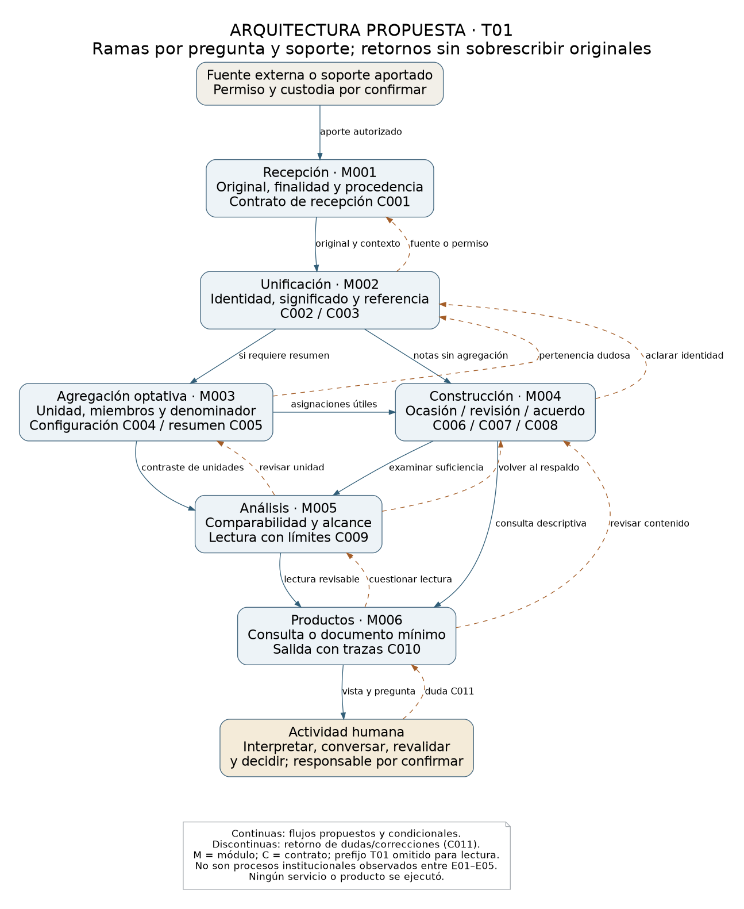
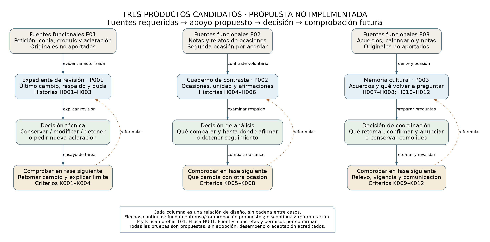

# T01 · Fundamentos, arquitectura y productos candidatos

Versión 1.1 · 25 de noviembre de 2026 · **Diseño revisado en coordinación**

Esta entrega propone tres apoyos concretos: recuperar el fundamento de una revisión de lugares, comparar ocasiones de compra y retomar acuerdos culturales. Su rasgo común es conservar el significado de la información y sus límites antes de convertirla en una comparación o decisión. Eso puede requerir una tabla o un cuaderno; un mapa es útil cuando aclara una pregunta espacial. La relación con una historia acredita pertinencia analítica, sin convertir el apoyo propuesto en una solución solicitada o aceptada por la persona.

El documento desarrolla el argumento de diseño. **No es el cuerpo del reporte final de Evidencia 1**, que se redactará después de la revisión de coordinación. El JSON contiene las especificaciones completas; el ZIP permite revisar su fundamento, alternativas, contratos y controles sin sobrecargar una futura síntesis de diez páginas. No se ejecutaron productos, modelos territoriales, GeoInsights ni servicios en la nube.

## Una síntesis para adaptar después al reporte

### La información es suficiente respecto de una decisión

La técnica que revisa registros recibió una relación de tres espacios para preparar visitas. En el tercero, la descripción de entrada nombraba otra calle. Contrastar nombre, antecedentes, croquis y aclaración mediada permitió reconocer el mismo espacio, conservar identificador y punto y modificar la referencia de acceso. La técnica no observó personalmente la puerta y no confirmó el estado del acceso anterior. Su primera intención de mover el punto no se ejecutó. Por tanto, el problema de diseño no puede formularse como corregir un punto erróneo o asegurar todas las entradas (E01-P029; P049–P065; P155; historias HU01-H001–H003, necesidades N01-N001–N004).

El ideal posterior es recuperar qué quiso decir una nota breve sobre un cambio y con qué respaldo se escribió. La persona imagina una carpeta por lugar, empezando por el registro y su explicación; abriría mapa o croquis si la duda siguiera siendo espacial. También limita el registro a la duda que surgió y afecta interpretar su entrega. Esta precisión evita diseñar una ficha interminable de todo lo desconocido (E01-P120–P137).

> «No quisiera que pareciera que este caso quedó a medias por no tener esa carpeta que imaginamos.»
>
> Participante E01-P157; cita verificada mediante N01-V0041.

La oportunidad es un expediente de revisión que muestre qué se conservó o modificó, por qué y qué sigue pendiente. Su utilidad futura debe contrastarse con las notas actuales. El episodio atendido no demuestra una carencia de plataforma.

La investigadora de compras ofrece otra decisión. Comparar tiempos desde una vivienda y tiempos después de una visita mezclaba salidas distintas. Reconstruir propósito, actividades y origen permitió corregir la unidad sin tener que conocer toda la semana de cada persona. Tiempo y cercanía siguieron importando: cambiaron de función en el argumento. El mapa ayudó a situar lugares conectados por una salida; la explicación de esa relación también procedía de las palabras de la persona (E02-P074–P097; HU01-H004).

La investigación distingue además descripción de recorrido y explicación de una elección entre alternativas. Reconoce que no reconstruyó todas las opciones conocidas y posibles. Esa carencia específica limita una explicación amplia, sin invalidar una descripción acotada. El cuaderno propuesto debe conservar lo observado, lo relatado después y lo interpretado, incluyendo diferencias entre lecturas; no resolverlas por fuerza en una única versión (E02-P058–P071; HU01-H005; N01-N007 y N008).

El ideal pide primero una segunda ocasión contrastante del mismo caso, con interés y disponibilidad por recabar. Un periodo entero no es condición inicial. La prueba que propone la investigadora es comparar qué puede decir con una ocasión y qué cambia con la segunda. Incluso reducir una afirmación sería útil:

> «O explicar menos, pero mejor.»
>
> Participante E02-P148; N01-V0094. Corrige la recapitulación del entrevistador que equiparaba utilidad con explicar más.

Por eso el segundo candidato es un cuaderno de contraste de ocasiones y afirmaciones, que podría organizarse con soportes existentes. No sería un sistema para clasificar personas por rapidez o inferir causas desde trayectos (HU01-H004–H006; N01-N006–N009).

La coordinadora cultural construyó una serie de tres encuentros con equipo y anfitriones. La visita en horario parecido aportó una experiencia de escucha y acomodo; la confirmación de las tres fechas aportó otra cosa: poder ofrecer continuidad. Un salón vacío no era prueba suficiente de disponibilidad. La consulta parcial permitió reconocer personas interesadas para quienes una tarde era posible, sin identificar el horario preferido de toda la comunidad. No se interpreta la falta de respuesta como rechazo (E03-P029; P052–P081; HU01-H007).

Su ideal es recuperar interlocución, acuerdos prácticos y preguntas para que otra persona del equipo retome una relación. Las descripciones de ritmos servirían para preparar una propuesta y mejores preguntas al visitar. Deben distinguir quién las contó y en qué ocasión, además de separar lo dicho antes de las notas propias posteriores. La coordinadora no llegaría a explicar a los anfitriones su espacio desde una nota antigua (E03-P149–P169; HU01-H011–H012).

> «Con una nota clara, el calendario y mensajes directos nos entendemos.»
>
> Participante E03-P182; N01-V0177. Se refiere a comunicar acuerdos de una serie pequeña; el interés por la carpeta está en el relevo entre personas, sin mudar toda conversación.

El tercer candidato organiza esa memoria mínima. Incluye estados comprensibles —posibilidad, confirmado, idea, pendiente, cerrado— y referencias a fuentes existentes. Una idea de otra serie no se convierte en programación. La necesidad parcialmente abierta de explicar mejor la autonomía de cada sesión se aborda mediante revisión de invitación y recepción, sin inferir confusión general a partir de una pregunta individual (HU01-H008 y H010; N01-N013, N015).

### Lo que el portafolio debe preservar

Los cinco casos no forman una cadena institucional. La semejanza entre carpetas, cuadernos y notas no acredita un único proceso, una demanda común de visor o una preferencia compartida por homologar. En ACT01 las posturas ante homologación siguen **NO_RECABADA** y el poder y el interés se interpretan por ámbito. En D01 no hay fuente formal directamente atribuible a ninguno de los cinco episodios ni divergencia formal demostrada. Sus diez preguntas continúan pendientes. El encargo institucional se conserva como propuesta del cliente, sin transformarlo en diagnóstico demostrado.

La mercería muestra por qué conservar una necesidad no obliga a incorporarla a software público. Reponer el conocido se resolvió con remanente, medida, referencia, muestra y condiciones de oferta. Explorar otro elástico era consulta adicional; no se lo compró por la cantidad exigida y la conveniencia todavía incierta, sin demostrar defecto o rechazo definitivo. El deseo ideal es comparar un par tangible del mismo ancho con evidencia de tacto, costura, uso o lavado. Las fuentes de todas esas pruebas no están resueltas, y más conocimiento no elimina la restricción de cantidad (HU01-H013–H017; N01-N018–N024).

> «Pero para la suavidad preferiría tener el pedazo en la mano.»
>
> Participante E04-P152; N01-V0245. Una foto puede complementar una comparación concreta; no sustituye la muestra.

Las prácticas comerciales actuales permanecen como prácticas a preservar. El ideal de ensayos del par de muestras queda pendiente de validación, fuera de este portafolio; no se borra por ser minoritario. Una futura referencia digital tendría que apuntar al objeto físico y su contexto, no afirmar que lo digitalizó.

La salida personal a mirar libros también se atendió. Mensajes y apertura consultada permitieron encontrarse; leer, preguntar y decidir al llegar formaban parte de la experiencia. Una nota ideal de lugares para conversar corresponde a otras ocasiones y no garantiza mesa o ambiente actuales. La lista propia podría bastar y el mapa sería condicional a no ubicar un lugar (HU01-H018–H021; E05-P124–P160).

> «Encontré uno y lo compré, pero no era la condición para que funcionara.»
>
> Participante E05-P173; N01-V0305. El propósito incluye mirar y compartir la tarde, sin compra obligatoria.

Estas historias protegen el descubrimiento y la comprobación situada. No se las convierte en recomendador, reserva o planificador total. H021 permanece pendiente como apoyo privado opcional, separado de la memoria cultural de P003. N005 sigue siendo una condición analítica para una futura petición específica de acceso, **sin historia ni actividad nueva inventada**.

### Tres candidatos comparables, sin selección urbana ficticia

| Candidato | Decisión que apoyaría | Dependencia que puede cambiar la selección | Alternativa suficiente que debe contrastarse |
|---|---|---|---|
| Expediente de revisión de lugares (T01-P001) | Conservar, modificar o detener; comprender el último cambio al retomar | Acceso al respaldo, responsable de mantenimiento y significado de la referencia | Pauta de nota breve junto a copia/versiones actuales |
| Cuaderno de contraste de ocasiones (T01-P002) | Elegir unidad y alcance de afirmación; continuar o detener seguimiento | Segunda ocasión voluntaria y diferencia que aporte al argumento | Cuaderno, texto, esquema y hoja de localización ya utilizados |
| Memoria de acuerdos culturales (T01-P003) | Preparar qué retomar/confirmar y qué puede anunciarse | Relevo real entre personas, revalidación y carga de conservar notas | Nota clara, calendario y mensajes actuales |

P001 es el primer candidato para una conversación de pertinencia institucional por su relación directa con registros territoriales. Esto no acredita adopción. P002 y P003 no tienen un orden total justificado: responden a decisiones y cargas distintas. Tampoco hay presupuesto, pesos, ahorro o impacto medidos que permitan asignarles puntuaciones. La extensión espacial de P001 y la exploración topológica de P002 son separables del apoyo básico y tienen condiciones más exigentes.

Cada producto del JSON desarrolla datos, operaciones, responsables pendientes, exclusiones y cuatro criterios de comprobación. Los doce criterios T01 son **PROPUESTO_NO_EJECUTADO**. No son resultados de prueba ni reemplazan los 28 criterios de HU01.

## Fundamentos críticos: qué se representa y quién puede discutirlo

Las instrucciones atribuyen a Andrea una lectura crítica de los límites y de la retórica visual, verbal y metodológica de los mapas, según la síntesis del expediente. Esa atribución docente se mantiene sin inventar apellido, biografía o publicación. Los PDF originales de clase no están redistribuidos y no se declaran leídos. La fundamentación técnica procede de fuentes primarias consultadas por separado.

[Harley, *Deconstructing the Map*](https://disp.web.uniroma1.it/sites/default/files/Harley%20-%20deconstructing%20the%20map.pdf), especialmente pp. 10–11, permite examinar selección, omisión y símbolos como parte de un argumento (T01-F002; A002). Aplicado al diseño, titular una vista «accesos seguros» excedería lo conocido en E01. «Referencias incorporadas a esta revisión» expresa una pregunta más acotada. El título, la leyenda y los colores deben permitir distinguir objeto, evidencia y alcance. Una zona sin observaciones necesita rótulo de no observada, sin confundirse con valor cero.

La retórica metodológica también incluye qué se cuenta y cómo se normaliza. Un conteo de registros con dudas puede responder a intensidad de revisión, selección o documentación, además del fenómeno que interesa conocer. No se transforma automáticamente en una tasa por habitantes. En el diseño, una eventual fracción de discrepancias exigiría el universo de registros efectivamente revisados y comparables. El mapa debe permitir volver a ese denominador y al mecanismo de recepción.

La autoría tiene varias capas: quien observó, quien relató, quien intermedió, quien incorporó y quien interpreta una nueva comparación. Preservarlas evita que una aclaración mediada se presente como observación de la técnica o que un comentario de una persona sea opinión de asistentes. Cuestionar un límite requiere una vía para expresar motivo, respaldo y versión afectada. Esa vía no obliga a resolver todo desacuerdo con una geometría única ni a pedir autorización de una colega para cada decisión.

Un error demostrado frente al contrato se corrige; la incertidumbre requiere expresar de dónde viene y cómo se estimó, si es cuantificable. El desconocimiento mantiene su motivo, como no saber el estado de la otra puerta. Un desacuerdo legítimo conserva interpretaciones y fuentes. No se traduce ninguna de estas situaciones a un porcentaje de confianza inventado. Los contratos de dudas y correcciones preservan originales y permiten advertir derivados afectados (T01-C011).

### Cuatro términos que no deben intercambiarse

| Concepto | Qué significa | Consecuencia para este diseño |
|---|---|---|
| Escala de representación | Relación entre distancia representada y distancia en terreno | Un croquis sin medidas no acredita escala numérica; el zoom no aporta detalle nuevo |
| Resolución | Menor separación espacial o intervalo temporal que el conjunto permite distinguir | No se deduce de decir «la tarde», «último cambio» o «otra ocasión» |
| Unidad de análisis | Entidad sobre la que se formula la pregunta o calcula una medida | Sitio/acceso, salida/actividad y acuerdo/fecha requieren distinciones propias |
| Cobertura | Ámbito espacial y periodo a los que corresponden observaciones | Tener una referencia de CDMX no demuestra cobertura de toda la ciudad |

La definición de escala se contrastó con [USGS](https://www.usgs.gov/educational-resources/finding-your-way-map-and-compass), introducción (F040). La separación de cobertura y resolución se contrastó con [DCAT 3](https://www.w3.org/TR/2024/REC-vocab-dcat-3-20240822/), §6.6.4–6.6.7 (F013). Esto no declara conformidad DCAT del JSON.

HU01 conserva 21 perfiles con 21 campos cada uno. Sus 21 contextos temporales y dos contextos espaciales continúan siendo descripciones. Los requerimientos de grano añadidos en los productos son **propuestas**: por revisión/afirmación en P001, por ocasión/actividad en P002 y por acuerdo/fecha pertinente en P003. No modifican las expresiones originales ni afirman resolución de datos no inspeccionados. Ningún CRS o atributo de las capas SSC se completa por suposición.

### MAUP y falacia ecológica: dos riesgos distintos

El problema de la unidad de área modificable, conocido como **MAUP**, trata la dependencia de resultados respecto del modo de formar áreas. [Openshaw](https://www.uio.no/studier/emner/sv/iss/SGO9010/openshaw1983.pdf), §III(i), distingue variación por agregar a menos áreas mayores y variación por formar agrupaciones alternativas a escala semejante (F001; A001).

En una extensión futura de P001 se podría mantener un conjunto autorizado de registros revisados y comparar su resumen en distintas unidades. Dos tamaños de rejilla explorarían el efecto de escala; dos posiciones de una rejilla del mismo tamaño explorarían zonificación. Antes habría que fijar variable, periodo, denominador y tratamiento de bordes. No se han construido esas rejillas o calculado resultados. Su razón es comprobar si una decisión depende de una configuración, incluyendo la posibilidad de que no cambie.

Escaneo, hexágonos y más observaciones no eliminan automáticamente ese problema o el sesgo del registro. Una configuración estable tampoco demuestra que se midió el fenómeno correcto. Por otro lado, comparar salida completa con actividad puntual en P002 plantea una diferencia semántica de unidad; no conviene llamar MAUP areal a toda dificultad de comparación.

La **falacia ecológica** aparece al trasladar a individuos asociaciones entre características de grupos. [Robinson](https://www.stats.uwo.ca/faculty/aim/2015/9938/articles/Robinson1950AmericanSociologicalReview.pdf), pp. 351–354, muestra por qué las asociaciones agregadas no determinan las individuales (F003; A003). Así, un promedio del área no permite afirmar cómo prefiere comprar una persona. Tampoco basta proximidad cartográfica para explicar su elección. El diseño conserva nivel de afirmación y fuentes que lo limitan.

### Ocho familias de agregación, con decisiones de adopción diferentes

La evaluación completa está en `tablas/alternativas_agregacion.csv` y `desarrollo/alternativas_agregacion.md` del ZIP. Cada ficha desarrolla pregunta, proceso generador, denominador, jurisdicción, parámetros, tiempo, autoría, exclusiones y comparabilidad. No se aplican todas a todos los productos.

| Familia | Utilidad posible | Decisión actual y límite principal |
|---|---|---|
| Administrativa | Relacionar revisión con ámbito de actuación | Condicionar a competencia y vigencia acreditadas; no es geometría universal |
| Rejilla/hexágonos | Contrastar dependencia del resumen respecto de partición | Extensión opcional de P001; tamaño, origen, proyección y bordes deben ser visibles |
| Natural | Seguir un proceso físico, como drenaje, si una pregunta ambiental lo exige | Fuera de productos actuales; sin proceso ambiental pertinente demostrado |
| Tenencia/concesión | Precisar autorización de un uso si la futura tarea lo necesita | Condicionar; no atribuir propiedad a anfitriones o deducir derecho por apariencia |
| Comunitaria | Conservar referencias y delimitaciones situadas de quienes usan un lugar | Adoptar descripción con autoría si se obtiene y acuerda; no portavoz único o consenso ficticio |
| Redes | Relacionar actividades/lugares dentro de una ocasión | Adoptar esquema narrado en P002; no equivale a red vial, movilidad digital o cadena institucional |
| Influencia | Delimitar búsqueda/accesibilidad bajo una pregunta explícita | Condicionar; un radio no acredita recorrido real y «cerca» en E05 no fija metros |
| Referencia | Comparar con una partición analítica justificada | Condicionar; referencia estadística o analítica no es límite verdadero o jurídicamente competente por defecto |

El Marco Geoestadístico es una referencia documental opcional para P001, registrada con alcance especialmente limitado: se leyó el texto oficial indexado sobre finalidad y límites, mientras la apertura de la página no produjo contenido legible y no se inspeccionó ningún archivo cartográfico. Su descripción no acredita descarga, edición, CRS, resolución o licencia operativa (F014). Las capas SSC siguen ausentes. Igualdad de un conteo entre dos particiones no prueba identidad de geometrías, versiones o equivalencia jurídica.

### Cuatro prácticas que una persona podría examinar

El diseño propone mostrar **incertidumbre y denominadores**, permitir **comparar unidades**, explorar **escenarios metodológicos** y hacer visibles **exclusiones** (T01-V001–V004). En P001 esto significa ver qué representa el punto y qué respaldo tiene una revisión, y solo si se activa un resumen, conocer quién entró en el denominador. En P002 significa poder cambiar la unidad que se compara y examinar qué afirmación deja de sostenerse, sin borrar relatos posteriores. En P003 significa diferenciar una experiencia anterior de una confirmación actual y preparar la pregunta pendiente.

Un escenario A/B debe conservar las fuentes comunes, la regla que cambia y la configuración completa. Cambiar una regla por vez ayuda a interpretar y después puede requerirse revisar interacciones entre decisiones. Es una propuesta de sensibilidad, sin resultado o contrafactual ejecutado. Las exclusiones se cuentan solo cuando existe un universo comprobable; si no, se describen. El número de razones de exclusión puede superar el de registros porque las razones se superponen; la conciliación de estados finales debe usar entidades únicas.

## Cuatro lentes técnicos con umbrales de uso

Las fichas completas y herramientas están en el JSON y en `desarrollo/lentes.md` y `tablas/herramientas.csv`. Evaluar un lente no obliga a recomendarlo. Las herramientas son candidatas con **COMPATIBILIDAD_NO_PROBADA**; no se instalaron paquetes ni se ejecutaron modelos.

**Escaneo espacial (SCAN).** Un uso hipotético sería preguntar si se concentran discrepancias de identificación entre registros realmente revisados, para orientar más comprobación. Harían falta eventos definidos, controles comparables o exposición pertinente, localización y periodo. Una opción Bernoulli distinguiría registros revisados con/sin discrepancia bajo una probabilidad común en la hipótesis nula; Poisson requeriría otra estructura de conteos y exposición. No hay esos datos operativos. Ventanas y máximo de búsqueda se elegirían tras la pregunta; una extensión espacio-temporal requeriría intervalos justificados, sin heredar días epidemiológicos.

Se consultó la guía oficial [SaTScan](https://www.satscan.org/cgi-bin/satscan/register.pl/SaTScan_Users_Guide.pdf?todo=process_userguide_download), versión 10.1 realmente servida, aunque el sitio anuncia 10.3.3, y el repositorio de autores (F004–F005). La comparación Monte Carlo de máximos atiende la búsqueda definida; no autoriza escoger después el menor valor p entre muchas configuraciones sin controlar esa exploración adicional. Detección, causa y capacidad de intervenir son cuestiones distintas. **No pertinente en los productos básicos**, reconsiderable solo con marco de revisión, decisión territorial y responsable.

**Potencia y escalamiento.** Se separa una relación entre magnitudes —por ejemplo esfuerzo de revisión y tamaño del lote, si esa pregunta se llegara a plantear— de una distribución de duraciones con posible cola pesada. La primera exige dominio, estimación y diagnóstico del modelo de error, comparabilidad de lotes y alternativas funcionales. La segunda exige observaciones positivas, selección/dependencia conocidas, estimación de exponente y umbral de cola, bondad de ajuste y comparación con modelos como lognormal o potencial truncada. No se dispone de ninguna de esas muestras.

La distinción se contrastó con [Bettencourt y coautores](https://www.pnas.org/doi/10.1073/pnas.0610172104), sección de relaciones de escalamiento, y [Clauset, Shalizi y Newman](https://sites.santafe.edu/~aaronc/courses/5352/readings/Clauset_Shalizi_Newman_09_PowerlawDistributionsInEmpiricalData.pdf), §§3–5 (F006–F007). No se trasladan exponentes de ciudades a tareas de revisión. El README de [powerlaw](https://github.com/powerlaw-devs/powerlaw) documenta una candidata para la rama distributiva, sin resolver por sí sola una regresión entre magnitudes (F008). Una recta log–log no basta; tampoco un ajuste no rechazado prueba mecanismo. **No pertinente ahora**, reconsiderable con pregunta y muestra que permitan distinguir alternativas, sin mínimo universal inventado.

**Análisis topológico de datos (TDA).** La extensión condicional de P002 preguntaría si perfiles de muchas ocasiones comparables ofrecen formas de similitud útiles para formular contrastes. Mapper construye agrupaciones locales guiadas por un filtro y una cobertura superpuesta, y conecta grupos que comparten miembros. No es sinónimo de homología persistente, ni su dibujo representa geografía. Se consultó [KeplerMapper 2.1.0](https://kepler-mapper.scikit-tda.org/en/latest/theory.html), secciones Mapper y Setup (F009).

El diseño debe declarar variables, normalización y métrica, filtro, cobertura y agrupamiento, incluyendo sensibilidad a esas elecciones. Desconocido no es cero. En esta propuesta, las conexiones permitirían volver a ocasiones y palabras; no demostrarían trayecto, causa o relación social. La primera comparación de dos ocasiones no necesita ese análisis. **Condicional** a utilidad del cuaderno básico, matriz autorizada comparable y volumen que justifique exploración multivariable; descartar si codificar aplana contexto o añade carga excesiva.

**Modelos basados en agentes (ABM).** Una extensión hipotética de P003 podría explorar condiciones para sostener una serie bajo reglas alternativas de confirmación. Requeriría agentes funcionales de coordinación, mediación y gestión del espacio, ambiente de calendarios/recursos, reglas de interacción, orden de actualización y parámetros fundamentados. Incorporar asistentes exigiría otra pregunta y datos; una coordinadora no calibra preferencias comunitarias. Se consultaron [Mesa](https://mesa.readthedocs.io/stable/overview.html), su manifiesto main y [ODD](https://www.jasss.org/23/2/7.html) para describir propósito, entidades, escalas, procesos y evaluación (F010–F012).

Calibrar requeriría registros autorizados de varias ocasiones y comparar con observaciones no usadas para ajustar. Habría que variar reglas, inicialización, tiempos de respuesta y activación, distinguiendo incertidumbre de parámetros, estructural y variación aleatoria. Escenarios condicionales no son predicciones ciertas ni efectos causales demostrados. **No pertinente ahora**: primero debe probarse si basta la tabla de acuerdos. No se traslada el requisito de Python de la rama main a cualquier versión estable de Mesa.

## Adaptar GeoInsights a evidencias y decisiones, con ramas y retornos

La referencia es **COVID-19 GeoInsights Mobility Pipeline, DataLama Team, 2020–2021, licencia MIT**, commit `ab60b86a6a87bca0dd370c7c4af3ada4185d187e`. La huella del ZIP coincide con `procedencia_snapshot.json`. Se extrajo para lectura estática, sin ejecutar scripts. Es una copia pública y no se declara idéntica al ZIP originalmente aportado en clase. El README mantiene la cita del artículo pendiente; no se inventa esa referencia.

Se leyeron README y LICENSE completos, orquestador, plan CSV de ejecución, unificador genérico, agregadores geométrico/radial/comunidad, constructor de grafos, TDA, wrapper de Bogotá y extractores pertinentes. Los archivos/rangos exactos están en `arquitectura.adaptacion_geoinsights.archivos_examinados`; POS se consultó parcialmente. La lectura no es auditoría de todo el repositorio.

Se retoma la separación de etapas y el patrón de adaptadores y derivados. El orquestador distingue las seis etapas y lee configuración (`pipeline_scripts/excecute_all.py`, líneas 16–21 y 75–100); `GenericUnifier` describe contratos y carpetas de originales/derivados (`functions/generic_unifier_class.py`, 31–64 y 76–123). La adaptación cambia el recorrido rígido por ramas y retornos de dudas. Los contratos se centran en referencia, ocasión, revisión y acuerdo, en lugar de imponer casos/población/movilidad.

La necesidad de adaptación es concreta. En `universal_generic_unifier.py`, 82–84, la llamada a construir casos está comentada y se crea un marco temporal de depuración. En `universal_geometry_agglomerate.py`, 144–146, la población queda como marco vacío; sus uniones `within/inner` en 105 y 126–130 exigen revisar bordes y pérdidas si se adaptaran. `tda_script.R`, 16–24 y 102, carga Mapper desde directorio externo y lee una matriz de distancias; su construcción está comentada en el constructor inspeccionado, 99–101. Esto identifica dependencias y riesgos de reutilización, sin afirmar un fallo ejecutado o ausencia de toda vía externa para obtenerla (F021–F029; A015–A016).

No se transfieren casos, Rt, movilidad, alertas, ventanas o parámetros epidemiológicos al proyecto. Tampoco se instalan por inercia las dependencias históricas de `requirements_excecution.txt`. La comunidad del agregador de redes no es cartografía comunitaria; una agrupación algorítmica no acredita voz o autoridad de quienes habitan un lugar.

*Figura 1. Disponible después de extraer el ZIP junto a este documento. Flechas continuas: paso propuesto de objetos; discontinuas: dudas o correcciones que requieren revisión. Las conexiones son de arquitectura, sin cadena institucional observada entre casos. El archivo DOT y la exportación SVG permiten editarla; PNG y PDF permiten revisarla.*

| Responsabilidad | Qué recibe/prepara | Qué permite devolver |
|---|---|---|
| Extracción/recepción | Original autorizado, finalidad y procedencia | Duda de fuente o permiso, sin crear contenido ausente |
| Unificación | Identidad, significado, modalidad y referencia opcional | Ambigüedad semántica o espacial al origen pertinente |
| Agregación | Universo y configuración cuando la pregunta los requiere | Asignaciones, denominador y exclusiones conciliables |
| Construcción | Revisiones, ocasiones y acuerdos enlazados | Inconsistencias del contenido, con fuentes localizadas |
| Análisis | Comparabilidad, alcance e incertidumbre | Necesidad de acotar afirmación o cambiar configuración |
| Productos | Vista/documento con título, límites, interacción y trazas | Pregunta del lector sobre contenido o representación |

Una nota puede pasar de unificación a construcción/consulta sin convertirse en polígono agregado. La rama de agregación puede aportar una comparación directamente a análisis. La consulta descriptiva puede saltar análisis numérico, conservando revisión de límites. El backend prepara y controla; la interfaz facilita lectura e interacción; las personas observan, interpretan, conversan y deciden; una fuente externa conserva sus condiciones de acceso. Son responsabilidades diferentes.

### Contratos que conservan sentido, no solo columnas

Los once contratos propuestos tienen campos con significado, tipo, origen, unidad o motivo de no pertinencia y regla de nulos. Comparten identidad local, versión, fuentes versionadas y motivos de valores ausentes. Los contratos de recepción, referencia unificada y referencia espacial no presuponen campos reales de SSC (C001–C003). Configuración y asignaciones/resumen mantienen miembros, denominador y exclusiones (C004–C005). Ocasión, revisión y acuerdo conservan contenido propio (C006–C008). Lectura, salida y duda permiten rastrear y revisar la interpretación (C009–C011).

Una transformación se acepta si su significado y sus entradas están respaldados; se advierte cuando la comparabilidad es parcial; se detiene cuando necesita permiso, referencia o información imprescindible que falta. Nulo no se imputa como cero. Los originales no se sobrescriben. Una corrección crea versión y señala qué derivados deben revisarse.

Las conversiones de unidades requieren magnitudes compatibles; las uniones semánticas requieren identidad y cardinalidad revisadas; la alineación temporal no confunde fecha de nota con fecha de observación. Una operación métrica requiere CRS documentado y adecuado al cálculo. La advertencia de [GeoPandas `to_crs`](https://geopandas.org/en/stable/docs/reference/api/geopandas.GeoDataFrame.to_crs.html) aclara sus supuestos de segmentos y necesidad de referencia de origen (F015). Reproyectar no crea precisión. Las agregaciones de tasas requieren denominadores/pesos pertinentes: no basta promediar porcentajes.

Puntos, líneas, polígonos, ráster, redes, texto/tablas, muestras físicas y tres dimensiones se evalúan explícitamente en el JSON. Texto y tablas son principales; geometrías requieren adaptador y finalidad; red de actividades no es red vial. Ráster y 3D no son necesarios para las decisiones actuales. La muestra física requiere referencia/custodia si se reconsidera H017 y permanece material. No se promete lectura universal de formatos.

Se evaluó [Google Earth Engine](https://developers.google.com/earth-engine/guides) por su finalidad de cómputo geoespacial y catálogo ambiental, y se descartó para este portafolio (F016). Ninguna decisión exige procesar imágenes para comprender un cambio, comparar relatos o confirmar un acuerdo. Si surgiera otra pregunta, se revisarían datos, contratos, cuenta, permisos, cuotas y condiciones, sin presumirlos.

*Figura 2. Tres caminos de diseño separados. Las fuentes son candidatas funcionales: sus soportes operativos no están aportados. Las flechas expresan por qué cada propuesta podría ayudar a una decisión y cómo se comprobaría; no resultados de uso, adopción o transferencias institucionales.*

## Qué información se requiere y qué se conoce de sus fuentes

El JSON registra once objetos de datos. Diez son **REQUERIDO_NO_DISPONIBLE**: los relatos justifican buscar esos soportes si se acuerda una fase posterior, sin demostrar que se puedan obtener. Uno es **CANDIDATO_DOCUMENTADO**, el Marco Geoestadístico como referencia contextual opcional, con alcance de lectura indexada explícito. No hay descarga o inspección de contenido territorial. Las fuentes situadas también pueden ser notas, conversación o conocimiento operativo, con condiciones de autoría, ocasión, acceso y esfuerzo.

En P001 se requieren petición/copia, explicación y respaldo de revisión. En P002, notas de ocasión y, si se acuerda, nueva reconstrucción contrastante; un catálogo de comercios no reconstruye alternativas conocidas o viables para una persona. En P003, notas/acuerdos, calendario, referencia de entrada y descripciones situadas que realmente puedan aportarse; una imagen no confirma una fecha. Los perfiles de HU01 orientan la información requerida sin convertirse en inventario de datasets disponibles.

## Trazabilidad, FAIR y adaptación JANUS

La entrega conserva la codificación y relaciones ya existentes. No se reinician entrevistas o libro común. La matriz de 21 historias muestra disposición individual y vínculo inverso a productos; las 39 filas GCR/LEN/DAT indican dónde se desarrolla cada requisito en diseño. Ese cierre de diseño no cierra implementación, rúbrica completa ni los 208 requisitos. Los restantes asuntos de procesos, actores, privacidad, reporte y documentación se mantienen con el estado y límites del expediente.

Los principios [FAIR](https://www.gofair.foundation/fair-principles) permiten preguntar por localización, acceso, interoperabilidad y reutilización; A1.2 admite autorización/autenticación (F017). Identificadores locales, enlaces, versión y huella contribuyen a revisar el paquete. No son por sí solos PIDs, FDO o conformidad integral. La licencia MIT del código no se extiende al corpus. El permiso de consultar un material y el de difundirlo son distintos; los metadatos de conocimiento y los del artefacto también.

[PROV-O](https://www.w3.org/TR/prov-o/), §3.1, ofrece vocabulario para entidades, actividades y responsables; se propone correspondencia futura, sin RDF validado (F018). [RO-Crate 1.1, Structure](https://www.researchobject.org/ro-crate/specification/1.1/structure.html) requiere un descriptor específico de metadatos para una implementación conforme (F019). Aquí se entrega un paquete documental con inventario; RO-Crate, DataCite y nanopublicaciones siguen como opciones a evaluar después de acordar contenido, permisos, esquema y prueba. No se inventa publicación o DOI. La versión consultada no se presenta como última versión vigente.

La adaptación JANUS sigue la síntesis del expediente: conserva instrucciones de análisis/integración, entradas/salidas, versiones, decisiones, consulta efectiva, incertidumbres y controles. Los parámetros/modelo exacto no expuestos se dejan `null`; la sesión se identifica como Codex basado en GPT-6, sin deducir identificador desplegado. Los prompts de desarrollo de entrevistas no se incorporan a este soporte y deberán excluirse del repositorio final. La revisión asistida no se llama revisión humana independiente, saturación o concordancia. No se afirma lectura del manuscrito JANUS ausente.

## Cómo revisar los soportes y qué comprueban los controles

Al extraer `T01_soportes_v1.zip`, el `LEEME.md` de cada carpeta explica su función. Las tablas completas conservan todos los campos del JSON, incluidos objetos anidados serializados sin recorte. La carpeta `desarrollo` ofrece las fichas técnicas para revisar alternativas, lentes, productos y arquitectura; `esquemas` separa contratos y diccionario de campos. Las matrices permiten buscar una historia o requisito y volver a la decisión correspondiente. El registro de fuentes y bibliografía incluye URL, versión cuando consta, fecha, localizador, alcance leído y fallos de recuperación. Los originales no incluidos se identifican como **PAQUETE_ENTRADA** por ruta y SHA-256, sin simular que están dentro del ZIP de salida.

El validador original se ejecutó sobre el **JSON final**. El archivo `T01_control_validacion.json` registra resultado, argumentos y huellas de resultado/validador. Su alcance es estructural y referencial. Las comprobaciones complementarias registran identidad de entradas, citas/localizadores, cobertura inversa, estados, tablas, diagramas, rutas, inventario y huellas, además de una revisión asistida de límites. Ningún control de producto futuro se marca como realizado.

Quedan pendientes pertinencia, factibilidad, aceptación y mantenimiento de los candidatos, acceso a datos operativos, pruebas de compatibilidad y ensayos de utilidad, así como revisión humana independiente. La agenda del JSON identifica para cada objeto la comprobación necesaria y su alcance. La fase siguiente puede implementar un apoyo, reducirlo a una pauta documental o descartarlo con una razón verificable.

## Precisiones de coordinación 1.1

Se conservan los tres productos, doce criterios propuestos, once contratos, cuatro lentes y cobertura de 21 historias/39 requisitos. La revisión técnica cotejó fuentes canónicas, trazas, tablas, huellas y código de referencia; no acredita aceptación ni implementación.

En T01-P001 se usa «explicita el alcance» en lugar de introducir firma como responsabilidad. No se recabó ese requisito. La afirmación T01-A010 se apoya ahora directamente en [INEGI, Características de las localidades 2020, síntesis de 2021, sección 6.2, página 7](https://www.inegi.org.mx/contenidos/inegi/spc/doc/bibliografia/CL_SMC_2020.pdf). Su alcance es metodológico e histórico: límites convencionales y función censal. El catálogo F014 conserva su lectura indexada; ninguna de las dos fuentes acredita payload vectorial, CRS, edición actual o correspondencia con el caso E01.

El diagrama de arquitectura incluye ahora el retorno directo de Productos a Construcción para revisar contenido, que ya constaba en el JSON. Se reexporta arquitectura y se conserva productos sin cambios; no se añaden flujos institucionales observados. Las dos figuras se inspeccionan con alcance de revisión asistida, no humana independiente.

[Soportes revisados 1.1](analisis/diseno/T01/soportes_revisados_v1_1/LEEME.md).
