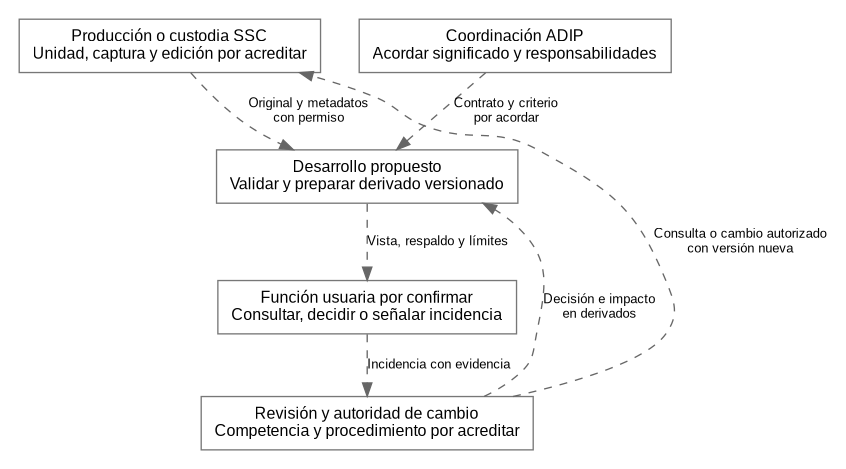

# Procesos y responsabilidades del encargo

## Evidencia que sí existe

Los cinco procesos están dibujados con detalle en [P01 revisado](../../67_procesos_descritos_v1_1.md). Cada mapa conserva pasos, decisiones, soportes, actores y regresos. Los cuatro modelos documentales están en [D01](../../72_contraste_documental_v1_1.md). No se acredita una regla formal directamente aplicable a los cinco episodios: se mantienen cero divergencias institucionales demostradas.

| Perfil y proceso | Información de entrada | Cierre y límite posterior |
|---|---|---|
| Revisión territorial E01 | Petición, registros, antecedentes y croquis | Devolución y explicación; la incorporación a fuente y uso en visita no constan. |
| Investigación E02 | Pregunta, narraciones, notas y esquemas | Texto y revisión de afirmaciones; no convierte una ocasión en frecuencia poblacional. |
| Coordinación cultural E03 | Invitación, visita y acuerdos | Tres encuentros y cierre sin nueva serie comprometida; no voz directa de asistentes. |
| Mercería E04 | Existencias, lista, referencia y muestra | Reposición y primer despacho; no venta total ni prueba de confección. |
| Salida personal E05 | Propósito, mensajes y horario | Explorar, encontrarse y despedirse; convivencia sin compra obligatoria. |

La captura institucional anterior a E01 y las transferencias entre instituciones no están documentadas por ese relato. Una fila que falta no se completa uniendo episodios ajenos.

## Recorrido institucional propuesto

| Carril funcional propuesto | Entrada y acción | Salida y retorno | Qué falta acreditar |
|---|---|---|---|
| Producción o custodia SSC | Identificar conjunto, captura, versión y finalidad de los límites | Original con metadatos y canal de aclaración | Unidad competente, método, edición, permisos y periodicidad |
| Coordinación del encargo ADIP | Acordar diccionario, correspondencias y responsabilidades | Contrato de intercambio y registro de desacuerdos | Acuerdo efectivo y recursos; coordinar no confiere toda autoridad sobre fuentes |
| Desarrollo del prototipo | Aplicar adaptador, controles y preparación | Derivado versionado, vista y bitácora | Implementación, entorno y aceptación; sin fuente compatible se detiene la operación |
| Consulta final | Examinar fuente, alcance y resultado para una tarea | Decisión o incidencia con evidencia | Usuarios y uso institucional concreto por confirmar |
| Autoridad de cambio | Recibir propuesta y consultar productor pertinente | Autorizar, rechazar o dejar pendiente; incorporación crea nueva versión | Competencia formal y procedimiento por acreditar |

Estas funciones permiten discutir el extremo a extremo sin dibujar una cadena institucional observada. El estado de cada conexión es PROPUESTA_DE_DISEÑO. Las únicas conexiones institucionales documentales son las que D01 atribuye a fuentes específicas, con fecha y ámbito propios.

## Incentivos y cargas por negociar

El productor podría ganar menor repetición de aclaraciones y reconocimiento de procedencia, y perder tiempo de preparación o control si se le exige mantener copias ajenas. La coordinación podría ganar comparabilidad y asumir mediación de conflictos; desarrollo ganaría contratos claros y tendría que gestionar fallas y versiones; la persona usuaria podría interpretar mejor y asumir lectura y reporte de dudas. La autoridad de cambio conserva responsabilidad por aceptar o rechazar modificaciones. Son hipótesis de incentivos, sin cuantificar costos ni atribuir posturas ante homologación.

La coalición es plausible si responsabilidades, recursos y atribución se acuerdan. Podría haber resistencia si la homologación desplaza trabajo sin capacidad o borra diferencias relevantes; la posición de los 46 actores sigue NO_RECABADA. El [mapa de actores](../../76_actores_y_preferencias_v1_1.md) conserva ámbitos, relaciones, ganancias, cargas y tres hipótesis previas, sin ampliarlos por esta especulación.

## Comparar proceso actual y deseado

| Cambio propuesto | Qué preserva | Nueva carga | Comprobación de pertinencia |
|---|---|---|---|
| Recuperar una explicación del cambio | Nota, croquis y consulta humana útil | Enlazar fuente, revisión y duda | Otra persona explica el cambio y decide consultar cuando falta sustento |
| Cuaderno de dos ocasiones | Narración y afirmación acotada | Acordar y reconstruir otra ocasión voluntaria | El contraste modifica, reduce o justifica conservar la afirmación |
| Memoria de acuerdos | Calendario, mensajes y relación con anfitriones | Seleccionar nota y revalidarla al retomar | Quien releva distingue confirmado, posible y pendiente |

Las frecuencias no documentadas siguen desconocidas. Custodia, revisión y autorización son funciones propuestas, con personas y unidades por designar, sin comprometer a terceros.

## Diagrama de responsabilidades propuestas

[Versión vectorial](recorrido_institucional_propuesto.svg). Todas las relaciones del diagrama son propuestas, sin confundirlas con evidencia del proceso institucional vigente.
